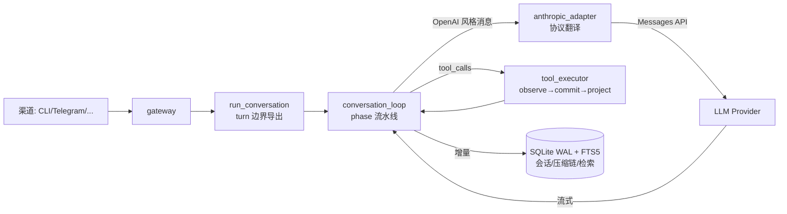
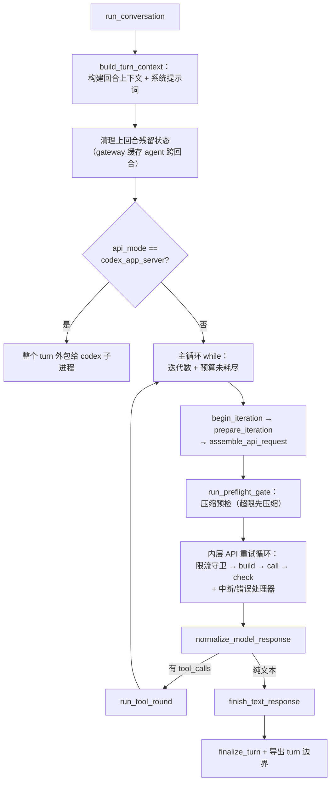

# Hermes Agent（NousResearch/hermes-agent）harness 实现导读

> 基于版本：`main@0138269`（锚点以此为准）｜语言：Python｜24.7 万 star
> 源码目录：`.spec/源码学习/_clones/hermes-agent`（浅克隆）
> 定位一句话：Nous Research 的多渠道个人 agent——「OpenAI 风格内核 + Anthropic 协议适配 + SQLite(WAL+FTS5) 状态库」，一个用防御性工程堆到极致的单体 harness。

---

## 0. 总览

hermes-agent 是五个仓里**生产防御最重**的一个：主循环文件 `agent/conversation_loop.py` 1683 行里，真正的循环体只有约 50 行，其余全是异常、预算、压缩、凭据、中断的防御逻辑——每个防御点都有 issue 编号注释（如 `#98722`、`#26080`）。

三个定义性选择：

1. **循环 = phase 流水线**：一个 turn 被分解为 `agent/turn_*.py` 里的十几个阶段函数（begin_iteration → prepare → assemble → preflight → api retry loop → normalize → tool round → finalize），`_LoopState` dataclass 是共享黑板。
2. **OpenAI 风格内核，多协议外壳**：内部消息是 OpenAI 风格 dict，Anthropic 走 adapter 翻译，还支持把整个 turn 外包给 codex 子进程。
3. **SQLite 单文件状态库**：WAL 模式（并发读+单写）、FTS5 全文检索（CJK 双字分词）、压缩按 `parent_session_id` 链分片。

### 模块地图（按职责分组）

| 组 | 模块 | 一句话 |
|---|---|---|
| 循环 | `agent/conversation_loop.py` | 主循环 + _LoopState 黑板 + phase 穿梭机 |
| 阶段 | `agent/turn_context / turn_api_call / turn_api_error / turn_finalizer` 等 | 一个 turn 的各阶段实现 |
| 工具 | `agent/tool_executor.py` | 顺序/并发双执行器，统一 observe→commit→project 管道 |
| 协议 | `agent/anthropic_adapter / anthropic_message_convert / anthropic_endpoints / anthropic_credentials` | Anthropic Messages 适配 |
| 压缩 | `agent/conversation_compression.py`、`agent/context_compressor.py`（3700+ 行） | 压缩编排与上下文压缩器 |
| 状态 | 根目录 `hermes_state*.py` 一族 | SQLite 会话库：主库/compression/dbfile/fts/guard |
| 辅助 | `agent/auxiliary_*.py` | 辅助模型（标题/摘要/结构化输出）与健康降级 |
| 多渠道 | `gateway/`、`acp_adapter/`、`cron/` | Telegram 等渠道网关、ACP、定时 |

### 架构总图

---

## 1. agent 主循环

**核心问题**：这个 Python 单体怎么组织一个 turn？

### 主线流程图

### 关键点

#### 1.1 phase 流水线 + 反射穿梭机

📍 `agent/conversation_loop.py:1281-1288`（_LoopState 文档串）、`:1376-1394`（_run_phase）

**干什么**：循环的全部局部变量装进 `_LoopState`（分固定/回合级/每迭代三层）；`_run_phase` 用 `inspect.signature` 自动从 state 取 phase 函数需要的参数、执行后把返回的 verdict 字段按名拷回（个别字段只置 True 不回清，称为 latched）。
**为什么**：2026 年 9 月的大分解（文件尾 PEP 562 兼容层注释，`conversation_loop.py:1624-1627`）把 5000+ 行单体拆成 turn_*.py 家族——黑板+反射让 phase 函数签名自由演化，不用层层传参。

#### 1.2 三层预算：迭代数、token 预算、宽限调用

📍 `agent/conversation_loop.py:1520`（while 条件）

**干什么**：主循环同时受 `max_iterations`、`iteration_budget.remaining` 和 `_budget_grace_call`（预算耗尽后的最后一次宽限调用）约束；另有 `restart_count` 防止「被退款的重启无限重新武装、占着 turn 租约不放」（`:1316-1320`）。
**为什么**：个人助理跑在用户手机/服务器上，失控循环烧的是真钱——预算体系是安全网，宽限调用保证预算尽时模型还能体面收尾。

#### 1.3 压缩是循环的一等公民：预检 + 上限 + 重武装

📍 `agent/conversation_loop.py:1525-1531`（run_preflight_gate）、`:1306-1309`（max_compression_attempts）、`:210-235`（_should_rearm_compression_budget）

**干什么**：发请求前先过压缩预检门（token 压力超限先压缩再发）；压缩尝试有连续无效上限，只有 provider 响应确认 prompt 已低于阈值才「重武装」允许再次压缩；压缩宿主超时会以 `compression_exhausted` 结束 turn 但保留完整 transcript（`:1572-1575`）。
**为什么**：压缩本身可能失败/无效/卡死——把它的重试、退避、超时全部纳入循环状态机，而不是散落的 try/except。

#### 1.4 所有出口统一过 turn 边界导出

📍 `agent/conversation_loop.py:1579-1618`（run_conversation）

**干什么**：`_run_conversation_turn` 的每一种结果（成功/部分/中断/重试耗尽/工具上限/预检超时/codex 运行时）都从 `run_conversation` 离开，出口处统一盖上 `{turn_id, current_turn_user_idx}` 边界戳。
**为什么**：下游（网关重放、多渠道同步、恢复）需要一个「这批 messages 属于哪个 turn」的可靠锚点——在唯一出口盖戳，比在每个分支里各自记容易不漏。

#### 1.5 codex_app_server：整个 turn 外包

📍 `agent/conversation_loop.py:1513-1518`

**干什么**：`api_mode == "codex_app_server"` 时，整个 turn 交给 codex app-server 子进程跑（transports/codex_app_server_session.py），循环体直接短路返回其结果。
**为什么**：harness 可以「自噬」——需要另一个 agent 运行时的能力时，把自己降级为代理层，而不是重造。

---

## 2. 工具系统

### 关键点

#### 2.1 双执行器 + 统一收尾管道

📍 `agent/tool_executor.py:1-9`（模块文档：sequential and concurrent dispatch）、`:147`（`class _BatchAbandoned(BaseException)`）

**干什么**：工具分顺序与并发两条执行路径（`_max_workers_for_tool_batch` 决定并发度），但都终结于同一条 `observe → commit → project` 管道（工具结果的 wire 形状只产生一次）；批次放弃用 `BaseException` 子类表达（普通 `except Exception` 捕不住它）。
**为什么**：并发提速不能产生第二套结果格式；放弃批次是控制流信号不是错误，用 BaseException 防止被业务异常处理误吞。

#### 2.2 工具进度即持久化时机

📍 `agent/tool_executor.py:178`（_flush_session_db_after_tool_progress）

**干什么**：工具执行的阶段性进展触发 SessionDB flush（带 stage 标记）。
**为什么**：长工具（跑测试、装依赖）中途崩溃时，已观察到的进度不丢——与 dsh 的 checkpoint 打点同思路，但挂在工具进度上。

---

## 3. 上下文管理

### 关键点

#### 3.1 上下文压缩器是独立大件

📍 `agent/context_compressor.py`（3700+ 行）、`agent/conversation_compression.py`

**干什么**：压缩编排独立成模块：估算 token 压力（`estimate_request_tokens_rough`）、选择压缩策略、生成状态文案（COMPRESSION_RETRY_*_TEMPLATE）、锁与死锁检测（`_compression_lock_holder_process_is_dead`，`hermes_state.py:127`）。
**为什么**：多渠道 + 长会话的个人助理里，压缩是常态路径不是异常路径——值得一个专职引擎。

#### 3.2 系统提示词的存取与漂移检测

📍 `agent/conversation_loop.py:644-796`（_persist_system_prompt / _restore_or_build_system_prompt / _stored_prompt_matches_runtime）

**干什么**：系统提示词持久化存储；新 turn 先比对存储版与运行时版是否一致（`_bot_chat_prompt_stale`），漂移则重建并同步 system 消息内容块（`_rewrite_system_content_blocks`）。
**为什么**：bot 长期在线，配置/环境变了提示词必须跟上——但盲目重发会破坏 provider 缓存，先比对再决定。

---

## 4. 模型接入

### 关键点

#### 4.1 OpenAI 内核 + Anthropic 适配层

📍 `agent/anthropic_adapter.py:1-8`（模块文档）

**干什么**：内部消息是 OpenAI 风格 dict；调 Anthropic 时由 adapter 家族翻译：adapter（客户端+调用）、message_convert（payload 转换）、endpoints（端点谓词：Azure/Kimi/MiniMax/Nous portal/opencode 等兼容端点判定）、credentials（API key → x-api-key；OAuth/Claude Code 凭据 → Bearer + beta 头）。
**为什么**：生态现实是两套协议并存——选 OpenAI 风格做规范形式，把 Anthropic 兼容端点生态（一堆套壳服务）一个 adapter 全吃下。

#### 4.2 错误分类器驱动重试与失败转移

📍 `agent/error_classifier.py`（FailoverReason）、`agent/retry_utils.py`（adaptive_rate_limit_backoff、jittered_backoff）

**干什么**：API 错误先分类（限流/超载/凭据过期/计费），再决定重试、退避、凭据池刷新（401 刷新有 per-entry 计数上限，`conversation_loop.py:1503`）或失败转移（FailoverReason）。
**为什么**：多家 provider 的错误面差异巨大——分类器把「错成什么样」翻译成「怎么办」，重试策略只是查表。

---

## 5. 会话与持久化

### 关键点

#### 5.1 SQLite WAL 单写多读 + 会话压缩链

📍 `hermes_state.py:1-6`（模块文档）、`:127`（压缩锁持有者死亡检测）

**干什么**：状态库是 SQLite（WAL 模式：并发读+单写者），存会话元数据、消息历史、模型配置；压缩不删历史，而是经 `parent_session_id` 链分片出新会话；会话带来源标签（cli/telegram/…）；压缩锁检测持有进程是否已死再决定抢占。
**为什么**：单文件数据库对个人部署零运维；「分片链」让压缩变成可追溯的血缘而不是覆盖；跨进程锁必须有死亡检测否则一次崩溃就永久锁死。

#### 5.2 FTS5 全文检索做会话记忆，中文友好

📍 `hermes_state_fts.py:1-5`（模块文档）

**干什么**：会话库内建 FTS5 索引，DDL 用 CJK-bigram（cjk_unicode61）分词器；带 tokenizer 能力回退、FTS 损坏检测和「原子 fail-open 触发器 detach」。
**为什么**：个人助理的核心能力是「记得你说过什么」——检索直接建在状态库里；中文双字分词保证 CJK 查询可用；检索索引坏了只 detach 不拖垮主库（fail-open）。

---

## 补遗：审计回填（工具参数过大 / Multi-Agent）

> 2026-09-18 二次审计发现的两处遗漏，回源码核实后补齐。

#### A. 单工具参数过大：续跑提示强制「拆小重发」

📍 `agent/conversation_loop.py:845-856`（_get_continuation_prompt 的 dropped_tools 分支）

**干什么**：工具调用参数过大（约 >8K tokens）导致流超时未送达时，把被丢弃的工具名（最多列 3 个）写进续跑提示：明确要求「不要原样重试同一大调用，把内容拆成多个小工具调用（多次 patch 或写小文件），每个调用的参数控制在 ~8K tokens 以内」。
**为什么**：大参数工具调用超时后如果原样重试，只会无限循环超时——把「为什么失败 + 怎么改」直接写进提示，是把错误转译成模型可执行指令的又一例（与「错误即导航」同思路）。

#### B. Multi-Agent：MoA 顾问团（Mixture-of-Agents）

📍 `agent/moa_loop.py:1-4`（模块注释）、`moa_trace.py`

**干什么**：`/moa` 斜杠命令把一个用户回合标记为 MoA 回合——常规 agent 循环**仍然掌管工具调用与回合终止**，MoA 只在每次模型迭代前收集参考模型（advisor）的上下文供主模型参考；带独立的追踪（moa_trace）与每顾问指标。
**为什么**：多代理不做「平级联邦」而是「主从参考」——主循环唯一，顾问只是前置上下文收集器，避免了多 agent 循环的终止与一致性难题；按回合 opt-in 也控制了成本。

## 6. 值得偷学的决策 + 横向对照

1. **_LoopState 黑板 + phase 流水线**——巨型循环的分解范式：状态集中、阶段自治、反射穿梭；适合「逻辑分支多到函数签名装不下」的场景。
2. **防御点全部带 issue 编号注释**（`#98722`、`#26080`…）——每个奇怪分支都能追到真实事故，重构时敢动的依据。
3. **压缩锁要检测持有者是否已死**——跨进程锁的必修课，dsh 用内核 lease、hermes 用进程存活检测，殊途同归。
4. **turn 唯一出口盖边界戳**——所有异常路径的结果统一在一个函数离开，元数据一致性靠结构不靠纪律。

| 维度 | hermes-agent | opencode | pi | dsh |
|---|---|---|---|---|
| 语言/风格 | Python 单体+phase 流水线 | TS Effect 函数式 | TS 纯函数 | TS Cordis 插件 |
| 循环形态 | while + phase 函数族 | while true + DB 重读 | 双层 while + 回调 | turn/step 事件状态机 |
| 持久化 | SQLite WAL + FTS5 + 分片链 | SQLite 消息/parts | jsonl + Entry 分支树 | append-only jsonl 事件日志 |
| 压缩 | 专职引擎（预检+上限+重武装） | prune+截断+摘要 | 分支摘要+文件清单 | 事件事务+KV cache 前缀 |
| 多渠道 | 一等公民（gateway/来源标签） | 无（单用户终端） | 无 | 无（SDK 侧重） |

### 断点建议

- 主循环：`agent/conversation_loop.py:1520`（while）对照 `_LoopState` 字段表（`:1281`）读
- phase 穿梭：`conversation_loop.py:1376`（_run_phase），再看一个 phase 实现如 `agent/turn_api_call.py`
- 工具执行：`agent/tool_executor.py:1` 的模块文档即地图，断在 `observe → commit → project` 管道
- 状态库：`hermes_state.py:1` 的模块文档 + `hermes_state_fts.py` 的 DDL
