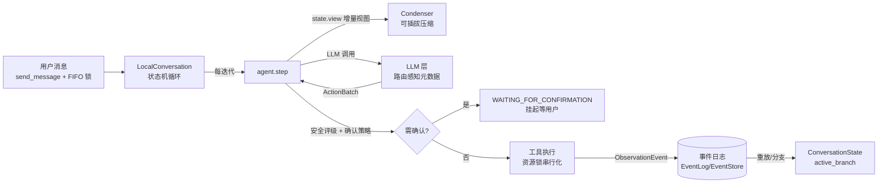

# OpenHands V1（OpenHands/software-agent-sdk）harness 实现导读

> 基于版本：`main@28e8ed2`（锚点以此为准）｜语言：Python（Pydantic 模型驱动）｜OpenHands 主仓 8.8 万 star（主仓已是前端/平台，agent harness 在本 SDK 仓）
> 源码目录：`.spec/源码学习\_clones\software-agent-sdk`（浅克隆）
> 定位一句话：V1 重写后的 agent SDK——「状态机驱动的会话 + 事件溯源 + 可插拔 Condenser 压缩」，给构建 agent 的人用的底座而非成品。

---

## 0. 总览

OpenHands V1 把旧版（agenthub/CodeActAgent，Python 插件式事件循环）重写为**强类型 SDK**：全部领域对象是 Pydantic 模型，Agent 用 Mixin 组合（`class Agent(CriticMixin, ResponseDispatchMixin, AgentBase)`，`agent/agent.py:374`），会话由**执行状态机**驱动，历史是**事件日志 + 增量视图**，压缩是**可插拔 Condenser 流水线**。

三个定义性选择：

1. **状态机驱动的运行循环**：`ConversationExecutionStatus`（IDLE/RUNNING/PAUSED/STUCK/FINISHED/WAITING_FOR_CONFIRMATION/ERROR）是循环的指挥棒——暂停、卡死、等确认、完成都是状态迁移而不是异常。
2. **Local/Remote 同接口双实现**：`LocalConversation`（进程内）与 `RemoteConversation`（连 agent-server）实现同一接口——SDK 既能嵌入单机脚本，也能撑起服务化部署。
3. **确认与安全分析器联动**：动作执行前由 SecurityAnalyzer 评级（SecurityRisk），确认策略按风险决定是否挂起等用户。

### 包结构

| 模块 | 职责 |
|---|---|
| `openhands/sdk/conversation/` | 核心：impl/local_conversation.py（3128 行主实现）、state.py、event_store.py、stuck_detector.py、fifo_lock.py、resource_lock_manager.py |
| `openhands/sdk/agent/` | Agent（step/astep）、acp_agent（ACP 协议）、parallel_executor（并行子代理）、critic_mixin、response_dispatch |
| `openhands/sdk/context/` | condenser/（压缩家族）、view/（增量视图）、agent_context、memory、prompts |
| `openhands/sdk/event/` | 事件类型体系：MessageEvent/ActionEvent/ObservationEvent/Condensation/ConversationError…（llm_convertible/ 定义哪些事件能进 LLM） |
| `openhands/sdk/tool/` + `openhands-tools/`（仓级） | 工具定义与内置工具库 |
| `openhands/sdk/security/` + `credential/` + `secret/` | 安全分析、凭据、密钥（可加密持久化） |
| `openhands-agent-server/` | RemoteConversation 的服务端 |

### 架构总图



---

## 1. agent 主循环

**核心问题**：状态机怎么驱动循环？并发消息怎么不丢？

### 主线流程图

```mermaid
flowchart TD
  A["run(): while true<br/>（持状态锁检查）"] --> B{"状态？"}
  B -->|PAUSED/STUCK| Z1[退出循环]
  B -->|FINISHED| C{"stop hook 允许停?}
  C -->|拒绝| C1[反馈注入为消息<br/>状态回 RUNNING → continue]
  C -->|允许| Z2[退出]
  B -->|RUNNING| D[卡死检测<br/>_check_stuck_or_nudge]
  D -->|stuck| Z3[标记并退出]
  D -->|ok| E["agent.step()：<br/>待确认动作优先 → condenser →<br/>LLM 采样 → ActionBatch"]
  E --> F{状态？}
  F -->|WAITING_FOR_CONFIRMATION| Z4[break 等用户]
  F -->|预算超限| Z5[发错误事件退出]
  F -->|迭代 ≥ 500| Z6[发错误事件退出]
  F -->|正常| A
```

### 关键点

#### 1.1 FINISHED 穿透：完成状态不立即退出循环

📍 `openhands-sdk/openhands/sdk/conversation/impl/local_conversation.py:1990-2000`（注释块）

**干什么**：agent 置 FINISHED 后循环**不**立刻 break——并发到达的用户消息经 `send_message()` 等 FIFO 锁后把状态改回 IDLE，循环下一迭代继续处理；只有其他终态（暂停/卡死/确认等待/预算/迭代上限）才 break。
**为什么**：注释原话「Without this design, concurrent messages would be lost」——状态机把「完成了」和「循环该退出了」解耦，并发消息的正确性靠结构不靠锁竞速。

#### 1.2 stop hook 可以反悔：拒绝停止并注入反馈

📍 `local_conversation.py:1948-1968`

**干什么**：FINISHED 状态先过 stop hook（`hook_processor.run_stop`）；hook 拒绝停止时，反馈文本包装成 environment 来源的 MessageEvent 注入，状态回 RUNNING 继续。
**为什么**：让外挂逻辑（质量门禁、验收钩子）拥有「不许交卷」的权力——与 dsh 的 turn-stopping 串行检查点同题，OpenHands 把它放进状态机主循环。

#### 1.3 状态锁穿透标记：工具线程不重抢锁

📍 `local_conversation.py:1981-1987`（`_step_holds_state_lock` 标记，注释引 #3485）

**干什么**：agent.step() 持状态锁执行期间置 `_step_holds_state_lock = True`，让在 worker 线程跑的状态变更型工具（如 switch_llm）跳过重新抢锁而不是死锁。
**为什么**：单锁状态机的经典坑——「持锁的 step」里再跑「要锁的工具」。用一个标记而不是可重入锁，语义更显式。

#### 1.4 一步 = 一次采样 + 动作批

📍 `agent/agent.py:645-700`（_step：待确认动作优先 → 钩子拦截检查 → prepare_llm_messages → LLM 采样）、`:185`（_ActionBatch：prepare/emit/finalize，`_truncate_at_finish` 在 FinishAction 处截断批次）

**干什么**：step 先执行上一步挂起的待确认动作（隐式确认路径），再经 condenser 准备消息、LLM 采样产出 ActionBatch；批次里出现 FinishAction 时截断其后的动作（finish 之后的不再执行）。
**为什么**：「确认批准后的续跑」是 step 的第一种情况而不是特殊流程；finish 截断保证终局动作语义干净。

---

## 2. 工具系统与确认

### 关键点

#### 2.1 确认决策 = 确认模式 × 安全分析器 × 策略

📍 `agent/agent.py:1046-1090`（_requires_user_confirmation）

**干什么**：是否需要用户确认由三件事决定——确认模式开启；单个 FinishAction/ThinkAction 永不确认；其余动作由 SecurityAnalyzer.analyze_pending_actions 评级（无分析器则一律 UNKNOWN），确认策略按风险数组裁决。
**为什么**：把「要不要问人」做成可组合判定（模式 × 风险 × 策略），安全分析器是可插拔的（`openhands/sdk/security/`），比硬编码工具白名单表达力强。

#### 2.2 资源锁管理器：文件/终端/浏览器会话串行化

📍 `openhands-sdk/openhands/sdk/conversation/resource_lock_manager.py:1-10`（模块注释）

**干什么**：工具执行期间对共享资源（文件、终端会话、浏览器会话）做串行化锁管理，工具持有资源时其他调用者排队。
**为什么**：并行子代理（parallel_executor）+ 多工具并发时，「两个工具抢同一个终端」必须由 harness 裁决——资源锁按资源粒度而不是全局锁，并发度不损失。

#### 2.3 卡死检测与「轻推」

📍 `conversation/stuck_detector.py`（370 行，消费 ActionEvent/AgentErrorEvent/ObservationEvent/CondensationSummaryEvent 模式）、`local_conversation.py:1975`（_check_stuck_or_nudge）

**干什么**：基于近期事件模式识别卡死（重复动作/重复错误无观察），先尝试 nudge（注入提示拉一把），救不回才标记 STUCK 终止。
**为什么**：与 OpenClaw 的四级熔断、opencode 的 doom-loop 权限同题——OpenHands 选择「先救后杀」，且检测器消费的正是事件日志（真相源复用）。

---

## 3. 上下文管理

### 关键点

#### 3.1 Condenser 家族：可插拔、可流水线、可滚动

📍 `openhands-sdk/openhands/sdk/context/condenser/`：`base.py:16`（CondenserBase ABC）、`:79`（PipelinableCondenserBase）、`:107`（RollingCondenser）、`llm_summarizing_condenser.py:38`（LLMSummarizingCondenser）、`pipeline_condenser.py:7`（PipelineCondenser 组合）、`no_op_condenser.py:7`

**干什么**：压缩器是 Pydantic 判别联合家族——NoOp（直通）、LLM 摘要（滚动窗口）、Pipeline（多个串联）；`prepare_llm_messages(state.view, condenser, llm)` 在每次采样前运行（`agent.py:684`），产出压缩事件（Condensation）时先落事件、本步直接 return。
**为什么**：压缩策略随模型/任务差异极大——抽象成可序列化配置（Pydantic 判别联合意味着 condenser 配置本身可以存盘/传输），且压缩动作也是事件（可回放审计）。

#### 3.2 增量视图：state.view 而非全量重放

📍 `agent/agent.py:678-684`（注释引用 issue #3053：messages from the cached, incrementally-maintained view）、`context/view/`

**干什么**：发请求的消息从「缓存、增量维护的视图」读出，而不是每次全量重放事件日志；LLM 调用上下文（LLMCallContext）每步构建一次并贯穿该步所有调用。
**为什么**：事件日志保证可回放，视图保证发请求的路径 O(增量)——两个职责分开（dsh 用 surface 投影达成同款平衡）。

#### 3.3 路由感知的压缩阈值

📍 `agent/agent.py:673-676`（resolve_runtime_metadata 注释：routed model 的真实端点限制驱动第一步的 condensation）

**干什么**：采样前先解析当前路由模型的运行时元数据（真实上下文上限），condenser 用它而非静态配置决定何时压缩。
**为什么**：同一 agent 可中途 switch_llm 到不同窗口的模型——压缩阈值跟着「现在这个端点的真实限制」走，避免第一步就超限。

---

## 4. 模型接入

### 关键点

#### 4.1 LLM 上下文与提示缓存分片

📍 `conversation/impl/local_conversation.py:296`（构造参数 `prompt_cache_key`：Override for the prompt-cache shard key）、`:713`（预算绑定 run 的全部 LLM：agent、condenser…）

**干什么**：会话可指定 prompt-cache 分片键（provider 提示缓存友好）；预算（budget）跨 agent 与 condenser 等全部 LLM 调用累计，超限发 MaxBudgetReached 错误事件。
**为什么**：KV cache 命中是成本大头——分片键是 API 层一等参数；辅助调用（压缩）也花主预算，必须统一记账。

#### 4.2 非多模态图像自动降级

📍 `agent/agent.py:122-184`（_non_multimodal_image_message / _replace_latest_user_images_with_references / _should_handle_non_multimodal_image_input）

**干什么**：切到不支持图像的模型时，把用户消息里的图片替换为文字引用消息，并可选注入 vision_inspect 工具让模型按需查图。
**为什么**：switch_llm 的连带问题——模型能力面变化时 harness 负责把历史「翻译」成新模型能吃的形式。

---

## 5. 会话与持久化

### 关键点

#### 5.1 事件日志 + 分支视图

📍 `conversation/event_store.py:123`（沿链回溯 while）、`state.py:362`（active_branch / _view_branch_leaf）

**干什么**：历史是事件日志，状态持有「当前分支叶」——回放沿链收集；ForkEdit/Condensation 等事件改变视图分支而不物理删除；`get_unmatched_actions(state.active_branch())`（`agent.py:652`）从分支找「有 action 无 observation」的挂起对。
**为什么**：可回放、可分支、可恢复三者共用一个原语（事件链）；「未匹配动作」直接从日志结构推导出确认流程的输入。

#### 5.2 密文持久化与秘密注册表

📍 `conversation/secret_registry.py`（369 行）、构造参数 `cipher`（local_conversation.py:280：加密持久化事件中的秘密）

**干什么**：会话可配 cipher，落盘时秘密字段加密，运行时经 SecretRegistry 按需解密供给工具。
**为什么**：SDK 定位（嵌入别人产品）决定了安全边界——事件日志可能被分享/归档，秘密必须可分离存储。

#### 5.3 Local/Remote 双实现同接口

📍 `conversation/impl/local_conversation.py`（3128 行）与 `remote_conversation.py`（1846 行，SSE 流、`max_iteration_per_run` 默认 500 由服务端配置回传 `:816`）

**干什么**：同一 Conversation 接口两个实现——本地进程内直跑，或连 agent-server（远程还带 ACP 事件桥接：`_acp_tool_call_id_to_event_id` 映射）。
**为什么**：SDK 的嵌入形态（脚本）与部署形态（服务）共享全部上层代码，切换是构造参数不是重构。

---

## 补遗：审计回填（LLM 错误降级 / 记忆 / 子代理注册表）

> 2026-09-18 二次审计发现的三处遗漏，回源码核实后补齐。

#### A. LLM 错误降级：FallbackStrategy + RetryMixin + 失败分类契约

📍 `openhands-sdk/openhands/sdk/llm/fallback_strategy.py:29-36`（触发换 LLM 的六类异常：APIConnectionError/RateLimitError/ServiceUnavailableError/LiteLLMTimeout/InternalServerError/LLMNoResponseError）、`:39,47`（FallbackStrategy.fallback_llms 备选链）、`llm/utils/retry_mixin.py:23`（RetryMixin，tenacity）、`llm/llm.py:348-349`（num_retries=5、retry_multiplier=8.0）、`event/error_classification.py:9-20`（FailureKind 八类 + FailureAction: none/retry/settings）

**干什么**：重试耗尽后按六类异常触发**换模型**——FallbackStrategy 持有 fallback_llms 备选链，逐个解析切换；tenacity RetryMixin 统一重试（默认 5 次、倍率 8.0）；错误分类契约（AUTH/QUOTA/RATE_LIMIT/CONFIG/TRANSIENT/AGENT_ACTION/INTERNAL/UNKNOWN）横跨 SDK/UI/遥测，每类映射处置动作（重试/改设置/不作为）。
**为什么**：三层递进——重试（同模型）→ 降级（换模型）→ 分类上报（给 UI 与遥测），每层只管自己的决策；「FailureAction=settings」把可自助修复的错误（如配置错）直接导向设置入口，而不是无限重试。

#### B. 记忆：两层 MEMORY.md 加载器

📍 `openhands-sdk/openhands/sdk/context/memory.py:1-8`（模块注释）

**干什么**：读 agent 自维护的 `MEMORY.md` 索引——用户层 `~/.openhands/memory/` 与项目层 `<workspace>/.openhands/memory/` 合并为一个 prompt-ready 字符串，在首次 `send_message()/run()` 时解析注入；同目录的日志（`YYYY-MM-DD.md`）**刻意不自动加载**，agent 按需自读。
**为什么**：索引进提示词、正文按需取——记忆的两级加载既保证「知道自己记过什么」，又不让全量记忆挤占上下文；两层（用户/项目）作用域让个人偏好与项目事实互不污染。

#### C. 子代理注册表：register_agent 一行注册

📍 `openhands-sdk/openhands/sdk/subagent/registry.py:1-6`（"Simple API for users to register custom agents"，示例 `from openhands.sdk import register_agent`）、`load.py`（discover_agents / load_user_agents / load_project_agents）

**干什么**：子代理经 `register_agent(agent, AgentContext)` 一行注册；另有从用户/项目目录自动发现加载（load_user_agents / load_project_agents）与定义到工厂的转换（agent_definition_to_factory）。
**为什么**：SDK 的多代理不做循环编排，而是做**代理的身份与发现**——注册表 + 目录发现让「子代理」成为可分发、可安装的资产，运行交给 Agent 主循环本身。

## 6. 值得偷学的决策 + 五仓横向对照

1. **FINISHED 穿透设计**——「任务完成」不等于「循环退出」，并发消息不丢的正确性由状态机结构保证。
2. **Condenser 是可序列化配置（Pydantic 判别联合）**——压缩策略可以像数据一样存盘、传输、热切换，比「代码里选策略」高一个抽象层。
3. **压缩阈值跟随路由的真实端点限制**——switch_llm 场景下第一步就不超限，元数据解析前置于压缩决策。
4. **待确认动作是 step 的第一种情况**——「批准后续跑」不是特殊流程而是循环的天然入口。

| 维度 | OpenHands SDK | OpenClaw | hermes | opencode | pi | dsh |
|---|---|---|---|---|---|---|
| 定位 | 给构建者的 SDK 底座 | 常驻编排层 | 个人助手单体 | 终端 coding agent | 嵌入式工具箱 | 企业插件平台 |
| 循环 | 状态机 + step | attempt 编排 | phase 流水线 | DB 重读 while | 双层 while | turn/step 事件 |
| 真相源 | 事件日志 + 增量视图 | 转录 + writer claim | SQLite + FTS5 | SQLite parts | transcript 数组 | append-only 日志 |
| 压缩 | Condenser 家族（可序列化） | 引擎注册表+看门狗 | 专职引擎 | prune+截断 | 分支摘要 | 事件事务+KV 复用 |
| 确认/安全 | 风险评级×策略×确认模式 | 审批观测+熔断 | 授权闸门 | allow/deny/ask | beforeToolCall | guard 单调+fail-closed |

### 断点建议

- 状态机循环：`conversation/impl/local_conversation.py:1931`（while true），对照 1990-2000 的 FINISHED 穿透注释
- 单步：`agent/agent.py:645`（_step），看「待确认动作优先」到 ActionBatch 的全程
- 确认：`agent/agent.py:1046`（_requires_user_confirmation）
- 压缩：`context/condenser/base.py:16` 起沿继承链读到 LLMSummarizingCondenser
- 卡死：`conversation/stuck_detector.py` 的事件模式表
