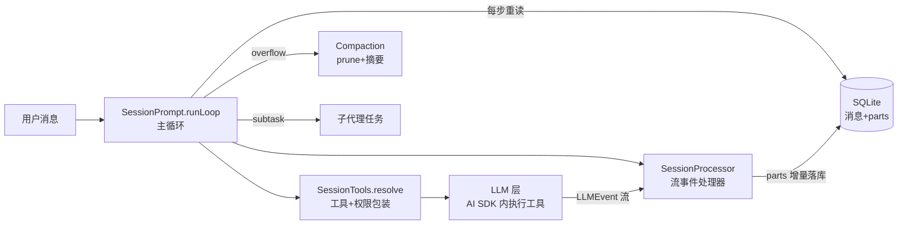
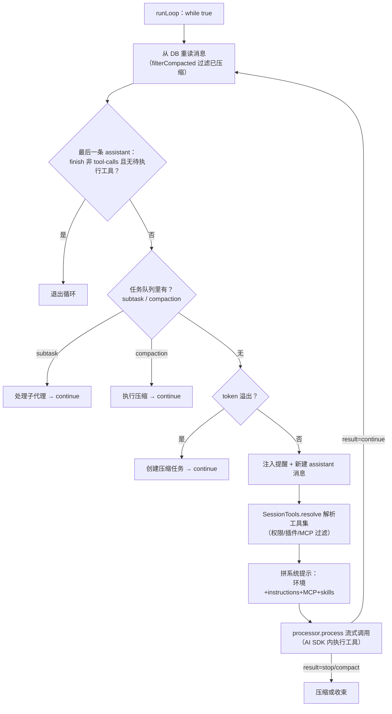

# opencode（anomalyco/opencode）harness 实现导读

> 基于版本：`dev@3dd1b30`（锚点以此为准）｜语言：TypeScript（Effect 函数式架构）｜20.8 万 star
> 源码目录：`.spec/源码学习/_clones/opencode`（浅克隆）
> 定位一句话：开源 coding agent——Server/Client 分离 + Effect 函数式内核 + 「数据库即真相」的会话模型。

---

## 0. 总览

opencode 的 harness 与 dsh/pi 都不同，三件事定义了它的骨架：

1. **Effect-TS 函数式架构**：全仓用 [Effect](https://effect.website)（`Effect.gen` / `Layer` / `Stream` / `Deferred`）组织——依赖注入靠 Service/Layer，重试/中断/资源清理是组合子而非手写状态机。
2. **消息即数据库行，part 即增量单位**：一条 assistant 消息由多个 part（text/reasoning/tool/step/patch）组成，流式事件逐 part 落库（SQLite），UI 直接订阅数据库。
3. **数据库即真相**：主循环每一步都从数据库重读会话消息再决策——「下一步发什么」永远由持久化状态推导。

### 包结构（harness 相关）

| 包 | 职责 |
|---|---|
| `packages/opencode` | 主包：session/（主循环 prompt.ts、流处理器 processor.ts、压缩、工具、权限）、agent、plugin |
| `packages/llm` | 模型接入层（流事件 LLMEvent、AI SDK 集成） |
| `packages/core` | 基础设施：Database、Schema（SessionV1）、effect 工具、权限 Schema |
| `packages/server` / `sdk` / `client` | Server/Client 分离与 SDK |
| `packages/plugin` / `protocol` | 插件事件与协议 |

### 架构总图

---

## 1. agent 主循环

**核心问题**：循环在哪、怎么决策继续还是停？

### 主线流程图

### 关键点

#### 1.1 每步从数据库重读会话——「DB 即真相」版事件溯源

📍 `packages/opencode/src/session/prompt.ts:1088-1094`（while true + filterCompactedEffect）

**干什么**：主循环每一轮都用 `MessageV2.filterCompactedEffect(sessionID)` 从数据库重新读出完整消息列表（已被压缩遮蔽的自动过滤），终止判定、工具解析、提示组装全部基于这份新读出的数据。
**为什么**：与 dsh「从事件日志派生请求」同一思想，但实现更直接——不维护内存会话副本，任何外部改动（压缩、revert、插件）写库后下一步自动生效。

#### 1.2 终止判定看「最后一条助手消息的 finish」

📍 `packages/opencode/src/session/prompt.ts:1106-1130`

**干什么**：最后一条 assistant 有 finish 且不是 `tool-calls`/`unknown`、没有未执行的本地工具、parent 指向当前 user 消息 → 退出；部分 provider 明明带工具调用却返回 stop（注释 L1103-1105），靠 `hasToolCalls` 兜住继续跑。
**为什么**：循环的驱动数据全在消息本身（finish 标记 + tool parts 状态），不需要独立的循环状态机；provider 的不合规行为在判定处显式容错。

#### 1.3 子代理与压缩都是「任务队列」

📍 `packages/opencode/src/session/prompt.ts:1142-1168`

**干什么**：每轮从消息流解析 tasks，`subtask` 类型交给 handleSubtask（子代理会话），`compaction` 类型交给 compaction.process；两者处理完 `continue` 回主循环。
**为什么**：把「循环中途要做的特殊事」统一为队列表达，主循环保持一条直线逻辑。

#### 1.4 maxSteps 最后通牒

📍 `packages/opencode/src/session/prompt.ts:1178-1179`、`:1281`

**干什么**：agent 可配 `steps` 上限；到达最后一步时在消息末尾追加一条 MAX_STEPS_PROMPT（提醒模型该收尾了）。
**为什么**：硬截断会让任务烂尾，先礼后兵——用提示词给模型最后一次自救机会。

---

## 2. 工具系统与权限

**核心问题**：工具在哪一层执行？权限怎么拦？

### 关键点

#### 2.1 工具在 LLM 层执行，processor 只管物化状态

📍 `packages/opencode/src/session/processor.ts:331-381`（tool-call 事件）、`:216-253`（ensureToolCall）

**干什么**：工具执行发生在 LLM 流内部（AI SDK 的 tool execute，`providerExecuted` 标记 provider 端执行的）；processor 收到 `tool-input-*/tool-call/tool-result` 事件后，把工具状态机（pending → running → completed/error）逐 part 写库。
**为什么**：执行与持久化分离——AI SDK 管并发执行，opencode 管「数据库里永远有最新状态」，UI 直接读库渲染工具卡片。

#### 2.2 doom-loop 检测做成了权限请求

📍 `packages/opencode/src/session/processor.ts:29`（阈值 3）、`:353-380`

**干什么**：每次 tool-call 事件检查最近 3 个 parts：同工具名 + 参数逐字节相同 → 触发 `permission.ask({permission: "doom_loop", ...})`，把「要不要继续」交给用户（可 always 放行该工具）。
**为什么**：死循环检测本质是「需要人类判断的异常」——复用权限系统的 ask 通道，不另造 UI 和状态。

#### 2.3 权限代数：evaluate 三态 + Deferred 异步审批

📍 `packages/opencode/src/permission/index.ts:28-38`（evaluate）、`:67-121`（ask）

**干什么**：`evaluate(permission, pattern, ...rulesets)` 按规则集得出 `allow | deny | ask`（默认 ask）；ask 时创建 `Deferred`，发布 `Event.Asked` 事件等 UI `reply`，规则集是 agent 与 session 两层的 `merge`。
**为什么**：审批是跨进程的（server 等前端用户点按钮）——Effect 的 Deferred 把「异步等待人类」表达成一个可组合的 Effect，deny 直接抛 `RejectedError`。

#### 2.4 工具执行包装：插件 before/after 钩子

📍 `packages/opencode/src/session/tools.ts:102-122`

**干什么**：SessionTools.resolve 给每个工具包一层 execute：前置触发 `tool.execute.before` 插件事件、真执行、后置 `tool.execute.after`，再叠权限 ruleset 过滤与可见性（`visibleTools`）。
**为什么**：工具的注册面（agent 级）与拦截面（插件级）分离，内置工具与 MCP 工具走同一条包装路径。

---

## 3. 上下文管理

### 关键点

#### 3.1 压缩是「修剪 + 工具输出截断 + 摘要」三件套

📍 `packages/opencode/src/session/compaction.ts:9-26`（常量：PRUNE_MINIMUM=2万 token、TOOL_OUTPUT_MAX_CHARS=2000、受保护工具 skill、保留最近 2000~15000 token）

**干什么**：溢出触发压缩：老对话修剪、工具输出截到 2000 字符、skill 等受保护工具豁免、最近 2000~15000 token 逐字保留，其余摘要；`filterCompacted` 在读取侧自动过滤被压缩消息。
**为什么**：coding agent 的大头是工具输出（命令日志、文件内容）——先截最肥的，再摘要对话，比一刀切摘要便宜且保真。

#### 3.2 溢出处理：截流而不是硬失败

📍 `packages/opencode/src/session/processor.ts:493-496`（isOverflow → needsCompaction）、`:656-660`（Stream.takeUntil）、`:693`（返回 "compact"）

**干什么**：流式过程中检测到 token 溢出，`takeUntil` 立即停止消费流，process 返回 "compact"，主循环创建压缩任务后重跑。
**为什么**：溢出恢复不用废弃当前流——尽早止损、压缩后从消息重新出发。

#### 3.3 系统提示五段拼装

📍 `packages/opencode/src/session/prompt.ts:1257-1271`

**干什么**：system = 环境信息 + instructions（AGENTS.md 类规则）+ MCP 说明 + skills；结构化输出模式追加 StructuredOutput 强制指令并 `toolChoice: "required"`。
**为什么**：分层来源各自独立演化，结构化输出（json_schema）作为请求格式的一等公民贯穿到工具层（`prompt.ts:74-82`）。

---

## 4. 模型接入

### 关键点

#### 4.1 LLM 层输出统一 LLMEvent 流

📍 `packages/opencode/src/session/processor.ts:77`（`type StreamEvent = LLMEvent`，来自 `@opencode-ai/llm`）、`prompt.ts` StreamInput

**干什么**：所有 provider 的响应统一为 LLMEvent 流（reasoning-start/delta/end、tool-input-*、tool-call、tool-result、step-start/finish、text-*、provider-error），processor 是唯一消费者。
**为什么**：与 pi 的三族事件同理——统一词汇让 part 物化逻辑只写一份。

#### 4.2 step-finish 时结算成本并跟踪文件变更

📍 `packages/opencode/src/session/processor.ts:435-497`

**干什么**：每步结束：结算 usage/cost 写入消息；`snapshot.patch` 产出本步文件变更（patch part 落库）；后台 fork 摘要生成；检测 thinking 块被 provider 丢弃的告警。
**为什么**：成本、文件变更、摘要都在步骤边界结算——part 流水线让「一步做了什么」在数据库里完整可审计。

---

## 5. 会话与持久化

### 关键点

#### 5.1 消息 = info + parts，part 级增量更新

📍 `packages/opencode/src/session/processor.ts:144-158`（updateToolCall）、`:299-305`（updatePartDelta）

**干什么**：每条消息是数据库一行（info：模型/成本/finish/时间），内容是 parts 集合（text/reasoning/tool/step/patch 各自独立行），流式期间按 part 做 delta 更新。
**为什么**：UI 增量渲染、断点恢复、回放都以 part 为粒度——比「整条消息覆盖写」细一级，崩溃时半条消息的部分结果也在。

#### 5.2 中断清理：未完成工具标记 interrupted

📍 `packages/opencode/src/session/processor.ts:585-607`（cleanup）、`:96-100`（孤儿识别 isOrphanedInterruptedTool）

**干什么**：流被中断时 cleanup 把所有 running 状态的工具 part 改写为 error + `interrupted: true`；下一轮主循环识别这类孤儿工具不再执行（`prompt.ts:96-100`）。
**为什么**：与 dsh 的合成收尾同题——保证「中断后重读消息」永远得到合法状态。

---

## 补遗：审计回填（LLM 错误降级细节）

> 2026-09-18 二次审计发现重试细节此前只有总览一句，回源码补齐。

#### A. LLM 重试：指数退避参数全部具名导出

📍 `packages/opencode/src/session/retry.ts:26`（RETRY_INITIAL_DELAY=2000）、`:27-30`（BACKOFF_FACTOR=2、JITTER_FACTOR=0.25、MAX_DELAY）、`:31`（RETRY_MAX_RETRIES=5）、`:10-11`（免费额度用尽 → Go 订阅升级提示）

**干什么**：重试初始延迟 2 秒、指数因子 2、抖动 0.25、最多 5 次；错误经分类后可携带 action（reason/provider/title/link）——免费额度耗尽时返回「subscribe to Go」升级引导而非裸错误。
**为什么**：重试参数是策略不是魔法数——具名导出让 provider 差异（有的限流窗口长）可以按 provider 覆写；「配额类失败」的降级出口是**引导用户升级**，这是产品级错误处理。

#### B. 重试挂载在流消费的 Effect 管线上

📍 `packages/opencode/src/session/processor.ts:674-688`（Effect.retry(SessionRetry.policy(...))）

**干什么**：流消费 gen 外层依次组合 `Effect.onInterrupt`（中断→halt AbortError）→ `Effect.retry(SessionRetry.policy)`（按 provider 决定重试）→ `Effect.catch(halt)` → `Effect.ensuring(cleanup())`；重试状态经 status.set 发布为会话状态（retry/attempt/next）。
**为什么**：重试是组合子而非手写循环——中断、重试、兜底、清理的执行顺序由 Effect 组合律保证；UI 从会话状态里直接读到「第几次重试、下次何时」。

## 6. 值得偷学的决策 + 横向对照

1. **doom-loop 检测复用权限 ask 通道**——异常检测不是新子系统，而是「请人类裁决」的一种权限请求。
2. **数据库即真相**——每步重读数据库，压缩/回退/子代理的复杂交互全靠「写库 → 下轮重读」自然收敛，不需要内存协调。
3. **工具输出截断先于对话摘要**——修剪上下文先砍最肥的部分（2000 字符截断），省钱且保真。
4. **step 边界结算一切**（成本/文件 patch/摘要）——审计粒度与循环粒度对齐。

| 维度 | opencode | pi | dsh |
|---|---|---|---|
| 架构底座 | Effect-TS 函数式 | 纯函数 + 回调 | Cordis 插件生态 |
| 唯一真相 | SQLite（消息+parts 行） | transcript 数组 | append-only 事件日志 |
| 工具执行层 | LLM 层（AI SDK 内） | 循环内（before/after 钩子） | 注册表四段流水线 |
| 权限 | allow/deny/ask 三态 + Deferred | beforeToolCall 阻断 | guard 单调 + 审批 fail-closed |
| 死循环防护 | 权限 ask（连续 3 次同参） | 无内建 | repeat-tool-reminder 插件 |

### 断点建议

- 主循环：`packages/opencode/src/session/prompt.ts:1088`（while true），对照 `MessageV2.latest` 看终止判定
- 流物化：`session/processor.ts:278`（handleEvent 的 switch）
- doom-loop：`session/processor.ts:353-380`
- 权限：`src/permission/index.ts:67`（ask 的 Deferred 等待）
- 压缩：`session/compaction.ts:9` 起的常量区即策略表
