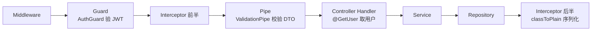
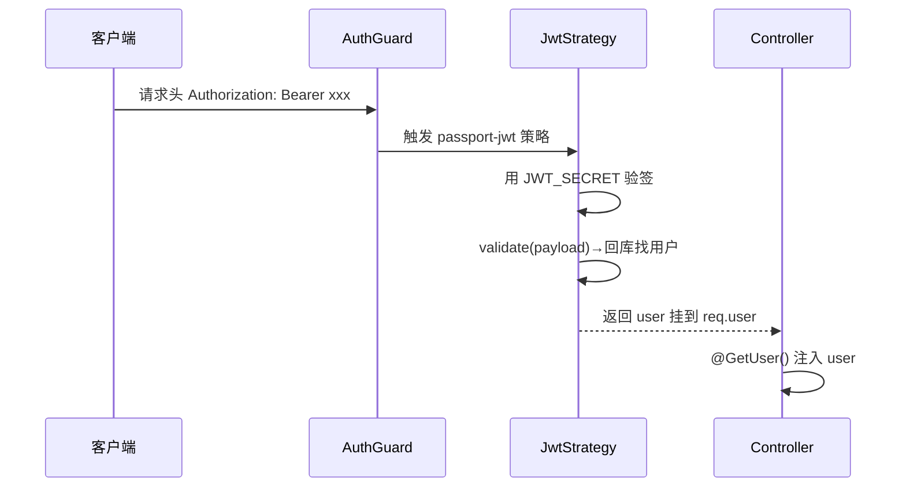

# nestjs-recipe 源码导读 —— NestJS 最佳实践的最小完整样本

> 源码版本：[arielweinberger/nestjs-recipe](https://github.com/arielweinberger/nestjs-recipe) master@`4ebf945`（2026-09-19 取源，959 星）
> 本地克隆：`.spec/源码学习/_clones/nestjs-recipe`
> **对应关系说明**：你说的「Zero to NestJS」对应 Ariel Weinberger 的经典课程《NestJS Zero to Hero》；其课程配套的任务管理后端仓已不公开，本文取同作者维护的「NestJS Best Practices Recipe」导读——同一个作者、同一套任务管理示例的最佳实践版（NestJS 7.x，2021 年代码，旧版本注意点见章4）
> 规模：23 个 TS 文件 ≈ 600 行——一小时内能读完的「最小完整 Nest 应用」，正好当你的主场第一课

## 00 · 总览

**这是什么**：任务管理 API（注册/登录 + 任务的增删改查/过滤），麻雀虽小五脏俱全：DTO 校验、Repository 模式、Passport-JWT 认证、自定义装饰器、环境配置校验、响应拦截器、单元测试——**NestJS 官方推荐的每一件「标准件」都有实物**。

**怎么跑起来**：配 `.env.stage.dev`（PORT/STAGE/DB_*/JWT_SECRET，见 `src/config.schema.ts`）→ `yarn && yarn start:dev`。需要本地 PostgreSQL。

**Nest 请求生命周期**（先建立这张图，后文所有代码都挂在这条链上）：

**学习动线**：章1 配置与全局件 → 章2 认证主线 → 章3 数据层主线 → 章4 收束。**读法建议：开着源码对照本文，600 行直接通读，不跳。**

---

## 01 · 最佳实践清单：配置、校验与响应

**本章在全局的位置**：`main.ts` + `app.module.ts` 共 50 行，浓缩了 Nest 应用的「门面三件套」。

**前置知识**：DI（依赖注入）：类不自己 new 依赖，构造器里声明，框架负责塞进来——Nest 的灵魂，Java Spring 同款。**环境配置**：不同环境（dev/prod）用不同 `.env` 文件，敏感信息不进代码库。

**关键点讲解**：

1. **全局管道 + 全局拦截器**（`src/main.ts:11-12`）：`app.useGlobalPipes(new ValidationPipe())` 让所有进来的请求体先过 DTO 校验；`useGlobalInterceptors(new TransformInterceptor())` 让所有出去的响应过序列化。对照 Gin：GVA 在 router group 上挂中间件；Nest 用管道/拦截器分层更细——**校验是管道的事、转换是拦截器的事**，别混。
2. **多环境配置文件**（`src/app.module.ts:10-13`）：`.env.stage.${process.env.STAGE}`——启动时用 `STAGE=dev|prod|test` 选择加载哪个环境文件。同一份代码，环境靠变量切换。
3. **配置进来先验身**（`src/config.schema.ts:3-12`）：Joi schema 声明 `PORT` 默认 3000、`JWT_SECRET` 必填等；`ConfigModule.forRoot({ validationSchema })` 在**应用启动那一刻**校验环境变量，缺了直接崩。**配置错误在启动时暴露，而不是跑到一半才发现**——这个习惯请直接抄走。
4. **数据库连接的工厂注入**（`src/app.module.ts:15-36`）：`TypeOrmModule.forRootAsync({ inject: [ConfigService], useFactory })`——连接参数全部从配置服务取，生产环境自动开 ssl（`:19-24`）。`autoLoadEntities: true` 免去手动注册实体。⚠️ 注意 `synchronize: true`（`:28`）：实体改动自动同步表结构，**开发方便、生产危险**（详见章4）。
5. **响应序列化拦截器**（`src/transform.interceptor.ts:11-14`）：`next.handle().pipe(map(data => classToPlain(data)))`——所有响应对象过 `classToPlain`，配合实体上的 `@Exclude()` 装饰器可以精准隐藏字段（比如密码）。⚠️ 但本仓的 User 实体**并没有**给 password 标 @Exclude——机制在、用法缺，章4 详说。

**收束**：50 行门面 = 校验、配置、序列化三道全局关卡。下一章走进认证主线。

---

## 02 · 认证主线：signup → signin → 受保护请求

**本章在全局的位置**：这是你在这批项目里看到的**第四种认证**，也是你最该吃透的一种——因为它就是 Nest 的官方姿势（Passport 生态）。

**前置知识**：**Passport**：Node 世界的认证标准件家族，`passport-jwt` 负责从请求头提取并验证 JWT。**Strategy（策略）**：一种认证方式的封装，你只需实现 `validate` 方法。

**核心问题**：一个请求带着 Bearer token 进来，Nest 是怎么变成「处理函数里直接拿到 user」的？

**主线流程图**：

**关键点讲解**：

1. **注册：哈希在仓储层做**（`src/auth/users.repository.ts:15-16`）：`bcrypt.genSalt()` + `bcrypt.hash(password, salt)`——bcrypt 带盐慢哈希（RuoYi 导读章2 讲过为什么）。注册成功与否的数据库细节也在这层处理：用户名唯一冲突捕获 Postgres 错误码 `23505` 转成 `ConflictException`（`:23-25`）。**错误码→业务异常的翻译在仓储层做完，上层干净**。
2. **登录：比对 + 签发**（`src/auth/auth.service.ts:27-30`）：`bcrypt.compare` 比对密码 → `jwtService.sign({ username })`——JWT 载荷只放 username（和你见过的 mall 一样极简）。
3. **守卫一挂，路由全保**（`src/tasks/tasks.controller.ts:23`）：类上 `@UseGuards(AuthGuard())`——该控制器所有接口都要登录。守卫内部触发 passport-jwt 策略，用 `JWT_SECRET`（从配置取，`jwt.strategy.ts:18`）验签。
4. **validate 是「验签之后」的钩子**（`src/auth/jwt.strategy.ts:23-32`）：签名验过只说明 token 是我们发的，`validate` 再回库确认用户真实存在，返回的 user 被 Passport 挂到 `req.user`。⚠️ 意味着**每个请求查一次库**——和 mall 同款取舍（权限实时 vs 性能）。
5. **自定义参数装饰器**（`src/auth/get-user.decorator.ts:4-9`）：`@GetUser()` 一行把 `req.user` 直接注入处理函数参数——**Nest 版的「上下文取值」**。对照：GVA 在 Gin context 里 `c.Get("claims")` 手动取；Nest 把它做成声明式装饰器。业务函数签名因此自解释：`getTaskById(id, @GetUser() user)`。
6. **数据按用户隔离**：任务的所有查询都带 `user` 条件（`tasks.service.ts:22` 的 `where: { id, user }`）——「我的任务只有我能看」。这就是你在 RuoYi 章四见过的「数据权限」的**最简形态**：单用户系统里一行 where 就够；多组织系统才需要 @DataScope 那样的拼 SQL 工程。

**收束**：注册哈希在仓储、登录签发在服务、验签在策略、取人在装饰器——各就各位。下一章看数据层怎么组织。

---

## 03 · 数据层主线：Repository 模式与动态查询

**本章在全局的位置**：Nest + TypeORM 的推荐分层——Controller 不碰查询、Service 不写 SQL 细节、Repository 承载全部数据逻辑。

**前置知识**：**QueryBuilder**：TypeORM 的链式查询构造器，条件拼接用参数绑定（`:status` 占位符）天然防注入。

**关键点讲解**：

1. **自定义仓储继承官方仓储**（`src/tasks/tasks.repository.ts:9-10`）：`@EntityRepository(Task) class TasksRepository extends Repository<Task>`——天生拥有 findOne/save/delete，再叠加业务查询方法。Service 只做编排（`tasks.service.ts:17-19`：getTasks 直接委托）。**「查询逻辑放仓储、业务编排放服务」**——这条边界线值得抄。
2. **动态条件的标准写法**（`tasks.repository.ts:16-28`）：`createQueryBuilder` 起手 → `where({ user })` 固定条件 → `if (status) andWhere(...)`、`if (search) andWhere(LOWER LIKE :search)` 逐个追加。参数化占位符 `{ status }` 防注入。对照 RuoYi 的 mapper XML + `${dataScope}`：同样是「拼条件」，这里是**值参数化**（安全）而非**片段拼接**（需小心）。
3. **仓储层记日志、抛 500**（`tasks.repository.ts:33-40`）：查询异常被 catch 后 `logger.error` 带上堆栈与过滤参数，再抛 `InternalServerErrorException` 对外只说「服务器开小差」——**内详外略**的日志纪律。
4. **DTO 是校验的唯一入口**（`src/tasks/dto/create-task.dto.ts:3-8`）：`@IsNotEmpty()` 标在字段上，配合章1 的全局 ValidationPipe 自动生效。**字段校验声明在 DTO，控制器零校验代码**——对照 Gin 手动 binding、Spring 手动 @Valid：Nest 最省。
5. **单元测试的标准姿势**（`src/tasks/tasks.service.spec.ts:7-27,35-38`）：`mockTasksRepository` 工厂造 mock 仓储 → `Test.createTestingModule` 用 mock 替换真实依赖 → 断言「service 调了仓储并返回结果」。**因为全靠构造器注入，测试才这么好写**——这就是 DI 的回报时刻。

**收束**：600 行代码读完了，你已经见过 Nest 全家桶的标准用法。最后一章收个尾——包括这个「最佳实践」仓里真实的坑。

---

## 04 · 收束：抄它的，也防它的坑

**抄走这五条**（直接可用于你的 Nest 项目）：

1. **配置启动即校验**（Joi schema + validationSchema）——配置错误活不过第一秒。
2. **校验归管道、转换归拦截器、鉴权归守卫、取人归装饰器**——Nest 的横切四分法，别混层。
3. **查询进仓储、编排进服务**——Controller 永远薄。
4. **数据隔离从第一行代码开始**（所有查询带 user 条件），别等上线再补。
5. **DI 写对，测试白送**（mock 仓储 + createTestingModule）。

**⚠️ 这个「最佳实践」仓的真实坑位**（读最佳实践也要带审查眼——这正是 Fact-Check 的精神）：

| 坑 | 出处 | 怎么改 |
|---|---|---|
| `synchronize: true` 生产会自动改表结构，极端情况丢数据 | `app.module.ts:28` | 生产改用 migration（`synchronize: false` + typeorm migration） |
| `User.tasks` 是 `eager: true`（`user.entity.ts:15`），任务接口带出 user 对象时** password 未标 `@Exclude()`**，存在随 JSON 泄出哈希密码的隐患 | `user.entity.ts:12-15` + 拦截器 `classToPlain` 无 Exclude 可依 | 给 password 加 `@Exclude()`，或去掉 eager 按需加载 |
| NestJS 7.x / TypeORM 0.2（2021 年代） | `package.json` | 学思想没问题；新项目抄结构后按最新版本适配 API |
| 无任何角色/权限体系（只有「登录与否」） | 全仓无 roles/authority 概念（已核实） | 进阶看 Nestier 的 RBAC 与六边形架构 |

**三连读路线**：本仓（Nest 标准件怎么用）→ 《Nest 通关秘籍》案例仓（Nest 全特性怎么玩：WebSocket/微服务/任务队列）→ Nestier（六边形架构 + DDD 怎么组织大项目）。三份读完，你的 NestJS 后端进阶闭环就齐了。
