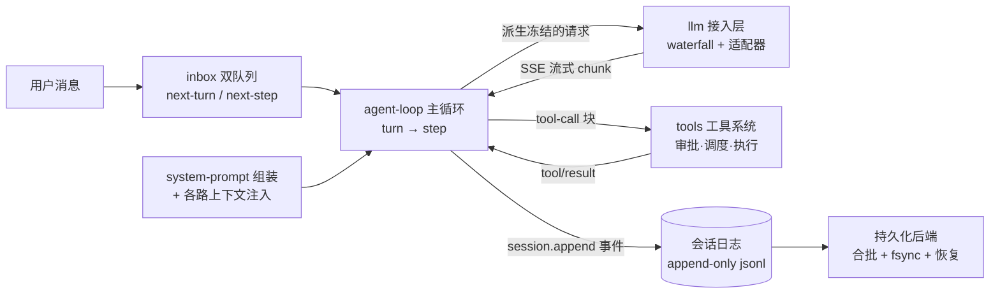
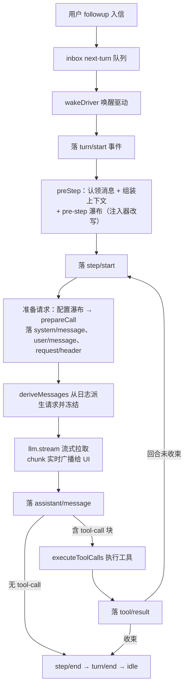
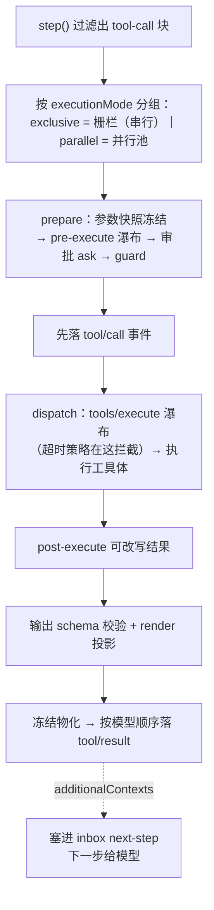
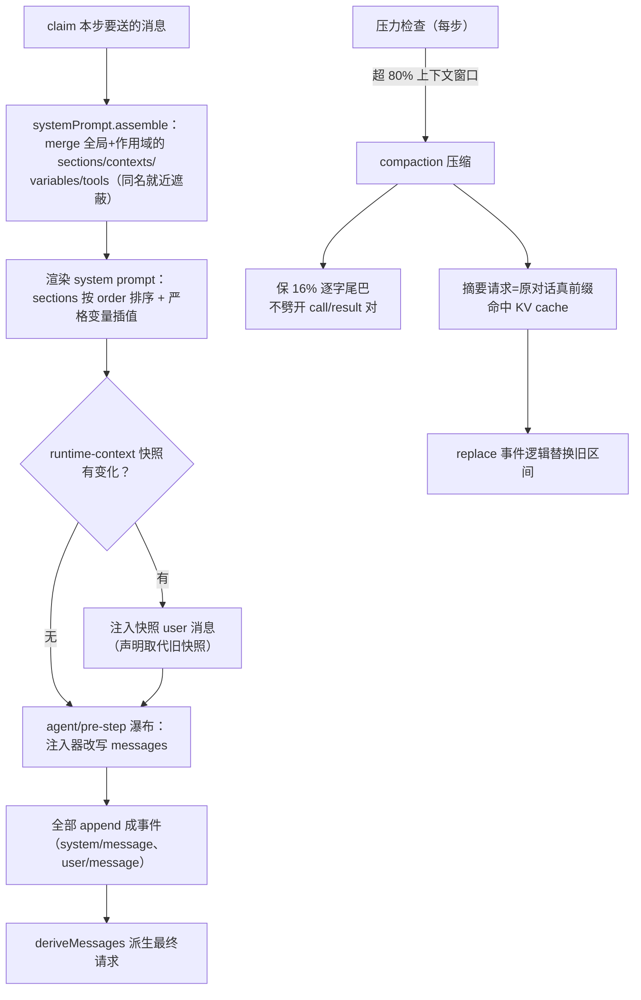
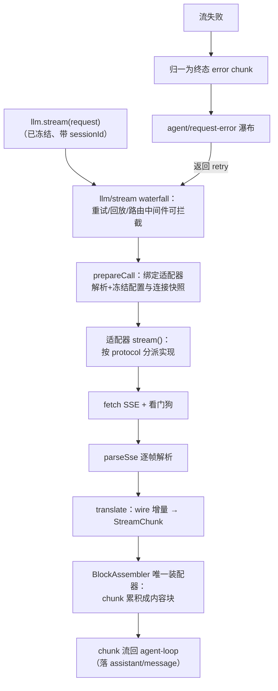
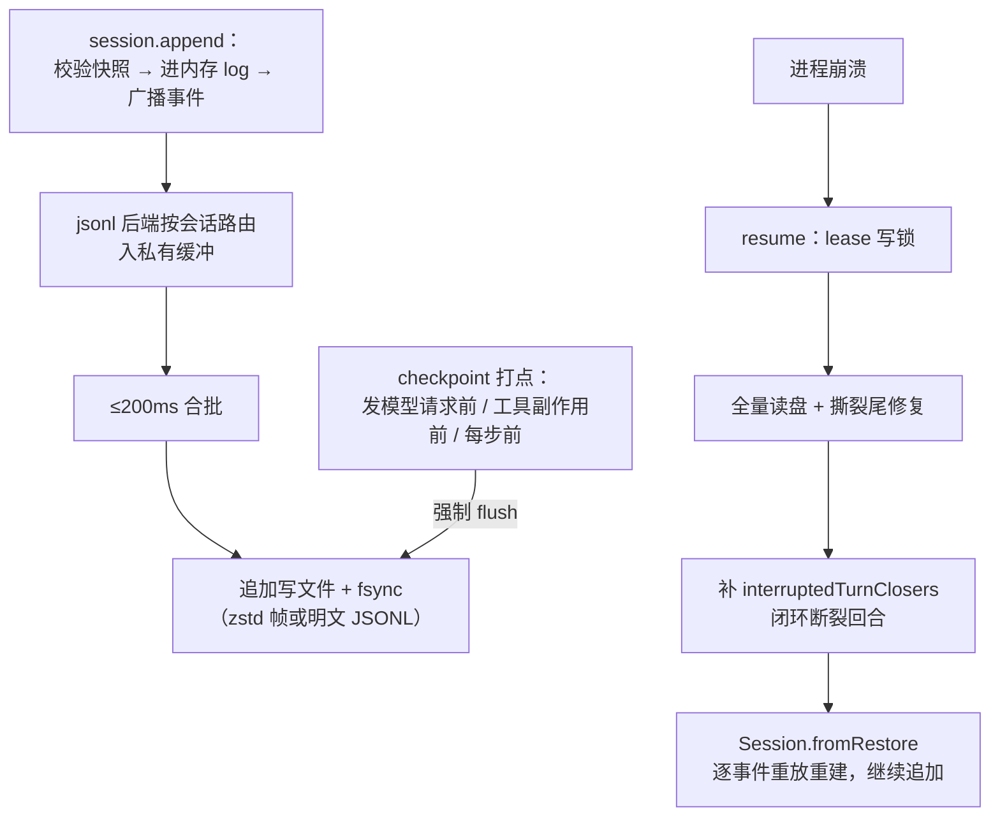

# DeepSeek Harness（dsh）核心实现导读

> 基于版本：`master@ddefc45`（2026-09-17，本文所有 `文件:行号` 锚点以此为准）｜语言：TypeScript（pnpm monorepo）
> 源码目录：`.spec/源码学习/_clones/deepseek-harness`（浅克隆，可对照走读）
> 范围：harness 五大件——主循环、工具系统、上下文组装、模型接入、会话持久化（不含 Cordis 底座与启动装配的展开）

---

## 0. 总览：30 秒建立全局感

**dsh 是什么**：DeepSeek 开源的 agent harness（22.9 万 star）。harness 直译「背带/马具」——就是套在裸 LLM 外面那层工程壳子，让只会输出文本的模型变成能调工具、有会话记忆、崩了能恢复的 agent。

**三个贯穿全域的核心思想**（后面每一章都是它们的变奏）：

1. **日志是唯一真相**：会话里发生的一切（用户消息、模型回复、工具调用、系统提示词、压缩摘要）先写成事件日志，发给模型的请求**永远从日志重新推导**，不从内存状态拼。这叫事件溯源（见前置知识）。
2. **一切皆插件**：模型适配器、工具注册表、agent 循环本身，都是挂在 Cordis 框架上的插件，可被配置替换。核心不写死任何策略。
3. **fail-closed（默认拒绝）**：权限审批、格式解析、沙箱，凡是拿不准的一律拒绝并说清原因——宁可停下来也不默默继续。

### 全域架构总图



一轮对话就是这张图转一圈：消息进 → 组装上下文 → 调模型 → 有工具调用就执行工具再回到调模型 → 没有就收尾 → 全程每一步都落日志。

### 学习动线

| 章 | 一句话 | 核心问题 |
|---|---|---|
| 1 | Agent 主循环 | 一条消息进来，dsh 怎么决定调模型、跑工具、何时停 |
| 2 | 工具系统 | 模型说「调工具 X」之后发生什么，怎么保证安全 |
| 3 | 上下文组装 | 请求发出前，模型看到的完整上下文怎么拼、超长怎么压 |
| 4 | 模型接入层 | 请求怎么变成 HTTP 调用、流式回复怎么累积成消息 |
| 5 | 会话持久化 | 这一切怎么落盘、崩溃后怎么毫发无损地恢复 |

按序读即可；1 是心脏，2/3/4/5 是四个方向的接口面，读完第 6 节端到端串联。

### 前置知识地图（不懂先补，每条 30 秒）

| 概念 | 一句话 | 权威链接 |
|---|---|---|
| Cordis | dsh 的插件框架：插件向共享 context 注册服务、事件和「可逆 effect」（插件卸载时自动回收） | https://github.com/cordiverse/cordis |
| 事件溯源 | 不存「当前状态」，只存「发生过的每个事件」；状态 = 重放全部事件算出来 | https://martinfowler.com/eaaDev/EventSourcing.html |
| SSE | Server-Sent Events：HTTP 长连接上服务器单向推流，LLM API 的主流流式协议 | https://developer.mozilla.org/en-US/docs/Web/API/Server-sent_events |
| AbortController | 可广播的「取消信号」：一个 controller.abort()，所有监听该 signal 的异步操作同时收到取消 | https://developer.mozilla.org/en-US/docs/Web/API/AbortController |
| Object.freeze | 冻结对象，之后任何修改静默失败（严格模式抛错）——dsh 用它保证请求不可变 | https://developer.mozilla.org/en-US/docs/Web/JavaScript/Reference/Global_Objects/Object/freeze |
| JSON Lines | 每行一个独立 JSON 的文本格式，天然支持追加写和逐行重放 | https://jsonlines.org/ |

两个 dsh 自造术语，首现先说清（后面不再解释）：

- **waterfall（瀑布）**：Cordis 的事件链模式——一串监听器依次处理同一个载荷，每个都能改写结果或直接短路，类似中间件洋葱圈。
- **projection（投影）**：从事件日志「折叠」出来的派生状态（fold）。日志变，投影跟着变；投影丢了，重放日志就能重建。

---

## 1. Agent 主循环（心脏）

**本章在全局的位置**：一切的指挥中枢。工具、上下文、模型接入都是它调用的子模块。
**核心问题**：一条用户消息进来后，dsh 怎么决定调模型、跑工具、何时停？

### 前置知识

- **turn 与 step**：dsh 的时间单位。turn（回合）= 一轮用户输入到 agent 收工；step（步）= 回合内一次「调模型 + 执行它要的工具」。一个 turn 包含 1..N 个 step，模型不再要工具时回合结束。

### 主线流程图



### 关键点讲解

#### 1.1 三层循环：kick → turn → step

📍 `packages/core/agent-loop/src/agent.ts:226`（kick）、`:270`（turn）、`:353`（step）

**干什么**：`kick()` 里 `while (await this.turn()) {}` 一口气跑完所有待处理回合；`turn()` 内部 `while(true)` 循环开步；`step()` 完成一次完整的「调模型 + 跑工具」。turn 返回 false 表示没有新工作，驱动收敛回 idle。
**为什么**：三层对应三个可中断粒度（回合/步/请求），取消、注入、恢复都能挂在最合适的层上，互不纠缠。整个 agent-loop 包仅 2469 行，循环本体不到 400 行——复杂度被推给了事件和插件。

#### 1.2 收件箱是日志的投影，不是内存队列

📍 `packages/core/agent-loop/src/inbox.ts:27-56`（投影定义）、`:235`（变更即落事件）

**干什么**：待处理消息分两个队列——`next-turn`（排队等下一回合）和 `next-step`（插进当前回合的下一步）。每次增删改都 append 一条 `agent/inbox/spliced` 事件，队列状态从事件重放得出。
**为什么**：进程崩了，重启重放日志，排队中的消息一条不丢。内存队列做不到这一点。

#### 1.3 三种入信方式：followup / steer / inject

📍 `packages/core/agent-loop/src/agent.ts:137-147`

**干什么**：`followup` 进 next-turn 队列并唤醒（新话题）；`steer` 进 next-step 队列并唤醒（用户中途「纠偏」，模型下一步立刻看到）；`inject` 进 next-step 但不唤醒（静默补充信息）。
**为什么**：把「用户想打断」和「用户想补充」区分开，是 agent 可交互性的关键——不是所有输入都该开新回合。

#### 1.4 日志是唯一事实源：请求从日志派生

📍 `packages/core/agent-loop/src/agent.ts:604`（deriveMessages）、`:611-618`（冻结组装）

**干什么**：发请求前，`session.deriveMessages()` 沿会话日志的「表面」（surface，当前有效消息面）走出 messages 数组，`Object.freeze` 后连同冻结的 header 组成请求。
**为什么**：内存状态可能有 bug，日志不会——只要请求永远从日志推导，重放就能精确复现任何一次历史请求。压缩历史也只需在日志上做逻辑替换（见 3.7），物理文件永不改写。

#### 1.5 有个插件专门校验「请求 = 日志重放」

📍 `packages/core/agent-loop/src/invariant.ts:21-56`

**干什么**：companion 插件挂在 `llm/stream` 上，每次发请求前断言：请求已冻结、带 sessionId、messages 与 `session.deriveMessages()` 逐字节一致、与折叠的 request/header 一致。不一致直接 fail。
**为什么**：把「日志推导 = 实际请求」这条最重要的不变量做成**运行时硬校验**而非口头约定。任何插件改乱了上下文，第一次发请求就会炸出来。

#### 1.6 流式三帧协议：start / chunk / end

📍 `packages/core/agent-loop/src/assistant-stream.ts:49-109`

**干什么**：每次模型尝试包装成 `AssistantStreamAttempt`：`start()` 发开场帧，每收一个 chunk 广播一帧（UI 实时渲染），落盘事件提交成功后才发 `end` 帧（带落盘 seq）。
**为什么**：UI 永远知道「这段流是否已安全落盘」——end 帧没来，刷新页面也不会丢内容。

#### 1.7 中断也落盘：半截回答保存为 interrupted

📍 `packages/core/agent-loop/src/agent.ts:403-431`

**干什么**：流被取消时，把已收到的可见前缀（`interruptedBlocks()`，组装器保证语法完整）作为一条带 `interrupted: true` 的 assistant/message 落盘；连一个完整块都没有就落 `assistant/attempt`（失败尝试，不留表面）。
**为什么**：用户按 ESC 中断，已生成的一半内容不丢，且历史对模型仍然合法。

#### 1.8 崩溃恢复：合成收尾事件补闭环

📍 `packages/core/agent-loop/src/index.ts:904-915`（resume 主线）、`:907`（interruptedTurnClosers）

**干什么**：resume 时先抢写锁、全量读日志，找出「turn/start 有但 turn/end 没有」的断裂处，合成缺失的工具错误结果、step/end、turn/end 补上，再用完整事件流作种子重建会话。
**为什么**：日志必须永远是合法序列——补完闭环，重放、计费、UI 回放才都正确。恢复逻辑不用「特殊状态标记」，就是普通事件。

#### 1.9 生命周期：三路取消信号融合

📍 `packages/core/agent-loop/src/index.ts:559-567`（abort 融合）、`:578-623`（反向拆解）

**干什么**：每个 agent 的创建期把三个取消源（调用方 signal、宿主 fiber 卸载、工厂 teardown）融合进一个 AbortController；拆解（dispose）是反向的：先停机 → 等空闲 → 关写句柄（排干落盘）→ 离开注册表——注册在任何资源存在**之前**，所以中途卸载也能完整回滚。
**为什么**：agent 的死法很多（用户取消/插件热更/程序退出），统一成一条拆卸路径，才不会泄漏半死的 agent。

**一句话收束**：主循环把「agent」做成了**日志上的确定性状态机**——醒来、开回合、开步、派生请求、流式落盘、执行工具、收尾，每一步都是一个事件；下一章看它把工具执行外包给谁。

---

## 2. 工具系统（主循环的手脚）

**本章在全局的位置**：主循环 `step()` 里那句 `executeToolCalls`（`agent.ts:489`）的全部下游。
**核心问题**：模型返回「调工具 X」之后发生什么？怎么既高效又安全？

### 前置知识

- **fail-closed**：安全原则——任何环节拿不准（没审批服务、异常、超时），一律按「拒绝」处理，绝不默认放行。
- **tool-call 块**：模型回复里 `type: 'tool-call'` 的内容块，带工具名 + JSON 字符串参数；dsh 执行后把结果作为 tool-result 消息回填。

### 主线流程图



### 关键点讲解

#### 2.1 四段调度接口：prepare / dispatch / finalize / finish

📍 `packages/core/tools/src/index.ts:798-803`（调度器暴露）、`packages/core/agent-loop/src/tool-calls.ts:170-174`（循环侧消费）

**干什么**：工具注册表把一次执行拆成四段：prepare（前置：审批、权限）、dispatch（执行体）、finalize（后置改写）、finish（物化广播）。前置后置**按模型顺序**，执行体可**并行重叠**。
**为什么**：并行加速的同时保证落日志顺序 = 模型看到的顺序——乱序执行，有序提交。

#### 2.2 调度：独占栅栏 vs 有界并行池

📍 `packages/core/agent-loop/src/tool-calls.ts:85-101`

**干什么**：每个工具声明 `isConcurrencySafe`。不安全的（如写文件）一个一个跑（栅栏）；安全的进池并发，上限 `maxParallelToolCalls`（默认值见 `constants.ts`，可热更，下一组生效）。
**为什么**：读类工具并行提速、写类工具保序防打架，两类语义一个调度器全覆盖。

#### 2.3 取消时给未启动的调用补合成错误

📍 `packages/core/agent-loop/src/tool-calls.ts:238-242`、`:250-260`

**干什么**：回合被取消时，已启动的等它落结果；没启动的直接落「aborted before dispatch」的合成错误结果。
**为什么**：模型发的 tool-call 必须每个都有 result，历史才合法、才能重放。合成结果让取消永远产出完整日志。

#### 2.4 权限只能收紧：单调 guard

📍 `packages/core/tools/src/index.ts:713`（guard 类型）、`:1496`（调用点）

**干什么**：guard 回调的返回类型只有 `string | undefined`——要么给出拒绝理由，要么沉默。**没有「允许」这个返回值**。
**为什么**：类型形状上杜绝「后挂的监听器把前面否决翻回允许」。安全靠代数性质而非文档约定。

#### 2.5 审批是可选接缝，但缺了就拒绝

📍 `packages/core/tools/src/index.ts:1702-1707`（机会式获取）、`packages/interaction/user-approval/src/index.ts:208-277`（fail-closed 审批服务）

**干什么**：工具要用户批准时走 `ctx.get('approval')`——没装审批服务就降级为拒绝。审批服务自身也是 fail-closed：问之前先落 `approval/asked` 事件，任何异常/超时/未知返回值都收敛为拒绝并落 `approval/decided`。
**为什么**：核心不依赖审批，但安全默认值永远是「不」。且审批记录是事件，回放可见。

#### 2.6 超时、重复提醒都是外挂插件，注册表零策略

📍 `packages/guard/timeout-policy/src/index.ts:56-78`（超时）、`packages/guard/repeat-tool-reminder/src/index.ts:213`（重复提醒）

**干什么**：超时插件挂 `tools/execute`，临时把 `exec.signal` 换成带 deadline 的信号，超时改写为 `TOOL_TIMEOUT` 结果；重复提醒挂 `tools/post-execute`，发现模型连续重复同参调用就注入提醒上下文（参数深排序做键，键序不同也命中）。
**为什么**：策略全部是插件，核心流水线稳定可测；提醒是 advisory（不否决），避免把模型卡死。

#### 2.7 三重冻结：谁也别想改结果

📍 `packages/core/tools/src/index.ts:1423`（参数）、`:1856-1871`（结果物化）、`:1669`（exec 对象）

**干什么**：工具参数 `deepFreeze`、最终结果快照深冻、执行上下文 `Object.freeze` 之后才给任何观察者。
**为什么**：杜绝「插件偷改工具结果」的通道，也杜绝结果对象在异步流转中被意外 mutate。

#### 2.8 错误即导航：拒绝要说清怎么改

📍 `packages/core/tools/src/index.ts:1443-1450`（PTC 塌缩拒绝文案）、`packages/sandbox/sandbox/src/escalation.ts:71-86`（沙箱升级提示）

**干什么**：PTC 模式（模型只见 `run_code` 一个工具）下模型直呼其他工具，拒绝消息自带修正路由："call it from inside a run_code program"；bash 沙箱拒绝输出结构化标记并给出同回合升级审批入口。
**为什么**：让模型每次被拒都知道下一步怎么走，而不是瞎猜重试。

**一句话收束**：工具系统 = 「五段事件化流水线（pre-execute/execute/post-execute/…全部是事件）+ 只紧不松的权限代数 + 事件化的调用与结果」。下一章看模型听到的「世界」是怎么拼出来的。

---

## 3. 上下文组装（主循环的燃料）

**本章在全局的位置**：主循环每一步发请求前，`preStep()` 里那两句 `systemPrompt.assemble` + pre-step 瀑布（`agent.ts:246-256`）的全部下游。
**核心问题**：请求发出前，模型看到的完整上下文怎么拼出来？超长了怎么压？

### 前置知识

- **system prompt**：对话里的第一条系统消息，定义 agent 的身份、规则、可用工具。dsh 里它是**插件拼出来的**，不是写死的一段文本。
- **KV cache**：LLM 服务端的加速机制——请求前缀与上次相同时，前缀部分不用重算。**摘要请求复用原对话前缀 = 摘要几乎免费**，这是本章最妙的一招。

### 主线流程图



### 关键点讲解

#### 3.1 双通道注入：注册式 vs 消息式

📍 `packages/core/system-prompt/src/index.ts:455,490,522,538`（注册式四接口）、`packages/core/agent-loop/src/agent.ts:250`（消息式瀑布）

**干什么**：静态或每步重算的内容（身份、工具清单）走 `ctx.systemPrompt.section/context/tools/variable` 注册进 system prompt；消息型内容（时间读数、文件引用、tmux 状态）走 `agent/pre-step` 瀑布，作为独立 user 消息注入、带来源可溯源。
**为什么**：两种内容生命周期不同——system prompt 是「模型的世界观」，注入消息是「当下的事实」，混在一起就没法分别管理。

#### 3.2 注入器去重：没变化就不打扰

📍 `packages/context/time-context/src/index.ts:153-179`、`packages/core/agent-loop/src/runtime-context.ts:147-158`

**干什么**：runtime-context 快照只在文本**变化**时才注入新消息，且开头声明 "supersedes earlier snapshots"；时间/tmux 注入器用投影折叠出上次注入值，相同则跳过。
**为什么**：防止历史被时间戳这类噪音刷屏，白烧上下文窗口。

#### 3.3 段顺序集中分槽，插件领号入座

📍 `packages/core/system-prompt/src/index.ts:125-160`（SECTION_ORDERS：身份 -1000 → 工具段 1000-3000 → MCP 3100 → …）

**干什么**：system prompt 的段落顺序用集中常量分槽，插件按 `getSectionOrder('FILE_REFERENCE')` 领号。
**为什么**：多个插件各写各的段，顺序不打架；漂移在编译期暴露而不是 prompt 里悄悄变。

#### 3.4 变量插值严格模式：坏 prompt 组装期就炸

📍 `packages/core/system-prompt/src/index.ts:326-363`

**干什么**：`{{var}}` 插值遇到未知变量或空值直接 throw，绝不静默留空。
**为什么**：坏 prompt 在组装期爆炸，远好过在模型行为期表现为「模型怎么突然变傻了」。

#### 3.5 compaction 三个触发器

📍 `packages/compaction/compaction-basic/src/index.ts:144-162`（步间压力）、`:176-220`（溢出恢复）、`packages/compaction/command-compact/src/index.ts:67`（手动）

**干什么**：① 每步开始前检查，估算用量超 `thresholdRatio(默认0.8) × contextWindow` 就压；② 请求报 `CONTEXT_WINDOW_EXCEEDED` 就强制压（retainTokens=0）并返回 `{kind:'retry'}` 重发；③ 用户手动 `/compact`（只在空闲时执行）。
**为什么**：预防 + 兜底 + 手动三层，覆盖「预估失准」「突发大注入」「用户主动」三种场景。

#### 3.6 压缩区间选取：不劈开工具对

📍 `packages/compaction/compaction-basic/src/region.ts:118-156`（选区）、`:338-358`（配对平衡）

**干什么**：从尾部保 `retainRatio(默认0.16)` 的逐字历史，压缩前面的区间；区间边界必须「tool-call/tool-result 配对平衡」，且永不包含 system 头。
**为什么**：把模型的 tool-call 和它的 result 劈到压缩区两侧，重放时就是非法历史。

#### 3.7 压缩是事件事务：start/summary/end + 逻辑替换

📍 `packages/compaction/compaction-basic/src/region.ts:174-277`、`:309-321`（事件即锁）、`:507-510`（replace）

**干什么**：先落 `compaction/start`（未配对的 start 就是「已在压缩中」的锁，崩溃后重扫日志仍可识别）→ 异步摘要（带稳定性断言防并发写入）→ `compaction/summary` + 一条带 `surfaceOp:{op:'replace'}` 的替换消息 + `compaction/end`。物理日志 append-only，旧内容只是被 surface 替换掉。
**为什么**：并发安全不靠内存互斥锁，靠日志本身——重放永远看得到「这里发生过压缩」。

#### 3.8 摘要请求 = 原对话真前缀，命中 KV cache

📍 `packages/compaction/compaction-basic/src/summarizer.ts:24-30,119-179`

**干什么**：摘要调用不用独立的 summarizer system prompt，而是复用原对话的 system+tools+被压消息作前缀，把结构化压缩指令（Primary Request/Files/Errors/Pending/Next Step 八节）作为最后一条 user 消息追加。
**为什么**：摘要请求是原请求的真前缀，前缀 KV cache 全命中——一次「上下文手术」几乎不额外付前缀计费和延迟。

**一句话收束**：上下文组装的纪律是「**先落事件、再派生请求**」——system prompt、快照、注入、压缩摘要全部先变成日志事件，请求永远从 surface 单向派生。下一章跟着请求走进模型接入层。

---

## 4. 模型接入层（主循环对接模型的一侧）

**本章在全局的位置**：主循环那句 `preparedCall.stream(request) ?? llm.stream(request)`（`agent.ts:391`）的全部下游。
**核心问题**：一个冻结的请求对象，怎么变成具体的 HTTP 调用？流式回复怎么变成规范消息？

### 前置知识

- **SSE 帧**：模型 API 的流式响应格式——一串 `data: {...}` 文本帧，`data: [DONE]` 结尾。每帧是一个 JSON 增量（文本片段、工具参数片段、用量…）。
- **适配器（adapter）模式**：定义统一接口，每个模型厂商一个实现。dsh 里新接一个 provider **只需要实现一个 `stream()` 方法**。

### 主线流程图



### 关键点讲解

#### 4.1 `llm/stream` waterfall：重试和路由都是普通中间件

📍 `packages/llm/llm/src/index.ts:1118`

**干什么**：每次模型调用都过一遍 `llm/stream` 瀑布，默认末端是适配器执行；任何插件都能拦截——`next()` 透传，或直接短路返回自己的流。
**为什么**：核心路径零特判。回放（复现历史）、限流、路由全是平等插件。

#### 4.2 适配器契约小到极致：只需实现 `stream()`

📍 `packages/llm/llm/src/index.ts:284`（唯一抽象方法）、`packages/llm/llm-deepseek/src/index.ts:133`（注册）

**干什么**：`LlmAdapter` 唯一必须实现的是 `abstract stream(options): AsyncIterable<StreamChunk>`；其余（列模型、重试策略、定价）全可选。DeepSeek 实现按 `connection.protocol` 再分派 `messages`（默认）/`chat-completions` 两个协议适配器。
**为什么**：接新 provider 的成本 = 翻译一种 wire 格式。SSE 解析、块装配、usage 映射全部复用。

#### 4.3 配置代际冻结：热更不能把新 key 发到旧端点

📍 `packages/llm/llm/src/index.ts:920-966`（prepareCall）、`packages/llm/llm-deepseek/src/protocols/chat-completions/adapter.ts:170-203`（连接快照）

**干什么**：`prepareCall` 一次性解析配置并深冻结，绑定「注册代」；每次流调用再冻结一份连接快照，API key 从同一份快照解析。
**为什么**：设置热更（HMR）期间，被拒的旧配置代不可能把新 key 发到旧端点——配置一致性靠不可变性。

#### 4.4 工具参数增量累积：按 index 建块、推迟收尾

📍 `packages/llm/llm-deepseek/src/protocols/chat-completions/translate.ts:115-195`

**干什么**：chat-completions 协议里工具参数是逐片 JSON 字符串，翻译层按 wire `index` 建 `OpenBlock`，`text += fragment` 累积原始串；id/name 只认首个非空值；block-end/usage/finish 全部推迟到 `[DONE]` 统一吐出。
**为什么**：参数 JSON 只有拼完才能解析，中途解析必炸。规范消息只在一个地方诞生。

#### 4.5 全系统唯一的块装配器

📍 `packages/llm/llm/src/assembler.ts:38`（BlockAssembler）、`:135-149`（max-tokens 剪枝）

**干什么**：`StreamChunk → ContentBlock` 的算法只有一份：UI 实时渲染、会话日志回放、token 估算共用。max-tokens 截断时丢弃不完整的 tool-call 块并同步修剪回放信封。
**为什么**：截断的工具调用不可安全执行，「保留半个 tool-call 骗过执行器」是真实事故模式。

#### 4.6 重试 = 注册期冻结的数据 + 独立执行插件 + 事件先行

📍 `packages/llm/llm/src/retry-policy.ts:18-24`（策略是数据：默认重试码 EMPTY/RATE_LIMIT/SERVER/TIMEOUT/TRANSPORT，AUTH/QUOTA 不重试）、`packages/llm/llm-retry/src/index.ts:243`（挂 agent/request-error）、`:188-190`（先落 `llm/retry` 事件再等待）

**干什么**：重试策略随适配器注册被捕获冻结；执行器是独立插件，挂在主循环的失败扩展点上；每次重试**先落事件再等待**，重试计数持久化在会话投影里。
**为什么**：进程重启后重试计数仍在、语义仍对；不装这个插件可换成任何自定义恢复策略。

#### 4.7 退避算法：指数 + 对称抖动 + 尊重 retry-after

📍 `packages/llm/llm-retry/src/index.ts:59-64,227-238`

**干什么**：`min(initial × 2^n, max) × 抖动`，默认 5 次、500ms 起、10s 封顶；服务端给了 `retry-after` 就优先采用，超出封顶则放弃。
**为什么**：抖动防止惊群（一堆客户端同一毫秒重试）；尊重服务端节流信号是礼貌也是效率。

#### 4.8 token 计量靠日志重放，不碰网络路径

📍 `packages/llm/token-meter/src/index.ts:146-171`

**干什么**：计量服务订阅 `session/event`，从落盘的 `assistant/message.usage` 折叠用量与上下文压力；provider 上报的 usage 只有在不低于全量启发式估计时才采信。
**为什么**：任意时点可复算、可审计；「估算永不低于真实」保证预算判断保守。

#### 4.9 看门狗：卡死连接归一为可重试的 TIMEOUT

📍 `packages/llm/llm-deepseek/src/protocols/chat-completions/adapter.ts:203-216`

**干什么**：每次流读取包一层空闲看门狗（默认 5 分钟），超时归一为 `TIMEOUT` 错误码——恰好在默认可重试码列表里。
**为什么**：挂死的连接和明确的失败要能走同一条恢复路径。

**一句话收束**：模型接入层的答案是「**中性流协议 + 单一装配器**」——适配器只做翻译，chunk 到消息只有一种算法，错误全是数据。最后一章看这一切怎么安全落盘。

---

## 5. 会话持久化（一轮对话的归宿）

**本章在全局的位置**：前四章每一次 `session.append` 的最终去向。
**核心问题**：高吞吐的事件流怎么低成本落盘？崩溃后怎么毫发无损地恢复？

### 前置知识

- **fsync**：操作系统把写缓冲真正刷到磁盘的系统调用。不做 fsync，「写入成功」可能只是进了内存——掉电就没。
- **append-only（追加写）**：文件只往后加行、永不改写已有内容。崩溃时最坏丢最后一行，不会损坏中间。

### 主线流程图



### 关键点讲解

#### 5.1 append 尽力而为，flush 是唯一持久化承诺

📍 `packages/session/session-persistence/src/handle.ts:87-109`（接口契约）、`packages/session/session-persistence-jsonl/src/storage.ts:274-319`（200ms 合批）

**干什么**：接口上 `append` 允许后端缓冲（实际实现是 structuredClone 入私有缓冲，≤200ms 合批一次 fsync）；只有 `flush` 是崩溃屏障。
**为什么**：热路径零等待，fsync 的成本只在语义边界付——「在哪同步」从硬编码变成策略。

#### 5.2 三个 checkpoint：崩溃永远断在安全边界

📍 `packages/session/session-checkpoint-policy/src/index.ts:63-83`

**干什么**：在三个语义边界强制 flush——发模型请求前（保证请求前缀已落盘，失败则不放行）、顶层工具副作用前、每步开始前。
**为什么**：崩溃后日志恰好断在「请求前/副作用前」这类可安全续跑的位置，配合合成收尾事件（1.8），恢复就是确定性重放。

#### 5.3 单 handle promise 链：免锁的顺序保证

📍 `packages/session/session-persistence-jsonl/src/storage.ts:357-370`

**干什么**：每个会话句柄一条 promise 链，所有变更排入单链串行执行（append、flush、close 全走它）。
**为什么**：落盘顺序 = 事件 seq 顺序是正确性前提，单链天然免锁，比互斥锁简单且不会饿死。

#### 5.4 撕裂尾自愈：崩溃留下的半行不致命

📍 读侧 `packages/session/session-persistence-jsonl/src/index.ts:726-741`（明文）、写侧 `storage.ts:328-337`

**干什么**：读盘时发现最后半行 JSON 不完整（或 zstd 帧校验失败），标出 `tornTruncateTo` + 尽力恢复的完整尾部；写侧第一次追加前先 truncate 再重写恢复的事件。
**为什么**：append-only + fsync 已经把坏情况压到「最后一行撕裂」，撕裂自愈让这个坏情况也不致命、不重复。

#### 5.5 跨进程内核锁，故意无超时

📍 `packages/session/session-persistence-jsonl/src/lease.ts:1-39`

**干什么**：写打开时拿内核级锁（POSIX flock + 锁 inode 复核；Windows 命名信号量），进程死亡内核自动释放；**故意不设超时**。
**为什么**：被抢占的僵死写者若被超时踢掉后继续追加，会把日志撕开。宁可等，不可抢。

#### 5.6 格式迁移 v0→v3：链式编译 + 原子发布

📍 `packages/session/session-format/src/chain.ts:41-77`（只接受相邻版本链）、`packages/session/session-persistence-jsonl/src/generation.ts:881-940`（发布事务）

**干什么**：版本迁移只允许 v0→v1→v2→v3 严格相邻的链，启动时校验链完整；读旧文件先「准备迁移」不写盘，写打开才发布：临时文件 + fsync → worker 里全量校验（sha256 + 重放验证）→ 比对源文件身份 → `link()` 独占发布（已存在即有赢家）。
**为什么**：升级路径和崩溃安全共用同一套机制，任一环节失败源文件毫发无损；未来版本的文件直接拒绝（fail-closed），绝不误报损坏。

#### 5.7 未知事件词表：整体拒读

📍 `packages/session/session-persistence/src/storage-contract.ts:75-80`

**干什么**：读到未知事件类型且未标 `ignorable`，整个会话拒绝加载。
**为什么**：静默丢事件会重建出「看起来正常其实错了」的会话——那比打不开糟糕得多。

#### 5.8 惰性物化 + link 原子发布

📍 `packages/session/session-persistence-jsonl/src/index.ts:1098`（首批写入才物化）、`:1132-1137`（link 而非 rename）

**干什么**：`create` 之后零磁盘足迹，首批事件到达才真正建文件；发布用 `link()`——EEXIST 说明有并发赢家，按字节比对后接受。
**为什么**：建了就扔的空会话不产生磁盘垃圾；rename 会静默覆盖，link 让并发物化互不践踏。

**一句话收束**：持久化的哲学和主循环一脉相承——**事件先行、fsync 是策略、崩溃恢复靠重放不靠运气**。

---

## 补遗：审计回填（工具规模治理 / 记忆 / Multi-Agent）

> 2026-09-18 二次审计发现的三处遗漏，回源码核实后补齐。

#### A. 工具规模治理：PTC 模式把全部工具塌缩成一个 `run_code`

📍 `packages/core/tools/src/index.ts:988`（wireSchemas）、`:1002-1007`（ptc 只发 run_code）、`:1262-1266`（schemaOf 白名单投影）

**干什么**：native 模式把全部工具 schema 发给模型；ptc 模式**只发 `run_code` 一个工具**，其余工具在代码里调用；且发给模型的 schema 经 `schemaOf` 白名单投影——只有 name/description/parameters，timeoutMs 与回调永不外发。
**为什么**：工具一多，schema 本身就挤占上下文且稀释模型注意力——「把工具清单折叠成一门可编程语言」是工具规模的终极压缩；白名单投影保证模型的注意力只花在决策所需字段上。

#### B. 记忆：跨会话快照引用（session-reference）

📍 `packages/context/session-reference/src/index.ts:1-3`（模块注释）

**干什么**：跨会话快照准备服务——宿主把会话提及（mention）适配为结构化引用，本服务负责精确读取、投影、预算控制与持久上下文（深读笔记：`session-reference/src/index.ts:154-178` 把 `@session` 引用的跨会话快照紧跟引用消息注入）。
**为什么**：dsh 没有独立记忆库——「记忆」= 用引用语法把**别的会话的快照**按需拉进当前上下文，持久化与预算控制复用同一套会话基建。

#### C. Multi-Agent：subagent 是一个 11 包的完整域

📍 `packages/subagent/`（域目录）、`packages/subagent/subagent/README.md:1-3`（"The subagent delegation seam… choosing a provider backend, composing delegation tools, or debugging child-agent runs"）

**干什么**：子代理委托缝（delegation seam）按后端分族：subagent-acp、**subagent-claude-code**、**subagent-codex**（把别家 agent 当子代理）、subagent-dsh-sdk（本仓自调用）、subagent-fork-in-process / subagent-spawn-in-process / subagent-in-process-driver（进程内 fork vs spawn 两种托管方式）、tool-subagent / tool-subagent-control（把「派子代理」暴露为工具）。
**为什么**：「多代理」的本质是**托管策略 × 后端协议**两个正交维度——dsh 把每个组合做成独立可插拔包，父 agent 经 tool-subagent 以工具形式派发子任务。

## 6. 全景回顾：一条消息的一生

五域读完，把一条消息从敲进终端到重启恢复完整走一遍：

```mermaid
sequenceDiagram
  participant U as 用户
  participant LOOP as 主循环
  participant CTX as 上下文组装
  participant LLM as 模型接入
  participant TOOL as 工具系统
  participant LOG as 会话日志
  U->>LOG: followup → inbox 落事件
  LOG-->>LOOP: 投影变化唤醒驱动
  LOOP->>CTX: 组装 system prompt + 快照 + 注入
  CTX->>LOG: 落 system/message、user/message
  LOOP->>LOG: deriveMessages 派生冻结请求
  LOG-->>LLM: llm/stream → 适配器 fetch SSE
  LLM-->>LOG: chunk 流 → 落 assistant/message
  LOOP->>TOOL: tool-call 块 → 审批/执行
  TOOL->>LOG: tool/call、tool/result（模型序）
  LOG-->>CTX: 压力超限？→ compaction（replace 事件）
  LOOP-->>U: 无更多 tool-call → turn/end → idle
  Note over LOG: 全程 append-only；崩溃后 lease→读盘→补闭环→重放恢复
```

### 值得偷学的五个决策

1. **请求从日志派生 + 运行时不变量校验**（`invariant.ts`）——「唯一真相源」不是口号，是每次请求前逐字节比对的断言。
2. **权限只能收紧的类型形状**（guard 无 allow 返回值 + 审批 fail-closed 全链）——安全性用类型代数表达，不靠 review 自觉。
3. **摘要请求复用原对话前缀**（`summarizer.ts`）——把昂贵的辅助调用设计成主调用的真前缀，KV cache 免费送。
4. **append 尽力而为 / flush 唯一承诺 + 语义边界 checkpoint**——持久化正确性从「每次都同步」变成「在哪同步是策略」。
5. **错误即导航**——拒绝消息永远附带「下一步该怎么改」，无论收件人是模型还是用户。

### 断点建议（想亲手调试时）

- 主循环起步：`packages/core/agent-loop/src/agent.ts:353`（step 入口），观察 turn/step 事件怎么落
- 一次完整请求：`agent.ts:604-618`（deriveMessages + 冻结），对照 invariant 断言
- 工具调度：`packages/core/agent-loop/src/tool-calls.ts:122`（runGroup），看并行池怎么保模型序
- 压缩事务：`packages/compaction/compaction-basic/src/region.ts:174`，打日志观察 start/summary/end 事件对
- 崩溃恢复：`packages/core/agent-loop/src/index.ts:894-916`，kill 进程后 resume 看补闭环
