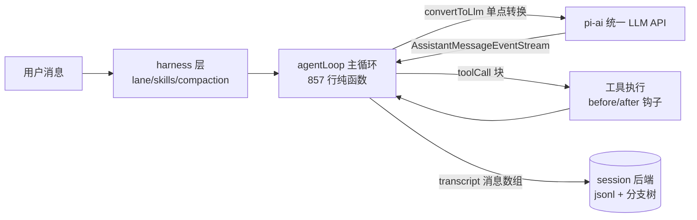
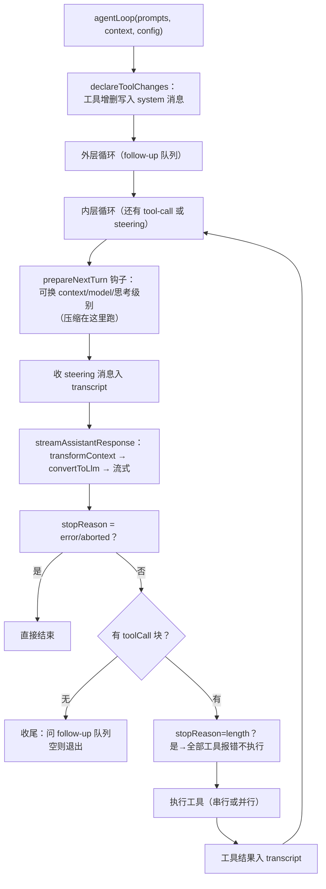

# pi（earendil-works/pi）harness 实现导读

> 基于版本：`main@e4ce7b4`（2026-09-18，锚点以此为准）｜语言：TypeScript｜10.7 万 star
> 源码目录：`.spec/源码学习/_clones/pi`（浅克隆）
> 定位一句话：极简主义 agent 工具箱——统一 LLM API（pi-ai）+ 857 行的 agent 主循环 + coding agent 壳，Everything is a library, not a framework。

---

## 0. 总览

pi 是 Mario Zechner（libGDX 作者）的 agent 项目，走的是与 dsh「重插件化」完全相反的路线：**没有插件系统、没有事件总线、没有服务注册表**——主循环就是一个纯函数 + 一组可注入的回调配置（`AgentLoopConfig`），谁想改行为就传函数进来。

### 包结构（harness 相关）

| 包 | 职责 |
|---|---|
| `packages/agent` | 核心：`agent-loop.ts`（主循环）+ `harness/`（上层封装：压缩/会话分支/skills）|
| `packages/ai` | 统一 LLM API：多 provider、自动 auth、流式、工具调用规范化、跨 provider 中途切换 |
| `packages/coding-agent` | coding agent 壳（内置工具、TUI 集成） |
| `packages/session-backends` | 会话存储后端 |
| `packages/durable` | 持久执行/重放 |

### 架构总图

### 学习动线

| 章 | 一句话 |
|---|---|
| 1 | 主循环：双层 while + 回调配置，857 行讲完一个 agent |
| 2 | 工具系统：接口极简，钩子即权限 |
| 3 | 上下文：transcript 即状态，工具增删都写进 system 消息 |
| 4 | 模型接入：pi-ai 统一 API 的三个契约 |
| 5 | 会话：Entry 分支树 + jsonl 后端 + durable 重放 |

---

## 1. agent 主循环

**核心问题**：一条消息进来，循环怎么转、何时停？

### 前置知识

- **transcript**：会话的完整消息数组。pi 里 system prompt、工具声明都是 transcript 里的 system 消息——**没有独立的 prompt/tools 字段**。
- **steering**：agent 干活时用户插话。pi 分两级：steering（当前轮注入，不打断）和 follow-up（agent 快停时才注入）。

### 主线流程图

### 关键点

#### 1.1 主循环是纯函数，行为全靠配置注入

📍 `packages/agent/src/agent-loop.ts:37`（入口 agentLoop）、`:162`（runLoop 主体）

**干什么**：`agentLoop(prompts, context, config, signal, streamFn)` 返回一个 `EventStream<AgentEvent, AgentMessage[]>`；循环内部没有任何全局状态或注册表，所有扩展点（convertToLlm / transformContext / beforeToolCall / prepareNextTurn / getSteeringMessages…）都是 `AgentLoopConfig` 上的可选回调（定义在 `packages/agent/src/types.ts:156-301`）。
**为什么**：库优先（library not framework）——嵌入方不需要理解插件生命周期，改行为 = 传一个函数。857 行讲完整个 agent 循环。

#### 1.2 双层循环：内层跑工具与插话，外层接续追问

📍 `packages/agent/src/agent-loop.ts:177`（外层 while）、`:181`（内层 while）

**干什么**：内层 `while (hasMoreToolCalls || pendingMessages.length > 0)` 处理工具链和 steering；内层自然退出（模型不再要工具）后，外层问 `getFollowUpMessages()`，有排队消息就继续，没有才真正结束。
**为什么**：steering（干活着时插话）和 follow-up（干完活追问）是两种用户意图，分两个队列两个注入时机，互不抢跑。

#### 1.3 工具增删写进 transcript：模型自己知道装备变了

📍 `packages/agent/src/agent-loop.ts:291-321`（declareToolChanges）

**干什么**：每次请求前对比「transcript 已声明的工具集」与「当前可执行工具集」，差异以 `toolsAdded/toolsRemoved` 字段写入一条 system 消息插到待发消息前面。
**为什么**：工具状态变化成为对话历史的一部分——重放 transcript 永远得到一致的工具集，模型也明确被告知「你现在多了/少了什么工具」，不用猜。

#### 1.4 截断消息里的工具调用全部判死

📍 `packages/agent/src/agent-loop.ts:236-239`、`:434-459`（failToolCallsFromTruncatedMessage）

**干什么**：`stopReason === "length"`（输出被 token 上限截断）时，这条消息里所有 tool-call 一律不执行，逐个返回错误结果让模型重新发起（错误文案明说「参数可能被截断，请重发完整调用」）。
**为什么**：流式工具参数有「尽力 JSON 修复」——截断的参数可能**恰好解析成功但内容不完整**，静默执行比报错危险得多。与 dsh 装配器的 max-tokens 剪枝异曲同工，但 pi 更激进：整批作废。

#### 1.5 流式消息即状态：partial 原地替换

📍 `packages/agent/src/agent-loop.ts:370-411`

**干什么**：流开始就把 partial assistant 消息 push 进 `context.messages`，每个 delta 事件原地替换最后一条，结束时替换为最终消息；期间随时 emit `message_update`。
**为什么**：UI 与 transcript 共享同一对象引用，零拷贝同步；且崩溃时 transcript 里天然留有「最后那个 partial」，恢复逻辑有据可查。

#### 1.6 事件协议：agent_end 携带全部新消息收束

📍 `packages/agent/src/agent-loop.ts:152-157`（createAgentStream）

**干什么**：`EventStream` 以 `agent_end` 事件为终点，该事件携带本次运行新增的全部消息数组，同时是 stream 的最终返回值。
**为什么**：事件流（给 UI）与结果（给调用方）一条通道，await stream 即得结果，不用两套 API。

---

## 2. 工具系统

**核心问题**：工具怎么定义、执行、拦截？

### 关键点

#### 2.1 AgentTool 接口：一个 execute + 声明式元数据

📍 `packages/agent/src/types.ts:406-431`

**干什么**：工具 = TypeBox schema（参数）+ `execute(toolCallId, params, signal, onUpdate)`（抛异常即错误，不把错误编码进 content）+ 可选 `executionMode`（sequential/parallel 单工具覆盖）+ 可选 `replay: "never" | "safe"`（durable 重放策略）。
**为什么**：接口越小越容易被嵌入方正确实现；`onUpdate` 回调让工具自己流式上报部分结果（TUI 里的进度条就靠它）。

#### 2.2 beforeToolCall / afterToolCall：钩子即权限系统

📍 `packages/agent/src/agent-loop.ts:681-709`（before）、`:786-813`（after）

**干什么**：执行前钩子返回 `{block: true, reason}` 即拦截（循环自动产生错误结果）；执行后钩子可整体替换 content/details/isError/terminate（字段级覆盖，无深合并）。
**为什么**：pi 不做审批框架——审批/日志/改写全是一个回调的事，嵌入方自己组合（coding-agent 层才实现真正的权限 UI）。

#### 2.3 并行工具：准备有序、执行并发、结果保序

📍 `packages/agent/src/agent-loop.ts:542-616`（executeToolCallsParallel）

**干什么**：逐个 prepare（校验 + before 钩子）后，允许的工具并发执行（`Promise.all` 天然保序收集），`tool_execution_end` 按完成顺序发，但 toolResult 消息按模型原始顺序入 transcript。
**为什么**：执行加速与历史有序不冲突——和 dsh「乱序执行、模型序提交」同款纪律，但实现只需一个 `Promise.all`。

#### 2.4 terminate 语义：全票通过才提前收工

📍 `packages/agent/src/agent-loop.ts:644-646`（shouldTerminateToolBatch）

**干什么**：批次里**每个**工具结果都 `terminate === true` 才终止整个 agent 运行；单个工具说了不算。
**为什么**：并行批次里一个工具要求停、另一个还在写文件时，贸然停止会留下半成品；全票制保守但安全。

---

## 3. 上下文管理

**核心问题**：模型看到的世界怎么拼、超长怎么压？

### 关键点

#### 3.1 transcript 即状态：改 prompt = append system 消息

📍 `packages/agent/src/types.ts:341-380`（AgentState）

**干什么**：`AgentState.systemPrompt` 是只读的——由 transcript 里的 system 消息重放得出；要改 prompt 只能追加新的 system 消息。工具列表同理（见 1.3）。
**为什么**：和 dsh「请求从日志派生」同一思想，但没有事件层——transcript 数组本身就是日志。更轻，语义等价。

#### 3.2 上下文管理是两个注入函数，不是子系统

📍 `packages/agent/src/types.ts:185-207`（convertToLlm / transformContext）

**干什么**：`transformContext`（AgentMessage→AgentMessage，裁剪/压缩/注入外部上下文在这里做）+ `convertToLlm`（AgentMessage→LLM Message，UI 专用消息在这里过滤）。两个函数在每次 LLM 调用前依次执行（`agent-loop.ts:346-353`）。
**为什么**：把「应用消息体系」与「LLM 消息体系」解耦——应用可以往 transcript 塞任意自定义消息类型（`CustomAgentMessages` 声明合并扩展，`types.ts:324-333`），发请求前才收缩成 LLM 认识的形状。

#### 3.3 压缩产物带「文件操作清单」+ 分支摘要

📍 `packages/agent/src/harness/compaction/compaction.ts:24-29`（CompactionDetails：readFiles/modifiedFiles）、`compaction/branch-summarization.ts`

**干什么**：压缩生成摘要消息的同时，提取被压缩历史里读写过的文件清单存进压缩条目的 details；另有 branch-summarization 给会话分支生成摘要。
**为什么**：压缩后模型最常丢的正是「我动过哪些文件」——把文件操作清单做成压缩产物的一等公民，恢复记忆不用翻历史。

---

## 4. 模型接入（pi-ai）

**核心问题**：怎么把几十家 provider 的差异抹平？

### 前置知识

- pi-ai 只收**支持工具调用**的模型（README 明说：agentic workflow 离不开 function calling）。

### 关键点

#### 4.1 StreamFn 契约：错误不许抛，必须流里说

📍 `packages/agent/src/types.ts:19-37`

**干什么**：传给循环的流函数契约明文规定——不许 throw/reject，失败必须编码为流事件 + 最终 `stopReason: "error" | "aborted"` 的 AssistantMessage。
**为什么**：主循环对错误的处理只有一条路径（收到 error 即收束，`agent-loop.ts:221-225`）。「错误即数据」让重试策略完全交给上层（pi-ai 内建 `retryAssistantCall`）。

#### 4.2 统一事件词汇：text/thinking/toolcall 三族增量

📍 `packages/agent/src/agent-loop.ts:379-397`（循环消费的事件类型）

**干什么**：所有 provider 的流式都规范化为 `text_start/delta/end`、`thinking_*`（推理内容）、`toolcall_*`（工具调用增量）三族事件，外加 start/done/error。
**为什么**：UI 和循环只学一套词汇；thinking 作为一等公民统一暴露（各家推理内容格式差异在 pi-ai 内部消化）。

#### 4.3 跨 provider 中途切换：上下文可序列化交接

📍 `packages/ai/README.md`（Context Serialization / Cross-Provider Handoffs 章节）

**干什么**：上下文可序列化并交接给其他模型，会话中途换模型不丢上下文；auth 自动解析（环境变量/OAuth/凭据库）。
**为什么**：coding agent 的日常是「这个模型卡住了换一个试试」——中途切换是一等能力而非应急 hack。

---

## 5. 会话与持久化

**核心问题**：会话怎么存、怎么分支、崩溃怎么续？

### 关键点

#### 5.1 Entry 树 + fork 策略：会话是树不是线

📍 `packages/agent/src/harness/session/fork.ts:23-40`（ForkSourceSnapshot/DestinationSnapshot）、`fork-policy.ts`

**干什么**：会话底层是 Entry（带 id）构成的树；fork 时按策略（fork-policy）从源分支构建快照（entries + 标量值 + nextSeq），支持「当前状态投影」与「选分支」两种模式。
**为什么**：压缩/回退/试错都建模为「开分支」而不是改历史——物理不可变，逻辑可分叉，与 dsh 的 surface 替换殊途同归。

#### 5.2 jsonl 后端 + 版本化 codec + legacy 迁移

📍 `packages/agent/src/harness/session/jsonl/`（codec.ts、legacy-v3.ts、storage.ts）

**干什么**：jsonl 存储（带 JSONL_FORMAT_VERSION 头），含 legacy v3 会话的迁移识别（`legacy-v3.ts` 的 isLegacyV3SessionHeader）。
**为什么**：格式演进走「版本头 + 显式迁移」，和 dsh 的 v0→v3 链式迁移同一命题，pi 版更轻。

#### 5.3 durable 运行时：effect-gate + replay 声明

📍 `packages/agent/src/harness/execution/effect-gate.ts`、`types.ts:421-422`（`replay: "never" | "safe"`）、`harness/runtime/`（reducer/restore/drive）

**干什么**：工具声明自己的副作用可否安全重放（never/safe）；runtime 层（reducer + restore + drive）在恢复时用 effect-gate 决定哪些副作用闸门放行。
**为什么**：崩溃恢复的硬问题是「这个工具上次执行到一半，重启后能不能重跑」——把答案做成工具接口的一个字段，恢复策略就有了依据。

---

## 补遗：审计回填（记忆）

> 2026-09-18 二次审计发现 pi 的记忆机制此前未覆盖，回源码核实后补齐。Multi-Agent 经核实**真不存在**（grep `subagent|spawn.*agent|parallel.*agent` 全空，pi 是单 agent 工具箱）。

#### A. 记忆：SessionSearchService 会话检索

📍 `packages/agent/src/search/index.ts:1`（SearchQuery）、`:20`（SessionSearchService）

**干什么**：`searchSessions(query) → SessionSearchHit[]`（会话级命中：sessionId/score/snippet）与可选的 `searchEntries`（条目级命中），外加 `sync / notify(sessionId) / remove / close` 生命周期方法——索引增量同步由会话变更通知驱动。
**为什么**：pi 没有独立记忆库——「记得」= 对全部历史会话的**可检索性**；接口只有六个方法，检索后端（FTS/向量/纯遍历）完全由实现方决定，与 pi「库不是框架」的定位一致。

## 6. 值得偷学的决策 + 与 dsh 对照

1. **循环即函数、行为即回调**——不需要插件框架也能做到全可定制；中小型 harness 的复杂度甜点。
2. **工具增删写进 transcript**（declareToolChanges）——一行 system 消息解决「模型对装备的知情权」，成本几乎为零。
3. **截断即全灭**——被 token 上限截断的消息里，工具调用宁可全部报错重来，不赌「参数恰好完整」。
4. **压缩产物带文件操作清单**——恢复的不是「对话记忆」而是「工作记忆」。

| 维度 | pi | dsh（DeepSeek Harness） |
|---|---|---|
| 扩展模型 | 回调配置（函数注入） | Cordis 插件 + 事件瀑布（一切皆插件） |
| 唯一真相 | transcript 消息数组 | append-only 事件日志 + surface 投影 |
| 上下文压缩 | 分支摘要 + 文件清单 | 事件事务（start/summary/end）+ KV cache 前缀复用 |
| 权限 | beforeToolCall 一个钩子 | guard 单调代数 + 审批 fail-closed 全链 |
| 规模 | agent 包 2507 行 | agent-loop 2469 行 + 全域插件化 |

一句话：**pi 证明了一个好用的 agent 循环可以小到一个下午读完；dsh 证明了它可以在企业级约束下长成平台。**

### 断点建议

- 主循环起步：`packages/agent/src/agent-loop.ts:162`（runLoop），配合 `types.ts` 的 AgentLoopConfig 对照读
- 工具拦截：`agent-loop.ts:662`（prepareToolCall），断在 beforeToolCall 看拦截路径
- 压缩：`packages/agent/src/harness/compaction/compaction.ts`，从 CompactionDetails 入手
- 会话分支：`harness/session/fork.ts:23` 起
