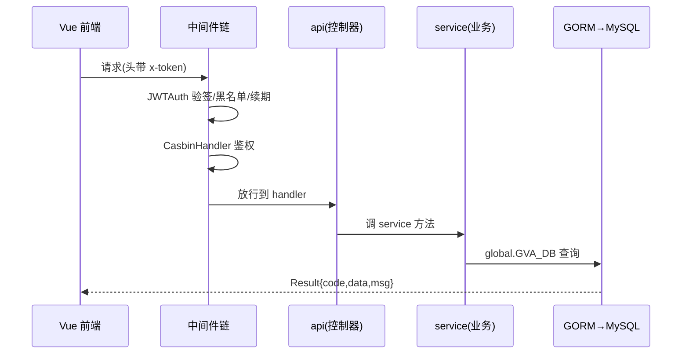
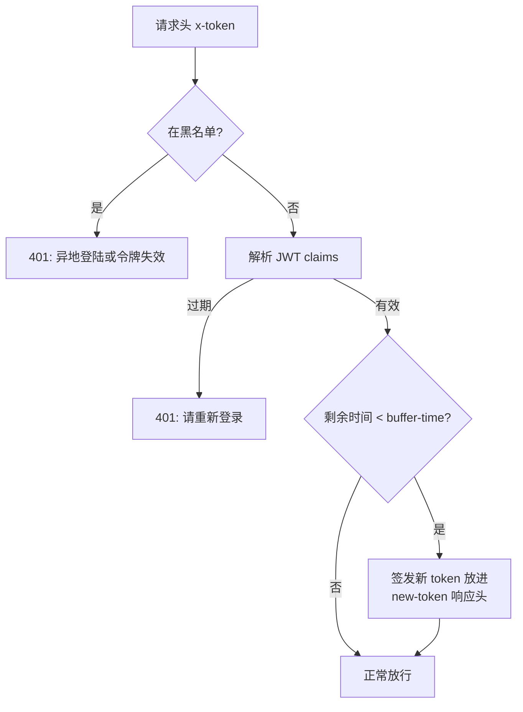
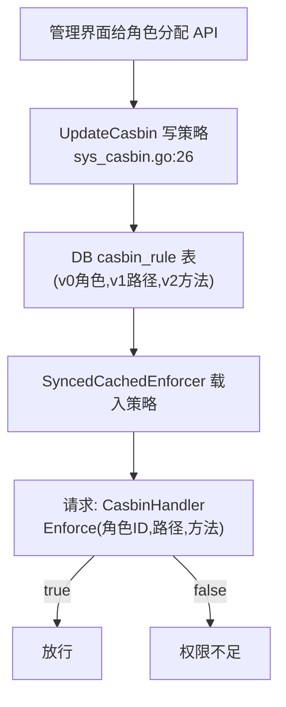

# gin-vue-admin 源码导读 —— 用 Go 的方式解你熟悉的那些后端问题

> 源码版本：[flipped-aurora/gin-vue-admin](https://github.com/flipped-aurora/gin-vue-admin) main@`d6d4950`（2026-09-19 取源，25k 星）
> 本地克隆：`.spec/源码学习/_clones/gin-vue-admin`（锚点均出自本次克隆，`server/` 为 Go 后端）
> 前置建议：已读 RuoYi/mall 导读最佳——本文继续沿用「同一个问题、不同答案」的对照法，这次换语言

## 00 · 总览

**gin-vue-admin 是什么**：Go（Gin）+ Vue 的全栈基础平台——后台管理那套老朋友（用户/角色/菜单/API/字典/操作日志）之外，还有一个**生产级的代码生成器**和**插件系统**。对你最大的价值：**换一门语言重看权限、会话、迁移、生成器这些你已经认识的问题**，从而分清「哪些是好设计，哪些只是 Java 的习惯」。

**前置知识（Go 后端对照 TS 后端）**：

| Go 世界 | 你熟悉的世界 |
|---|---|
| Gin 框架 | Express/Fastify（路由+中间件，几乎同构） |
| `middleware` 中间件函数 | NestJS 的 Guard/Interceptor 混合体 |
| `global` 包的全局单例（`GVA_DB` 等） | 依赖注入容器的「穷人版」：直接用全局变量 |
| GORM（ORM） | TypeORM（连 `many2many` 装饰器都神似，只是写成 struct tag） |
| `go.mod` | package.json |

**怎么跑起来**：`server/` 下 `go mod tidy && go run main.go`（配置在 `config.yaml`），自动建表灌数据；`web/` 是 Vue3 前端。默认账号 admin / 123456（种子写死于 `source/system/user.go:48-55`）。

**学习动线**：章1 架构动线 → 章2 认证 → 章3 Casbin 鉴权（重点）→ 章4 表与工程化 → 章5 生成器与插件 → 章6 收束。

---

## 01 · 架构与一次请求动线

**本章在全局的位置**：GVA 没有 Spring 的「自动装配魔法」，它的启动是一段你能从头读到尾的普通代码——这对理解「框架到底帮你做了什么」是绝佳教材。

**核心问题**：一个私有接口请求进来，Gin 的中间件链是怎么挂上去的？

**主线流程图**：

**关键点讲解**：

1. **启动序列是明码**：`main.go:30` → `core.RunWindowsServer` 之前，`initialize/` 目录按顺序装配：路由（`initialize/router.go`）、数据库（`gorm.go` + 五种数据库适配文件）、Redis、Casbin、定时器、种子数据。对照 NestJS：`initialize ≈ AppModule` 的 providers 装配，只是手写版的。
2. **中间件链的挂载点**（`initialize/router.go:66-68`）：`PrivateGroup := Router.Group(prefix)` 然后 `.Use(middleware.JWTAuth()).Use(middleware.CasbinHandler())`——所有私有路由统一过这两道。公开路由（登录、验证码）放 `PublicGroup` 不过链。**分组 + Use** 是 Gin 版的「全局 Guard」。
3. **分层与 NestJS 逐层对应**：`api/`（控制器：解析参数、调 service、返回响应）→ `service/`（业务与事务）→ `model/`（GORM 实体与 request/response DTO）→ `global/`（`GVA_DB`/`GVA_CONFIG`/`GVA_LOG`/`GVA_REDIS` 全局单例，见 `global/global.go`）。对照 NestJS：Controller/Service/DTO 一模一样；差别在依赖获取——Go 这里直接用全局变量，Nest 用构造器注入。**全局单例简单粗暴但难测试**，这是它和 DI 的真实差距，也是你理解「DI 到底解决什么」的反例教材。
4. **统一返回**（`model/common/response/response.go:10-12`）：`Result{Code,Data,Msg}` + `Ok/OkWithData/FailWithDetailed` 静态辅助。第四个项目、第三种语言，返回三键还是这套——**接口契约的「code/data/message」是跨语言的行业共识**。

**收束**：GVA 的骨架 = 明码启动 + 分组中间件 + 三层分层。下一章看它的会话方案——第四种答案。

---

## 02 · 认证：x-token、黑名单与「缓冲期续期」

**本章在全局的位置**：RuoYi 用 Redis 双层、mall 用纯无状态，GVA 给出第三条路：**无状态 JWT + 黑名单 + 响应头下发新 token 续期**。

**前置知识**：本地内存缓存：`BlackCache` 是进程内的缓存（项目自带 `local_cache` 包，初始化于 `initialize/other.go:23`），读它比读 Redis 快但**只在本进程有效**。

**核心问题**：JWT 发出去就收不回——GVA 怎么实现「异地登录踢掉旧 token」和「快过期自动续」？

**主线流程图**（一次私有请求的 JWT 生命周期）：

**关键点讲解**：

1. **token 叫 x-token 不叫 Authorization**（`middleware/jwt.go:18-19`）：头名自定义，注释明说「前端存 cookie 或 localStorage」。规范与否见仁见智，**头名是可协商的约定**，别当成圣旨。
2. **黑名单实现踢人**（`jwt.go:25-30` + `:86-89`）：登录时若开启多点拦截，旧 token 被丢进黑名单；每个请求先查黑名单。存储有两级：进程内 `BlackCache`（快）+ Redis 服务（`service/system/jwt_black_list.go`，跨进程）。⚠️ 边界：**本地缓存黑名单在多实例部署时会失灵**（实例 A 拉黑，实例 B 不知道）——单实例够用，上集群要换 Redis 优先。
3. **缓冲期续期是「响应头版」滑动续期**（`jwt.go:56-68` + `config.yaml:4-8`）：token 有效 7 天、缓冲期 1 天；请求进来若发现剩余时间不足 1 天，**当场签发新 token，塞进 `new-token` 响应头**，前端负责存起来替换旧的。对比 RuoYi：RuoYi 服务端悄悄换 Redis 键（前端无感），GVA 必须**前端配合替换**——同样是滑动续期，「有状态」和「无状态」的实现复杂度落点完全不同。
4. **多点登录**（`jwt.go:64-67`）：`UseMultipoint` 开启后用 Redis 记录每个用户的活跃 JWT（`SetRedisJWT`），新登录挤掉旧登录。这就是「黑名单的来源」。
5. **诚实注释**（`jwt.go:47-54`）：作者留了一段被注释掉的「每请求查库校验用户是否被禁用」代码，注释写明「比较消耗性能 如需自行打开」。**性能与实时的取舍明码标价**，这种注释比文档诚实。

**收束**：三种会话方案你现在都见过实物了。下一章是 GVA 最值得学的部分——权限为什么交给 Casbin 这个标准件。

---

## 03 · 鉴权：把 RBAC 交给 Casbin 标准件

**本章在全局的位置**：RuoYi 自研 `hasPermi`、mall 自研动态 URL 匹配，GVA 直接用** Casbin**——权限领域的通用策略引擎。学它 = 学「什么时候该用标准件」。

**前置知识**：Casbin：一个「策略判定引擎」，你给它 ① 策略规则（谁能对什么做什么）② 匹配模型（RBAC/ABAC…），它只回答一个问题：`Enforce(sub, obj, act)`——这个 subject 对这个 object 做 act 允许吗？详见 casbin.org（官方文档，搜索「casbin get started」）。

**核心问题**：`e.Enforce(角色ID, 请求路径, 请求方法)` 这一行背后，规则存在哪、谁来维护？

**主线流程图**：

**关键点讲解**：

1. **鉴权中间件只有 20 行**（`middleware/casbin_rbac.go:13-31`）：从 JWT claims 拿 `AuthorityId` 当 subject，请求路径当 object，HTTP 方法当 act，`e.Enforce(sub, obj, act)` 判定，不过就「权限不足」。**中间件薄 = 逻辑都在标准件里**——对比 RuoYi 的 PermissionService、mall 的 DynamicAuthorizationManager，GVA 把「怎么判」外包了。
2. **策略存数据库**（`utils/casbin_util.go:20-43`）：`gormadapter.NewAdapterByDB(GVA_DB)` 把 Casbin 的存储接到 MySQL 的 `casbin_rule` 表（v0=角色，v1=API 路径，v2=方法）；enforcer 用 `SyncedCachedEnforcer`（带同步缓存，策略变了自动感知）；RBAC 匹配模型直接用字符串内嵌传入（`model.NewModelFromString`）。
3. **策略维护是界面化的**（`service/system/sys_casbin.go:26,110`）：`UpdateCasbin` 在角色编辑时全量重写该角色的策略；`GetPolicyPathByAuthorityId` 回显；API 路径变了还会同步改写策略（`:88 UpdateCasbinApi`）。**运营在界面上点，权限变更即时生效**——对比 RuoYi 要重新登录，GVA 的 enforcer 缓存同步机制让改动几乎实时。
4. **一个用户多个角色，但请求只带一个**：`SysUser.Authorities` 是 many2many 连接表 `sys_user_authority`（`model/system/sys_user.go:29` + `sys_user_authority.go:4-7`），但 JWT claims 里只放当前选定的 `AuthorityId`（默认 888，`sys_user.go:27`），`SetUserAuthority`（`sys_user.go:140+`）切换。**「多角色持有、单角色生效」**——登录时选定身份，权限判定简单干净。对比 RuoYi 的「一人多角色全量合并」，这是另一种取舍。
5. **路由分组即权限域**（`initialize/router.go:82-87`）：各模块路由注册进 PrivateGroup 自动受控，新增 API 默认「无权限」，必须在界面分配后才能访问——**默认拒绝**原则的实现。

**收束**：Casbin 教你的不是权限知识（那些 RuoYi/mall 都教过了），而是**「自研 vs 标准件」的选型眼光**：规则引擎这种东西，社区件通常比自研强。下一章看表与工程化。

---

## 04 · 表设计与工程化：模型即表、代码即种子

**本章在全局的位置**：Java 系项目用 SQL 脚本建表，GVA 用 GORM 把表定义写在代码里——这是两种工程哲学的正面相遇。

**前置知识**：ORM 迁移（migration）：由 ORM 根据模型定义自动建表/改表，替代手写 DDL。GORM 的 `AutoMigrate` 只做增量新增（加表加列），不删不改列。

**关键点讲解**：

1. **struct tag 就是表定义**（`model/system/sys_user.go:22-32`）：`gorm:"index;comment:用户UUID"`、`gorm:"many2many:sys_user_authority;"`、`json:"-"`（密码永不出参）——**字段、索引、注释、关联全在一个结构体里**。对照 TypeORM 的 `@Column`/`@ManyToMany` 装饰器：同构不同形。
2. **自动迁移 vs SQL 脚本**：`initialize/gorm_biz.go:9` 一行 `db.AutoMigrate()` 建表；配套 `ensure_tables.go` 与 `gorm_mysql/pgsql/oracle/mssql/sqlite` 五个适配文件——**同一套模型跑五种数据库**（这是 ORM 建表的真正红利，mall 那种 MySQL 专用 DDL 脚本做不到）。代价：复杂索引/存储引擎等 DDL 细节表达力弱于手写 SQL。
3. **种子数据是 Go 代码**：`source/system/` 下 `api.go`/`menu.go`/`casbin.go`……每个文件实现初始化逻辑并注册顺序号——`source/system/authority.go:12,18`：`const initOrderAuthority = initOrderCasbin + 1` + `system.RegisterInit(initOrderAuthority, &initAuthority{})`。**用常量算术编排初始化依赖顺序**，确保「API 先建、角色再建、Casbin 策略最后」——比 SQL 脚本按文件名排序执行精细得多。首次启动自动灌数据，跑起来就有完整后台。
4. **事务是函数式的**（`service/system/sys_api.go:137` 等）：`global.GVA_DB.Transaction(func(tx *gorm.DB) error {...})`——回调里用 `tx`，返回 error 自动回滚。对照 NestJS TypeORM 的事务装饰器或手动 transaction manager：**Go 的函数式事务直观且不会忘提交**。
5. **操作日志中间件**（`middleware/operation.go:31-79`）：Gin 中间件读请求 body（读完再塞回去让后续链路能用）、响应后组装 `SysOperationRecord` 异步入库。原理与 RuoYi 的 @Log 切面、mall 的注解日志同构——**只是 Go 没有 AOP，用中间件链手动实现**。这解释了一个差异：Java/TS 有「切面/装饰器」语法支持，Go 全靠中间件+显式调用。
6. **定时任务**（`initialize/timer.go:14-17`）：`robfig/cron` 库，启动时注册 `ClearDB` 每日清理任务，`task/clearTable.go` 是任务体。对照 RuoYi 的 quartz：Go 世界没有重量级调度框架，一个 cron 库 + 注册表就够。

**收束**：GVA 的工程化 = 「定义即代码」哲学：表在模型里、种子在 Go 里、顺序在常量算术里。下一章看它最出名的代码生成器与插件。

---

## 05 · 代码生成器与插件系统

**本章在全局的位置**：GVA 的代码生成器比 RuoYi 的更进一步——从「按表生成 CRUD」进化到「包/模板/历史/AI 辅助」；插件系统则让功能模块像安装包一样挂载。

**关键点讲解**：

1. **生成器家族**（`service/system/` 下 `auto_code_package.go`/`auto_code_history.go`/`auto_code_llm.go`/`auto_code_mcp.go`）：支持「包」组织（一次生成一个业务模块的全部前后端）、生成历史（可回溯再生成）、甚至接了 LLM 辅助生成（`auto_code_llm.go`）。对照 RuoYi 的 gen_table：**同一个思想（元数据→模板→代码），三代进化**——RuoYi 按表生成、mall 用 mbg 按库生成、GVA 按业务包生成并接 AI。
2. **插件系统**（`plugin/` 目录）：`announcement`（公告）、`email`、`auto` 等每个插件自含 model/router/api/service，`plugin/register.go` 统一注册，`initialize/plugin*.go` 装配（v1/v2 两代插件机制并存）。**功能模块可插拔**——像 npm 包之于前端工程。
3. **对你最有用的启示**：生成器和插件都在解决同一个问题——**「新业务模块的接入成本」**。表规范（RuoYi 章5）、模板渲染、注册机制三板斧，任何语言任何团队都用得上。

**收束**：到此你已经看了四种后端形态里的同一批机制。最后一章把四个项目摆到一张表上。

---

## 06 · 收束：四项目对照总表与标准件思维

**四项目对照总表**（建议收藏，这是这批导读的核心资产）：

| 维度 | RuoYi-Vue(Java) | mall(Java) | mall-swarm(Java) | gin-vue-admin(Go) |
|---|---|---|---|---|
| 会话 | JWT+Redis 双层可踢人 | 纯 JWT 7 天 | Sa-Token(Redis) 双账号 | JWT+黑名单+响应头续期 |
| 权限判定 | 自研 @ss.hasPermi | 自研动态 URL 匹配 | 网关统一判 Redis 规则 | **Casbin 标准件** |
| 权限粒度 | 按钮+数据权限(行级) | URL 资源 | URL 资源(集中式) | API 路径+方法 |
| 权限生效 | 重登录 | 每请求回库/清缓存 | 网关读 Redis 即时 | enforcer 缓存同步≈即时 |
| 建表方式 | SQL 脚本 | SQL 脚本(四域76表) | 同 mall | **GORM AutoMigrate** |
| 初始数据 | SQL insert | SQL insert | 同 mall | **Go 代码种子+顺序编排** |
| 代码生成 | gen_table 按表 | mbg 按库 | 同 mall | **按业务包+历史+AI** |
| 消息队列 | 无 | RabbitMQ 延迟关单 | 同 mall(保留) | 无 |
| 统一返回 | HashMap | 泛型 | 泛型 | struct+辅助函数 |

**沉淀三条**：

1. **标准件思维**：Casbin 之于权限 ≈ 你用 Passport 之于认证。判断标准：这个问题的「领域模型」稳定吗（RBAC 三十年没变）？稳定就找标准件；业务耦合的（如 mall 的 URL 资源规则）才值得自研。
2. **定义即代码 vs 脚本即真源**：GORM 迁移+代码种子（GVA）与 SQL 脚本（RuoYi/mall）是建表的两大学派。前者跨库、可编程编排；后者直观、DBA 友好。团队小选前者省事，有专职 DBA 倾向后者。
3. **多角色两流派**：「全量合并权限」（RuoYi）vs「持有多个、登录选定一个」（GVA）。后者判定简单、审计清晰，是当下更流行的设计。

**下一站**：回到你的主场 TypeScript——NestJS 三连读（nestjs-recipe 最佳实践 → 《Nest 通关秘籍》案例 → Nestier 六边形架构脚手架）。Java/Go 界的「标准件」在 Nest 世界长什么样（Guard/Pipe/Interceptor/CQRS/微服务传输器），以及企业级架构思想（六边形架构+DDD）如何落地。

**上手建议**：跑起来后进「超级管理员→角色管理→分配 API 权限」界面改一个角色的权限，再去 MySQL `SELECT * FROM casbin_rule WHERE v0='角色ID'` 看策略行变化——Casbin 的全部魔法就是这张表。
