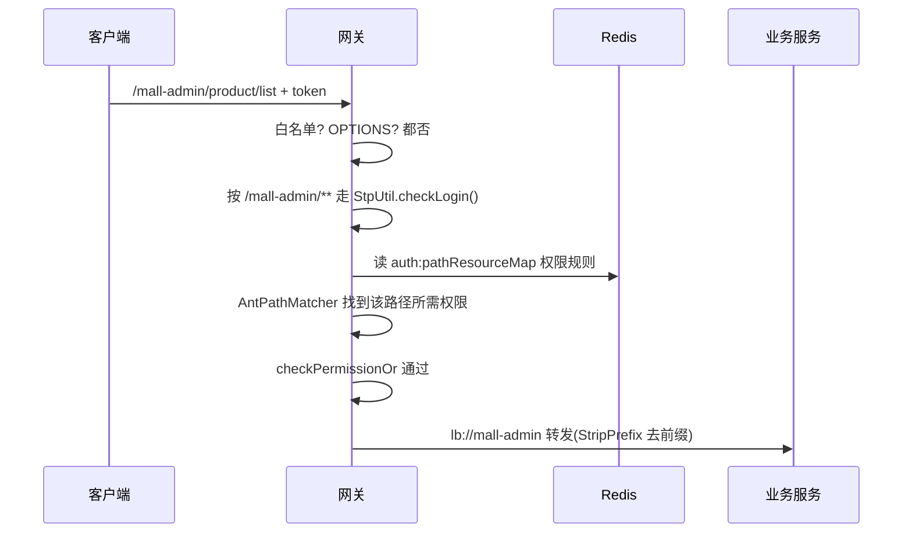

# mall-swarm 源码导读 —— 亲眼看一套单体怎么变成微服务

> 源码版本：[macrozheng/mall-swarm](https://github.com/macrozheng/mall-swarm) master@`04c442f`（2026-09-19 取源，13.1k 星）
> 本地克隆：`.spec/源码学习/_clones/mall-swarm`
> 前置建议：先读 mall 导读——**业务代码两边几乎一样**，本文只讲「多出来的东西」和「被改变的东西」

## 00 · 总览

**mall-swarm 是什么**：mall 的微服务版。商品、订单、会员这些业务一行没变（共享 `mall-mbg`、`mall-common` 底座），变的是**骨架**：多了网关、认证中心、监控中心，服务之间用 Nacos 互相认识。它回答的问题是——「业务不变的情况下，微服务到底多出了什么？」

**怎么跑起来**：先起 MySQL/Redis/RabbitMQ → 起 Nacos（把仓库 `config/` 目录下五组配置导入）→ 再起 gateway/auth/admin/portal/search/monitor。比 mall 多的最大件就是 Nacos。

**模块总图**：

```mermaid
flowchart LR
  FE["前端/客户端"] --> GW["mall-gateway<br/>网关(门禁+路由)"]
  GW --> AUTH["mall-auth<br/>认证中心"]
  GW --> A["mall-admin"]
  GW --> P["mall-portal"]
  GW --> S["mall-search"]
  AUTH -.|"Feign 拉用户校验"| A
  AUTH -.-> P
  A & P & S & GW & AUTH --- N["Nacos<br/>注册发现+配置"]
  MON["mall-monitor<br/>Spring Boot Admin"] --- A & P & S & GW & AUTH
```

**学习动线**：章1 拆分对照 → 章2 网关 → 章3 认证中心与 Feign → 章4 老问题新答案 → 章5 收束（值不值得拆）。

---

## 01 · 服务拆分对照：多出来的三个服务

**本章在全局的位置**：先建「拆了什么」的全景，后面三章看细节。

**前置知识**：服务注册与发现：每个服务启动时到注册中心（Nacos）登记「我叫什么、地址在哪」，调用方按名字找人——服务 IP 变了也不怕。

**核心问题**：mall 的 3 个应用变成 mall-swarm 的 8 个服务，多出来的 5 个都干嘛的？

**关键点讲解**：

1. **九模块清单**（`pom.xml:13-21`）：`mall-common`/`mall-mbg`/`mall-demo` 三个底座原样，业务服务 `mall-admin`/`mall-portal`/`mall-search` 原样，**新增** `mall-gateway`（网关）、`mall-auth`（认证中心）、`mall-monitor`（监控）。
2. **对照表**（本章浓缩）：

| | mall（单体） | mall-swarm（微服务） |
|---|---|---|
| 入口 | 每个应用自己一个端口 | 统一从网关进 |
| 登录 | 各应用自己发 JWT | 独立认证中心 + 网关统一校验 |
| 服务找人 | 不需要（进程内调用） | Nacos 注册发现 + OpenFeign 按名调用 |
| 配置 | application.yml 打包在 jar 里 | Nacos 配置中心（仓库 `config/` 是导入样例） |
| 监控 | 无 | Spring Boot Admin 监控中心 |
| 门禁 | 每个应用自己拦 | 网关统一拦，业务服务专注业务 |

3. **底座没动是关键**：`mall-mbg`（生成的实体/Mapper）、`mall-common`（返回/异常）两边通用——**微服务拆的是「部署边界」，不是「业务代码」**。很多团队以为微服务=重写，这个仓库证明：先拆部署、业务微调，是常态。
4. **`config/` 目录就是配置中心的「货」**：五组服务各有 dev/prod 两个 yaml（`config/gateway/mall-gateway-dev.yaml` 等），启动时从 Nacos 拉取。看一眼你会发现里面大多是 Redis 地址、日志级别——**配置外置后，改配置不用重新打包**。

**收束**：多出来的三个服务分别是「门卫（gateway）」「发证处（auth）」「体检中心（monitor）」。先看门卫。

---

## 02 · 网关：统一入口与统一门禁

**本章在全局的位置**：所有请求只从网关进，网关干两件事——把路指对（路由），把人拦住（鉴权）。

**前置知识**：Spring Cloud Gateway 跑在响应式栈（WebFlux）上；`lb://服务名` = 从注册中心做负载均衡地找这个服务。

**核心问题**：八个服务各自为政时，「登录了吗、有权吗」这个判断为什么必须收拢到一个地方？

**主线流程图**（一个请求的网关之旅）：



**关键点讲解**：

1. **路由双保险**（`mall-gateway/src/main/resources/application.yml:15-40`）：`discovery.locator.enabled` 开了「按服务名自动路由」，又显式写了 `routes`：`Path=/mall-auth/**` → `uri: lb://mall-auth` → `StripPrefix=1`（转发前去掉第一段路径）。**前缀即服务名**的约定，让客户端只需要认识网关一个地址。
2. **Sa-Token 全局过滤器**（`mall-gateway/config/SaTokenConfig.java:40-45`）：`SaReactorFilter` 拦 `/**`，白名单从 `IgnoreUrlsConfig` 读——和单体时代同一份白名单配置格式，只是执行地点从各应用挪到了网关。**一次判定，全部服务受益**：业务服务不再需要各自的 Spring Security 配置。
3. **双账号体系按路径分流**（`SaTokenConfig.java:50-53`）：`/mall-portal/**` 走 `StpMemberUtil.checkLogin()`（会员）、`/mall-admin/**` 走 `StpUtil.checkLogin()`（后台管理员）。一个网关里两套登录态互不干扰——「一个系统两种用户」的标准解法。
4. **权限规则表在 Redis**（`SaTokenConfig.java:56-73`）：网关从 Redis hash `auth:pathResourceMap` 拿「URL 模式→所需权限」映射，`AntPathMatcher` 逐条匹配出当前路径需要的权限，`StpUtil.checkPermissionOr` 校验。注意：**网关自己不维护规则，只读**——规则谁写的？下一章。

**收束**：网关 = 指路人 + 门卫，且门卫查的「权限手册」放在 Redis 里大家共享。看发证处和手册的作者。

---

## 03 · 认证中心与服务间调用

**本章在全局的位置**：token 从哪来（auth + 业务服务），服务之间怎么互相调用（Feign）。

**前置知识**：OpenFeign = 声明式 HTTP 客户端：写一个接口加 `@FeignClient("服务名")`，调用它就等于发 HTTP 请求，服务名由 Nacos 解析成真实地址。

**核心问题**：登录为什么值得独立成一个服务？服务 A 想调服务 B 的接口，代码长什么样？

**关键点讲解**：

1. **auth 是个「薄到惊人」的服务**：全部 Java 文件只有 6 个。核心就一个登录入口（`mall-auth/.../AuthController.java:34-46`）：按 `clientId` 区分管理员/会员，转给对应的 service。
2. **而 service 是个 Feign 客户端**（`mall-auth/.../service/UmsAdminService.java:16-20`）：`@FeignClient("mall-admin")` + `@PostMapping("/admin/login")`——所谓认证中心，就是**把「调 mall-admin 的登录接口」这件事代理出去**。真实的认证逻辑还在业务服务里（`mall-admin/.../UmsAdminServiceImpl.java:89-104`：`StpUtil.login(admin.getId())` 完成 Sa-Token 登录并返回 token 信息）。
3. **为什么要这么绕？** 对照单体 mall：登录接口本来就在 mall-admin 里。微服务化后认证独立成服务，收益是：**登录协议统一**（管理员/会员/未来第三方都从 `/mall-auth/login` 进）、**认证策略集中可换**、**网关只需信任一处发的 token**。代价是多一跳网络。这是典型的「为了边界清晰，接受额外复杂度」。
4. **Sa-Token 的 token 天然适配微服务**：Sa-Token 默认把会话存 Redis——网关和业务服务连同一个 Redis，网关拿着 token 就能验，**不需要业务服务参与**。会员侧还换成了 JWT 风格（`StpMemberUtil.java:44-49`：`TYPE="memberLogin"` + `StpLogicJwtForSimple`），一套框架两种 token 形态。
5. **服务间调用就是写接口**（`mall-demo/.../FeignAdminService.java:13` 等三个示例）：`@FeignClient("mall-admin")` 指定服务名，方法上写目标路径。demo 模块是作者留给你的「服务间调用说明书」。

**收束**：认证中心=协议统一层，Feign=把 HTTP 调用伪装成本地方法。下一章看看微服务化后，单体时代的老问题都被放到了哪里。

---

## 04 · 微服务化后的老问题新答案

**本章在全局的位置**：逐个对账——单体里你学过的机制（权限规则、延迟关单、定时任务），进了微服务世界搬到了哪、变了没有。

**关键点讲解**：

1. **权限规则从「应用内存」搬进「Redis 公共黑板」**：mall 单体时代，URL→权限映射在各应用进程内存里（`DynamicSecurityMetadataSource` 懒加载）；mall-swarm 里由 mall-admin 在资源变更时**重建 Redis hash**（`mall-admin/.../UmsResourceServiceImpl.java:85-86`：`del` + `hSetAll`），网关只读（key 定义 `mall-common/.../AuthConstant.java:37`）。**数据移个位置，架构就从「各管各的」变成「一处写、处处读」**——微服务里共享状态的常见姿势。
2. **消息队列原样保留**：`mall-portal/component/` 下 `CancelOrderSender`/`CancelOrderReceiver`/`OrderTimeOutCancelTask` 三件套与单体完全一致，10 分钟兜底 cron 都在（`OrderTimeOutCancelTask.java:24`）。**业务内的异步不因为微服务化而改变**——MQ 解决的是「业务步骤之间的解耦」，不是「服务之间的通信」。
3. **监控中心**（`mall-monitor/pom.xml:28,32`）：`spring-boot-admin-starter-server` + security。每个服务都是它的客户端，启动后到 Nacos 登记，监控台自动收编——微服务一多，没有这个你就不知道谁活着。
4. **⚠️ 已核实不存在的东西**（宣传与代码现状的差距）：仓库简介与 README 技术栈表里出现了 **Sentinel**（限流熔断）和 **Seata**（分布式事务，README:93），但全仓 grep 无对应依赖和代码。mall-swarm 的跨服务一致性**没有引入新方案**，依然靠业务内的最终一致设计。学这里要带着批判眼：宣传清单 ≠ 代码现实，**以依赖和代码为准**——这也是前面 Fact-Check 一直强调的习惯。
5. **Nacos 一物两用**：注册发现（服务互相找人）+ 配置中心（配置外置热改）。两个用途都依赖「服务启动时连上 Nacos」这一个动作，所以它是整个体系的第一块多米诺——Nacos 挂了，全套瘫痪。**基础设施的单点依赖清单**，是你评估任何微服务架构的第一张表。

**收束**：微服务化没有让老问题消失，只是给每个老问题换了个集中式的答案存放点。

---

## 05 · 收束：拆分代价 vs 收益，什么时候才值得拆

**收益清单**（这个仓库展示的）：
- **独立部署与扩容**：搜索是 CPU 大户就单独给 mall-search 加机器，其他不动。
- **边界即团队**：网关/认证/业务/监控各自演进，互不阻塞。
- **故障隔离**：搜索挂了，下单购物不受影响（网关路由隔离）。
- **协议统一**：所有外部流量过一个门卫，安全策略一处生效。

**代价清单**（同样是这个仓库展示的）：
- **一跳变 N 跳**：登录要 auth→Feign→mall-admin；任何网络抖动都算你的。
- **基础设施清单变长**：Nacos（两用）、Redis（共享会话+权限表）、网关、监控中心——每个都是要运维、要高可用、会挂的单点。
- **配置爆炸**：`config/` 里五组服务 × dev/prod 共 10 个文件起步。
- **分布式的新难题没解**：没有 Seata，跨服务数据一致性依然靠业务设计。

**判断准则**（收束成三问）：
1. 不同模块的**负载曲线**分开了吗？（搜索和订单峰谷不同步才需要独立扩容）
2. 团队**人数**超过单体协作上限了吗？（拆服务本质是拆组织沟通）
3. 有没有**独立部署/发布节奏**的硬需求？
三问皆是，才轮到微服务；否则单体多模块（mall 那种）就是性价比之王。**架构没有先进落后，只有匹配不匹配。**

**下一站**：gin-vue-admin——换一门语言（Go）重看同一批问题：登录态、RBAC、代码生成、工程分层。你会发现好设计是跨语言通用的，而各语言的「标准件」完全不同。

**上手建议**：起一套最小环境（Nacos+MySQL+Redis+网关+mall-auth+mall-admin），从网关登录拿 token，再用 token 穿网关调业务接口；然后在 Redis 里 `HGETALL auth:pathResourceMap` 亲眼看那本「权限手册」——网关鉴权的全部秘密就在这个 hash 里。
