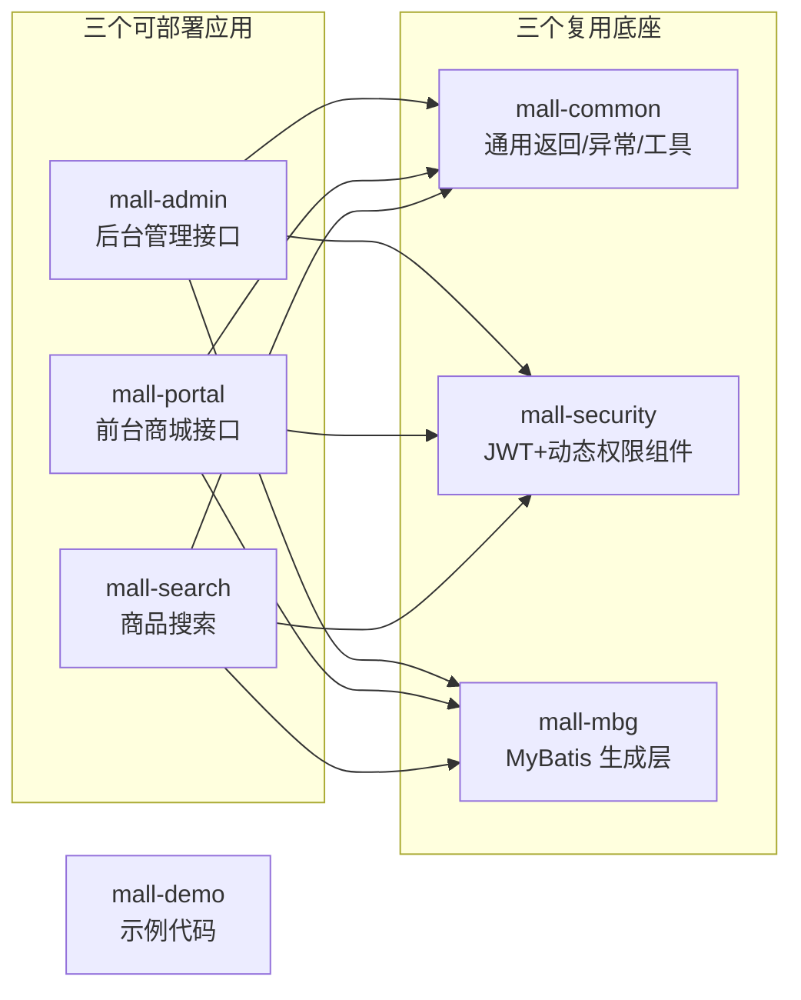
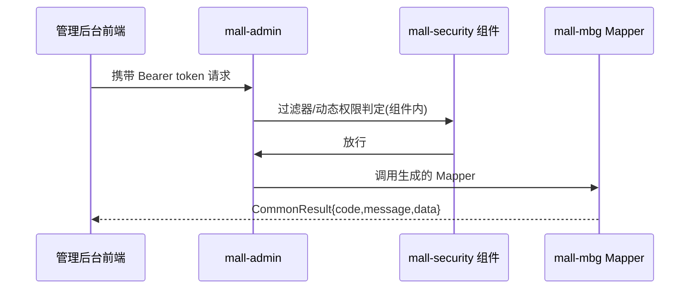
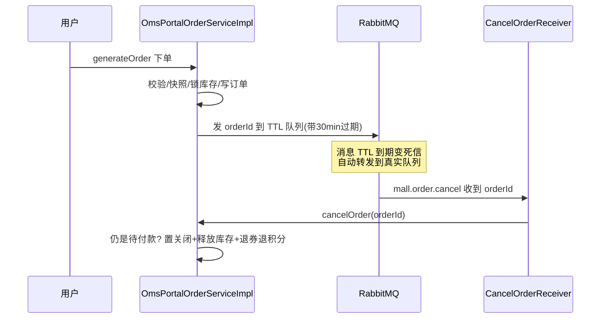
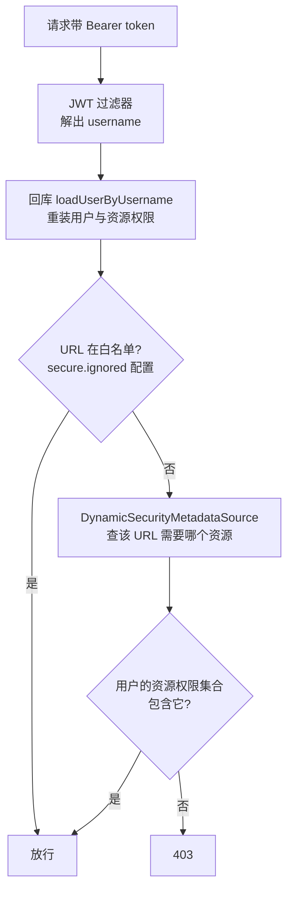
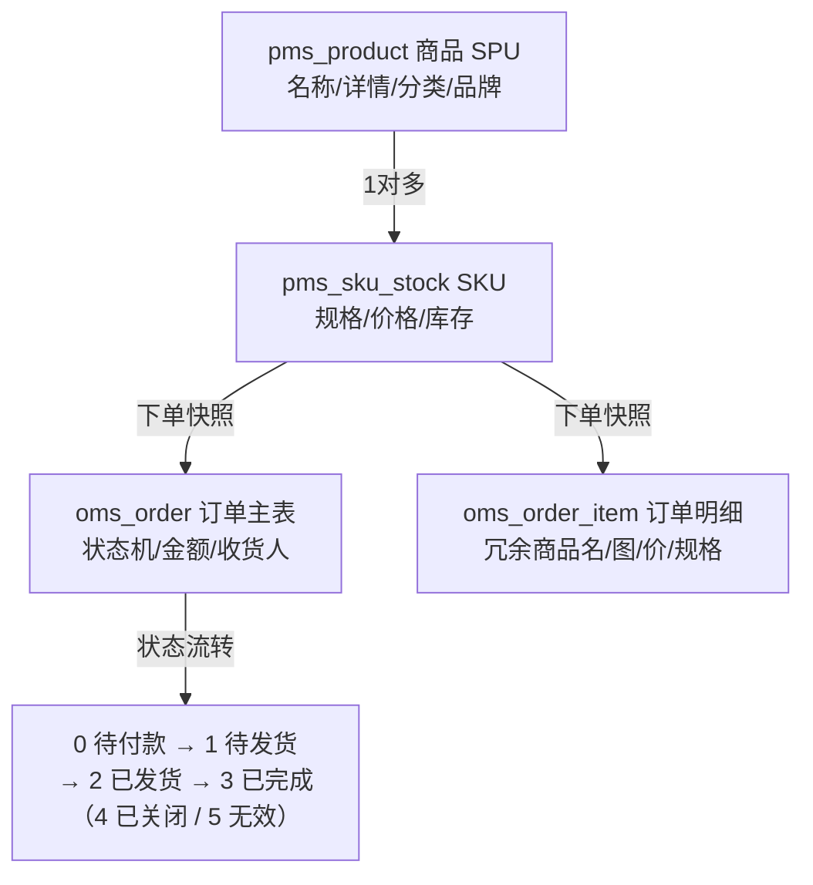
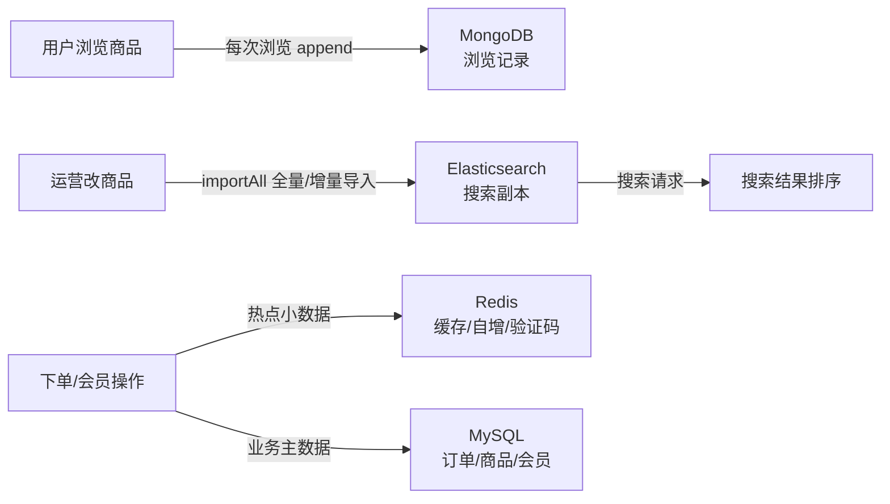

# mall 源码导读 —— 电商复杂度下的后端进阶（MQ/库存/权限/存储选型）

> 源码版本：[macrozheng/mall](https://github.com/macrozheng/mall) master@`dcaa93b`（2026-09-19 取源，84.7k 星）
> 本地克隆：`.spec/源码学习/_clones/mall`（下文 `文件:行号` 锚点均出自本次克隆，路径省略前缀 `mall-*/src/main/java/com/macro/mall/`）
> 前置建议：先读同目录 RuoYi 导读——本文多处与它对照，对比着学效果翻倍

## 00 · 总览

**mall 是什么**：一套电商系统——前台商城（下单、购物车、会员）+ 后台管理（商品、订单、促销、权限），Spring Boot + MyBatis。它是「业务复杂度」的教科书：RuoYi 教你权限和规范，mall 教你**消息队列、库存模型、订单状态机、多存储选型**——全是只会写接口的你没摸过的东西。

**怎么跑起来**：依赖 MySQL + Redis + RabbitMQ + Elasticsearch + MongoDB 五件套（`docker-compose` 或本地安装均可，仓库 README 有教程）；导入 `document/sql/mall.sql`；分别启动 `mall-admin`/`mall-portal`/`mall-search` 的 `MallAdminApplication` 等。只想读代码不跑环境也完全成立——本文锚点都在源码里。

**模块总图**：

**学习动线**：章1 架构 → 章2 下单与延迟关单（**最重磅**）→ 章3 认证鉴权 → 章4 表设计 → 章5 存储选型 → 章6 收束。时间紧只读 2 和 4。

---

## 01 · 全局架构：三个应用 + 三个底座

**本章在全局的位置**：先看清楚「一套代码怎么变成多个可部署应用、公共能力怎么下沉」。

**前置知识**：多模块 Maven 工程（RuoYi 导读章1 已铺垫）：这里是进阶版——不是「一个应用拆模块」，而是「多个应用共享底座模块」。

**核心问题**：为什么 mall 的模块里，有三个长得像「应用」、三个长得像「零件」？

**主线流程图**（一次后台请求的路径）：

**关键点讲解**：

1. **三应用三底座**（`pom.xml` 的 modules）：`mall-admin`（后台管理 API）、`mall-portal`（前台商城 API）、`mall-search`（搜索 API）各自独立打包部署；`mall-common`（返回/异常/工具）、`mall-security`（安全组件）、`mall-mbg`（MyBatis Generator 生成的实体和 Mapper）是零件库。对照 RuoYi 的「一壳六模块」：业务长大、部署要分开时，这个形态是过渡微服务前的标准姿势。
2. **能力下沉是「组件」不是「类库」**：`mall-security` 里是完整的过滤器、权限管理器、Token 工具（`component/`+`util/`+`config/`），应用引入后只需注册一个匿名 bean 提供自己查权限的方式（`mall-admin/config/MallSecurityConfig.java:36-39` 的 `dynamicSecurityService()`）。「通用逻辑写死、可变逻辑留口子」——这就是框架思维，值得抄进你的公共包设计。
3. **统一返回用泛型**（`mall-common/.../api/CommonResult.java:11-19,35-92`）：`CommonResult<T>{code,message,data}` + 一组静态工厂 `success/failed/validateFailed`。比 RuoYi 的 `HashMap` 强在编译期类型安全——两个项目对比教你：返回封装第一版求快可以 map，认真做就该泛型。
4. **异常处理四个清单**（`mall-common/.../exception/GlobalExceptionHandler.java:23-60`）：`ApiException`（业务异常，带自定义 IErrorCode）→ 参数校验 `MethodArgumentNotValidException` → `BindException` → SQL 语法错误。和 RuoYi 一样没有兜底 RuntimeException 的分支（未捕获异常走容器默认 500），但有「业务异常码对象化」的思路。
5. **代码生成层独立成模块**：`mall-mbg` 由 MyBatis Generator 生成（实体/Mapper 全是机器货），手写 SQL 放在各应用的 `dao/`。「生成的归生成、手写的归手写」分目录隔离，重新生成不冲掉手写代码——这是 RuoYi 生成器思路的工程化升级。

**收束**：骨架记住一件事——**应用会变多，底座要下沉**。下一章看这套架构里最精彩的一条业务链路。

---

## 02 · 下单与延迟关单：消息队列的第一个完整案例

**本章在全局的位置**：mall 的灵魂章节。你要学的不是「RabbitMQ API」，而是「为什么下单这个动作天生适合引入 MQ」。

**前置知识**：① RabbitMQ 三件套：交换机（收生产者消息，按路由键分发）、队列（存消息）、绑定（两者的连接规则）。② 死信：消息变成「死信」后（如被拒收、**TTL 过期**）会被转发到死信交换机——这是实现「延迟任务」的经典玩法。③ 最终一致性：不追求每步都锁在同一个事务里，而是「先干活，错了有补偿」。

**核心问题**：用户下单后 30 分钟不付款，订单要自动取消、库存要放回去——没有 MQ 这事怎么做？会死在哪儿？

**主线流程图**（延迟关单全链路）：

**关键点讲解**：

1. **下单主线九步**（`mall-portal/.../OmsPortalOrderServiceImpl.java:94-250`）：校验收货地址→购物车转订单快照→库存校验→优惠券/积分分摊金额→锁库存（`:165`）→组装订单并落库（`:224-229`）→更新优惠券状态/扣积分→删购物车→**发延迟取消消息**（`:245`）。读完你会对「一个接口 = 一串业务动作」有肌肉记忆。
2. **延迟关单的实现是「TTL + 死信」双队列**（`mall-portal/config/RabbitMqConfig.java:48-55`）：TTL 队列声明时挂两个参数 `x-dead-letter-exchange` 和 `x-dead-letter-routing-key`——消息在 TTL 队列里躺到过期，自动变成死信转发到真实消费队列 `mall.order.cancel`（队列名见 `domain/QueueEnum.java:14,18`）。没有任何「定时扫描」参与，延迟本身是 MQ 的能力。
3. **消息怎么带上延迟时间**（`CancelOrderSender.java:23-34`）：发送时用 `MessagePostProcessor` 给消息设 `setExpiration(毫秒)`——每条消息可以不同的 TTL。延时时长来自订单设置表（`sendDelayMessageCancelOrder` :327-334 读 `oms_order_setting.normal_order_overtime`），运营可配。
4. **消费端就是一行业务调用**（`CancelOrderReceiver.java:16-25`）：`@RabbitListener(queues="mall.order.cancel")` + `@RabbitHandler`，收到 orderId 调 `cancelOrder`。生产者/消费者只传一个 ID 不传大对象——「消息传引用不传状态」，学这个习惯。
5. **取消是幂等的，而且天然防并发事故**（`OmsPortalOrderServiceImpl.java:297-321`）：先查「status=0 且未删除」的订单，**查不到直接 return**——用户已付款的订单（status=1）根本不会被取消；然后置状态 4→释放锁定库存（`PortalOrderDao.xml:77` 的 CASE WHEN 批量减 `lock_stock`）→退优惠券→退积分。「先加闸门再干活」是所有消息消费方的安全范式，因为消息可能重复投递、可能迟到。
6. **兜底：定时任务**（`OrderTimeOutCancelTask.java:24-29`）：`@Scheduled(cron="0 0/10 * ? * ?")` 每 10 分钟扫一遍超时未支付订单统一取消。为什么有了延迟消息还要它？——MQ 丢消息、服务重启时消息处理中断等意外总要有个「对账员」。**主链路走事件、旁路挂定时兜底**，是可靠的异步系统的标准双保险。
7. **⚠️ 诚实的发现：下单主流程没有包事务**：`generateOrder` 只有 `@Override` 没有 `@Transactional`，全文件 grep 零命中（类级仅 `@Service` :32-33）。锁库存、插订单、扣积分、删购物车分步执行，任何一步挂了不会整体回滚——它选择的是**最终一致**：失败的部分由取消链路补偿（释放库存/退券/退积分）。⚠️ 边界：MQ 也只用了默认配置，**未开启发布确认和手动 ack**（`application.yml` 无相关配置，已核实）——生产级用这套要自己补可靠性，教学价值在于让你看见「强事务之外的另一种设计」。

**收束**：这一章你已经拿到三件武器：TTL+死信做延迟任务、消息消费幂等闸门、事件+定时双保险。下一章回到安全，看 mall 和 RuoYi 的两种截然不同的会话哲学。

---

## 03 · 认证与鉴权：无状态 JWT 与 URL 级动态权限

**本章在全局的位置**：RuoYi 章二/三章的镜像参照物——同样的问题，mall 给了另一套答案。

**前置知识**：无状态认证：服务端不存会话，每个请求凭 token 自证（本仓 token 7 天有效、不续期）。RBAC 在 mall 后台的形状：管理员→角色→**资源（URL 模式）**。

**核心问题**：token 不带 Redis 户口本，mall 怎么做到权限改了马上生效、接口统一管控？

**主线流程图**（后台接口鉴权）：

**关键点讲解**：

1. **通用 JWT 过滤器**（`mall-security/component/JwtAuthenticationTokenFilter.java:36-56`）：从 `Authorization` 头剥掉 `Bearer ` 前缀（前缀名走配置 :31-34）→ `getUserNameFromToken` 解出用户名 → **回数据库** `loadUserByUsername` 重装 UserDetails → `validateToken` 校验 → 装进 SecurityContext。与 RuoYi 的本质区别：**mall 的权限每请求都是新的**（改权限立即生效），代价是每请求查一次库（实践中通常缓存优化）。
2. **token 是纯无状态的**：`JwtTokenUtil.generateToken`（`util/JwtTokenUtil.java:49,77,142`）+ 配置 7 天过期（`mall-admin/application.yml:19-23`，`expiration: 604800`）。没有滑动续期、没有服务端踢人——**省了 Redis 会话，丢了管理能力**。和 RuoYi 对照：会话方案没有绝对优劣，取决于你要「可管理」还是「零存储」。
3. **登录自己比对密码**（`mall-admin/.../UmsAdminServiceImpl.java:99-111`）：`passwordEncoder.matches` 手动比对 + 禁用检查 + 手动构建 `UsernamePasswordAuthenticationToken` 塞进上下文，不走 `authenticationManager.authenticate()`。跟 RuoYi 的「交给框架」对照——两条路都通，RuoYi 那条能吃到框架的全部标准件，mall 这条自由但细节自负。
4. **后台 RBAC 以「资源」为权限粒度**：管理员→角色→资源三层，关系表 `ums_role_resource_relation`（`document/sql/mall.sql:3200`）。资源就是 URL 模式——真实数据如 `/brand/**`「商品品牌管理」（`document/sql/mall.sql:3038`）；用户权限集合的形状是「资源 id:名称」（`bo/AdminUserDetails.java:29-32`）。对比 RuoYi 的「权限字符挂在菜单/按钮」：mall 的权限直接对着接口 URL，前后端解耦更彻底。
5. **URL→资源 的动态匹配三件套**：白名单来自配置文件 `secure.ignored`（`mall-security/config/IgnoreUrlsConfig.java:16-17`，装配于 `SecurityConfig.java:43-47`）；`DynamicSecurityMetadataSource` 懒加载「URL→所需资源」映射（`component/DynamicSecurityMetadataSource.java:25-44`）；`DynamicAuthorizationManager.check` 拿用户权限对答案（`component/DynamicAuthorizationManager.java:39`）。新增接口默认受控，权限配置在管理界面点一点就生效——**数据驱动的权限**。
6. **权限缓存与一致性**（`mall-admin/.../UmsAdminCacheServiceImpl.java:64-88`）：管理员的资源列表缓存进 Redis（key 含 adminId）；当某资源的角色关系变化，**批量删除所有相关管理员的缓存**（:84-88）——改权限、清缓存、下次请求重建。这是「Cache Aside + 主动失效」的活例，比 RuoYi 的「重新登录才生效」体验好一档。
7. **前台会员同一套底座**：会员的 Redis 缓存与验证码存取在 `mall-portal/.../UmsMemberCacheServiceImpl.java:38-65`。一套 `mall-security` 组件，admin 和 portal 各自提供 `UserDetailsService` 实现——底座复用的样子。
8. **没有行级数据权限**：全仓检索未见类似 RuoYi `@DataScope` 的机制——后台运营能看到所有订单所有商品（管理场景通常如此）。⚠️ 对比结论：RuoYi 强在「多租户/组织级数据隔离」，mall 强在「接口级统一管控」，选型看业务形态。

**收束**：会话模型（Redis 双层 vs 纯 JWT）、权限粒度（按钮字符 vs URL 资源）、生效速度（重登 vs 实时）——三组对照记牢，你就能给任何系统选型。下一章钻进数据层看表怎么设计。

---

## 04 · 表设计思想：四域前缀、SPU/SKU、订单快照与状态机

**本章在全局的位置**：mall 的 76 张表（`document/sql/mall.sql`）是「业务复杂度怎么映射进数据库」的最好教材。

**前置知识**：SPU（标准产品单元，「iPhone 15」）/SKU（库存量单位，「iPhone 15 黑色 256G」）——电商表设计的地基：**一个 SPU 挂多个 SKU，价格和库存在 SKU 上**。

**核心问题**：商品有几十个规格、订单要在商品改价后依然是对的——表怎么设计才能扛住这些？

**主线流程图**（一张订单的诞生与它的表）：

**关键点讲解**：

1. **五域前缀是第一眼规范**：`pms_`（Product 商品 18 张）、`oms_`（Order 订单 8 张）、`ums_`（User 会员 25 张）、`sms_`（Sales 营销 13 张）、`cms_`（Content 内容管理 12 张，帮助/专题/话题），共 76 张（`document/sql/mall.sql`）。看到表名就知道属于哪个子系统——比起 RuoYi 的 `sys_` 一刀切，**域前缀是业务系统表命名的主流做法**。
2. **SPU/SKU 两层拆分**（`pms_product` / `pms_sku_stock`）：SPU 表放「商品介绍层面」的东西，SKU 表放规格（`sku_code`）、价格（`price`/`promotion_price`）、库存（`stock`/`low_stock` 预警/`lock_stock` 锁定）。**价格库存永远在 SKU 级**——因为用户买的是「黑色 256G」不是「iPhone 15」。凡是有规格变体的业务（门票场次/房型/课程班次）都能套。
3. **库存三概念与一次完整的生命周期**（DDL + `OmsPromotionServiceImpl.java:53,73,96,167`）：`stock` 真实库存、`lock_stock` 下单锁定、**可售 = stock − lock_stock**（代码里每次现算）。生命周期三步：下单加锁（lock_stock + 量，章2）→ **支付成功转化**（`paySuccess:261-263` 调 `PortalOrderDao.xml:50-64` 的 `updateSkuStock`：stock 和 lock_stock 同步减）→ 取消/超时释放（lock_stock 减回去）。「先锁后转化」是库存系统的入门模型，秒杀那章（后续进阶）会见到它的进化。
4. **订单快照是订单表的灵魂**（`OmsPortalOrderServiceImpl.java:105-121`）：下单时把商品名、图片、价格、规格、品牌**逐字段拷进** `oms_order_item`。为什么不引用商品 ID 就够了？——商品会改价、改图、下架，而**半年前的订单必须原样重放**。「订单要快照，别外键直查」是交易系统的铁律。
5. **订单状态机显式编码**（`oms_order` DDL status 注释 + `generateOrder:195-196`）：`0待付款→1待发货→2已发货→3已完成`，旁路 `4已关闭`（超时取消）、`5无效订单`。状态值和流转条件写进注释与代码双重对齐，每个接口只允许从特定状态迁出（如 cancelOrder 只吃 status=0）。**有状态机的业务，先画状态机再写代码**。
6. **金额一律 decimal(10,2)**、逻辑删用 `delete_status`（`oms_order` DDL，0/1 两值，比 RuoYi 的 0/2 更朴素）、订单号 `order_sn` varchar(64)（生成规则：日期+Redis 自增，`generateOrderSn:446-455`）。int 存钱是事故新闻的常客——decimal 是底线。
7. **营销也是域**：`sms_coupon`（优惠券）+ `sms_coupon_history`（领取使用记录）+ 三张 relation 表；`sms_flash_promotion`（限时购）+ session + product_relation。优惠券「券模板/用户持券」分两张表、限时购「活动/场次/商品」三层挂接——营销系统的通用骨架。

**收束**：表设计四板斧——域前缀、SPU/SKU、订单快照、状态机——全是可迁移模式。下一章回答「ES/MongoDB/Redis 到底什么时候该上」。

---

## 05 · 存储选型思想：什么数据放什么库

**本章在全局的位置**：mall 同时用了 MySQL、Redis、Elasticsearch、MongoDB 四种存储，是「按数据形态选存储」的天然教案。

**前置知识**：ES = 倒排索引的搜索引擎，擅长全文检索与相关度排序；MongoDB = 文档库，schema 灵活、写吞吐高。它们不是替代 MySQL，是各管一段。

**核心问题**：同一家电商公司，浏览记录、商品搜索、订单数据，为什么放三种不同的地方？

**主线流程图**（一份数据的存储迁移路线）：

**关键点讲解**：

1. **Redis 三用途**：会员对象缓存+验证码（`mall-portal/.../UmsMemberCacheServiceImpl.java:38-65`）、订单号自增 `incr`（`OmsPortalOrderServiceImpl.java:446-455`，日期做 key 前缀，天然按天重置）、后台资源权限缓存+主动失效（章3 第 6 点）。共同点：**小、热、可丢**（丢了能重建或无所谓）的数据。
2. **Elasticsearch 只做搜索**（`mall-search/.../EsProductServiceImpl.java:45,128-132`）：MySQL 仍是商品数据的家，ES 里是搜索副本（`importAll` 全量导入）；搜索时用 `functionScoreQuery` 给搜索词命中的商品加权排序（:128-132）。记住分工——**ES 是索引不是账本**，删库跑路前先想清楚哪边是源。
3. **MongoDB 接浏览记录**（`mall-portal/.../MemberReadHistoryServiceImpl.java:62-83`）：用户每次看商品 append 一条，按会员查列表、按 ID 批量删。为什么不用 MySQL？浏览记录**写多读少、量大、结构可能变、丢几条无所谓**——典型的「访问流水」特征。产品详情、订单就不行，它们要强一致。
4. **选型判据四问**（本章浓缩）：数据要强一致吗？（订单/库存→MySQL）是不是给搜索用？（→ES 副本）是不是热缓存？（→Redis）是不是大体量低价值流水？（→MongoDB）。反过来：把订单放 Mongo、把浏览记录放 MySQL 分表，都是「拿错工具」。
5. **多存储的代价**：同一个商品数据存在于 MySQL 和 ES 两处，就有一致性问题（mall 用「导入」动作手动同步）；Redis 缓存的权限需要主动失效逻辑（章3）。**每多一种存储，就多一份一致性成本**——这是比「会不会用」更重要的架构判断。

**收束**：存储选型 = 看数据形态与访问模式，不看流行度。下一章把两个项目放一张表里对照收尾。

---

## 06 · 收束：RuoYi vs mall 对照与进阶思维沉淀

**两张对照表**（建议收藏）：

| 维度 | RuoYi-Vue | mall |
|---|---|---|
| 会话模型 | JWT(uuid)+Redis 双层，可踢人，30/20min 滑动续期 | 纯 JWT 7 天，无续期无踢人，权限实时 |
| 密码校验 | 交给 `authenticate()`（框架标准件） | 手动 `passwordEncoder.matches` |
| 权限粒度 | 菜单/按钮权限字符 + 数据权限(@DataScope) | URL 资源动态匹配，无数据权限 |
| 权限生效 | 重登录（缓存于 LoginUser） | 每请求回库/清缓存即时生效 |
| 统一返回 | AjaxResult(HashMap) | CommonResult\<T\>(泛型) |
| 事务策略 | service 方法 @Transactional 强事务 | 下单无包事务，最终一致+补偿 |
| 异步能力 | 无 MQ，线程池旁路日志 | RabbitMQ TTL+死信延迟关单+定时兜底 |
| 表风格 | sys_ 后台规范、树形、字典 | 四域前缀、SPU/SKU、订单快照、状态机 |
| 存储 | MySQL+Redis | MySQL+Redis+ES+MongoDB |

**沉淀六条**：

1. **快照思想**：交易类数据必须冗余当时的上下文（订单快照），「引用别人」和「记录当时」是两种完全不同的需求。
2. **最终一致三件套**：锁定资源（lock_stock）→ 事件驱动补偿（延迟消息取消）→ 定时对账兜底（10 分钟 cron）。分布式的世界里，这套比「一个大事务」常用得多。
3. **消费端幂等闸门**：先查状态再干活（status=0 才取消），消息重复投递也不出事。
4. **能力下沉为组件**：mall-security 的「通用写死 + loadDataSource 留口子」是公共模块设计的标准范式。
5. **库存三概念**：真实/锁定/可售——任何「先占住再结算」的业务（库存、座位、额度）都是这个模型。
6. **存储选型四问**：强一致？搜索用？热缓存？大流水？——分别对应 MySQL/ES/Redis/MongoDB。

**mall 的边界**（引出下一站）：它仍是**单体**——三个应用共库共缓存、服务间没有网络调用、没有注册中心和网关。当流量继续涨、团队继续拆，下一步就是 mall-swarm：同一套电商业务拆成微服务（Nacos 注册配置中心、Gateway 网关、OpenFeign 服务调用、Sentinel 限流熔断），外加 Sa-Token 换掉 Spring Security。**单体→微服务到底拆了什么、多了什么麻烦**，去 mall-swarm 里找答案。

**上手建议**：本地起 MySQL+Redis+RabbitMQ（ES/Mongo 可先不装），跑起 mall-portal，用 curl 下单后立刻去 RabbitMQ 管理台（15672）看 `mall.order.cancel.ttl` 队列里躺着一条消息——亲眼看它 30 分钟后跳进 `mall.order.cancel` 被消费，比读十遍代码都深刻。
