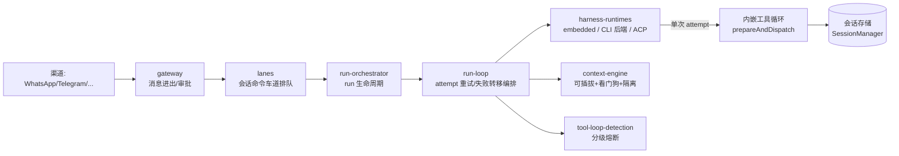
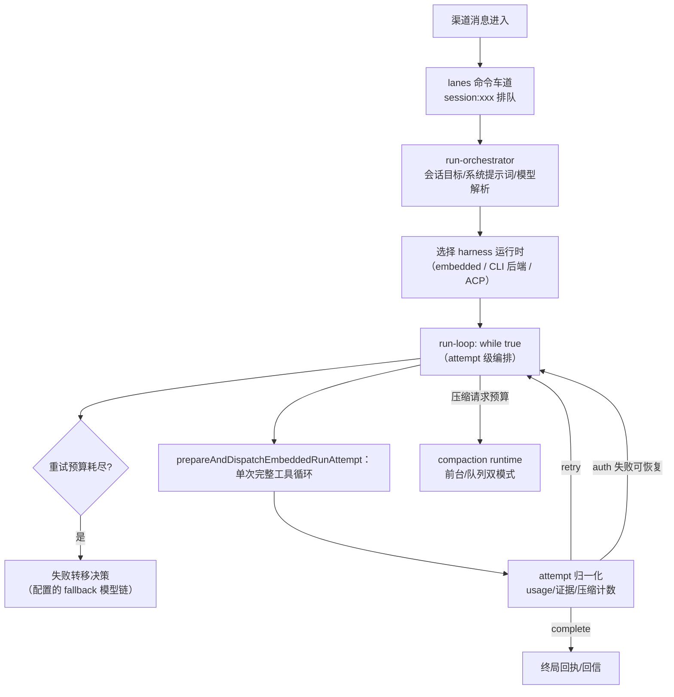

# OpenClaw（openclaw/openclaw）harness 实现导读

> 基于版本：`main@cb4d0357`（锚点以此为准）｜语言：TypeScript（src/ 平铺大目录 + Rust crates 网关）｜39 万 star
> 源码目录：`.spec/源码学习\_clones\openclaw`（浅克隆，已检出 src/packages/docs）
> 定位一句话：7×24 跑在用户自己设备上的个人 AI 助手（原 Clawdbot/Moltbot）——多渠道消息进出、**harness 本身可替换**、运维级防御密度全场最高。

---

## 0. 总览

OpenClaw 与其他四仓的最大差异：它不是「一个 agent 循环」，而是**一个常驻系统的 agent 运行时编排层**。三条定义性事实：

1. **多 harness 运行时**：embedded（内嵌 SDK 工具循环）、CLI 后端（符合条件时外包给外部 CLI agent）、ACP 运行时——`src/agents/harness-runtimes.ts` 统一管理，agent 循环本身是可替换组件。
2. **外层循环管 attempt，不管 turn**：`run-loop.ts` 的 `while(true)` 编排的是「一次完整 run attempt」的重试预算、认证重试、模型失败转移链、压缩预算与权限重启；单次 attempt 内的工具循环委托给所选 harness。
3. **运维级防御**：工具死循环分级熔断、压缩看门狗、上下文引擎隔离健康检查、会话车道排队——因为它是跑在用户手机/小主机上的守护进程，崩了没人盯。

### 架构总图

### 关键目录

| 目录 | 职责 |
|---|---|
| `src/agents/` | 主战场：embedded-agent-runner/（109 个模块：run-loop、compact.* 一族、model 一族、tool-result 一族）、tool-loop-*（熔断）、prepared-model-runtime.*（模型运行时巨族） |
| `src/context-engine/` | 上下文引擎：注册表、legacy fallback、compaction-watchdog、quarantine-health |
| `src/gateway/` + `src/channels/` | 渠道网关与多渠道接入 |
| `src/daemon/` + `src/cron/` | 常驻守护与定时 |
| `src/interactive/` + `src/cli/` | 交互式会话与 CLI |
| `crates/`（Rust，未检出） | crabbox 原生网关 |

---

## 1. agent 主循环

**核心问题**：「循环」在 OpenClaw 里到底是什么形状？

### 主线流程图

### 关键点

#### 1.1 外层循环管 attempt，内层循环交给 harness

📍 `src/agents/embedded-agent-runner/run-loop.ts:291`（while true）、`:366-395`（prepareAndDispatchEmbeddedRunAttempt）

**干什么**：`while(true)` 的每次迭代 = 一次完整 run attempt（整个「LLM+工具」循环打包），attempt 之间处理：重试预算（`runRetryBudget`，区分 dispatched/counted 两种计数）、认证重试（`authRetryPending`）、压缩请求预算（`compactionRequestBudget`）、权限变更重启（`permissionChanges.prepareRestart()`，`:451-458`，注释明说「操作员指示的续跑不算模型失败重试」）。
**为什么**：常驻系统里「一次 run」的生命周期远比「一次工具调用」复杂——把重试、降级、续跑全部抬到 attempt 层，harness 内部保持纯粹。

#### 1.2 模型失败转移是预解析的候选链

📍 `src/agents/model-fallback-candidates.ts`（resolveModelCandidateChain，run-orchestrator.ts:30 引入）、`embedded-cyber-failover.ts`

**干什么**：run 开始前解析模型候选链（主模型 → 配置的 fallback 链），attempt 失败按 `resolveRunFailoverDecision` 决定切换还是终止，`failoverRetryController` 跟踪转移原因。
**为什么**：个人助手不能因为一家 provider 抽风就沉默——候选链预先解析，转移是数据驱动的查表不是临时拼装。

#### 1.3 会话车道：多会话排队的一等抽象

📍 `src/agents/embedded-agent-runner/lanes.ts:6-16`（resolveSessionLane / resolveGlobalLane）

**干什么**：每个会话映射到 `session:<id>` 命令车道，全局工作走全局车道；run 在自己的车道上排队串行，跨车道并发。
**为什么**：一个守护进程同时服务几十个渠道会话——车道把「同会话串行、跨会话并发」变成显式结构，配合 `laneController.throwIfAborted()` 支持取消。

---

## 2. 工具系统与熔断

### 关键点

#### 2.1 工具死循环分级熔断

📍 `src/agents/tool-loop-detection.ts:50-52`（阈值：UNKNOWN_TOOL=10 / CRITICAL=20 / GLOBAL_CIRCUIT_BREAKER=30）、`:523`（detectToolCallLoop）、`tool-loop-thresholds.ts:1`（WARNING=10）

**干什么**：`recordToolCall/recordToolCallOutcome` 记录近期工具历史，`hashToolCall(名字+参数)` 识别重复；分级动作——警告（10 次）→ 未知工具熔断（10 次）→ 危险（20 次）→ 全局熔断（30 次）；配套 `tool-loop-no-progress.ts`（无进展检测）、`tool-loop-argument-churn.ts`（参数抖动——名字相同参数反复微调也算循环）。
**为什么**：无人值守场景模型死循环的代价是烧钱+刷屏+占死车道——这是 opencode「连续 3 次同参弹权限」的运维加强版，做成独立的分级熔断器族。

#### 2.2 审批等待是可观测状态

📍 `src/agents/agent-run-approval-wait.ts:6-21`（observeAgentRunApprovalWait）

**干什么**：审批 pending 状态被包装成可订阅对象（pending/pausedMs/onChange/dispose），每次 exec/wait 独立计时。
**为什么**：审批卡住 = agent 在等人类——守护进程需要把这个「暂停时长」上报给监控与用户（Telegram 里显示「等你批准」），而不是无限挂起。

#### 2.3 工具结果预算与截断家族

📍 `src/agents/embedded-agent-runner/` 的 `tool-result-text-budget.ts`、`tool-result-truncation.ts`、`tool-result-context-guard.ts`、`tool-result-char-estimator.ts`

**干什么**：工具结果进入上下文前经过字符预算估算、截断与守卫管线（与 opencode 的 2000 字符截断同题，OpenClaw 做成了模块族，含 send-receipts 与 presentation 序号）。
**为什么**：消息渠道（WhatsApp 有消息长度限制）+ 上下文窗口双重约束下，工具输出必须双向瘦身：给模型的截断、给渠道的重新打包。

---

## 3. 上下文管理

### 关键点

#### 3.1 上下文引擎可插拔 + legacy 永远兜底

📍 `src/context-engine/init.ts:1-14`（注册表 + legacy fallback）、`registry-contract.ts` / `registry-selection.ts` / `delegate.ts`

**干什么**：上下文引擎走注册表：内置引擎先注册（legacy 永远在，作为默认槽位的安全兜底），插件经 `api.registerContextEngine()` 增补；运行时按 host（如 `agent-harness:<id>`，run-loop.ts:260-269）+ 操作类型选取引擎，逻辑 turn 持有 lease。
**为什么**：「怎么管上下文」本身是演进最快的部分——引擎做成可替换插槽（与 dsh 插件化同思想），但保证任何配置错误都退回可用状态。

#### 3.2 压缩是运行时 + 看门狗 + 隔离

📍 `src/agents/embedded-agent-runner/compact*.ts`（15+ 个模块：queued/foreground-work/hooks/safety-timeout/successor/checkpoint…）、`src/context-engine/compaction-watchdog.ts`、`quarantine-health.ts`

**干什么**：压缩运行时区分前台与队列两种执行模式，带安全超时、后继会话（successor）、去重（duplicate-user-messages）、诊断；context-engine 侧配压缩看门狗与隔离健康检查（引擎异常可被隔离而不是拖垮 run）。
**为什么**：压缩是常驻系统最易失火的部件——15 个模块的全职团队 + 看门狗 + 隔离，把「压缩坏了」的影响半径控制住。

---

## 4. 模型接入

### 关键点

#### 4.1 prepared-model-runtime：模型配置的「物化发布」巨族

📍 `src/agents/prepared-model-runtime*.ts`（40+ 文件：catalog/publication/lease/owner/hot-reload/retention…）

**干什么**：模型目录（catalog）、认证、别名、provider 归一化被「准备-物化-发布」成带租约与所有权的运行时资源，支持热重载（hot-reload-dispatch）与代际（generation scope，run-orchestrator.ts:29 引入）；run 通过 `acquireAgentRunPreparedModelRuntime` 获取。
**为什么**：OpenClaw 支持几十家 provider + OAuth + 多认证档案（auth-profiles），配置热变更不能让进行中的 run 拿到半新半旧的模型栈——「配置即资源、发布即事务」。

#### 4.2 CLI 后端外包判定

📍 `src/agents/embedded-agent-runner/cli-backend-dispatch.ts`（run-orchestrator.ts 引入 runEmbeddedAgentViaCliBackendIfEligible）

**干什么**：满足条件时整个 run 外包给外部 CLI agent 后端（有独立的 transcript 分发协议 eligibility/transcript 模块）。
**为什么**：与 hermes 的 codex_app_server 同款「自噬」模式——好用的外部 agent 运行时直接编入候选，OpenClaw 只做编排与渠道适配。

---

## 5. 会话与持久化

### 关键点

#### 5.1 SessionManager + 会话挂起

📍 `src/agents/sessions/session-manager.ts`（run-orchestrator.ts:36 引入）、`session-suspension.ts`（resolveSessionSuspensionTarget/suspendSession）

**干什么**：会话由 SessionManager 管理，支持「挂起」（suspension，外层 fallback 尝试期间延迟挂起，run-orchestrator.ts:183 注释）与 run-session-target 身份解析/继承。
**为什么**：多渠道长期会话需要「暂停而不销毁」的中间态——挂起释放算力但保留恢复点，配合重放状态（replayState，run-loop.ts:289 accumulatedReplayState）跨 attempt 累积。

#### 5.2 转录即事实源

📍 `src/agents/embedded-agent-runner/transcript-runtime-state.ts`、`transcript-byte-preflight-authority.ts`、`transcript-rewrite.ts`

**干什么**：会话转录有独立的运行时状态、字节预检权威与重写模块；重试保持自己的准入（admission），只有转录变更才需要 writer claim（run-loop.ts:292 注释）。
**为什么**：多 harness（embedded/CLI/ACP）共享同一会话转录——写权集中管理 + 预检权威，防止两个运行时对历史各执一词。

---

## 补遗：审计回填（工具规模治理 / 记忆 / Multi-Agent）

> 2026-09-18 二次审计发现的三处遗漏，回源码核实后补齐。

#### A. 工具规模治理：Tool Search 目录压缩（16 模块族）

📍 `src/agents/tool-search.ts:1`（模块注释："Tool Search catalog compaction for large OpenClaw, MCP, and client tool inventories"）、`tool-search-runtime-config.ts:3-9`（resolveAgentToolSearchRuntimeConfig，`toolSearchMode: "tools" | false`）

**干什么**：把自有 + MCP + 客户端注入的大工具清单压缩成**可搜索目录**（tool-search-catalog）——模型经搜索工具按需取用（readToolSearchId / prepareToolSearchDispatcherArguments），配 ranking（排序）、directory（schema 目录，带 MAX_TOOL_SCHEMA_DIRECTORY_PROMPT_CHARS 上限）、code-mode（代码内调用）、recovery / scheduling / transcript 配套模块；本地轻量模型（lean）自动启用。
**为什么**：几十个 MCP 服务可能注入数百工具，全量发 schema 既挤上下文又稀释注意力——「目录 + 搜索 + 按需取用」让工具面从 O(全部工具) 变成 O(检索结果)；按模型能力自动开关，小模型不背大目录。

#### B. 记忆：根记忆文件定位与修复

📍 `src/memory/root-memory-files.ts:1-5`（"Locates root memory files that seed agent context"；CANONICAL_ROOT_MEMORY_FILENAME="MEMORY.md"、LEGACY="memory.md"、ROOT_MEMORY_REPAIR_RELATIVE_DIR）

**干什么**：定位为 agent 上下文播种的根记忆文件（规范名 MEMORY.md，兼容旧 memory.md），配合 `memory-artifact-provenance.ts`（记忆产物溯源）与 `memory-host-sdk/`；损坏走 `.openclaw-repair/root-memory` 修复目录而非原地覆写。
**为什么**：记忆文件由 agent 自己维护，写坏是常态——「规范名 + 遗留名 + 修复目录」三件套让记忆损坏可恢复、可溯源，这是无人值守系统对记忆的运维化处理。

#### C. Multi-Agent：swarm 控制器与多实例

📍 `src/agents/code-mode-swarm.runtime.ts`（swarm 运行时）、`code-mode-swarm-controller-source.ts`（控制器源码注入）、`openclaw-tools.swarm.ts`（swarm 工具）；`src/claws/`（多 agent 实例）、`src/fleet/`

**干什么**：swarm 以「代码模式控制器」形态组织多个 agent 协作（控制器源码作为可注入资源），swarm 能力作为工具暴露给模型；另有 claws（多实例 agent）与 fleet 目录支撑实例编排。
**为什么**：与 dsh 的「派子代理工具」同路数但更进一步——群体协作的编排逻辑本身可以是代码（code-mode），模型负责高层意图， swarm 控制器负责调度。

## 6. 值得偷学的决策 + 横向对照

1. **harness 可替换、编排为王**——OpenClaw 把「agent 循环」降级为可替换运行时，自己的核心价值是 attempt 级编排（重试/转移/压缩/审批/车道）；做平台时这是正确的分层。
2. **死循环分级熔断器**——警告/未知工具/危险/全局四档 + 参数抖动检测，比「N 次同参弹窗」细腻，无人值守系统的标配。
3. **legacy 引擎永远兜底**——可插拔注册表必配一个不可卸载的 fallback 槽位，演进不牺牲可用性。
4. **压缩做成「模块族 + 看门狗 + 隔离」**——把最易失火的部件圈起来单独防御。

| 维度 | OpenClaw | hermes | opencode | pi | dsh |
|---|---|---|---|---|---|
| 形态 | 常驻编排层（harness 可换） | Python 单体循环 | Effect 服务内核 | 纯函数循环 | 插件生态平台 |
| 循环粒度 | attempt（内层委托 SDK） | turn + phase | step（DB 重读） | turn（双层 while） | turn/step 事件 |
| 死循环防护 | 四级熔断 + 参数抖动 | 迭代/预算三层 | 权限 ask（3 次同参） | 无内建 | 提醒插件 |
| 上下文 | 引擎注册表+看门狗 | 专职压缩引擎 | prune+截断 | 分支摘要 | 事件事务+KV 复用 |
| 面向 | 多渠道个人助手（无人值守） | 多渠道个人助手 | 单用户终端 | 嵌入式工具箱 | 企业 SDK |

### 断点建议

- 编排循环：`src/agents/embedded-agent-runner/run-loop.ts:291`（while true），对照开头 60 行的参数表读
- attempt 派发：`run-orchestrator.ts:1-45` 的 import 区即依赖地图
- 熔断：`src/agents/tool-loop-detection.ts:50`（阈值表）+ `:523`（detectToolCallLoop）
- 上下文引擎：`src/context-engine/init.ts`，再挑 `compaction-watchdog.ts` 看防御姿势
- 车道：`embedded-agent-runner/lanes.ts`（全文件仅 20 行，五脏俱全）
