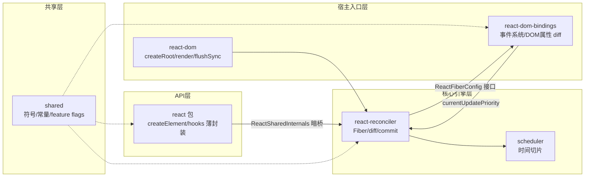

# react/react 源码导读

> 基于版本：main 分支 commit `59aff3e18cb5b3a336c280bbfa57ec37999511b9`（2026-09-18，react/react，原 facebook/react 已迁至 react 组织）｜语言：JavaScript + Flow｜源码目录：`.spec/源码学习/_clones/react`（sparse-checkout 只检出 packages/）
> 一句话：把「UI = f(state)」这句口号，用一棵可中断的 Fiber 树 + 一条调度循环 + 一段原子提交实现的渲染机器。

## 这个仓库解决什么问题

手写 DOM 的时代，界面状态散落在成百个 DOM 修改语句里，改一处动全身。React 的核心抽象是声明式：你只描述"现在这个状态该长什么样"（render 函数），它负责算出最小 DOM 改动并安全落地。整个仓库就在回答三个问题：**怎么算**（协调/diff）、**什么时候算**（调度/时间切片）、**怎么安全落地**（提交）。读源码就是看这三个问题的工业级答案。

## 前置知识地图

按"缺了必晕"排序（导读各章也会就地铺垫，这里是总预习清单）：

1. **事件循环 / 宏任务与微任务**——时间切片的物理基础，不懂这个 Scheduler 章完全看不懂。📖 https://developer.mozilla.org/en-US/docs/Web/JavaScript/EventLoop
2. **链表**——Fiber 树的骨架。搜索「MDN 链表 数据结构」即可，概念比 API 重要。
3. **位掩码**——lane 优先级系统的表达方式。搜索「位运算 bitmask 入门」。
4. **Object.is**——React 判断"变没变"的相等语义。📖 https://developer.mozilla.org/en-US/docs/Web/JavaScript/Reference/Global_Objects/Object/is
5. **JSX 与转译**——知道"JSX 会被改写成函数调用"这一件事就够了（第 2 章展开）。

## 架构总图

三个关键接线：react 包与 reconciler 互不 import，靠 `ReactSharedInternals.H` 分发器换手；reconciler 碰不到 DOM，一切 DOM 操作走构建期注入的 `ReactFiberConfig` 接口；事件系统对渲染管线的唯一输出是"当前更新优先级"这个全局值。

## 学习动线

编号即推荐阅读顺序，01→10 顺序读即可；标注★的章节独立性强，时间紧可先跳。

| 章 | 讲什么（一句话） | 核心问题 |
|---|---|---|
| 01 | 三层架构与包接线 | 一次 render 调用要穿过哪几层？ |
| 02 | JSX 与 ReactElement | 标签变成了什么对象？ |
| 03 | Fiber 架构与双缓冲 | 什么数据结构敢渲染一半停下？ |
| 04 | 更新定价与调度启动 | setState 后第一毫秒发生什么？ |
| 05 | Scheduler 时间切片 | 怎么造一个可暂停的时钟？ |
| 06 | 协调与 Diff（含 ErrorBoundary） | 新树怎么高效算出来？ |
| 07 | 提交 Commit 三段仪式 | 浏览器哪一刻看到新界面？ |
| 08 | Hooks 实现 | useState 凭什么记得上一次的值？ |
| 09★ | 事件系统 | onClick 和原生 click 之间隔着什么？ |
| 10 | 设计取舍总览 | 这台机器为什么长这样？ |

依赖关系：04→05、06→07 是硬依赖（后章直接引用前章机制）；03 是 04/06/07 的共同底座；08 需要 06+07 的阶段概念；09 只依赖 04 的 lane 概念。

## 上手建议

1. **先跑一个最小应用**：Vite 起 `npm create vite@latest -- --template react`，写一个计数器（useState + 一个大列表 + useEffect），所有章节的现象它都能演示。
2. **断点四连**（Chrome DevTools Sources 里直接打断点，构建产物有 sourcemap 时定位 react-dom development 版）：
   - `ReactFiberHooks.js` 的 `dispatchSetStateInternal` 急切计算段——亲眼看"同值不渲染"；
   - `ReactFiberRootScheduler.js` 的 `processRootScheduleInMicrotask`——看微任务里怎么排期；
   - `ReactFiberBeginWork.js` 的 `beginWork`——看 bailout 判活；
   - `ReactFiberWorkLoop.js` 的 `commitRoot`——看三段仪式顺序。
3. **配合 React DevTools**：Components 面板开 "Highlight updates"，直观看到哪些子树被 bailout 了（第 6 章判活的可视化）。
4. **读源码姿势**：本导读每章 5-10 个关键点，读到锚点处**先自己开源码看上下文 20 行**再回来看讲解——导读是地图，源码才是领土。

## 设计取舍总览（第 10 章要点透视）

- **Fiber 化**：用数据结构换调用栈——买到可中断，付出内存与复杂度。
- **双缓冲**：永远最多两棵树、旧节点池化——更新几乎零分配。
- **lane 位掩码**：31 条车道一次位运算定组合——多任务集表达力的最省解。
- **commit 原子性**：全系统唯一不可中断段——UI 永不撕裂的底线。
- **编译时转向**：React Compiler 进入官方包——"运行时 diff 一切"开始让渡给"编译期证明"。

## 覆盖范围声明

本次导读覆盖客户端渲染主线（六核心包约 9.6 万有效源码行）。**未覆盖**（后续值得单独成轮）：RSC 服务端组件线（`react-server-dom-*`/`react-client`/Fizz 流式渲染）、DevTools 全家桶、react-native-renderer/react-art 其他宿主、React Compiler 本体。九命题清点结论（主循环/错误降级/上下文等 4 项有机制映射、5 项经检索确认不存在）见同目录 `大纲.md` 文末表格。
