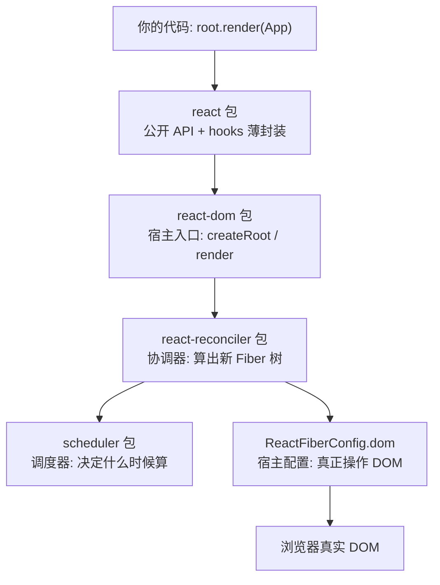

# 第 1 章：总体架构与包结构 —— 一次 render 调用的旅程

## 本章在全局的位置

本章是全仓的"地图页"：先认清 39 个包里谁在干活、层与层之间怎么接线，后面九章都是在这张地图上放大某一层。本仓是 monorepo：一个大仓库里住着几十个可以独立发布的包。

## 前置知识

### monorepo
一个 git 仓库里放多个包（`packages/` 下每个目录一个包，各有自己的 `package.json`），共享一次安装、一次提交。React 所有包的版本号由根目录 `ReactVersions.js` 统一管理。

### Flow
React 源码用的类型标注工具（不是 TypeScript）。看到 `function f(x: Lane): void` 这种冒号语法就是类型标注，构建时会被剥掉。`__DEV__` 是编译期开关：开发版保留告警，生产版整段删除。

## 核心问题

你写下 `root.render(<App />)`，到屏幕上出现内容，中间要穿过哪几层代码？

## 主线流程图



## 关键点讲解

### 三层接线：API 层 → 宿主层 → 协调层

📍 `packages/react/index.js:77`

`react` 包本体小得惊人（约 4000 行）：导出 `createElement`、`useState` 这些名字，但只做参数打包和转发，真正的实现全在别的包。它是"前台接待"，负责把你的调用翻译成内部格式。

📍 `packages/react-dom/src/client/ReactDOMClient.js:10`

`react-dom` 是浏览器宿主的入口包，`createRoot` 就是从 `./ReactDOMRoot` 转出来的。它自己也不干活，是"包工头"：把 react-reconciler（算账的）和 DOM 操作（砌墙的）组合起来。

> 为什么三层而不是一层？因为协调器要同时服务 DOM、Native、Art 三种宿主——本章第 5 个关键点展开。

### createRoot 只做三件事

📍 `packages/react-dom/src/client/ReactDOMRoot.js:239-258`

```js
const root = createContainer(container, ConcurrentRoot, /*...*/);
markContainerAsRoot(root.current, container);
listenToAllSupportedEvents(rootContainerElement);
```

第一件事 `createContainer`（react-reconciler 的 `ReactFiberReconciler.js:235`）：在内存里建出 FiberRoot——整个应用的"渲染工程部"。第二件事把 fiber 根挂到 DOM 容器上（留个互相找到对方的钩子，事件系统靠它）。第三件事把所有原生事件一次性委托到根容器上，第 9 章的主角在这里提前登场。

为什么事件只挂根容器一份而不是每个节点都挂？上万节点挂上万监听器，内存和注册开销都吃不消；委托到根上，一份监听器服务全树。

### render 的去向：只是"递单子"

📍 `packages/react-dom/src/client/ReactDOMRoot.js:135` → `packages/react-reconciler/src/ReactFiberReconciler.js:353`

`root.render(children)` 内部只有一行：`updateContainer(children, root, null, null)`。reconciler 里的 `updateContainer` 做两步：`requestUpdateLane`（给这次更新定优先级，第 4 章讲）然后排队——注意它**不直接渲染**。render 是"下订单"，什么时候开工由调度系统决定，这是 React 能做异步渲染的第一块拼图。

### 跨包暗桥：ReactSharedInternals

📍 `packages/shared/ReactSharedInternals.js:11`、`packages/react/src/ReactHooks.js:24`

有个鸡生蛋问题：`react` 包发布时不知道谁在渲染（react-dom？react-native？），而 hooks 的真正实现在协调器里。解法是共享内部对象：`react` 包把 internals 挂在 `__CLIENT_INTERNALS_DO_NOT_USE_OR_WARN_USERS_THEY_CANNOT_UPGRADE` 上导出，`shared/ReactSharedInternals.js` 把它引回来。

你调 `useState` 时（`ReactHooks.js:24` 的 `resolveDispatcher`），它只是去读 `ReactSharedInternals.H`——一个当前由渲染器填好的"分发器"。渲染时协调器把 H 换成真实现（`ReactFiberHooks.js:563`），渲染完换回哨兵值（`ReactFiberHooks.js:660`）。

这解释了一条铁律：**hooks 只能在组件渲染期间调用**——因为只有那时 H 才指向真实现，其他时候读 H 得到的是禁止调用的哨兵。

### 宿主配置注入：协调器为什么碰不到 DOM

📍 `packages/react-reconciler/src/forks/ReactFiberConfig.dom.js`

翻遍 react-reconciler 源码，没有任何 `document.createElement`——它 import 的是一个叫 `ReactFiberConfig` 的模块。这个模块实际是构建期的"占位符"：打包 react-dom 时被替换成 `ReactFiberConfig.dom.js`，打包 native 渲染器时换成 fabric 的版本（`forks/` 目录下 dom/art/fabric/markup/noop 五种并排）。

这是"依赖倒置"的教科书操作：协调器定接口（创建实例、往容器插入、改属性……），宿主给实现。所以 react-native、react-art 能和 react-dom 共用同一颗协调器大脑——学一遍 React 核心，等于同时看懂三个渲染器。

### shared 包：全仓常量的单一事实源

📍 `packages/shared/ReactSymbols.js:16`

`shared/` 平铺着符号表（`REACT_ELEMENT_TYPE`）、特性开关（`ReactFeatureFlags.js`，同一份代码在这里拨开关出不同版本）、错误消息等。跨包 import 常量只准走 shared，避免"两个包各抄一份常量后来改不同步"的经典事故。

### 本次不覆盖的包（先声明，后面不再提）

RSC 服务端组件线（`react-server-dom-*`、`react-client`、`react-server`）、DevTools 全家桶（约 20 个 `react-devtools-*` 包）、`react-native-renderer`/`react-art` 其他宿主、`react-refresh` 热更新。它们是独立子系统，混进主线只会打断动线。

## 收束

一次 render 的旅程是：你的代码 → react（翻译）→ react-dom（组队）→ reconciler + scheduler（算账 + 排期）→ FiberConfig.dom（砌墙）→ 屏幕。下一章从管线的入口讲起：JSX 写的"HTML"到底变成了什么对象，才能被这条管线消化。
