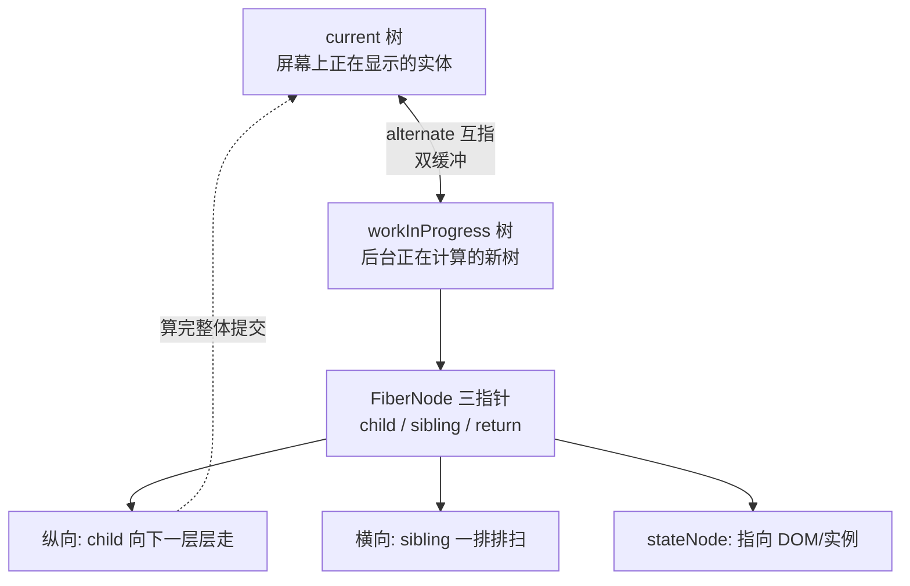

# 第 3 章：Fiber 架构 —— 可中断渲染的数据底座

## 本章在全局的位置

上一章的 Element 是静态单据。本章讲 React 把单据变成的运行时实体——Fiber 节点：它是后面所有章节（调度、diff、提交、hooks）共享的数据底座，认不清 FiberNode，后面全是天书。

## 前置知识

### 链表
一种用"指针"串起来的数据结构：每个节点存数据和指向邻居的引用，找下一个靠 `.next` 而不是数组下标。Fiber 树用三个指针把树"拍平"成链表网：`child`（第一个孩子）、`sibling`（下一个兄弟）、`return`（父节点——真叫 return，尽管语义是父节点）。

### 调用栈
函数 A 调 B、B 调 C，浏览器把它们压进栈；C 没返回，A 和 B 就都下不来。React 15 的递归渲染正是栽在这里：渲染一棵树 = 一长串嵌套调用，中途根本没法"暂停"，一停整个调用栈就废了。

## 核心问题

React 在内存里用什么数据结构摆弄组件树，为什么这个结构敢渲染到一半停下来？

## 主线流程图



## 关键点讲解

### FiberNode 字段全览：五组身份信息

📍 `packages/react-reconciler/src/ReactFiber.js:134-206`

一个 FiberNode 约 20 个字段，按用途分五组看就不乱了：**实例组**（`tag` 节点类型、`type` 组件/标签名、`stateNode` 实体指针）、**链表组**（`return/child/sibling/index`，树的形状）、**状态组**（`pendingProps` 新 props、`memoizedProps/memoizedState` 上次算完的记忆、`updateQueue` 更新队列）、**效果组**（`flags` 这节点要动 DOM 的标记、`subtreeFlags` 子树里有动静的汇总、`deletions` 要删谁）、**优先级组**（`lanes` 这个节点有待处理的更新、`childLanes` 子树里有）。别背，混个脸熟，后面每章都会撞见它们。

### 为什么是链表：把"树"拍平才能半路停车

📍 `packages/react-reconciler/src/ReactChildFiber.js:1168-1179`

递归渲染不可中断，是因为进度存在调用栈里——栈是浏览器管的，JS 够不着。Fiber 的解法：把树的遍历改成 `while` 循环，"当前处理到哪了"只靠一个全局指针 `workInProgress` 表示。想暂停？循环 break，指针留在原地；想恢复？从指针处接着走。三指针结构就是为这种"平面推进"设计的——`ReactChildFiber.js:1168` 的注释还透露一个代价：fiber 没有反向指针（只有 return），所以 diff 做不了从两端往中间的双端优化，这是后话。

打个比方：递归是"一层楼一层楼盖，上去了就得封顶才能下来"；链表循环是"用便利贴记着当前工地，随时收工，明天从便利贴接着干"。

### 双缓冲：两棵树来回倒

📍 `packages/react-reconciler/src/ReactFiber.js:323-351`

```js
let workInProgress = current.alternate;
if (workInProgress === null) {
  workInProgress = createFiber(/*...*/);
  workInProgress.alternate = current;
  current.alternate = workInProgress;
}
```

同一位置永远最多两棵 fiber 树：`current`（屏幕上正在显示的，动不得）和 `workInProgress`（后台正在算的新版）。`createWorkInProgress` 负责拿到/造出"另一棵"：第一次见面就各建一个并 `alternate` 互指；以后更新直接复用对方那棵旧节点，重置 flags 换上新 props。

注释（`ReactFiber.js:326-330`）点破设计动机：**树最多两份，所以旧节点可以池化复用**——更新时几乎不用新分配内存。这就是"双缓冲"这个名字的来历：显卡画下一帧也是同一招，前台一帧给你看，后台一帧随便改。

### FiberRoot 与 rootFiber：工程部和工地

📍 `packages/react-reconciler/src/ReactFiberRoot.js:50-110`

两个容易混的"root"：`FiberRootNode` 是工程部——管理整个应用级状态（`containerInfo` 对应哪个 DOM 容器、`pendingLanes` 全局还有哪些活没干完、`callbackNode` 当前排的什么任务、三大回调 `onUncaughtError` 等）；`root.current` 指向的 HostRoot fiber 才是 fiber 树的入口工地。第 1 章的 `markContainerAsRoot(root.current, container)` 挂的就是这个入口。

### WorkTags：每个 fiber 的身份牌

📍 `packages/react-reconciler/src/ReactWorkTags.js:44-58`

`FunctionComponent = 0`、`ClassComponent = 1`、`HostComponent = 5`（DOM 元素）、`HostText = 6`（纯文本）……协调器对每种身份走完全不同的处理分支，所以 `tag` 是 beginWork 大 switch 的钥匙（第 6 章的 switch 就按它分发）。

### stateNode：fiber 的实体指针

📍 `packages/react-reconciler/src/ReactFiber.js:146`

`stateNode` 是 fiber 和现实世界的连接点：HostComponent 的 fiber 指向真实 DOM 节点，类组件 fiber 指向组件实例，FiberRoot 的 fiber 指回 FiberRootNode。Element 里没有实例（第 2 章说过），实例就住在 fiber 这里——"单据"和"实体"的分界在字段上可见。

## 收束

Fiber = 用三指针链表 + 双缓冲把组件树变成"可暂停、可复用、可指认"的运行时结构。有了底座，下一章看它怎么转起来：一个 setState 发出的更新，怎么被定价（lane）、排队、排期。
