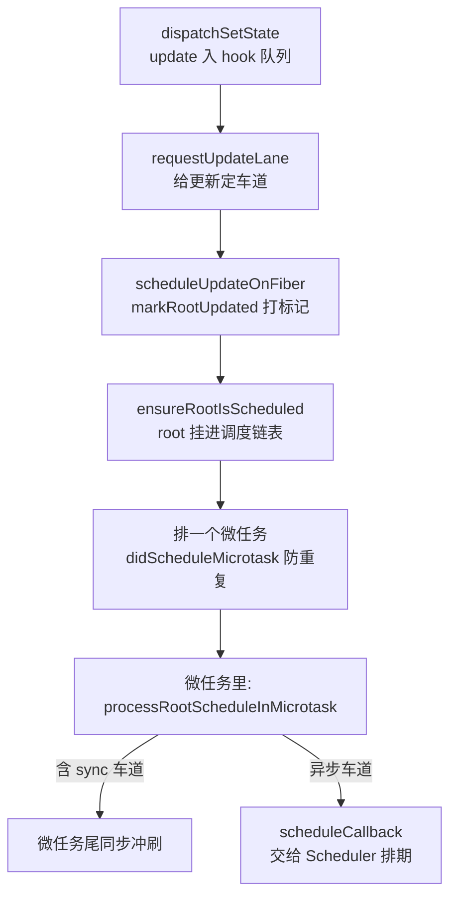

# 第 4 章：渲染入口与调度启动 —— setState 之后的第一毫秒

## 本章在全局的位置

底座（Fiber）有了，本章接通"用户调用 → 内部引擎"的开关：一个 setState 发出后，怎么被定价、合并、排期——注意，到这里**还没有任何渲染发生**，只做了"接单"。

## 前置知识

### 位掩码（bitmask）
用一个整数的每一个二进制位当开关：`0b1010` 表示"2 号和 4 号开关开着"。合并两组开关用按位或 `|`，查某个开关用按位与 `&`。一次 CPU 指令处理 31 个布尔值，这是 React 优先级系统的地基。

### 微任务（microtask）
Promise.then 排进的那种"本轮代码跑完后、浏览器渲染前"执行的小任务。它比 setTimeout 快，且天然把"同一轮事件里的多次调用"合并成"下一轮一次执行"——React 靠它做更新合并。（事件循环全景第 5 章铺开。）

## 核心问题

`setState` 之后、渲染开始之前，React 在第一毫秒里做了哪些事？

## 主线流程图

## 关键点讲解

### 选道：这次更新该走哪条车道

📍 `packages/react-reconciler/src/ReactFiberWorkLoop.js:812-871`

`requestUpdateLane(fiber)` 是更新的定价处，三个分支：legacy 模式一律 SyncLane（快车道）；处于 `startTransition` 上下文则走 TransitionLane（慢车道）；否则看"当前事件优先级"映射成 lane——在 click 事件里 setState 和在 scroll 事件里 setState 定价不同（这个"事件优先级"哪来的？第 9 章揭晓：注册事件时按事件名定的）。

### lane：31 条车道的位掩码

📍 `packages/react-reconciler/src/ReactFiberLane.js:41-107`

lane 是 31 位整数，一位就是一条车道：`SyncLane = 0b...010`（第 2 位）、`InputContinuousLane`（第 4 位）、`DefaultLane`（第 6 位）、`IdleLane`（第 29 位）……**位越低优先级越高**。两条车道合并 = 按位或；"这批更新里有没有 sync"= 一次按位与。总车道数 `TotalLanes = 31`，恰好卡在 32 位整数的符号位安全区内。

为什么不用一个数字当优先级？因为一次渲染可能同时带着好几档活（sync 的表单 + transition 的列表），车道集合让"一次渲染捎带多档任务"成为一次位运算。

### setState 入队：先记账，再喊单

📍 `packages/react-reconciler/src/ReactFiberHooks.js:3718-3721`

`dispatchSetState` 把 update 对象挂进对应 hook 的队列，然后 `enqueueConcurrentHookUpdate` 拿到 root，调 `scheduleUpdateOnFiber(root, fiber, lane)`。注意一个 update 只有 lane + action 等几个字段——"action 是什么"先记下账，兑现等到渲染时（第 8 章）。

### scheduleUpdateOnFiber：打标记 + 保障调度

📍 `packages/react-reconciler/src/ReactFiberWorkLoop.js:987-1093`

这个函数做两件事：`markRootUpdated(root, lane)`（`ReactFiberLane` 上点亮车道）和 `ensureRootIsScheduled(root)`。中间还夹着防御逻辑：如果更新发生在渲染进行中，记进 `workInProgressRootInterleavedUpdatedLanes`（`:1067-1075`）——渲染期间外面的世界还在动，这些"插队账单"等本轮算完一起结。

### 根调度链表：10 次 setState 只排一次任务

📍 `packages/react-reconciler/src/ReactFiberRootScheduler.js:116-168`

`ensureRootIsScheduled` 轻得出奇：把 root 挂进全局的"待调度根链表"（已在链表里就 fast path 跳过），然后 `ensureScheduleIsScheduled` 检查 `didScheduleMicrotask`——没排过微任务才排一个。于是**同一轮事件里连发 10 次 setState，只有第一个会真正排任务**，后九个只是把 root 再挂一遍链表。批处理的第一层就发生在这里：批的是"调度"，不是 setState 本身。

### 微任务里排期：真正的决策时刻

📍 `packages/react-reconciler/src/ReactFiberRootScheduler.js:259,384`

微任务触发 `processRootScheduleInMicrotask`，逐个根调 `scheduleTaskForRootDuringMicrotask`，三连问：这批车道有没有被高级任务饿太久？饿了就标记过期防饿死（`:397` 的 `markStarvedLanesAsExpired`）。含 sync 车道？那微任务结尾同步冲刷（React 承诺离散事件同步上屏）。否则按最高优先级车道换算成 Scheduler 优先级，`scheduleCallback` 排期——把"什么时候跑"交给下一章的时钟。

### flushSync：同步逃生门

📍 `packages/react-reconciler/src/ReactFiberRootScheduler.js:185-247`

`flushSync(fn)` 跳过整个异步排期：走 `flushSyncWorkAcrossRoots_impl` 当场把所有根上的 sync 车道干完再返回。代价是打断批处理（性能）和潜在的撕裂风险，所以官方定位是"逃生门，不是常规操作"。

### 批处理的真相

把本章串起来：**"自动批处理"不是把 setState 存起来攒一攒，而是"多次接单、一次排期"**——每次 setState 都立刻入队（账不丢），但调度入口被微任务 + `didScheduleMicrotask` 去重成每轮事件最多一次。render 拿到的是合并后的完整账本。所谓"React 18 之前事件外不批"，本质是老版本只在事件处理器里做这层去重。

## 收束

setState 的第一毫秒：定价（lane）→ 入队 → 挂根链表 → 微任务里排期。活儿排下去了，什么时候真正开工？下一章拆 Scheduler：React 怎么用 MessageChannel 造出一个"每 5ms 能停下来看一眼"的时钟。
