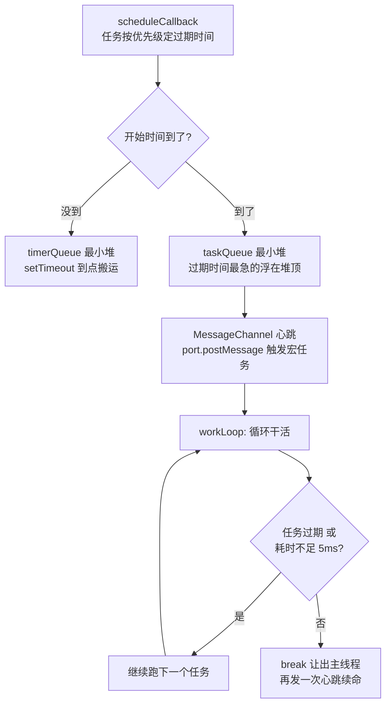

# 第 5 章：Scheduler 时间切片 —— 一个可暂停的时钟

## 本章在全局的位置

上一章结束时活儿已排进 Scheduler。本章进 `scheduler` 包（全仓最独立的包，约 2000 行，无任何 React 依赖）：看 React 怎么在"JS 无法主动让出 CPU"的世界里，造出时间切片。

## 前置知识

### 事件循环与宏任务
JS 单线程，浏览器靠事件循环轮流执行任务队列里的宏任务（setTimeout 回调、消息事件等），**每个宏任务之间是浏览器喘口气的机会**（渲染、响应用输入）。想"让浏览器插个队"，办法是结束当前宏任务、把剩余活排成下一个宏任务。

📖 https://developer.mozilla.org/en-US/docs/Web/JavaScript/EventLoop

### MessageChannel
一个前后端无关的消息通道对象：`port1.postMessage()` 会让 `port2.onmessage` 作为**宏任务**在稍后触发。和 `setTimeout(fn, 0)` 相比它不受浏览器"嵌套 5 层后强制 4ms 延迟"的钳制，是最快、最稳的宏任务发牌器。

📖 https://developer.mozilla.org/en-US/docs/Web/API/MessageChannel

### requestIdleCallback（了解即可）
浏览器提供的"有空再跑"API，但触发时机依赖浏览器空闲状态、可能延迟数秒甚至更久（MDN 原文：不设 timeout 时"multiple seconds will elapse before the callback is fired"），React 试过之后弃用，自己造了调度器——这正是本章存在的理由。

### 最小堆（min-heap）
一种二叉树形状的数组：父节点永远 ≤ 子节点，`peek` 拿最小值 O(1)、`push/pop` O(log n)。 Scheduler 用它按"过期时间"管任务，最急的永远在堆顶。

## 核心问题

浏览器没有"暂停我的 JS"按钮，React 怎么做到渲染一半停下来让路？

## 主线流程图



## 关键点讲解

### 为什么自己造：现成 API 全不合格

📍 `packages/scheduler/src/forks/Scheduler.js:546-548`

`setTimeout(fn, 0)` 有两层问题：浏览器对嵌套定时器强制 4ms 钳制（卡帧），且语义是"稍后"不是"尽快"。`requestIdleCallback` 频率失控。注释里明说：DOM 环境首选 MessageChannel，"因为 4ms 的 setTimeout 钳制"；Node 环境（jsdom 混跑）优先 `setImmediate`（`Scheduler.js:531`），它既更快又不会阻止进程退出。

### MessageChannel 心跳循环

📍 `packages/scheduler/src/forks/Scheduler.js:546-554,498-528`

初始化时建一个 `MessageChannel`，`schedulePerformWorkUntilDeadline` 就是 `port.postMessage(null)`，`port1.onmessage` 指向 `performWorkUntilDeadline`。每次心跳：干活 → 还有活（`hasMoreWork`）就再 post 一次 → 没活了歇着。**渲染大任务被切成 N 个宏任务，每个宏任务之间浏览器都能插进渲染**——这就是"可中断"的全部物理基础。

### 双最小堆：就绪的和延时的分开管

📍 `packages/scheduler/src/forks/Scheduler.js:79-80,103-126`

`taskQueue`（就绪任务）和 `timerQueue`（延时任务）各是一个最小堆。`advanceTimers` 不停检查 timerQueue 堆顶：到点的搬进 taskQueue（排序键从"开始时间"换成"过期时间"）。两个堆 + 一个 setTimeout 搬运器，就是完整的延时任务系统。

### Task 与过期时间：优先级的物理意义

📍 `packages/scheduler/src/forks/Scheduler.js:356-380`

任务入队时按优先级算 `expirationTime = startTime + timeout`：Immediate 是 -1（立刻过期）、UserBlocking 250ms、Normal 5000ms、Low 10000ms、Idle 用 `maxSigned31BitInt`（近乎永不过期），各档超时常量在 `SchedulerFeatureFlags.js:13-15`。

**过期时间就是优先级的物理化**：排序键统一成"谁急谁靠前"，堆顶永远是最急的；任务一旦过期，`didUserCallbackTimeout` 为 true，调用方知道"不能再让了，用户已经等出忍耐极限"。

### workLoop：干一个、看一眼

📍 `packages/scheduler/src/forks/Scheduler.js:193-266`

```js
while (currentTask !== null) {
  if (currentTask.expirationTime > currentTime && shouldYieldToHost()) {
    break;  // 没过期，且时间片用完 → 让出
  }
  const continuationCallback = callback(didUserCallbackTimeout);
  if (typeof continuationCallback === 'function') {
    currentTask.callback = continuationCallback;
    return true;  // 返回了续命函数 → 立刻让出，下个心跳接着干
  }
  // ...
}
```

循环里两个让出口：时间片到了 break；任务回调返回"续命函数"（continuation，比如"这棵 Fiber 树还有一半没算完"）时立刻让出，把续命函数挂回原任务。这个 continuation 机制就是 React 渲染半途"存档"的方式。

### 5ms 时间片与 needsPaint

📍 `packages/scheduler/src/forks/Scheduler.js:459-472`、`SchedulerFeatureFlags.js:11`

`shouldYieldToHost` 只干一件事：本次心跳已耗时 ≥ `frameInterval` 就让路，默认 `frameYieldMs = 5`。选 5ms 而不是 16.6ms（一帧）是刻意的：切片比帧小，浏览器每帧之间有富余，动画不掉帧；源码注释（`Scheduler.js:452-455`）明说"不求对齐帧边界，对齐帧请用 rAF"。另有 `needsPaint` 标记：React 主动说"我要上屏了"，Scheduler 立刻让路（`:460`）。

注意：这里 5ms 是 **Scheduler 层**的让步节奏；reconciler 侧还有自己的让步窗口（每 25ms/5ms 检查一次，第 6 章），两层配合而非一回事。

### 与 reconciler 对接：lane 换算成五档

📍 `packages/react-reconciler/src/ReactFiberWorkLoop.js:3073-3078`

上一章 `scheduleTaskForRootDuringMicrotask` 排期时，把车道集合里最高优先级的车道换算成 Scheduler 五档之一。真正渲染时 `workLoopConcurrentByScheduler` 的循环是 `while (workInProgress !== null && !shouldYield())`——每算完**一个 fiber 节点**问一次 Scheduler"还能干吗"，答"不能"就带着 `workInProgress` 指针退场，下个心跳从断点继续。lane（React 语义优先级）→ Scheduler 五档（执行优先级），两层各司其职。

## 收束

Scheduler 的全部魔法 = MessageChannel 宏任务心跳 + 双最小堆 + 5ms 让步检查。下一章回到主线：拿到"可以开工"的许可后，reconciler 怎么把新 Element 树算成新 Fiber 树——以及算到一半组件抛错了怎么办。
