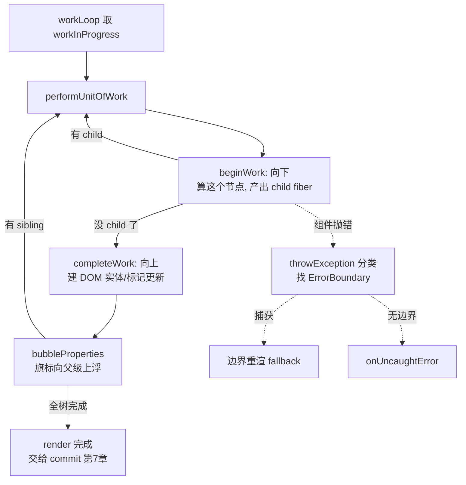

# 第 6 章：协调与 Diff —— 把新单据算成新实体

## 本章在全局的位置

Scheduler 发了开工许可。本章进 react-reconciler 的渲染阶段：从 FiberRoot 出发自上而下，把"新 Element 描述"对齐到"新 Fiber 树"上，能复用的复用、必须重建的重建——这是 React 性能的心脏。

## 前置知识

### 引用比较 vs 值比较
JS 里 `a === b` 比较对象时比的是内存地址（引用），不是内容。React 到处利用这一点："props 对象引用没变"往往意味着"整棵子树可以跳过"——`React.memo` 本质就是把上次的 props 引用存下来做这个比较。

### 深度优先遍历（DFS）
先一直往最深处走，走到头再回头走旁边的分叉。Fiber 的 beginWork（向下）/completeWork（向上）就是一次 DFS 的下行段与回溯段，只是用循环而非递归实现（第 3 章的伏笔在此兑现）。

## 核心问题

新的 Element 树怎么高效地变成新的 Fiber 树？组件渲染到一半抛出异常，React 怎么不崩？

## 主线流程图

## 关键点讲解

### 双循环总控：sync 一口气，concurrent 切片跑

📍 `packages/react-reconciler/src/ReactFiberWorkLoop.js:2772,3056,3081-3123`

`workLoopSync`（`:2772`）就是 `while (workInProgress) performUnitOfWork()`——sync 车道的活不让步，一口气干完（用户输入，慢就是卡手）。`workLoopConcurrent`（`:3056`）则设一个 `yieldAfter = now() + (非Idle ? 25 : 5)` 的窗口，窗口内循环、到点收工。注意这是本版本的最新策略：**Transition 类任务每 25ms 让一次**（故意给动画留整帧，注释说宁可动画降到 30fps 也别被渲染抢成 PPT），Idle 任务 5ms 一让。

`performUnitOfWork`（`:3081`）是循环体：调 `beginWork` 拿返回值——是 child 就继续向下（`workInProgress = next`）；返回 null 说明这个节点及其子树处理完，转 `completeUnitOfWork`（`:3368`）向上回溯。

### beginWork 判活：这个节点还用重新算吗

📍 `packages/react-reconciler/src/ReactFiberBeginWork.js:4247-4292,3936-3953`

beginWork 第一段是"续命审查"：`oldProps !== newProps`（引用比较）或 legacy context 变了 → 标记 `didReceiveUpdate`，老实重算；否则查这个 fiber 有没有待处理的更新/上下文（`checkScheduledUpdateOrContext`，`:3936`）——都没有就走 `attemptEarlyBailoutIfNoScheduledUpdate`（`:3955`）：**直接克隆自己、跳过整棵子树**。

这就是 `React.memo` 的底层机理：memo 组件的 props 引用不变时，它的整个子树在本轮渲染里"原地躺平"。审查通过后按 `workInProgress.tag` 大 switch 分发（函数组件 → `updateFunctionComponent` `:1450` → `renderWithHooks`，第 8 章的主舞台）。

### reconcileChildren：mount 和 update 走两套

📍 `packages/react-reconciler/src/ReactFiberBeginWork.js:338-369`

算完组件拿到新的 children Element 后，`reconcileChildren` 按场景分流：首次挂载（`current === null`）用 `mountChildFibers`——没有旧节点可比，直接建新的，**并且不开 effect 追踪**（`:344-354` 注释：挂载阶段每个新节点反正都要插进 DOM，没必要逐个打标记）；更新场景才用 `reconcileChildFibers` 开启逐个比对。这就是 `shouldTrackSideEffects` 开关的出处（`ReactChildFiber.js:418` 的 `createChildReconciler(shouldTrackSideEffects)`）。

### 单元素 diff：key 对、type 对，才能复用

📍 `packages/react-reconciler/src/ReactChildFiber.js:1688-1758`

新 child 是单个 Element 时，沿旧 fiber 兄弟链找 key 相同的节点：找到了且 `elementType` 也相同 → `useFiber` 复用旧 fiber（换 pendingProps），顺手 `deleteRemainingChildren` 删掉多余兄弟；key 相同但 type 不同（`
` 变 ``）→ 连自己和兄弟全删，新建；key 不同 → 删掉当前这个，继续往后找。**key 和 type 是复用的两把锁，缺一不可**——这也解释了为什么用数组下标当 key 在"头部插元素"时会引发灾难：key 全对得上，但对上的全是错位的旧实体。

### 列表 diff：两遍走，实在不行才建 Map

📍 `packages/react-reconciler/src/ReactChildFiber.js:1162-1290,454,498`

列表 diff 两遍走。第一遍（`:1196-1249`）：新旧列表从头逐槽比对（`updateSlot`），前缀能对上就一路复用——覆盖最常见场景（追加、尾部删）。第一遍在槽位对不上处断掉后进入第二遍：把剩下的旧 fiber 塞进 `key → fiber` 的 Map（`mapRemainingChildren` `:454`），新 children 剩余部分逐个查 Map 配对（`updateFromMap`）。

移动判定在 `placeChild`（`:498`）：维护 `lastPlacedIndex`（当前已确认位置最大的旧节点下标），新节点对应的旧下标比它小就打 Placement（要挪）。`ReactChildFiber.js:1168-1179` 的注释交代了为什么不做 Vue 那种双端 diff：fiber 没有反向指针，而列表场景头部插入是少数派，为少数派付 Map 成本不划算——这是一个明码标价的取舍。

### completeWork：向上时建实体、标记更新

📍 `packages/react-reconciler/src/ReactFiberCompleteWork.js:1082,245,463-481`

beginWork 处理"组件"，completeWork 处理"宿主节点"。挂载时在这里真正 `createInstance` 创建 DOM 节点，并 `appendAllChildren`（`:245`）把子树的 DOM 预挂上来——注意只是"造出来拿在手里"，还没插进文档。更新时（`updateHostComponent` `:463`）：`oldProps === newProps` 引用相同直接返回；不同就 `markUpdate` 打一个标记。**逐属性的细粒度 diff 不在这里做**——本版本把它推迟到 commit 阶段的 `commitUpdate`（`packages/react-dom-bindings/src/client/ReactFiberConfigDOM.js:999`），渲染阶段只问"变没变"，不问"哪变了"。

### bubbleProperties：旗标冒泡，commit 的导航图

📍 `packages/react-reconciler/src/ReactFiberCompleteWork.js:793-850`

每个节点 complete 时，把所有孩子的 `flags`、`subtreeFlags`、`lanes`、`childLanes` 按位或起来存进自己的 `subtreeFlags`/`childLanes`，向父级冒泡。效果：根节点的 subtreeFlags 一眼看穿"整棵树有没有任何节点要动 DOM"。commit 阶段遍历时，subtreeFlags 为空的子树整段跳过——上一章 FiberNode 里那些"看起来多余"的字段，全是为这一刻准备的导航地图。若本节点 bailout 了（`didBailout`，`:794`），孩子没重算，连冒泡都可以剪枝。

### 异常分支：ErrorBoundary 的捕获路径

📍 `packages/react-reconciler/src/ReactFiberThrow.js:364,114`

组件抛错（或抛 Promise）时进 `throwException`，先分类：抛的是 thenable（Promise）→ 这是 Suspense 场景，挂起等待；是普通错误 → 沿 return 链向上找类组件边界，找到就 `createClassErrorUpdate`（`:114`）给边界 fiber 派一个特殊 update——渲染时它调 `getDerivedStateFromError` 算出 fallback 状态，随后再触发 `componentDidCatch` 上报；找不到边界 → `createRootErrorUpdate` 走 `onUncaughtError`（createRoot 的第三个回调）。工作循环侧的配合在 `ReactFiberWorkLoop.js:2831`（`SuspendedOnError` 分支 → `throwAndUnwindWorkLoop` 沿途把栈退干净）。设计哲学：**局部失败局部兜底，默认不掀翻整桌**。

### Context 惰性传播：不 广播，只记账

📍 `packages/react-reconciler/src/ReactFiberNewContext.js:553,197,515`

老版本 Context 一变就全树广播。现在的机制：消费组件 `readContext` 时把自己的 fiber 记进该 context 的订阅名单（`readContext` `:553`）；Provider 收到新值时 `propagateContextChange`（`:197`）只给订阅者打 lane；而所有组件 bailout 前 `checkScheduledUpdateOrContext` 会查 `checkIfContextChanged`（`:515`）——订阅过且值真变了才不许躺平。第 6 章的 bailout 机制因此对 Context 也成立：没订阅 Context 的子树不受任何牵连。

## 收束

渲染阶段 = beginWork 向下算 + completeWork 向上建实体 + 旗标冒泡绘导航图；diff 的复用判定锁在 key + type 两把锁上；异常沿 return 链找边界兜底。下一章 commit：算好的新树怎么在"不可中断"的三段仪式里安全落进真实 DOM。
