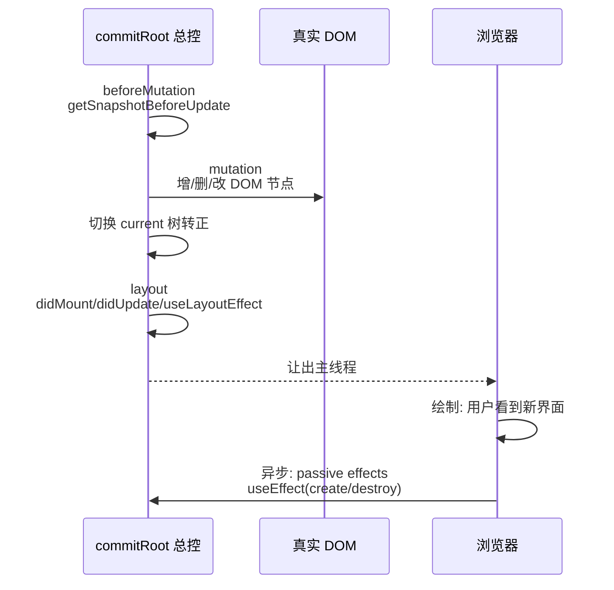

# 第 7 章：提交 Commit —— 不可中断的三段仪式

## 本章在全局的位置

渲染阶段算好的 workInProgress 树还是"草稿"。本章讲它转正的仪式：commit。三个子阶段一口气跑完，中途绝不让人插队——这是 React 里唯一"不可中断"的部分。

## 前置知识

### 浏览器绘制时机
JS 代码让出主线程后，浏览器才可能重绘屏幕。在一段同步 JS 里改了 DOM，用户要等这段代码全部跑完、浏览器走到绘制阶段才能看见。commit 利用这一点：把所有 DOM 改动塞进一段同步代码，用户要么看不到、要么直接看到最终态。

## 核心问题

为什么 commit 必须不可中断？三个子阶段各干什么、浏览器在哪个时刻看到新界面？

## 主线流程图



## 关键点讲解

### commit 为什么不可中断

📍 `packages/react-reconciler/src/ReactFiberWorkLoop.js:3869`、`packages/react-reconciler/src/ReactFiberCompleteWork.js:847-849`

渲染阶段敢中断，因为草稿画废了可以整张扔掉重来——用户从没见过草稿。commit 动的是真实 DOM、真实 ref、真实生命周期，**一旦开始就没有"扔掉重来"的余地**：DOM 删了一半被中断，页面就是残废。所以 commit 全程设 `CommitContext` 标记（`ReactFiberWorkLoop.js:3869`），期间新到的更新只能排队；`ReactFiberCompleteWork.js:848` 的注释甚至明说 bubbleProperties 的实现"假设 commit 与 render 永不并发"。这是一次清醒的取舍：render 求灵活，commit 求原子。

### commitRoot 总控：先排 passive，再走仪式

📍 `packages/react-reconciler/src/ReactFiberWorkLoop.js:3725-3921`

`commitRoot` 开场先 `markRootFinished`（`:3759`，把这批车道销账），然后**第一时间**把 passive effects（useEffect 那部分）用 `scheduleCallback(NormalSchedulerPriority, flushPassiveEffects)` 排进 Scheduler（`:3806`）——排得早是为了排在其他任务前面，注释 #16714 记录了这个顺序调过的 bug。随后依次走三个子阶段，每个子阶段靠第 6 章冒泡好的 `subtreeFlags` 判断"整棵树有没有这段的活"（`:3857-3861`），没活直接跳过整段遍历。

### beforeMutation：改 DOM 前最后读一眼

📍 `packages/react-reconciler/src/ReactFiberWorkLoop.js:3874` → `packages/react-reconciler/src/ReactFiberCommitWork.js:351`（阶段入口）；类组件快照调用点 `ReactFiberCommitWork.js:526` → 实现 `packages/react-reconciler/src/ReactFiberCommitEffects.js:633`

第一段主服务一件事：类组件的 `getSnapshotBeforeUpdate`（滚动位置保存是教科书用例——必须在 DOM 变动前读旧值）；另附带 View Transition 追踪与失焦处理。为什么不放在渲染阶段顺手做？因为渲染可能中途废弃重来，快照只在"确定要改"前一瞬间读才有意义。

### mutation：真正动 DOM 的一段

📍 `packages/react-reconciler/src/ReactFiberWorkLoop.js:4031` → `packages/react-reconciler/src/ReactFiberCommitWork.js:2016,2035,2061`

`commitMutationEffects` 深度优先遍历（`recursivelyTraverseMutationEffects` `:2035`，subtreeFlags 指路），每个节点按 flags 处理三件事：`ChildDeletion` 卸载子树（连带解绑 ref、清理 effect）；`Placement` 把第 6 章就造好的 DOM 节点插进容器——这是新节点第一次接触文档；`Update` 调 `commitUpdate`，**上一章欠下的逐属性 diff 在这里补上**（`packages/react-dom-bindings/src/client/ReactFiberConfigDOM.js:999`，内部 `updateProperties` 逐项比对）。函数组件分支（`:2061` 的 switch）还会先跑 useInsertionEffect 的清理与重建（`ReactFiberCommitWork.js:2104-2109`，CSS-in-JS 库依赖的插入时机）。

### 切换 current：另一棵树转正

📍 `packages/react-reconciler/src/ReactFiberWorkLoop.js:4051`

```js
root.current = finishedWork;
```

mutation 结束、layout 开始之前，一行赋值完成改朝换代：`finishedWork` 从此是 current 树，旧树降级为 alternate 等待下次复用（第 3 章双缓冲在此闭环）。放在这个间隙是精确计算过的：mutation 里还在改旧树的 DOM，layout 里组件读的已是新世界的 current——新旧世界的换防必须发生在两者之间。

### layout：同步的"改完之后"

📍 `packages/react-reconciler/src/ReactFiberWorkLoop.js:4125` → `packages/react-reconciler/src/ReactFiberCommitWork.js:3050,599`

`commitLayoutEffects`（`:3050`）里 `commitLayoutEffectOnFiber`（`ReactFiberCommitWork.js:599`）处理三件事：类组件 `componentDidMount`/`componentDidUpdate`、hooks 的 `useLayoutEffect`、ref 挂载赋值。关键词是**同步**：它们全在浏览器绘制前跑完，所以 useLayoutEffect 里读 `getBoundingClientRect` 再改 DOM，用户看到的是改完的最终态，不会闪一下——这是它和 useEffect 的本质区别。

### passive effects：绘制后的异步补票

📍 `packages/react-reconciler/src/ReactFiberWorkLoop.js:4688`

`useEffect` 的 create/destroy 在 `flushPassiveEffects` 里执行——由 commitRoot 开场排的那张 Scheduler 工单触发，通常落在浏览器绘制之后。副作用是"异步"的：数据订阅、事件绑定、日志上报都不阻塞画面。代价是它有独立的失败窗口：flush 过程中来 flushSync，React 会先打完这批 effect 再处理同步任务（文档里"flushSync 可能让 useEffect 提前触发"的出处）。

### 用户看到界面的时刻

把时序钉死：mutation 改完 DOM → layout 同步跑完 → commit 让出主线程 → **浏览器绘制，用户看见新界面** → 之后某个宏任务里 passive effects 执行。所以"setState 后什么时候能看到新 UI"的答案是：同步 setState（click 里的）在本次事件循环结束、浏览器下一次绘制时；transition 的则由 Scheduler 排期后再走同样流程。

## 收束

commit = beforeMutation（读快照）→ mutation（动 DOM）→ 切 current → layout（同步回调）→ 绘制 → passive（异步补票），三段仪式内不可中断，仪式外一切可等待。下一章回到写代码时最常用的 API：hooks 在这套流程里到底藏了什么机关。
