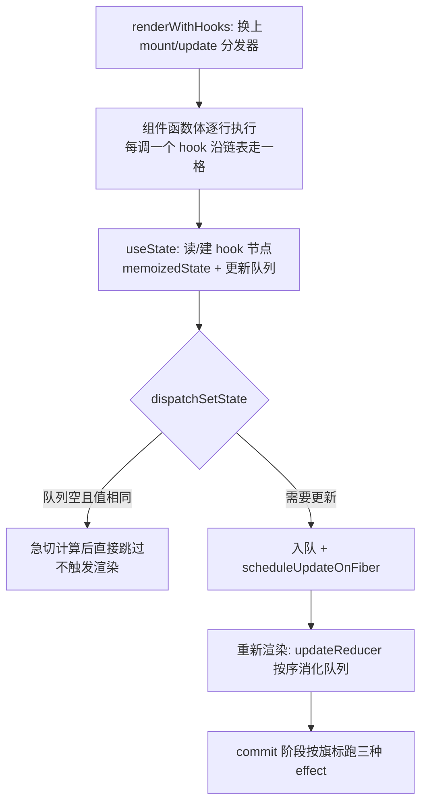

# 第 8 章：Hooks 实现 —— 函数组件里的机关

## 本章在全局的位置

第 6 章看到函数组件的渲染入口是 `renderWithHooks`，本章拆开它：useState 怎么存值、为什么 hooks 有顺序铁律、useEffect 的三种兄弟差在哪——全部问题都指向同一个机关：链表 + 分发器。

## 前置知识

### Object.is
`Object.is(a, b)` 是比 `===` 更严格的相等判定：`===` 认为 `NaN === NaN` 是 false、`+0 === -0` 是 true，Object.is 都反过来。React 判断"状态变没变"用的就是它，所以 `setState(NaN)` 不会引发重渲。搜索关键词：MDN Object.is。

📖 https://developer.mozilla.org/en-US/docs/Web/JavaScript/Reference/Global_Objects/Object/is

### 环形链表
普通链表尾节点的 next 是 null，环形链表的 next 指回头结点，转圈遍历不需要额外记头指针。React 的更新队列用它，是为了挂载新 update 时不用找尾——随手从任一节点接进圈里。

## 核心问题

函数组件每次渲染都从头执行，useState 凭什么记得上一次的值？"不能在 if 里用 hooks"到底是为什么？

## 主线流程图



## 关键点讲解

### dispatcher 暗桥：hooks 是"借来的"函数

📍 `packages/react/src/ReactHooks.js:24-43`、`packages/react-reconciler/src/ReactFiberHooks.js:563-566,660`

第 1 章埋的暗桥在这里揭晓全貌：`useState` 内部只是 `resolveDispatcher().useState(...)`——从共享对象上现取当前的"分发器"。`renderWithHooks` 开场按场景换装（`ReactFiberHooks.js:563-566`）：首次挂载装 `HooksDispatcherOnMount`、更新装 `HooksDispatcherOnUpdate`；渲染结束把 H 换回 `ContextOnlyDispatcher`（`:660`，一个只会在你调 hooks 时报错的哨兵）。

所以"hooks 只能在组件体内调用"不是道德规劝而是物理事实：只有渲染期间 H 才指向真实现。同一个 `useState` 名字，mount 时和 update 时背后是两套不同函数——这套"运行时多态"让 hooks 不需要任何注册仪式。

### hooks 链表：顺序即身份

📍 `packages/react-reconciler/src/ReactFiberHooks.js:983-1002,1004`

```js
function mountWorkInProgressHook(): Hook {
  const hook = { memoizedState: null, baseState: null,
                 baseQueue: null, queue: null, next: null };
  if (workInProgressHook === null) {
    currentlyRenderingFiber.memoizedState = workInProgressHook = hook;
  } else {
    workInProgressHook = workInProgressHook.next = hook;
  }
  return workInProgressHook;
}
```

一个组件的所有 hook 串成单链表，头结点存在 `fiber.memoizedState`。mount 时每调一个 hook 就在链尾接一个新节点；update 时（`updateWorkInProgressHook` `:1004`）严格沿旧链逐格走——**第 N 次调用的 hook 必须对上第 N 个节点**。

这就是顺序铁律的真相：hooks 没有名字、没有 id，调用顺序就是它们的唯一身份。放进 if 里，两次渲染链表形状对不上，update 时就会"张冠李戴"——读到别的 hook 的状态，开发版直接报错拦截。

### useState 的存储布局

📍 `packages/react-reconciler/src/ReactFiberHooks.js:984-991`

一个 useState 拥有：`memoizedState`（当前值）、`queue`（这个 state 的更新队列：pending 环形链表 + `lastRenderedReducer`/`lastRenderedState` 供急切计算用）、`baseQueue`（低优先级没消化完的残留账）。函数组件的"状态"不在 fiber 上集中放，而是摊在链表各节点的 memoizedState 里——useRef、useMemo 存的也是各自节点的 memoizedState。

### eager 急切计算：同值跳过渲染的证据

📍 `packages/react-reconciler/src/ReactFiberHooks.js:3676-3707`

```js
if (fiber.lanes === NoLanes && (alternate === null || alternate.lanes === NoLanes)) {
  const eagerState = lastRenderedReducer(currentState, action);
  update.hasEagerState = true;
  update.eagerState = eagerState;
  if (is(eagerState, currentState)) {
    // Fast path. 不调度渲染
    enqueueConcurrentHookUpdateAndEagerlyBailout(fiber, queue, update);
    return false;
  }
}
```

dispatch 时如果这个 fiber 完全没有待处理更新，就**立刻**用 reducer 算一遍新值：和旧值 `Object.is` 相同的话连渲染都不排期。"setState 同一个值不重渲"的源码出处就在这。算过的结果存在 update 上（`hasEagerState`），渲染阶段直接用，不再算第二遍。注意前提是"队列空"——已有排队更新时无法急算，会老实入队等渲染。

### 更新队列消费：按顺序把账兑现

📍 `packages/react-reconciler/src/ReactFiberHooks.js:1265,1307`

useState 底层就是 useReducer（reducer 固定为 `basicStateReducer` `:1265`：action 是函数就调它，否则直接返回——函数式更新 `setCount(c => c + 1)` 的实现）。重新渲染时 `updateReducer`（`:1307`，主体在 `updateReducerImpl`）把 pending 环形队列摘下来，按 lane 过滤：本轮优先级够的依次 apply 出新状态；不够的留在 `baseQueue`，等未来某个优先级足够的渲染补算（这套"低优先级残留"机制保证 transition 渲染作废重跑时，低优先级账单一张不丢）。

### useEffect 建档：旗标与环形 effect 链

📍 `packages/react-reconciler/src/ReactFiberHooks.js:2640-2654,2605-2621`

`mountEffectImpl`（`:2640`）建 hook 节点后调 `pushSimpleEffect`，给 effect 打上 `HookHasEffect | HookPassive` 双旗标——`HookHasEffect` 表示"这个 effect 上轮刚有实质变化，需要跑"，没打它的（deps 没变）commit 时直接跳过。所有 effect 串成环形链挂在 `fiber.updateQueue.lastEffect`（`pushEffectImpl` `:2605-2621`），commit 阶段顺着圈跑一圈即可。

### deps 比较：逐位 Object.is

📍 `packages/react-reconciler/src/ReactFiberHooks.js:2671-2680`

update 时 `areHookInputsEqual` 把新旧 deps 数组逐位 `Object.is`：长度相同且每位都相等 → 不打 `HookHasEffect`，本轮 effect 不跑。所以 deps 数组长度必须稳定（条件里写 deps 会导致错位比较），`[]` 和"不写 deps"的区别也在这里：前者每次都"逐位比较 0 个元素恒相等"，后者恒不等。

### 三种 effect 的时机表

📍 `packages/react-reconciler/src/ReactFiberWorkLoop.js:4031,4125,4688`

| Hook | 旗标 | 执行阶段 | 时机 |
|---|---|---|---|
| useInsertionEffect | HookInsertion | mutation（`ReactFiberCommitWork.js:2104-2109`） | DOM 变动中，CSS-in-JS 专用 |
| useLayoutEffect | HookLayout | layout 同步 | 绘制前，可同步读改 DOM |
| useEffect | HookPassive | passive 异步 | 绘制后的宏任务 |

一个 flags 位决定 effect 在哪段被消费——第 7 章的三个子阶段各自只认自己的旗标。记忆口诀：**越靠近 DOM 变动越同步，越靠近"副作用"越异步**。

## 收束

hooks 的全部魔法 = 渲染期换装的分发器 + 按调用顺序对位的链表 + 用 flags 控制执行时机的 effect 队列。下一章讲最后一个独立子系统：你写的 onClick 和浏览器原生 click 之间，还隔着两层委托。
