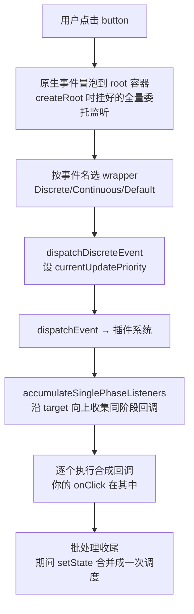

# 第 9 章：事件系统 —— 从原生 click 到你的 onClick

## 本章在全局的位置

主线渲染管线已全部走通。本章是最后一个独立子系统：`react-dom-bindings` 包。它和管线的接口只有一个：事件发生时设好"当前更新优先级"，让第 4 章的选道逻辑知道这次 setState 该走哪条车道。

## 前置知识

### 事件委托（event delegation）
不给每个子节点挂监听器，而是给共同祖先挂一个：事件冒泡到祖先时统一处理，再按 `event.target` 反查真正的主角。省内存、动态子元素免注册——React 事件的底层形态。

### 捕获与冒泡
原生 DOM 事件从 window 沿祖先链"捕获"下行到 target，再"冒泡"上行回去。`addEventListener` 第三参数决定监听的是下行还是上行段。React 的合成事件两条线都委托。

📖 https://developer.mozilla.org/en-US/docs/Web/API/EventTarget/addEventListener

## 核心问题

一次原生 click 发生后，React 怎么找到并执行你写在组件上的 onClick？它和 setState 的优先级怎么联动？

## 主线流程图

## 关键点讲解

### 第一层委托：root 上的一次性全量注册

📍 `packages/react-dom-bindings/src/events/DOMPluginEventSystem.js:432-459`

`listenToAllSupportedEvents` 在 createRoot 时被调用（第 1 章 createRoot 的第三件事）：遍历 `allNativeEvents` 全集，每个事件名在根容器上注册**捕获 + 冒泡各一份**监听器。少数不能委托的（`nonDelegatedEvents`，如 scroll/media 事件）单独处理；`selectionchange` 不冒泡，挂在 document 上特判；`listeningMarker` 标记保证同一容器只挂一轮。从此整棵树的增删组件都不需要任何事件注册——委托是"挂一次管永远"的买卖。

### 被动监听：touch 三兄弟强制 passive

📍 `packages/react-dom-bindings/src/events/DOMPluginEventSystem.js:476-489`

注册监听器时（`addTrappedEventListener`），`touchstart/touchmove/wheel` 三种事件强制加 `{passive: true}`——告诉浏览器"我保证不调 preventDefault"，浏览器因此不必等回调执行就敢滚动页面。源码注释（`:477-482`）交了底：浏览器本想让 document 上的这些事件默认 passive，React 改挂 root 后主动补齐同等行为。

### 第二层：注册时就按事件名分好优先级

📍 `packages/react-dom-bindings/src/events/ReactDOMEventListener.js:99-112`

挂监听器时不是直接挂 `dispatchEvent`，而是 `getEventPriority(domEventName)` 先按名字定档：`click/keydown/mousedown` 等离散交互 → `dispatchDiscreteEvent`；`scroll/mousemove` 等连续事件 → `dispatchContinuousEvent`；其余 → 默认档。**注意优先级在注册时就定了，和事件发生在谁身上无关**——这是"事件优先级"的来源：click 里的 setState 天生快车道。

### 点击发生：优先级注入 setState

📍 `packages/react-dom-bindings/src/events/ReactDOMEventListener.js:121-137`

真点击到达 root 时，`dispatchDiscreteEvent` 只多干一件事：`setCurrentUpdatePriority(DiscreteEventPriority)`，然后才进入分发。此刻你的 onClick 执行、里面调 setState、走到第 4 章 `requestUpdateLane` 的 `resolveUpdatePriority()`——读到的就是这里设的值，于是这次更新拿到高优先级车道。**事件系统与渲染管线的全部联动，就压缩在这一个全局变量的一设一读里。**

### 收集 listener：沿 return 链向上一路点名

📍 `packages/react-dom-bindings/src/events/DOMPluginEventSystem.js:157,589,717`

`dispatchEvent`（`ReactDOMEventListener.js:157`）先找 target 对应的 fiber（第 1 章 `markContainerAsRoot` 埋的对应关系 + 节点到 fiber 的映射），然后 `dispatchEventForPluginEventSystem`（`:589`）调 `accumulateSinglePhaseListeners`（`:717`）：从 target fiber 沿 `return` 指针向根走，沿途把每个 fiber props 上同名的 `onClickXXX` 收进执行队列（捕获阶段反向、冒泡阶段正向）。Fiber 树在这里第二次当了索引——第一次是旗标冒泡给 commit 指路。

### 合成事件：统一的壳

📍 `packages/react-dom-bindings/src/events/SyntheticEvent.js`

你的回调拿到的 event 不是原生事件，是包装它的 SyntheticEvent：统一了跨浏览器的 `preventDefault/stopPropagation` 等接口，原生事件存在 `nativeEvent` 字段。React 17 已移除事件池——历史版本"事件对象被复用、异步读会变 null"的坑在本版本不存在，可以放心异步持有。

### 批处理边界：一个事件 = 一批

📍 `packages/react-dom-bindings/src/events/ReactDOMUpdateBatching.js:46`、`DOMPluginEventSystem.js:313,343`

dispatch 的外面包着 `batchedUpdates`（`ReactDOMUpdateBatching.js:46`）：整个事件的所有监听器执行完才收尾冲刷。于是 onClick 里连续五个 setState 共享一次排期（第 4 章的微任务去重在这里托底）。unstable_batchedUpdates 这个"手动批"入口就是同一机制的对外暴露，历史上用于事件外场景——18 之后自动批已覆盖，它只剩兼容使命。

### 插件注册表：事件名到行为的映射表

📍 `packages/react-dom-bindings/src/events/plugins/`

`plugins/` 目录是九命题"工具系统"在 react 里的投影：SimpleEventPlugin 等插件各管一摊事件（注册名字、生成合成事件类型、提供提取逻辑），启动时统一注册进系统。想给 React 加一种新事件，历史上就是写一个 plugin——和 agent 系统的"工具注册表"是同构思想。

## 收束

一次 click 的旅程：冒泡到 root 的全量委托 → 按事件名定好的 wrapper 设优先级 → 沿 fiber 树点名收集回调 → 合成事件逐个执行 → 批处理收尾。至此九个章节的机器全部拆完，最后一章站远一点，评一评这套设计值不值。
