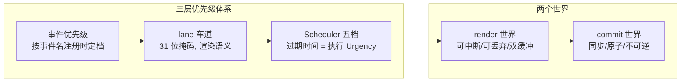

# 第 10 章：设计取舍总览 —— 这台机器为什么长这样

## 本章在全局的位置

九章拆解完毕。本章不进新代码，把散落各章的取舍收拢成一张账：每个设计买了什么、付了什么。读懂取舍，才算把这个仓库的设计意图内化成自己的判断力。

## 核心问题

如果重来一次，React 团队还会这么设计吗？哪些选择是被迫的，哪些是主动下注？

## 主线流程图

## 关键取舍逐条看

### Fiber 化：用复杂度买可中断

📍 `packages/react-reconciler/src/ReactChildFiber.js:1168`

Fiber 化的本质是一次交换：把"进度存在调用栈里"换成"进度存在数据结构里"。买到的：可中断、可恢复、可按优先级重排——没有它就没有时间切片、过渡和 Suspense。付出的：FiberNode 约 20 个字段 × 每个节点常驻内存；beginWork/completeWork 两阶段模型的心智负担；以及链表结构连"双端 diff"这种常规优化都做不了的死角（无反向指针）。这笔账在 2017 年是豪赌，今天看赌赢了——并发特性全部建立在它之上。

### 双缓冲：最多两棵树的极致抠门

📍 `packages/react-reconciler/src/ReactFiber.js:326-330`

为什么不是"每次渲染克隆一棵新树"？内存会翻倍增长。React 的答案是**每位置永远最多两棵、alternate 互指、旧树池化复用**——挂载完成后，日常更新几乎零节点分配，GC 压力趋近于零。代价是"current 到底指哪棵"的心智转换（第 7 章 mutation 后 layout 前换防的精确时序）。这是把"够用就好"用到极致的样板。

### lane 车道：为什么是位掩码而不是数字

📍 `packages/react-reconciler/src/ReactFiberLane.js:41`

单个数字当优先级，表达不了"一次渲染同时捎带 sync 的表单 + transition 的列表"。31 条独立车道 + 位运算，让"合并任务集""查有没有某档""挑最高档"都是一条 CPU 指令。上限 31 是刻意的：留在 32 位符号安全区。取舍在于优先级档位有限（31 条），但 React 判断够用——调度粒度的需求天然收敛。

### 三层优先级各管一段

事件优先级（注册时按事件名定，解决"这次交互天生多急"）、lane（渲染语义：sync 车道不让步、transition 车道可废弃）、Scheduler 五档（执行层：过期时间即紧迫度）。三层之间单向换算、各不越权——事件系统不知道渲染细节，Scheduler 不知道 React 存在。**分层换算而非一个大表**，是整个优先级体系可维护的关键。

### 单渲染会话：全局变量撑起的简化

📍 `packages/react-reconciler/src/ReactFiberWorkLoop.js:3056-3123`

整个 reconciler 的"当前在算哪棵树"是全局变量 `workInProgressRoot`——同一时刻只允许一个渲染会话，靠 executionContext 位标记防重入。为什么不做多渲染并行？单主线程 JS 里并行渲染本就要靠时间片伪造；两棵 workInProgress 树同时算，内存和失效逻辑都会爆炸。这是"单线程前提下选择最简单正确解"的克制。

### commit 的原子性：唯一不可协商的边界

📍 `packages/react-reconciler/src/ReactFiberWorkLoop.js:3869`

全系统处处讲"可中断"，唯独 commit 一口回绝。DOM、ref、生命周期一旦动了就没有回滚按钮——用户看到的必须是完整结果。这条边界反过来塑造了其他设计：快照读（getSnapshotBeforeUpdate）必须在 beforeMutation、current 切换必须卡在 mutation 与 layout 之间、passive effect 全部外移。**系统的不可协商点越少越好，且都明码标在架构图上**。

### 编译时转向：运行时王座开始让渡

📍 `packages/react/index.js:29`

`react` 包新导出 `__COMPILER_RUNTIME`——React Compiler（编译期自动 memo）已进入官方包。这是十年来最大的方向修正：过去"运行时 diff 一切、依赖开发者手写 memo/useMemo"，现在编译器在构建期证明"哪些不会变"。运行时这套渲染机器没有废，但 React 的性能哲学正从"运行时兜底"转向"能编译期证明的就不进运行时"。学源码时看到的 eager 计算、bailout、bubbleProperties，未来会被编译器提前消解掉一部分——但它们仍是编译器做判断所依赖的运行时地基。

### 宿主解耦：一个协调器养活多端

📍 `packages/react-reconciler/src/forks/ReactFiberConfig.dom.js`

协调器只认 `ReactFiberConfig` 接口，DOM/native/art/fizz 各交实现。买到的：React Native、Ink（终端 UI）都直接复用本仓协调器；React 团队改一次 diff 算法全端受益。付出的：所有宿主能力都要先抽象成接口（createInstance/appendChild/commitUpdate……），接口膨胀且个别平台差异需要 fork 硬编码。这是"平台战争"赢下来的架构红利。

### 错误处理哲学：局部失败，局部兜底

📍 `packages/react-reconciler/src/ReactFiberThrow.js:364`

异常处理的目标不是"不崩"，而是**把崩的半径收到最小**：有边界就换 fallback 继续渲染，没边界才惊动 `onUncaughtError`；hydration 失败这类"可自愈"的错误走 `onRecoverableError` 静默降级重渲。对照常见"一错全白屏"的实现，React 把错误当成渲染管线的常规输入而非例外。

## 一张表收尾

| 取舍 | 买到 | 付出 |
|---|---|---|
| Fiber 链表化 | 可中断/可恢复/并发地基 | 内存 + 两阶段心智负担 |
| 双缓冲 | 更新零分配 | current 切换时序纪律 |
| lane 位掩码 | 多任务集 + O(1) 运算 | 31 档上限 |
| 单渲染会话 | 实现简单正确 | 无真并行 |
| commit 原子 | UI 永不撕裂 | 唯一不可中断段 |
| 编译时转向 | 自动 memo 终局 | 迁移期双轨 |
| 宿主解耦 | 一脑多端 | 接口抽象税 |

## 收束

React 的源码读到这里可以合上了：一个"把 DOM 操作变成状态推导"的库，最终把全部复杂度都压进了**数据结构（Fiber）+ 一条可中断的循环 + 一段不可中断的提交**。想继续深入，下一站推荐 RSC 服务端组件线（`react-server-dom-*`）和 React Compiler——它们是这套机器的下一个十年。
