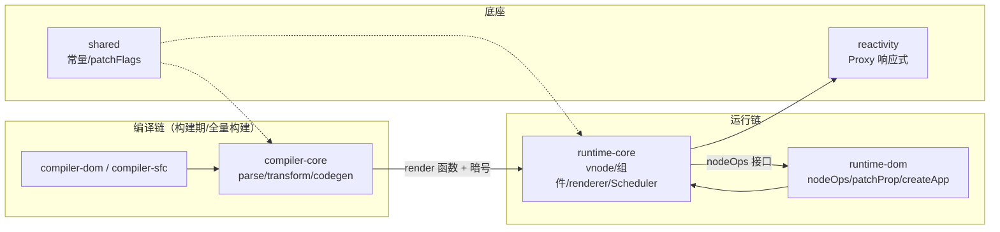

# vuejs/core (Vue 3) 源码导读

> 基于版本：main 分支 commit `4ab865a848a1da3d10fb674f857e5fff13094644`（2026-09-18）｜语言：TypeScript｜源码目录：`.spec/源码学习/_clones/vue3`（浅克隆，只检出 packages/）
> 一句话：用「编译期算暗号 + Proxy 记账 + 有序冲刷」把"UI = f(状态)"的每次兑现降到最便宜。

## 这个仓库解决什么问题

手写 DOM 的痛点是状态与视图的同步成本。Vue3 的答案是三件套：**Proxy 响应式**让"数据变了"这件事自动被发现；**编译器**在构建期把"模板里哪些部分会变"算成暗号（PatchFlags/Block）；**渲染器**按暗号把更新缩到最小。读源码就是看这三件事怎么咬合成一条链：get 记账 → trigger 排队 → 重跑 render → patch 动态点 → DOM。

## 前置知识地图

按"缺了必晕"排序（各章也会就地铺垫）：

1. **Proxy / Reflect**——响应式的物理基础。📖 https://developer.mozilla.org/en-US/docs/Web/JavaScript/Reference/Global_Objects/Proxy
2. **事件循环与微任务**——批量更新的时间边界。📖 https://developer.mozilla.org/en-US/docs/Web/JavaScript/EventLoop
3. **AST 与编译流水线概念**——读第 4/5 章前过一遍。搜索「AST 抽象语法树 入门」。
4. **位掩码**——PatchFlags 与 effect 旗标的表达方式。搜索「位运算 bitmask 入门」。
5. **最长递增子序列（LIS）**——第 8 章核心。搜索「最长递增子序列 贪心 二分」。

## 架构总图

三个关键接线：编译链产出 render 函数与暗号给运行链消费；运行链对宿主的全部操作收口在 nodeOps/patchProp（换宿主即换实现）；Scheduler 已并入 runtime-core（3.5 起，无独立包）。

## 学习动线

编号即推荐阅读顺序；标注★的章节独立性强，时间紧可后置。

| 章 | 讲什么（一句话） | 核心问题 |
|---|---|---|
| 01 | 三层架构与包接线 | 模板到 DOM 要穿几层？ |
| 02 | Proxy 与依赖收集（dep 双链表） | 谁在用这个值怎么被记账？ |
| 03 | ref / computed / watch | 惰性缓存怎么实现？ |
| 04★ | 编译器流水线 | 模板怎么变 render 函数？ |
| 05★ | PatchFlags 与 Block 树 | 怎么只更新动态部分？ |
| 06 | 组件实例与 setup | 组件在内存里长什么样？ |
| 07 | 渲染器 patch 主线 | 更新怎么走到最小 DOM 改动？ |
| 08 | Diff：最长递增子序列 | 最少移动怎么算出来？ |
| 09 | 调度：queueJob 与 nextTick | 多次改动怎么合并一次冲刷？ |
| 10 | 设计取舍总览 | 每个选择买了什么付了什么？ |

依赖关系：02 是 03/06/07/09 的共同地基；04→05（暗号怎么打的）；06→07（实例给渲染器用）；07→08；05 与 07 互为答案（建议连读）。想走最短路线：02→06→07→09→08。

## 上手建议

1. **先跑一个最小应用**：Vite 起 `npm create vite@latest -- --template vue`，写一个含 computed、watch、v-for（带/不带 key 各一）的组件，第 2/3/8/9 章现象全覆盖。
2. **断点四连**（VSCode 调试 Vite 项目，node_modules 里 `@vue/runtime-core/dist/runtime-core.esm-bundler.js` 可断点）：
   - `reactivity` 的 `ReactiveEffect.run`——看 activeSub 切换；
   - `runtime-core` 的 `queueJob`——同一事件改三次数据，看去重；
   - `runtime-core` 的 `patch`——看 n1/n2 分流与 optimized 标志；
   - `runtime-core` 的 `patchKeyedChildren`——造一次乱序移动，看 LIS 结果。
3. **配合 Vue DevTools**：Inspector 里看组件渲染轨迹，对照第 9 章的 id 顺序。
4. **读源码姿势**：本导读每章 5-8 个关键点，锚点处先开源码看上下文再回来看讲解；本仓为 TypeScript，类型定义（如 `Dep`/`Link` 类）本身就是最好的文档。

## 设计取舍总览（第 10 章要点透视）

- **Proxy 一揽子**：全对象监听买到，IE11 付出。
- **编译暗号**：更新比对缩到动态点，代价是绑定模板语法。
- **不可中断冲刷**：实现简单、父子顺序确定、好调试，超长任务无让步。
- **组件级重渲**：细粒度是"依赖收集细"，不是"DOM 更新细"——别神化。
- **3.5 dep 双链表**：核心数据结构推倒重写的样板，API 零感知。

## 覆盖范围声明

覆盖客户端运行主线（非测试源码约 5.5 万行）。**未覆盖**：compiler-sfc（`<script setup>` 编译）、SSR 线（server-renderer/compiler-ssr）、hydration、vue-compat、Vapor 模式。九命题清点结论见同目录 `大纲.md` 文末表格。姊妹篇：本仓 React 导读（`.spec/源码学习/react__react/`），第 5/9/10 章有多处双框架对照。
