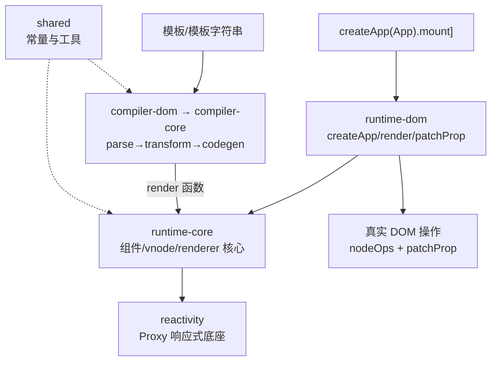

# 第 1 章：总体架构与包结构 —— 一份模板的旅程

## 本章在全局的位置

本章是 vuejs/core 的"地图页"：认清 13 个包怎么分层、`createApp(App).mount('#app')` 这行代码穿过哪几层，后面九章都是在放大这张图的某一块。

## 前置知识

### monorepo
一个仓库管多个包（`packages/` 下每目录一包，各有 package.json），Vue 用 pnpm workspace 管理。好处是编译器和运行时可以同步改、原子提交。

### tree-shaking
打包器把"import 了但没用到的导出"从产物里删掉。Vue 的运行时-only 构建就是靠它摇掉整个编译器的——本章第 3 个关键点就是这句注释。

## 核心问题

你写的 `.vue` 文件或模板字符串，到屏幕上的 DOM，中间经过哪几层？

## 主线流程图

## 关键点讲解

### 三层分工：编译侧、运行时侧、响应式底座

📍 `packages/vue`、`packages/runtime-core`、`packages/reactivity`

全仓分三链：**编译链**（compiler-core → compiler-dom → compiler-sfc）把模板变成 render 函数；**运行链**（runtime-dom → runtime-core）挂载和更新组件；**响应式底座**（reactivity）被运行链引用，让"数据变了 UI 跟着变"。三链在根目录 `packages/shared` 汇合共享常量。记住一个判断：任何 Vue 特性要么是"编译时多做了事"（第 4/5 章），要么是"运行时多做了事"（第 6-9 章），要么是"响应式兜住了"（第 2/3 章）。

### vue 包：唯一的"全量构建"入口

📍 `packages/vue/src/index.ts:3`

文件头注释原话："This entry is the 'full-build' that includes both the runtime and the compiler"。只有 `import { createApp } from 'vue'` 这个入口同时带编译器，所以它支持 `template` 字符串现写现编译（`compileToFunction`，`index.ts:23`）。构建工具（Vite/vue-loader）走的是编译期出 render 函数的路线，运行时根本不需要编译器。

### runtime-only 构建：编译器是被"摇掉"的

📍 `packages/runtime-dom/src/index.ts:21`

源码注释："Importing from the compiler, will be tree-shaken in prod"——runtime-dom 虽然引了编译器（为了支持全量构建），但只在 `template` 配置存在时才调用。打包器一看生产代码里这条路径没人走，把整个 compiler 链从产物里删掉。你没配任何东西却"免费"得到运行时-only 包，靠的就是 tree-shaking 和这条精心设计的引用。

### createApp 的真身：惰性渲染器 + 实例方法

📍 `packages/runtime-dom/src/index.ts:104` → `packages/runtime-core/src/apiCreateApp.ts`

`createApp` 是个箭头函数包着 `createAppAPI(...)` 的产物（渲染器由 `ensureRenderer()` 惰性创建——不 mount 就永远不建渲染器）。返回的 app 对象上挂着 `use`/`component`/`directive`/`mount` 等链式方法。`.mount()` 才第一次触发真实的 vnode 渲染。

### 宿主操作收口：nodeOps 与 patchProp

📍 `packages/runtime-dom/src/index.ts:20`

DOM 的所有操作被收进两个模块：`nodeOps`（增删查改节点）和 `patchProp`（属性/事件/样式打补丁）。runtime-core 的渲染器只认这两个接口——这就是"自定义渲染器"（`createRenderer`）能跑在 Canvas/小程序/WebGL 上的原因：换宿主 = 换这两个模块的实现。

### shared：编译器与渲染器的暗号表

📍 `packages/shared/src/patchFlags.ts:23`

`PatchFlags`（第 5 章主角）定义在 shared 包——因为**编译器负责打暗号、运行时负责读暗号**，两边必须认同一张表。这也是"为什么这个常量改了要全仓重测"的原因：它跨链共享。

### 本次不覆盖的包

compiler-sfc（SFC 解析 + `<script setup>` 编译，值得单独一轮）、server-renderer 与 compiler-ssr（SSR 线）、runtime-core 里的 hydration.ts（约 1100 行）、vue-compat（兼容层）、runtime-test（测试专用 DOM）。

## 收束

一张图三条链：编译链出 render 函数，运行链拿它挂载组件，响应式底座让数据变化自动触发重渲。下一章潜到最底层——`reactive()` 一个普通对象后，读写之间到底发生了什么。
