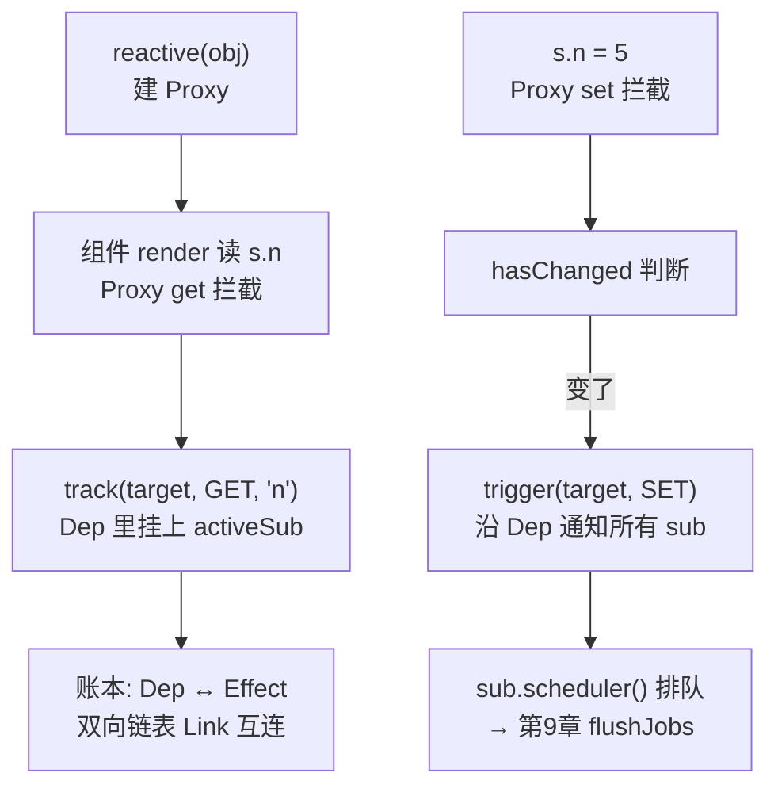

# 第 2 章：响应式 —— Proxy 与依赖收集

## 本章在全局的位置

上一章看到响应式是全仓底座。本章拆开它：`const s = reactive({n: 0})` 之后，读 `s.n`、写 `s.n` 各发生什么，"谁用了这个值"怎么被记成账、值变了怎么精准通知——这是第 3/6/7/9 章共同的地基。

## 前置知识

### Proxy / Reflect
ES6 的元编程 API：`new Proxy(target, handler)` 可以拦截对对象的所有基础操作（get/set/has/delete...）；`Reflect.get(target, key, receiver)` 是对应的"默认行为执行器"。Vue3 用它替换了 Vue2 的 `Object.defineProperty`。

📖 https://developer.mozilla.org/en-US/docs/Web/JavaScript/Reference/Global_Objects/Proxy

### 位掩码
用一个整数的每个二进制位当开关，`flag & MASK` 查开关、`flag | MASK` 开开关。Vue3.5 的 effect 状态、编译产物的 PatchFlags 都用它（第 5 章再见）。

## 核心问题

一个普通对象被 `reactive()` 包一层后，"谁在用它的哪个属性"是怎么被自动记账、属性一变又是怎么精准通知的？

## 主线流程图



## 关键点讲解

### reactive()：能代理谁、怎么代理

📍 `packages/reactivity/src/reactive.ts:87`、`:43`

`reactive(target)` 返回 `new Proxy(target, handler)`，只有 `targetTypeMap`（`reactive.ts:43`）列出的六种类型可代理：Object/Array/Map/Set/WeakMap/WeakSet——其他原始值没有 Proxy 挂点，这正是 ref 存在的理由（第 3 章）。同一对象反复 `reactive()` 返回同一个代理（按 target 缓存），避免套娃。

### Proxy handler 已是类结构：老资料又过时了

📍 `packages/reactivity/src/baseHandlers.ts:49`、`:137`

网上旧教程清一色讲 `function createGetter()` 返回 get/set 函数——本版本（3.5+）已重构为类：`BaseReactiveHandler`（基础 get）、`MutableReactiveHandler`（带 set）、`ReadonlyReactiveHandler`。读源码时按类方法找 `get()`/`set()`，别按函数名搜。

### get 拦截：记账、解 ref、惰性深代理

📍 `packages/reactivity/src/baseHandlers.ts:105-133`

`get()` 干三件事：第一，`track(target, TrackOpTypes.GET, key)`——记账，"此刻 active 的 effect 用了这个 key"（`:113`）。第二，如果取出来的是 ref，自动 `.value` 解包（`:122`，所以 `s.refProp` 不用手写 .value）。第三，如果值是对象，**返回它的 reactive 代理而不是原值**（`:127-132`）——嵌套对象是访问到才代理，初始化整棵大对象时几乎零开销。

### set 拦截：先执行后通知，值没变不通知

📍 `packages/reactivity/src/baseHandlers.ts:177-190`

`set()` 先 `Reflect.set` 真正写入，再按情况 `trigger`：新 key 是 ADD、已有 key 且 `hasChanged(value, oldValue)` 才是 SET（`:186-188`）——赋同一个值不触发任何更新。还有一个防误报判断：只在 `target === toRaw(receiver)` 时触发，避免原型链上的 set 引发子对象误通知。

### track / trigger：账房的两个窗口

📍 `packages/reactivity/src/dep.ts:262`、`:294`

`track(target, type, key)` 拿到这个 key 对应的 `Dep`（没有就建），把当前活跃订阅者挂上去；`trigger(target, type, key)` 找到 key 的所有 Dep，遍历通知它们的订阅者。两个函数都只认全局变量 `activeSub`——"当前正在跑的 effect"，这就是下一关键点。

### Dep 与 Link：3.5 版双向链表账本

📍 `packages/reactivity/src/dep.ts:67`、`:32`、`:109-123`

这是 3.5 的招牌重构：老版本的 Dep 里是 `Set<effect>`、effect 里是 `Set<Dep>`，双向都是集合。新版改成 `Dep` 类和 `Subscriber` 之间用 `Link` 节点互连成**双向链表**（`Link.sub` + `Link.dep`，`dep.ts:32`）：挂账时 `new Link(activeSub, this)` 接进两条链（`:114-123`）。官方发布说明的收益：内存 -56%、大型深度响应式数组操作最高 10 倍提速——旧资料讲"Dep 是 Set"的都要更新。

### activeSub 切换：依赖收集的全局魔法

📍 `packages/reactivity/src/effect.ts:162-191`

```js
run(): T {
  // ...
  const prevEffect = activeSub
  activeSub = this
  shouldTrack = true
  try {
    return this.fn()      // 跑副作用函数，期间所有 track 都记到 this 头上
  } finally {
    activeSub = prevEffect // 跑完恢复
  }
}
```

`ReactiveEffect.run()` 把全局 `activeSub` 指向自己再执行函数——函数里发生的每次 get 都会带出"是我在用"。这就是依赖收集的全部魔法：**不是 Proxy 主动找你记账，是 effect 跑之前把"我是谁"挂在窗口上**。React 的 dispatcher 换装（H 暗桥）和这里是同构思想：运行期挂上下文，机制内零注册仪式。

## 收束

响应式 = Proxy 拦截读写 + activeSub 时机记账 + Dep/Link 双链账本 + trigger 精准通知。通知发出后谁接住、排不排队，下一章先看站在订阅者位置的三个高级 API：ref、computed、watch。
