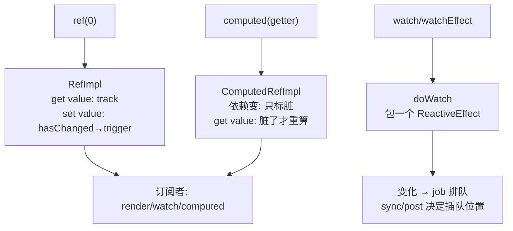

# 第 3 章：ref / computed / watch —— 响应式三兄弟

## 本章在全局的位置

上一章的 `reactive()` 只能包对象。本章讲绕开这个限制的三个封装：ref（让原始值也响应式）、computed（惰性缓存的派生值）、watch（订阅变化做副作用）——读完你就有资格读懂第 6 章"组件实例也是响应式世界的一员"了。

## 前置知识

### 惰性求值与脏标记
"惰性"= 用到才算；"脏标记"（dirty flag）= 一个布尔值，true 表示"依赖变过了、缓存过期了"。两者配合：依赖变了只标脏（便宜），真正读取时才重算（贵的推迟到必要时刻）。computed 是这个模式的教科书。

## 核心问题

为什么 ref 要 .value？computed 凭什么做到"依赖不变就不重算"？watch 和 watchEffect 到底差在哪？

## 主线流程图

## 关键点讲解

### RefImpl：一个字段的"对象版响应式"

📍 `packages/reactivity/src/ref.ts:129`、`:142`

原始值（数字/字符串）没法挂 Proxy，ref 的解法是包一层对象：`RefImpl` 内部一个 `dep`，`get value()` 时 track、`set value()` 时 `hasChanged` 判断后才 trigger。`.value` 不是语法噪声，是**访问 getter 的必经入口**——所有响应式魔法都藏在这次属性访问里。另外 ref 内部存的是 `_value`：对象值仍会用 `toReactive` 包成响应式代理（`ref.ts:125`），所以 `ref(obj).value` 也是深响应的——3.5 改的是 dep 结构（第 2 章的 Link 链表），深响应从没变过。

### ComputedRefImpl：三件套实现惰性缓存

📍 `packages/reactivity/src/computed.ts:47`、`:82`、`:131`

`ComputedRefImpl` 实现了 `Subscriber` 接口（它自己也是响应式图里的节点）：`get value()`（`:131`）先检查是否脏了——不脏直接返回缓存；脏了才跑 getter 重算。`globalVersion`（`:82`）是 3.5 加的全局版本号：一轮批量更新开始时版本+1，computed 发现版本对不上才知道"可能脏了"，连逐个检查依赖都省了。

### refreshComputed：依赖变了只标脏

📍 `packages/reactivity/src/effect.ts:376`

computed 的依赖变化时不立刻重算——`refreshComputed` 只把它标记为"需要刷新"，真重算推迟到下一次 `.value` 读取。对比一个误区：computed **不是**"依赖一变就算好等你要"，而是"变了我知道，你要时才算"。这让"定义了但本轮没人读"的 computed 零成本。

### doWatch：watch 家族的共同躯干

📍 `packages/runtime-core/src/apiWatch.ts:146`

`watch(source, cb)`、`watchEffect(fn)` 全部汇入 `doWatch`：把 source/封装成 getter，包成 `ReactiveEffect`，用它的 `scheduler` 字段接住变化——触发时不直接跑 cb，而是把 job 排进调度队列（第 9 章）。源码注释里 "`watchEffect` = `watch` with `cb: null`"，一语道破两家族同源。

### 三种 watch 的 flush 旗标

📍 `packages/runtime-core/src/apiWatch.ts:56`、`:63`、`:76`

`watchEffect`（组件更新**前**跑，默认）、`watchPostEffect`（更新**后**，要读已更新的 DOM 用它）、`watchSyncEffect`（**同步**立即跑，不等队列）。三个 API 就是同一个 `doWatch` 传不同的 flush 旗标——没有三套实现，只有三个入口。

### effectScope：一棵 effect 树统一停

📍 `packages/reactivity/src/effectScope.ts:6`、`:4`

组件里创建的所有 effect（render、computed、watch）自动归入当前作用域：全局 `activeEffectScope`（`:4`）指针在组件初始化时指向本组件 scope，effect 创建时顺势登记。卸载时 `scope.stop()` 沿树把所有 ReactiveEffect 一并 stop——没有它，每个组件要自己记账清理，泄漏必然满天飞。这就是"组件卸载自动清理副作用"的物理实体。

## 收束

三兄弟都是第 2 章机制的不同姿态：ref 是"单字段 reactive"，computed 是"带脏标记的订阅者"，watch 是"用队列接通知的订阅者"。数据侧齐了，下一章切到编译侧：一份模板字符串怎么变成 render 函数——编译器要打给运行时的暗号（PatchFlags）在第 5 章等着我们。
