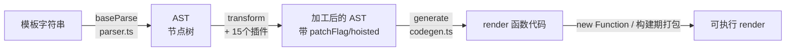

# 第 4 章：编译器流水线 —— 模板变 render 函数

## 本章在全局的位置

数据侧讲完了，本章切到编译链（与运行时完全独立的一段）：`
{{ b }}
` 这个字符串经过 parse→transform→codegen 三站，变成浏览器能执行的 render 函数。理解本章，"模板到底是不是字符串拼接"这类疑惑永久消除。

## 前置知识

### AST（抽象语法树）
源代码的树状结构化表示：标签→节点、属性→节点属性、插值→表达式节点。编译器不直接"字符串进出"，而是"字符串进、树加工、字符串出"——中间那棵树就是 AST。

### 插件模式（transform）
AST 的每个加工步骤做成独立函数（transform 插件），主流程逐节点调用所有插件。`transforms/` 目录下 15 个插件对应 15 种模板特性（v-if/v-for/v-on...），加特性=加插件，不动主流程。

## 核心问题

一个模板字符串经过哪三站变成 render 函数？每站各留下什么？

## 主线流程图

## 关键点讲解

### baseCompile：三段总装

📍 `packages/compiler-core/src/compile.ts:67`、`:95`、`:106`

`baseCompile` 就是流水线总装：`baseParse(source)` 得 AST（`:95`）→ `transform(ast, options)` 加工（`:106`）→ `generate(ast)` 出代码。前后各夹着一些选项处理（prefixIdentifiers、缓存 key 等）。编译器侧的一切从这 40 行看起。

### baseParse： tokenizer 模式的解析器

📍 `packages/compiler-core/src/parser.ts:1028`

`baseParse` 输出 `RootNode`——模板的 AST。3.4 版解析器重写为 **tokenizer（分词器）模式**：不靠逐字符正则硬啃，而是状态机切 token（标签开/闭/文本/注释），官方数据解析速度翻倍。你需要知道的是：AST 节点类型就几种（ELEMENT/TEXT/INTERPOLATION/COMMENT...），和 DOM 树同构。

### transform：AST 的插件式加工线

📍 `packages/compiler-core/src/transform.ts:334`

`transform` 对 AST 做深度优先遍历，每到一个节点就依次调用注册的 transform 插件。`transforms/` 目录下 15 个插件各管一摊：`vIf.ts` 编译 v-if、`vFor.ts` 编译 v-for、`transformElement.ts` 算属性和 patchFlag（第 5 章主角）、`cacheStatic.ts` 做静态提升。**指令没有运行时解释器**——它们全在这一站被翻译成对运行时 API 的调用。

### 指令的编译归宿：一个指令一个运行时约定

📍 `packages/compiler-core/src/transforms/vOn.ts`、`vFor.ts`、`vIf.ts`

举例：`@click="fn"` 编译成 `onClick: _withModifiers(fn, ["prevent"])`；`v-for` 编译成 `_renderList(...)` 调用；`v-if` 编译成三元表达式。运行时根本不知道"指令"存在——它只认编译产物里的这些约定函数。这就是为什么自定义指令（`v-my-dir`）走的是另一条路（`withDirectives`，第 6 章带过）：运行时必须给用户指令留接口，内置指令则纯编译期消化。

### codegen：AST → 代码字符串

📍 `packages/compiler-core/src/codegen.ts:283`

`generate` 把加工完的 AST 序列化成 JS 源码字符串：`_createElementBlock("div", { id: _unref(a) }, _toDisplayString(b) ...)`。注意产物是**字符串**——运行时构建里用 `new Function` 现场编译执行；构建期流程则交给打包器再编译一轮。

### 编译发生在哪：两个时机一套代码

📍 `packages/vue/src/index.ts:23`（运行时）与 @vitejs/plugin-vue（构建期）

同一套 compiler-core 在两个地方服役：开发 playground/CDN 场景在浏览器里现编译（全量构建）；工程化场景在构建期由 plugin-vue 调用（这就是 SFC 的 `<template>` 块）。第 1 章的 tree-shaking 讲的是"运行时不要编译器"，本章补上另一半："编译器在构建期已把活干完"。

## 收束

模板编译 = parse 出 AST → transform 插件加工（指令在此消失、变成运行时约定）→ generate 出代码。transform 这一站还往 AST 上打了两种"暗号"——patchFlag 和静态提升，它们是 Vue3 性能王牌的主角，下一章专讲。
