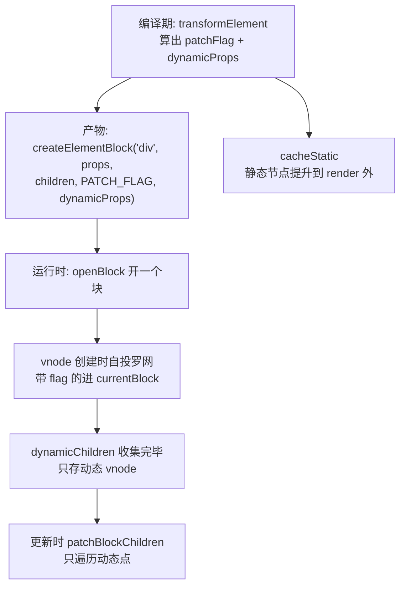

# 第 5 章：编译优化 —— PatchFlags 与 Block 树

## 本章在全局的位置

上一章说 transform 往 AST 上"打暗号"。本章放大这个暗号系统：编译期标记出"哪会变"，运行时跳过"不会变的"——这是 Vue3 相对 Vue2 和相对 React 的最大性能差异点。建议先读过第 7 章 patch 再回来看，两章互为答案。

## 前置知识

### 位掩码
第 2 章已铺垫：整数按位当开关，`|` 组合、`&` 查询。PatchFlags 是它在编译产物的应用。

### 虚拟 DOM（vnode）
用 JS 对象描述 DOM 节点（`{type: 'div', props: {...}, children: [...]}`），更新时新旧两棵 vnode 树比对（diff），只把差异落到真实 DOM。Vue 的 vnode 结构在 `runtime-core/src/vnode.ts`。

## 核心问题

传统虚拟 DOM 要整树比对才知道"哪里变了"，Vue3 怎么做到只比对动态的部分？

## 主线流程图

## 关键点讲解

### PatchFlags：编译器给运行时的暗号表

📍 `packages/shared/src/patchFlags.ts:23`、`:69`、`:94`、`:123`

每个 vnode 一个数字，按位表达"我会怎么变"：`TEXT = 1`（只有文本会变）、`CLASS=2`/`STYLE=4`/`PROPS=8`（指定 props 会变，配 dynamicProps 名单）、`STABLE_FRAGMENT`（`:69`，子节点顺序稳定不用 diff）、`DYNAMIC_SLOTS`（`:94`）、`BAIL = -2`（`:123`，负数是逃生门——放弃所有优化走全量 diff）。运行时见 flag 做事，没 flag 的方面根本不看。

### transformElement：编译期算出动态名单

📍 `packages/compiler-core/src/transforms/transformElement.ts:101`、`:218`

上一章的插件里，这个最关键：它遍历节点的 props，把动态的记下来，累积出 `patchFlag`（`:101`）和 `dynamicProps` 名单（`:102,:218`）。例如 `
hi
` 的产物 flag 是 PROPS，dynamicProps 只有 `['id']`——**文本 'hi' 是静态的，运行时永远不会看它一眼**。这个信息编译期就 100% 确定，运行时只是消费。

### 静态提升：不变的东西连创建都省了

📍 `packages/compiler-core/src/transforms/cacheStatic.ts:40`、`:253`

`cacheStatic` 把纯静态子树（内容永不变化的节点）标记为可提升，`getConstantType`（`:253`）给节点评"常量等级"。提升后的 vnode 在 render 函数外定义为 `_hoisted_1`、`_hoisted_2`（`transform.ts:295`）——每次重渲染直接复用同一份 vnode 对象，创建成本归零；配合 diff 时按 `PatchFlags.BAIL` 整段跳过。

### openBlock / currentBlock：动态点自投罗网

📍 `packages/runtime-core/src/vnode.ts:253`、`:271`

编译产物里每个块级节点外都包了 `openBlock()`。它把一个数组压进 `blockStack`，`currentBlock`（`:253`）指向栈顶——**此后创建的每个 vnode 都会检查自己带不带 patchFlag，带就把自己的引用塞进 currentBlock**（vnode 创建函数里的收编逻辑）。嵌套块自动随栈嵌套。于是 render 一遍跑完，动态 vnode 的扁平列表就自己攒出来了，零遍历成本。

### dynamicChildren：只走动态点的更新

📍 `packages/runtime-core/src/renderer.ts:388`、`:988`

更新时 `patch` 的 `optimized` 参数直接取 `!!n2.dynamicChildren`（`:388`）：新 vnode 带 block 数据就走 `patchBlockChildren`（`:988`）——只遍历那份动态点列表，逐个精准 patch，**静态子树整棵不进入比对**。这就是"避开 VDOM 无用功"的兑现现场。React 没有等价物：它每次都要把组件子树整棵重跑 + 协调（靠 bailout 优化，但比较范围仍是"整个子树"）。

### 三套优化叠一起

PatchFlags（这个 vnode 只有 id 会变）+ 静态提升（这段子树永不参与）+ Block 树（只有这 3 个动态点）是叠乘关系：一次更新的比对量从"整棵树"缩到"几个动态点 + 各自名单里的 props"。代价是**强依赖编译器**——手写 render 函数（`h()`）享受不到，flag 全空、BAIL 退回全量比对。这是"模板比 JSX 在 Vue 里更快"的根源，不是玄学。

## 收束

编译期把"会变什么"算成暗号打在产物上，运行时按暗号精准更新、跳过一切确定不变的东西。下一章回到运行时主线：一个组件 vnode 是怎么长出实例、跑起 setup、交出子树的。
