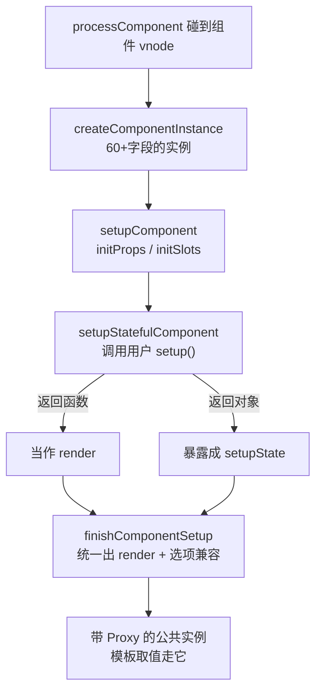

# 第 6 章：组件实例与 setup —— 一个组件在内存里的样子

## 本章在全局的位置

数据侧（02/03）、编译侧（04/05）都齐了。本章进入运行链：`<MyComp/>` 这个 vnode 怎么长出一个"组件实例"，setup 怎么被执行、props/emits 怎么就位、模板里的 `{{ x }}` 怎么通过一层 Proxy 代理找到值——组件是连接响应式与渲染的枢纽。

## 前置知识

### with 语句的替代：Proxy 代理作用域
模板里的 `{{ msg }}` 编译后是裸的 `msg` 标识符（`_ctx.msg`）。谁负责让"裸标识符"找到 setup 返回值/data/props？Vue 用一层 Proxy 按优先级代查——和 `with(obj){}` 语法糖同思路，但可优化、可控制。

## 核心问题

一个组件从 vnode 到"setup 跑完、render 可用"，实例里发生了什么？

## 主线流程图

## 关键点讲解

### createComponentInstance：所有组件状态的集中地

📍 `packages/runtime-core/src/component.ts:614`

实例字段六十多个，分组记：**身份组**（type/parent/root/appContext）、**渲染组**（vnode/next/subTree/render/update/isUnmounted）、**状态组**（data/props/attrs/slots/setupState/ctx）、**响应式组**（effect/scan/effectScope——本组件全部 effect 的归属，第 3 章的 scope）、**依赖组**（provides/inject）、**生命周期组**（各钩子数组）。读 renderer 代码时每个缩写字段都能回到这张清单。

### setupComponent：props 先行，setup 后行

📍 `packages/runtime-core/src/component.ts:809`、`:829`

`setupComponent` 做两件事：`initProps`（`componentProps.ts:199`，把 vnode 的 props 分成"声明过的 props"和"落到 attrs 的剩余"）和 `setupStatefulComponent`（`:829`）。注意顺序：**props/slots 必须在 setup 之前就位**——setup 函数第一个参数就是它们。

### handleSetupResult：返回函数就当 render 用

📍 `packages/runtime-core/src/component.ts:934`

setup 的返回值只有两种合法形态：对象（暴露给模板）或**函数**（直接当 render）。`handleSetupResult` 就是这个分流——`<script setup>` 的语法糖本质也在这里兑现：编译器把模板编译成 render 函数放进 setup 末尾返回。

### finishComponentSetup：Options API 的兼容层

📍 `packages/runtime-core/src/component.ts:998`

如果组件没用 setup（老式 Options 写法），这一站把 `data()/methods/computed/watch` 逐个安装到实例上，并把模板编译产出的 render（或用户手写的）挂到 `instance.render`。函数式/类式/Options 式组件在此殊途同归：**实例上最后都有统一的 render + 状态挂点**。

### emit 与 props：声明驱动的两面

📍 `packages/runtime-core/src/componentProps.ts:199`、`packages/runtime-core/src/componentEmits.ts:113`

`initProps` 只把"组件声明过的 props"做成浅响应式对象，多余的进 `attrs`（这就是"为什么没声明的 prop 不响应"）。`emit(event, ...)` 查 `emits` 声明（没声明在 dev 下有警告），拼出 `onXxx` 去 vnode 的 props 里找回调——**事件在 Vue3 里没有独立通道，就是特殊的 prop**。

### PublicInstanceProxyHandlers：模板取值的查找链

📍 `packages/runtime-core/src/componentPublicInstance.ts:449`、`:474`

模板编译产物用 `_ctx.msg` 取值，`_ctx` 就是带这层 Proxy 的公共实例。`get` 拦截按优先级找：`setupState → data → props → ctx`（`:455-485`），并用 `accessCache` 缓存"这个 key 在哪类"避免每次都试四层——这就是"为什么模板里不用 .value"的真正答案（解 ref 也在这一层顺手做掉）。

### provide / inject 与错误链

📍 `packages/runtime-core/src/apiInject.ts:10`、`:36`；`packages/runtime-core/src/errorHandling.ts:112`、`:130-131`

`provide` 把值挂进 `instance.provides`，子实例创建时原型式继承父的 provides（`inject` 沿 `instance.parent` 链找 key）。错误处理同构：`handleError`（`:112`）沿 parent 链逐层问 `errorCaptured` 钩子（`:130-131`），没人接才上抛到 `app.config.errorHandler`——和第 2 章"沿 parent 链找 inject"是同一条链。

## 收束

组件实例 = 一次性把 props/slots/setup/render/作用域/生命周期装进一个对象，再用一层 Proxy 给模板开"统一取值窗口"。实例就绪后只差最关键一步——把 render 包成 effect 接进响应式循环，这是下一章渲染器的开场戏。
