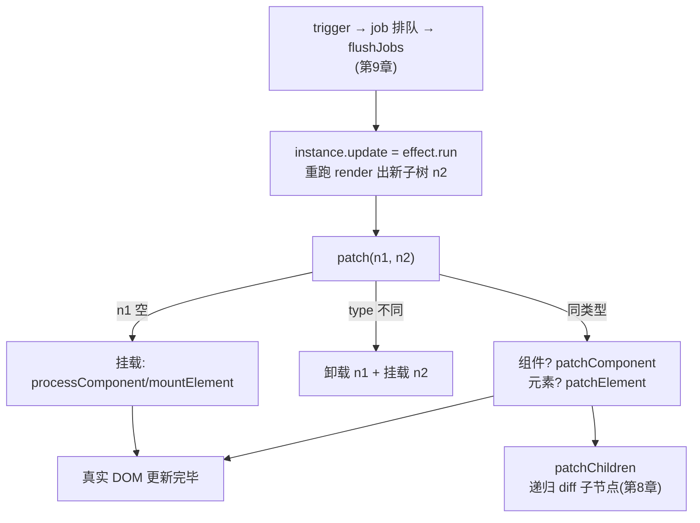

# 第 7 章：渲染器 —— patch 主线

## 本章在全局的位置

前面所有零件到齐：vnode（05 章）、实例（06 章）、响应式（02 章）。本章把它们接成闭环：`instance.update` 怎么诞生、`patch(n1, n2)` 怎么分流挂载/更新/卸载——这是 runtime-core 最核心的 2600 行（renderer.ts）的主干道。

## 前置知识

### 渲染器与渲染函数
"渲染器"（renderer）是把 vnode 树转成真实 DOM 的引擎；组件的 render 函数只是"生产 vnode 的零件"。引擎全局一份，零件每组件一份——别混。

## 核心问题

数据变化后，Vue 怎么从"重跑 render"走到"真实 DOM 被最小化更新"？

## 主线流程图

## 关键点讲解

### patch 总闸：n1/n2 分流

📍 `packages/runtime-core/src/renderer.ts:379`、`:392-394`

`patch(n1, n2, container)` 是一切更新的入口，三分支：`n1 === null` → 挂载（没有旧节点）；`n1 && !isSameVNodeType(n1, n2)` → 卸旧的、挂新的（`:394`；`isSameVNodeType` 就是"type 相同且 key 相同"——**给元素换 tag 或 key 会强制重建**）；否则 → 同类型打补丁。整个渲染器就是这一个函数的递归展开。

### processComponent / mountComponent：组件的分水岭

📍 `packages/runtime-core/src/renderer.ts:1178`、`:1215`

vnode 分两类处理：组件 vnode 进 `processComponent`（`:1178`）→ `mountComponent`（`:1215`）→ 上章的 createComponentInstance/setupComponent 流水线；元素 vnode 进 `processElement` → `mountElement`。注意"组件的 children 是 render 出来的子树，元素的 children 是真孩子"——递归在这里分叉。

### setupRenderEffect：instance.update 的诞生

📍 `packages/runtime-core/src/renderer.ts:1329`、`:1617`

这是全仓最重要的"接线"之一：`setupRenderEffect` 把"跑 render + patch"包成一个 ReactiveEffect——`instance.update = effect.run.bind(effect)`（`:1617`）。从此**组件渲染就是一个响应式副作用**：render 里读过的响应式数据都自动记账（第 2 章 activeSub 机制），数据一变 trigger 把 `instance.update` 作为 job 排进队列（第 9 章），重跑 render 出新子树再 patch。整条反应链就此合龙。

### mountElement：真 DOM 的诞生地

📍 `packages/runtime-core/src/renderer.ts:667`

挂载元素 vnode 的地方：`createElement` 造节点 → 递归 patch children → `hostPatchProp` 打属性/事件 → 插进容器。注意顺序优化：**先装配后插入**——子树全部就绪才一次性 `insert` 到文档，避免中间态渲染。指令（v-show 等）也在这里挂载（`directives` 遍历 created/beforeMount 钩子）。

### patchElement：更新的主战场

📍 `packages/runtime-core/src/renderer.ts:840`

同类型元素更新走这里：先 `patchChildren`（三种模式：带 key 走第 8 章 diff、无 key 走 `patchUnkeyedChildren`、静态子树走 block 快路）再 `patchProps`（按 dynamicProps 名单只更新会变的属性——第 5 章暗号在此消费）。完整更新 = 新 vnode 信息 + 旧 DOM 的最小改动。

### unmount：卸载也要走完生命周期

📍 `packages/runtime-core/src/renderer.ts:2157`

`unmount` 递归处理组件/元素/fragment/teleport 各形态：组件先触发 `beforeUnmount`、执行 scope.stop（第 3 章 effectScope 在此兑现"自动清理"）、卸子树，再 `unmounted` 钩子，最后删 DOM。删除是最后一步——**生命周期钩子跑的时候 DOM 还在**，这是很多库行为对齐的细节。

## 收束

渲染器主干 = patch 总闸的三分流 + 挂载装配线 + 更新补丁线 + 卸载清理线，枢纽是"组件渲染 = ReactiveEffect"这根轴。其中最精的一段——同层子节点的 key diff——下一章单独拆。
