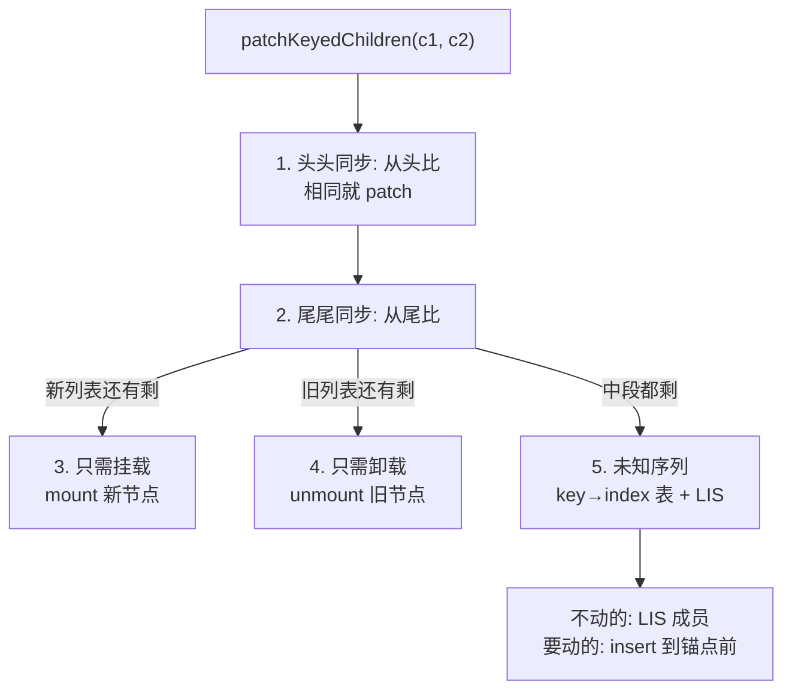

# 第 8 章：Diff 算法 —— 最长递增子序列

## 本章在全局的位置

上一章的 `patchChildren` 在"新旧都是列表且带 key"时进入 `patchKeyedChildren`——全仓最精巧的 200 行。本章走完它的五步，重点回答：为什么"最长递增子序列"是最少移动方案。

## 前置知识

### 最长递增子序列（LIS）
一个数字序列里挑出尽量多的数，让它们严格递增（不必连续）。例：`[5, 2, 3, 1, 4]` 的 LIS 是 `[2, 3, 4]`。Vue 的用法：下标数组里"递增"= "这些位置的节点本来顺序就没变"，LIS 即"不用动的最大集合"→ 移动最少。求法用贪心+二分，复杂度 O(n log n)。

## 核心问题

新旧两个 children 列表都有 key，怎么用最少的 DOM 移动完成对齐？

## 主线流程图

## 关键点讲解

### 五步总览：注释就是目录

📍 `packages/runtime-core/src/renderer.ts:1820`、`:1836`

`patchKeyedChildren` 内部按注释分五步（`:1836` 起依次是 "1. sync from start" `:1836`、"2. sync from end" `:1862`、"3. common sequence + mount" `:1889`、"4. common sequence + unmount" `:1919`、"5. unknown sequence" `:1933`）。设计思想：**用两次双端扫描把最常见的简单场景（头部追加、尾部追加/删除）O(n) 解决掉**，只有真正乱序的中段才进昂贵的第 5 步。

### 前缀同步与后缀同步

📍 `packages/runtime-core/src/renderer.ts:1836`、`:1862`

第 1 步双指针从头比，type+key 相同就 patch 并同时右移；第 2 步从尾比同时左移。两个循环任一停住即止，剩下一头对齐的——直接进入第 3/4 步批量 mount/unmount。日常"列表尾部 push 一条"在第 2 步就被消化，根本见不到 LIS。

### 中段建档：newIndexToOldIndexMap

📍 `packages/runtime-core/src/renderer.ts:1972`

走到第 5 步，先把中段新节点在旧列表里的位置记成 `newIndexToOldIndexMap`（`:1972`，找不到的记 0=全新要挂载）。查找靠一张 `keyToNewIndexMap` 表 O(1) 定位。这张数组就是 LIS 的输入原料。

### getSequence：求出"不用动"的最大集合

📍 `packages/runtime-core/src/renderer.ts:2597`、`:2024`

`getSequence(newIndexToOldIndexMap)`（调用在 `:2024`，实现在 `:2597`）求 LIS：数组里值严格递增的子序列 = 一批"位置关系和旧列表一致"的新节点——它们原地不动最省事。实现是贪心+二分（维护每长度末尾最小值的数组 + 前驱回溯），O(n log n)。注意它返回的是**下标序列**，供后面直接定位。

### 移动与挂载：锚点一次到位

📍 `packages/runtime-core/src/renderer.ts:2051`

最后倒序遍历中段新节点（从右往左，保证锚点先就位）：是 LIS 成员→只 patch 不动；在 map 里是 0→mount 插入；否则→`move` 插到正确锚点前（`:2051` 的 move 判定注释）。**倒序遍历 + 先处理右侧**是"一次到位"的关键：每个节点的插入锚点此时已经是最终位置。

### patchUnkeyedChildren：反面对照组

📍 `packages/runtime-core/src/renderer.ts:1760`

不给 key 的列表走 `patchUnkeyedChildren`：按位短平快 patch，谁多谁少就地增删。位置变了全部就地改内容（每个节点的 patch 都触发真实 DOM 更新）。这就是"列表为什么必须加 key"的反面教材——不加 key 不是不 diff，是把"移动"退化成"逐个改"。

## 收束

五步 diff = 双端扫描处理简单场景 + key 建档 + LIS 求最大不动集 + 倒序锚点移动。React 的列表 diff 只做前缀复用 + Map 配对、不优化移动，Vue 的 LIS 多付 200 行换"最少 DOM 移动"（对照本仓 React 导读 06 章）。下一章看所有这些更新是怎么被排队调度、合并冲刷的。
