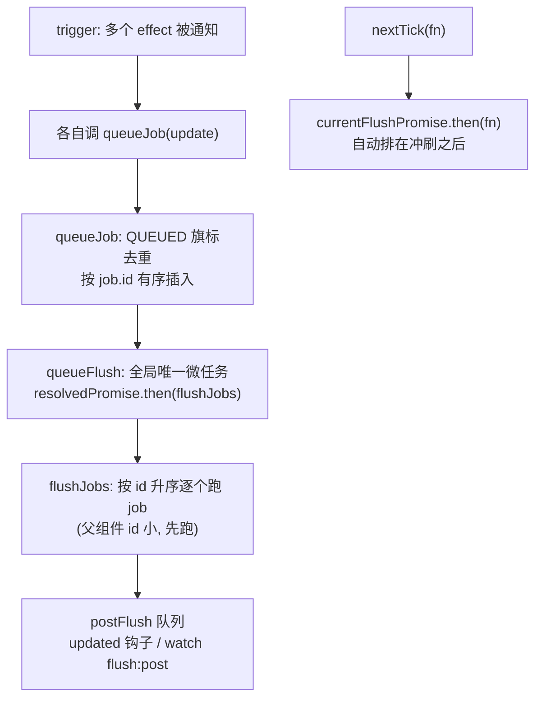

# 第 9 章：调度系统 —— queueJob 与 nextTick

## 本章在全局的位置

前面反复出现"trigger 之后 job 排队"。本章拆开队列：Vue 怎么把同一轮里的多次数据变化合并成一次 DOM 冲刷、job 按什么顺序跑、`nextTick` 到底是什么——这是响应式（02 章）与渲染器（07 章）之间的传送带。一个历史事实先交代：**scheduler 已从独立包并入 runtime-core**（3.5 起），网上还在讲 `@vue/runtime-core 依赖 @vue/scheduler 包` 的资料过时了。

## 前置知识

### 微任务
Promise.then 回调排进微任务队列，本轮同步代码跑完、浏览器渲染前执行。天然适合"攒一批、下轮一起干"——React 和 Vue 的批量更新都建立在它上（详细机制见本仓 React 导读第 5 章）。

## 核心问题

一轮事件里改了 10 次数据，为什么 DOM 只更新一次？nextTick 里拿到的是什么时刻？

## 主线流程图

## 关键点讲解

### queueFlush：全局唯一的冲刷微任务

📍 `packages/runtime-core/src/Scheduler.ts:119-121`、`:50-51`

`queueFlush` 三行干大事：`currentFlushPromise = resolvedPromise.then(flushJobs)`——有且只有一个全局微任务（`resolvedPromise = Promise.resolve()`，`:50`；`currentFlushPromise` 非空就不再排，`:120`）。冲刷完成后置回 null，下一轮数据变化再排新的。**同一 tick 改 10 次数据 = 排队 10 个 job，但冲刷只有一次**——Vue 的"自动批处理"就这么几行。

### queueJob：旗标去重 + 按序插入

📍 `packages/runtime-core/src/Scheduler.ts:99-117`

每个 job 先查 `QUEUED` 旗标（`:100`）——已在队列里的直接跳过（去重的实现，不是数组 includes 扫描）。插入时按 `job.id` 找位置：id 比队尾大直接 push（快路径），否则 `findInsertionIndex` 二分插入（`:105-108`）。**队列天然按 id 有序**，这是下一步冲刷顺序的基础。

### flushJobs：按 id 升序，父先子后

📍 `packages/runtime-core/src/Scheduler.ts:221`

`flushJobs` 从队列头按序取 job 执行。组件更新 job 的 id 在创建时按调用顺序自增——**父组件的 id 一定小于子组件**（父先创建），所以父组件总是先更新，子组件拿到的是父更新后的 props，一轮冲刷内父子状态天然一致。React 为同样的目标用了另一套机制（lane + 双缓冲），殊途同归。

### nextTick 的真相：排在冲刷后面的那个 then

📍 `packages/runtime-core/src/Scheduler.ts:56`、`:65`

`nextTick(fn)` 的实现是 `currentFlushPromise ? currentFlushPromise.then(fn) : resolvedPromise.then(fn)`（`:65`）。所以它不是什么"定时器"，**就是一个排在 DOM 冲刷之后的微任务**：当前有挂起冲刷就搭冲刷的车，没有就立刻（下一个微任务）执行。"改完数据在 nextTick 里读 DOM"能读到新内容的原理全在这里。

### postFlush 队列：第二队列

📍 `packages/runtime-core/src/Scheduler.ts:125`

`queuePostFlushCb` 是独立队列：组件 `updated` 钩子、`watch(..., {flush: 'post'})` 都进这里，由 flushJobs 在主队列跑完后统一执行——保证"回调读到的一定是本轮全部更新完的 DOM"。三种 watch（第 3 章）的 flush 旗标在此兑现。

### 与 React 调度对照（收束用）

| | Vue | React |
|---|---|---|
| 合并手段 | job 旗标去重 + 单微任务冲刷 | 根链表 + 微任务去重排期 |
| 顺序保证 | job.id 升序（父先子后） | lane 优先级 + 双缓冲 |
| 逃生门 | nextTick | flushSync |
| 中断能力 | 无（一次冲刷到底） | 时间切片可中断 |

两边都选了微任务做批量边界；React 多买了"可中断"，Vue 换了更小的实现复杂度——第 10 章的取舍视角。

## 收束

调度 = 去重排队 + 按序冲刷 + nextTick 搭车。至此全链路闭环：Proxy 记账 → trigger → job 排队 → flushJobs 重跑 render → patch/diff → DOM。最后一章站在全局，给这台机器的设计记账。
