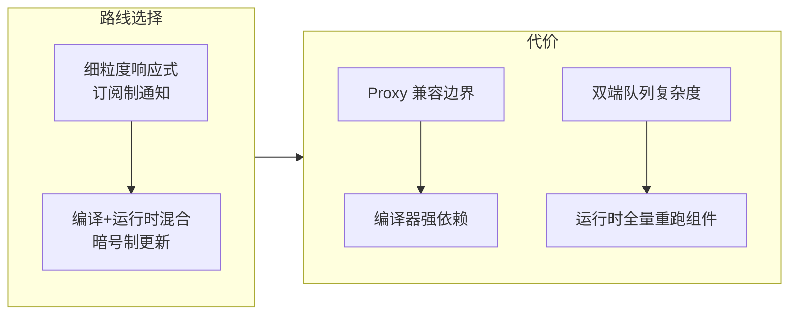

# 第 10 章：设计取舍总览 —— 这台机器为什么长这样

## 本章在全局的位置

九章拆解完毕。本章不进新代码，把散在各章的取舍收拢成一张账，并给出与 React 对照的判断框架——学完源码不复盘取舍，等于只记住了地图没记住路。

## 核心问题

Vue3 的每个关键选择买了什么、付了什么？哪些是"路线之争"，哪些只是"时点差异"？

## 主线流程图

## 关键取舍逐条看

### Proxy vs defineProperty：一揽子买断

📍 `packages/reactivity/src/baseHandlers.ts:49`

Vue2 靠 `Object.defineProperty` 逐属性劫持，天生残废（新增属性要 `$set`、数组索引靠重写方法）。Vue3 换 Proxy 一揽子买断：新增/删除/数组长度全监听、Map/Set 也能响应。付出的是 IE11 彻底出局 + `receiver`/原型链等边界处理复杂度（`baseHandlers.ts:177-190` 那些 toRaw 判断）。这不是"谁更先进"，是"要不要 IE"的时代决策。

### 细粒度的真相：组件级重渲染，不是 DOM 级

📍 `packages/runtime-core/src/renderer.ts:1617`

常见误解要澄清：Vue3 的更新单位仍是**组件**——trigger 把组件的 render effect 排队、整个 render 重跑、再靠 PatchFlags/Block 只比对动态部分。"细粒度"体现在依赖收集（哪个组件用哪个数据，记账到组件级）和比对范围（动态点），**不是**"哪个 DOM 节点变了就只动那个节点"（那是 Solid/Vapor 的路线，Vue 官方 Vapor 模式正在做这件事）。读懂这一点，性能问题才不会问错方向。

### 编译+运行时混合：暗号制的哲学

📍 `packages/shared/src/patchFlags.ts`

Vue3 把"静态分析能证明的事"在编译期算好（patchFlag、dynamicProps、静态提升、Block），运行时只消费结论。对照 React：把一切留给运行时、靠 diff 和 bailout 兜底——然后 React 19 又搞 Compiler 把这条补上。**两大框架正从相反方向逼近同一形态**：编译期算得越多，运行时越便宜。Vue 的教训是这套优化强绑模板语法，手写 render/JSX 享受不到。

### dep 双向链表：一次教科书级的性能重构

📍 `packages/reactivity/src/dep.ts:32`

3.5 把 Dep/Subscriber 从"互持 Set 集合"改成 Link 双向链表，官方发布说明的收益：内存 -56%、大型深度响应式数组操作最高 10 倍提速。启发不在链表本身，在**重构勇气**：这是对响应式核心数据结构的推倒重来，且 API 完全无感——好抽象让底层可以无限重写。

### 调度器的克制：不买可中断

📍 `packages/runtime-core/src/Scheduler.ts:221`

Vue 的冲刷是"一个微任务跑完所有 job"，不可中断；React 用 Fiber + 时间切片买了可中断。Vue 团队的判断：组件更新普遍够小、编译优化已削掉大半比对量，为长任务买中断机制不值。两个都是成熟答案——**差异来自优化水位判断，不是能力差距**。真有长任务，Vue 的官方答案也是让编译器更进一步（Vapor/编译期拆分）而不是运行时切片。

### 单实例 render effect：调试友好的来源

📍 `packages/runtime-core/src/component.ts:614`

每组件一个 render effect + id 有序队列，让"一次更新是谁触发的"在 devtools 里可完整回放（组件栈、trigger 链）。React 的并发重渲则经常"这轮谁渲染了"难以归因。Vue 选了**确定性顺序**（父先子后、同步冲刷）这条略保守但好调试的路线——工程取舍里"可解释性"是常被低估的资产。

## 一张表收尾

| 取舍 | 买到 | 付出 |
|---|---|---|
| Proxy | 全监听 + 集合类型 | IE11、边界复杂度 |
| 编译暗号 | 更新比对缩到动态点 | 绑定模板语法、编译器强依赖 |
| dep 双链表 | 依赖增删一个量级提速 | 核心结构推倒重来 |
| 不可中断冲刷 | 实现简单 + 可解释性好 | 超长任务无让步 |
| 组件级重渲 | 心智简单、生态统一 | 不是 DOM 级细粒度 |

## 收束

Vue3 的机器 = 响应式记账 + 编译暗号 + 有序冲刷 + 最少移动 diff，每层都在为"运行时少干活"让路。想继续深挖，下一站推荐 compiler-sfc（`<script setup>` 的编译魔法）和 Vapor 模式（真正的 DOM 级细粒度）。本导读到此收官。
