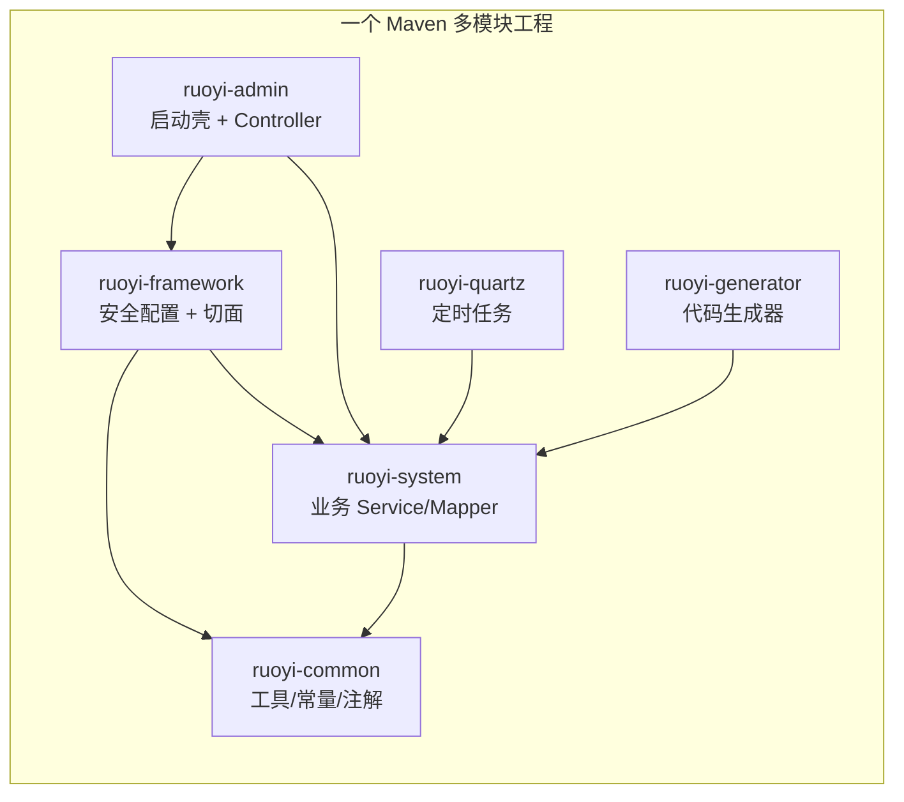
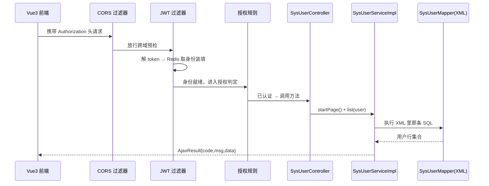
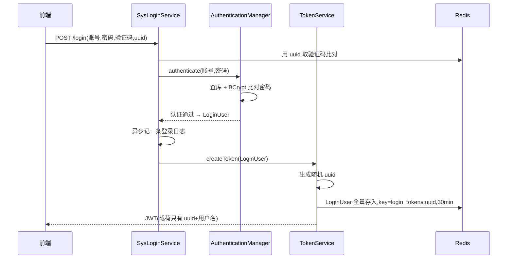
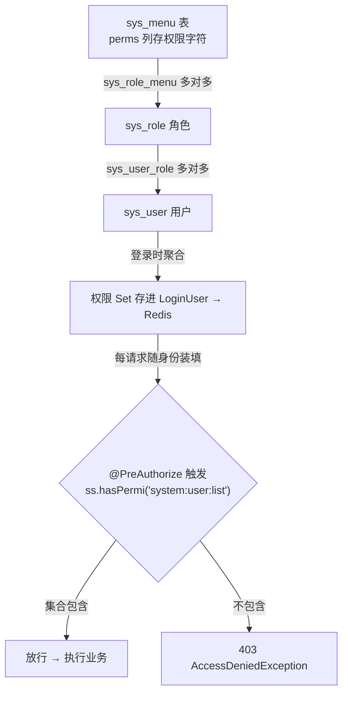
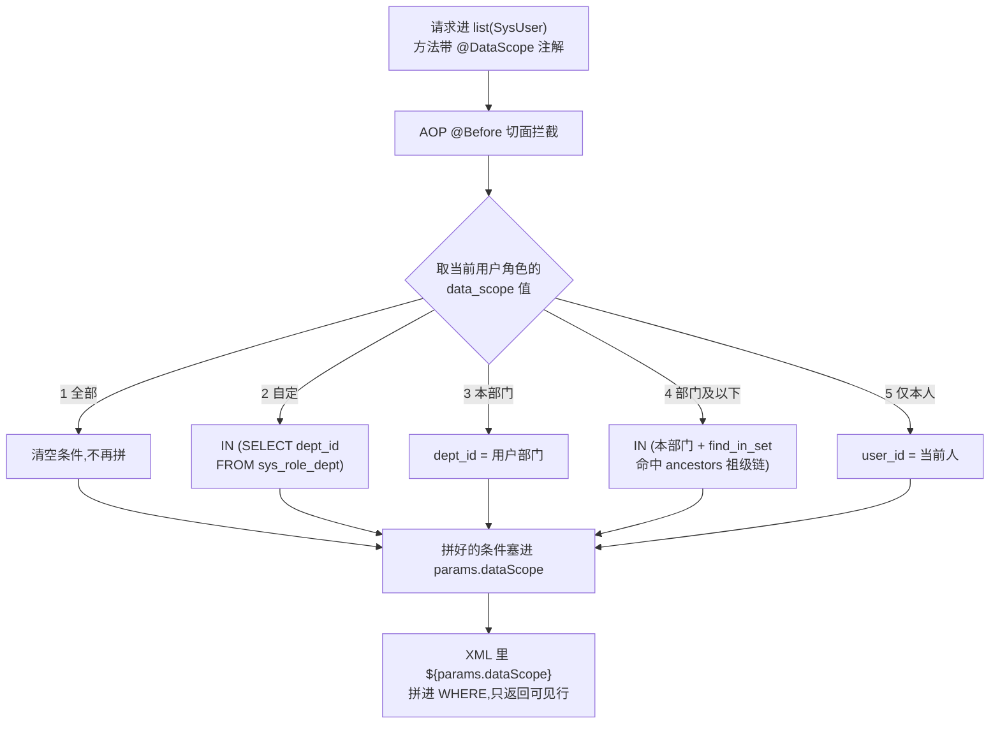

# RuoYi-Vue 源码导读 —— 给「只会写接口的你」的后端进阶第一课

> 源码版本：后端 [yangzongzhuan/RuoYi-Vue](https://github.com/yangzongzhuan/RuoYi-Vue) master@`13db1fc`（2026-09-19 取源）；前端参照 [yangzongzhuan/RuoYi-Vue3](https://github.com/yangzongzhuan/RuoYi-Vue3) master@`838965c`
> 本地克隆：`.spec/源码学习/_clones/RuoYi-Vue`、`_clones/RuoYi-Vue3`（下文所有 `文件:行号` 锚点均出自本次克隆）
> 阅读方式：章号即推荐阅读顺序，每章沿一条真实执行主线走读，配图与讲解一一对应

## 00 · 总览

**RuoYi-Vue 是什么**：国内最流行的开源后台管理系统脚手架（Java/Spring Boot 后端 + Vue3/Element Plus 前端）。它管的正是每个后台系统都绕不开的那摊事：用户、角色、菜单、部门、字典、操作日志、定时任务、代码生成。6.7k+ 星（Vue3 版），生产被抄烂的程度堪称「后台管理系统事实标准」。

**你为什么该读它**：你会写接口，但接口之外的东西——登录态怎么管、权限怎么拦、数据按部门隔离、操作日志怎么做到业务代码零侵入——这套代码全是最直白的教科书实现。它没有炫技，所以特别好学。

**怎么跑起来**（本地见真章）：MySQL 导入 `sql/ry_20260417.sql` + `sql/quartz.sql` → 改 `ruoyi-admin/src/main/resources/application-druid.yml` 数据源 → 运行 `ruoyi-admin` 的启动类（或 `ry.bat`）→ 前端 `npm install && npm run dev`。默认账号 `admin / admin123`。

**模块总图**：

**学习动线**：章1 架构与请求动线 → 章2 认证 → 章3 鉴权 → 章4 数据权限（3、4 章是重头戏）→ 章5 表设计与横切 → 章6 收束。想省时间：只读 2、3、4。

**前置知识**（已懂可跳过）：

| 概念 | 一句话 | 权威入口 |
|---|---|---|
| Spring Boot | Java 界的「NestJS + 全家桶」：注解声明 + 自动装配 + 内嵌容器 | spring.io（搜 spring boot） |
| Spring Security | 以「过滤器链」织进每个请求的安全框架，认证（你是谁）+ 授权（你能干啥）都在链上 | spring.io（搜 spring security） |
| JWT | 三段式自包含令牌：头部.载荷.签名，服务端不存也能验真 | jwt.io |
| MyBatis | SQL 写在 XML 里、接口方法一调就执行的老牌 ORM | mybatis.org |
| AOP | 面向切面：给一批方法统一「前后加戏」的机制（Nest 拦截器/Guard 的加强版） | 搜 Spring AOP 官方文档 |
| Redis | 内存键值库，这里当「会话仓库 + 计数器」用 | redis.io |

---

## 01 · 全局架构与一次请求动线

**本章在全局的位置**：开胃主菜。先建立「一个请求从进到出经过谁」的骨架，后面每一章都挂在这条骨架上。

**前置知识**：Maven 多模块 ≈ 前端的 monorepo workspace：一个仓库拆成多个子工程，子工程之间用依赖声明复用，最后由一个壳工程打包。

**核心问题**：一个 `GET /system/user/list` 请求进来，到底经过谁、每站干了什么？

**主线流程图**：

**关键点讲解**：

1. **六模块分工与依赖方向**（`pom.xml:177-182`）：`common` 是最底层（谁都能依赖它），业务全在 `system`，安全与切面在 `framework`，`admin` 只是「启动壳 + 所有 Controller」。为什么这么拆？安全方案或部署形态要换时，业务代码一动不动。
2. **JWT 过滤器的站位**（`SecurityConfig.java:113`）：`addFilterBefore(JWT过滤器, UsernamePasswordAuthenticationFilter.class)`——把自己插在 Spring Security 官方「用户名密码过滤器」前面。每个请求先验 token，验过就把身份放进安全上下文，后面所有人都免验。
3. **敢关 CSRF 的底气**（`SecurityConfig.java:90,98`）：`csrf.disable()` + `sessionCreationPolicy(STATELESS)`。CSRF 防的是「借浏览器里的 Cookie 会话作恶」，这套系统无 Cookie 会话、全靠请求头带 token，天然免疫，所以关得理直气壮。
4. **白名单**（`SecurityConfig.java:101-108`）：`/login`、`/register`、`/captchaImage` 和静态资源 `permitAll`，其余 `anyRequest().authenticated()`。还支持在方法或类上标 `@Anonymous` 注解收集白名单（注解定义 `Anonymous.java:17`，收集逻辑 `PermitAllUrlProperties.java:48,53`）。「先白名单、后全拦截」是所有鉴权系统的固定句式。
5. **Controller 只做转发**（`SysUserController.java:59-61`）：`list` 方法就一行委托 service。约定：参数校验、拼装返回在 controller；业务与事务在 service；SQL 在 mapper。三层各司其职，跟他家代码生成器（章5）配套。
6. **统一返回**（`AjaxResult.java:13,18-24`）：`AjaxResult extends HashMap`，固定三键 `code/msg/data`。前端拿到的形状永远一致，错误处理只看 `code`。简单到不像设计——但「全公司返回形状唯一」这事，很多团队做不到。
7. **全局异常分级**（`GlobalExceptionHandler.java:35,58,96`）：控制器不写 try-catch。`ServiceException`（业务异常）→ 原样 msg 返回；`AccessDeniedException` → 无权限；`RuntimeException` → 兜底 500。异常处理的本质是「分层兜底」。
8. **分页魔法**（`PageUtils.java:18-25`）：查询前一行调 `startPage()`，PageHelper 用 **ThreadLocal** 记住「下一条 SQL 要分页」，再由 MyBatis 拦截器自动拼 `limit`。前置概念 ThreadLocal：线程私有的储物柜，同一线程内谁都能存取。魔法 = 存柜 + 拦截，不是玄学。

**收束**：骨架清楚了——过滤器验身份、注解做门禁、controller 转发、service 干活、mapper 出数据、统一形状出去。下一章深挖第一站：token 从哪来。

---

## 02 · 认证：从登录到 token 的双层设计

**本章在全局的位置**：章1 里「JWT 过滤器每请求验 token」——这章讲 token 是怎么发出来、怎么续命、怎么作废的。

**前置知识**：JWT 三段式令牌（头.载荷.签名），签名防篡改但**内容人手一份可见**；BCrypt 是慢哈希密码算法（自带随机盐、故意算得慢，拖垮暴力破解）。见 jwt.io / 搜「BCrypt」。

**核心问题**：登录成功后，「你是谁」如何被之后的每个请求记住？——以及：为什么 RuoYi 的 JWT 只有 20 个字节大？

**主线流程图**：

**关键点讲解**：

1. **验证码先拦一道**（写入 `CaptchaController.java:58,78`，校验 `SysLoginService.java:115-116`）：图形验证码生成时存 Redis（key 带 uuid、限时 2 分钟级），登录时按 uuid 取出比对。目的：让「机器暴力试密码」的成本高于「人手输入」。
2. **认证不自己写 if-else**（`SysLoginService.java:76`）：把账号密码交给 `authenticationManager.authenticate()`，Spring Security 会去调 `UserDetailsServiceImpl` 按用户名查库、用 `BCryptPasswordEncoder` 比对密码（bean 注册在 `SecurityConfig.java:123-127`）。你只管提供「查人」和「加密器」两个零件，比对流程框架标准件。这就是「别自己造认证轮子」的范式。
3. **JWT 里几乎没东西**（`TokenService.java:122-125`）：载荷只有 `uuid + username`。用户角色、部门、权限集合统统不在里面。
4. **双层会话设计（本章灵魂）**：真身 `LoginUser`（含全部权限）以 uuid 为 key 存 Redis，TTL 30 分钟（`TokenService.java:150-156`）。为什么两层都要？——JWT 解决「防伪」（改一个字节签名就废），Redis 解决「挂失」（纯 JWT 无状态，发出去就收不回；有了 Redis 这层，删键即作废）。无状态的扩容优势 + 有状态的管理能力，全都要。
5. **滑动续期**（`TokenService.java:134-142` + `application.yml:96-102`）：每个请求进来 `verifyToken` 一遍——距过期不足 20 分钟就自动把 Redis TTL 刷回 30 分钟。效果：活跃用户永不掉线，闲置 30 分钟自动失效，且**前端 token 一个字都不用换**。
6. **每请求装填**（`JwtAuthenticationTokenFilter.java:34-42`）：解 JWT 拿 uuid → Redis 取 LoginUser → 塞进 `SecurityContextHolder`。此后任何一层代码 `SecurityUtils.getLoginUser()` 都能拿到当前人。过滤器是「把散装凭证翻译成上下文」的翻译官。
7. **登出与踢人**（`TokenService.java:100-107` + `LogoutSuccessHandlerImpl.java:47` + `SecurityConfig.java:111`）：登出就是删 Redis 键。键没了，JWT 再合法也是「查无此人」。管理员想强制下线任何人，删对应键即可——这就是第 4 点买来的能力。

**收束**：记住这对组合——**JWT 当防伪票，Redis 当户口本**。下一章：有了身份，如何判定「你能调这个接口吗」。

---

## 03 · 鉴权：RBAC 与按钮权限

**本章在全局的位置**：章2 确认「你是谁」，本章回答「你被允许做什么」——功能权限（接口）与按钮权限（UI）两层。

**前置知识**：RBAC（基于角色的访问控制）：用户不直接绑权限，中间加一层「角色」。人多变、岗少变，权限跟着岗位走，换人不换岗就不用重配权限。

**核心问题**：`@PreAuthorize("@ss.hasPermi('system:user:list')")` 这一行，是怎么被判定通过或拒绝的？

**主线流程图**：

**关键点讲解**：

1. **五表分工**（`sql/ry_20260417.sql:42,105,134,268,285`）：用户、角色、菜单三实体 + 用户角色、角色菜单两张关联表，标准多对多。彩蛋：**菜单表兼职权限表**——权限字符就存在菜单表的 `perms` 列，挂在每个按钮（F 类型）上，于是「界面长什么样」和「接口谁能调」天然对齐，一张后台管理界面维护完事。
2. **权限字符命名约定**（`sql/ry_20260417.sql:167,191`）：`system:user:list` = 模块：实体：动作。目录（M）/菜单（C）/按钮（F）三类菜单分层挂字符。读代码时先读字符，归属一目了然——命名即文档。
3. **权限集合的组装时机**（`SysPermissionService.java:58-84`）：登录时按用户角色把所有菜单 perms 聚合成 `Set<String>`，塞进 LoginUser 存 Redis。请求期**不再查库**。取舍：性能换实时性——改了权限要重新登录才生效（好在章2 有 Redis，想立即生效删键让人重登即可）。
4. **`@ss` 是个普通 Bean**（`PermissionService.java:18-40`）：`@Service("ss")` 注册了个名叫 ss 的 bean（作者自注：ss 取自 SpringSecurity 首字母），`@PreAuthorize` 里的表达式就是「从容器捞 ss、调 hasPermi」。NestJS 类比：Guard 里注入一个 PermissionService——同一思想，Spring 用 SpEL 字符串连线。
5. **超管短路**（`PermissionService.java:102`）：`roleKey == admin` 直接放行。每套权限系统都必须回答「上帝账号怎么办」，这里的答案是不参与判定、全部直通——简单，但要记得超管是**绕过**权限而不是「拥有全部权限字符」。
6. **前端按钮权限**（RuoYi-Vue3 `src/directive/permission/hasPermi.js:8-21`）：`v-hasPermi="['system:user:edit']"`——集合对不上就直接 `removeChild` 把按钮从 DOM 删掉。注意边界：**藏按钮只是体验优化，真正的门禁是后端 `@PreAuthorize`**——拿着前端藏起来的接口直接调，照样 403。
7. **前端动态路由**（RuoYi-Vue3 `src/permission.js:21-23`）：路由守卫里「有 token → 拉用户信息 → 按权限生成路由」。没权限的菜单连路由都不存在，地址栏手敲也进不去（进去了接口也会 403）。

**收束**：功能权限和按钮权限都是「字符集合的包含判断」，共用一套 RBAC 数据。第三层——「同样是查用户列表，你只能看到你部门的行」——是另一门手艺，下一章。

---

## 04 · 数据权限：同一个接口，不同人看到不同的行

**本章在全局的位置**：接口权限之上的一层细粒度控制。RuoYi 用一个注解 + 一个切面 + mapper 里一个占位符完成，是全项目最值得精读的机制。

**前置知识**：① 邻接表树：每行存 `parent_id` 指向父节点；查「所有子孙」要递归，贵。RuoYi 冗余了一列 `ancestors`（祖级链：`0,100,101` 这样的全部上级 id 串），一条 SQL 直达。② `${}` 与 `#{}`：MyBatis 里 `#{}` 预编译防注入，`${}` 是字符串拼接（危险但能拼列名/子查询）。

**核心问题**：同一个 `list` 接口，市级账号凭什么只看到本市的数据？这个「凭什么」是谁在 SQL 里写的？

**主线流程图**：

**关键点讲解**：

1. **配置落在角色上**（`sql/ry_20260417.sql:105` 的 `sys_role.data_scope` + `Constants.java:177-202`）：`char(1)` 五个值——1 全部 / 2 自定 / 3 本部门 / 4 本部门及以下 / 5 仅本人。注意：数据范围是**角色的属性**不是用户的，一人多角色时五条策略全要考虑（代码里用去重 + 「全部」短路处理）。
2. **五种策略一张表**（`DataScopeAspect.java:90-127`）：见上图。「全部」最优先——直接清空已拼内容并 break，能不拼就不拼（`:92-94`）；「自定」走 `sys_role_dept` 关联表子查询（`:101-105`）；「仅本人」切到 `user_id` 维度（`:116-121`）。
3. **ancestors 空间换时间**（`DataScopeAspect.java:114` + `sql/ry_20260417.sql:5-8`）：「本部门及以下」不递归，`find_in_set(本部门id, ancestors)` 直接命中所有子孙部门。冗余一列换掉递归查询——树形表设计的经典权衡，写部门/分类/组织树都能抄。
4. **注入点与消费点解耦**（`DataScopeAspect.java:137-145` + `SysUserMapper.xml:86,103,121`）：切面把拼好的条件塞进首个参数的 `params.dataScope`；业务 SQL 里只预留一个 `${params.dataScope}` 占位。业务 mapper 完全不感知数据权限存在——新增业务表想接入，XML 里抄一行占位即可。
5. **敢用 `${}` 拼接的安全闭环**（`DataScopeAspect.java:38,148-150`）：切面**第一件事**是 `clearDataScope` 清掉参数里的 dataScope 再重拼。因为 `params` 是前端可以传入的字段，先清空 = 用户传什么都没用，拼进 SQL 的内容 100% 来自服务端角色配置。⚠️ 条件成立的「安全」：闭环缺了任何一环（忘了清、或值里混入用户输入）就是 SQL 注入——抄的时候两处都要抄。
6. **超管不过滤**（`DataScopeAspect.java:50`）：`isAdmin()` 为真直接跳过，不拼任何条件。
7. **列表之外的兜底**（`SysUserController.java:107,127-128`）：列表靠 WHERE 拼接；但「查单个用户详情」这种非列表接口拼不了，就手动调 `checkUserDataScope(userId)` 显式校验「你要看的人在我的可见范围内，否则抛异常」。数据权限的两种落地形态：列表拼 WHERE、单条显式校验，缺一不可。

**收束**：回看主线图——数据权限的精髓是「**把 SQL 条件当成切面的产出物**」，业务代码零侵入。至此三层权限（接口/按钮/数据行）全部打通。下一章换视角：看这套系统纪律严明的「表」与「横切件」。

---

## 05 · 表设计思想与工程化横切

**本章在全局的位置**：前四章看「行为」，本章看「结构与纪律」——30 张表长一个样、六大横切件全在业务之外。

**前置知识**：逻辑删除：删数据不执行 `DELETE`，把 `del_flag` 标成「已删」，查询时永远带上「未删」条件——数据可恢复、可审计，管理后台标配。

**核心问题**：这套系统有哪些「可以直接抄走」的表规范与横切件？

**主线流程图**（一张业务表的一生——「约定先行」的自动化闭环）：

**关键点讲解**：

1. **通用字段五件套 + 双状态**（`sql/ry_20260417.sql:42-63`，`sys_user` 为例）：每表必有 `create_by / create_time / update_by / update_time / remark`（谁建的、谁改的，审计追溯全靠它），`status char(1)` 控启停、`del_flag char(1)` 控逻辑删（'0' 存在 / '2' 删除）。表规范没有高深技术，难的是**每张表都执行**。
2. **主键预留**（`sql/ry_20260417.sql:63,134` 等）：`auto_increment=100`（用户/角色）甚至 `=2000`（菜单）。前段编号留给内置数据和应急手插数据，与自增段永不冲突——多环境数据合并时你会感谢这个小心机。
3. **字典表对**（`sql/ry_20260417.sql:449,480`）：`sys_dict_type`（字典类型）+ `sys_dict_data`（字典项）。「性别、状态、是否」这类枚举不写死在代码，入字典表，前端下拉框动态拉取。加一个枚举值不用发版——枚举外置是后台系统的通用套路。
4. **代码生成器 = 表规范的变现**（`sql/ry_20260417.sql:668` 的 `gen_table`/`gen_table_column` + `ruoyi-generator/` 模块）：把要生成的表登记进来（存表与列的元数据、查询方式、UI 控件类型），模板渲染出整套 Java + Vue + 菜单 SQL。它能成立的前提就是第 1 条——**表长得够统一，代码才生成得出来**。「约定先行」的红利自动化兑现。
5. **异步操作日志**（`LogAspect.java:70,128` + `AsyncManager.java:19,43-45`）：`@Log(title=...)` 注解标记方法，切面在 `@AfterReturning` 里把「谁、何时、干了啥、结果」打包丢给 `AsyncManager`（一个延迟 10ms 的 `ScheduledExecutorService`）异步入库。业务方法里**一行日志代码都没有**。为什么异步：日志不拖慢主请求，日志挂了不影响业务——「旁路」思想。
6. **接口限流**（`RateLimiterAspect.java:53-64`）：`@RateLimiter` 注解 → 切面调 Redis 执行 **Lua 脚本**计数判断。前置概念：Redis 执行 Lua 是原子性的，「读计数→判断→超限拒绝/写回」三步不会被打断，天然无竞态。限流逻辑同样不沾业务代码。
7. **多数据源**（`DataSource.java:22-27` + `DataSourceAspect.java:26`）：`@DataSource(DataSourceType.SLAVE)` 注解 + 切面切换数据源上下文——读写分离的注解式路由，主库写从库读，一个注解完成。
8. **事务边界纪律**：`@Transactional` 只出现在 service 实现层，全仓共 7 个文件（`SysUserServiceImpl.java`、`SysRoleServiceImpl.java`、`SysDeptServiceImpl.java`、`SysMenuServiceImpl.java`、`SysDictTypeServiceImpl.java` 加 generator、quartz 各一个），controller 与 mapper 都不碰事务。边界一句话：**一个业务动作 = 一个事务 = 一个 service 方法**。

**收束**：表靠规范统一，横切靠注解 + 切面归位——业务方法因此干净到只剩业务。这就是「工程化」两个字的具象。

---

## 06 · 收束：能带走的进阶思维与这套系统的边界

**带走的六条思维**（每条都能在你的接口代码里立刻用上）：

1. **权限三层模型**：接口层（`@PreAuthorize`，防越权调用）→ 按钮层（`v-hasPermi`，防误操作）→ 数据层（`@DataScope`，防越权看行）。只有接口层的权限系统，等于大门上锁、卧室敞开。
2. **会话双层设计**：JWT 当防伪票 + Redis 当户口本。纯 JWT 发出去收不回，纯 Session 扛不住扩容，两层组合两个都要。
3. **滑动续期**：过期时间按「活跃度」续命，而不是到点全员掉线。成本只是一个 if。
4. **约定先行**：表规范统一 → 代码生成器变现 → 新功能半天上线。约定的价值 = 被自动化兑现的价值。
5. **横切归位**：日志、限流、数据范围、多数据源全部收进切面/过滤器/注解，业务方法只剩业务。判断标准：这段逻辑换一个业务还成立吗？成立就不该写在业务里。
6. **SQL 条件即产物**：数据权限的本质是「程序化地生成 WHERE 片段」。想清楚「谁在什么时候往 SQL 里放了什么」，很多「查询范围」需求都会解。

**这套系统的边界**（也是你接下来该去 mall 里找的答案）：

- **没有消息队列**：全仓 pom 无 rabbitmq/kafka/rocketmq/amqp 依赖（已核实），异步只有线程池旁路。没有「削峰、解耦、延迟任务」这些玩法。
- **单库无分库分表**：数据量大了以后 `sys_oper_log` 这类流水表会最先扛不住。
- **没有检索中间件**：搜索就是 SQL `like`。
- **缓存只用在会话/验证码/限流计数/字典**：没有「缓存商品详情、缓存一致性」这类重头戏。

**下一站**：mall（84.7k 星）——同样的 Spring Boot，但业务换成了电商：订单超时自动取消用什么做（消息队列的延迟消息）、商品详情凭什么扛住高并发（多级缓存）、商品搜索为什么不用 SQL（Elasticsearch）、一张订单表要怎么设计（状态机 + 明细拆分）。这些 RuoYi 没有的，mall 全有。

**上手建议**：本地跑起来后，把 admin 改个角色只给「本部门」数据范围，去用户管理页看列表变化；再在 `DataScopeAspect.java:38` 打个断点，看 `params.dataScope` 里被拼进了什么——一行断点胜过十遍阅读。
