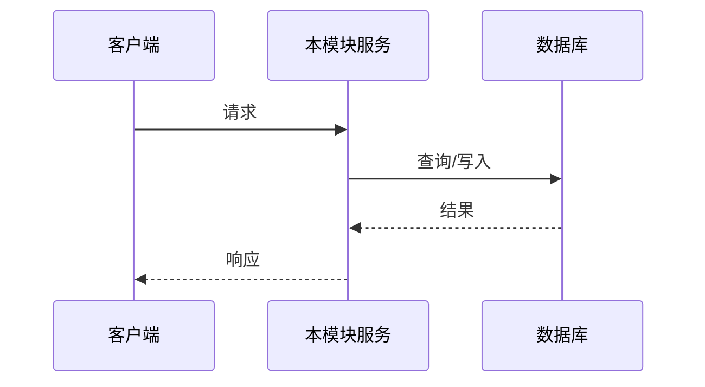
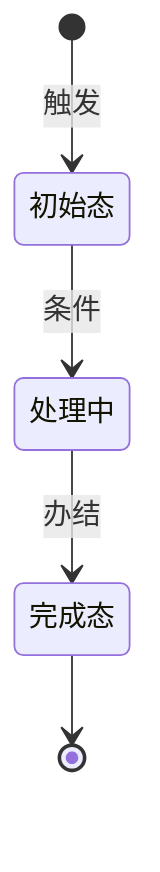

# 【模块技术方案】{{MODULE_INDEX}}_{{MODULE_NAME}}

> **所属总文档**：{{PRODUCT_NAME}} TDD　|　**模块定位**：{{MODULE_SUMMARY}}
> **责任架构师**：{{AUTHOR_NAME}}　|　**文档状态**：`[草稿]/[待评审]/[已定稿]`
> 📐 本文件是技术方案 **L2 模块细节**；章节清单遵循 `references/tdd-structure.md`（7 必须 + 3 可选）。

---

## 章节清单（写前先列）

| 章节 | 是否包含 | 依据 |
|------|---------|------|
| 1~7 必须章节（含实现细节与决策） | ✅ 必含 | 范式固定 |
| 关键技术点与难点 | {{✅/❌}} | {{有并发/事务/缓存/幂等难点则✅}} |
| 异常与边界处理 | {{✅/❌}} | 建议保留 |
| 性能优化 | {{✅/❌}} | {{有性能指标则✅}} |

---

## 1. 模块概述与边界【必须】

### 1.1 定位与职责
{{MODULE_TECH_RESPONSIBILITY}}

### 1.2 应做 / 不应做（负向边界）
| 应做（技术职责） | 不应做（明确排除） |
|----------------|-------------------|
| {{DO_LIST}} | {{DONT_LIST}} |

## 2. 上下游依赖【必须】

| 方向 | 模块/系统 | 传递产物/前提 | 方式 |
|------|----------|--------------|------|
| 上游 | {{UPSTREAM}} | {{UP_PRODUCT}} | 同步调用 / 异步消息 / 共享数据 |
| 下游 | {{DOWNSTREAM}} | {{DOWN_PRODUCT}} | {{WAY}} |

## 3. 核心流程设计【必须】（能画必画）

### 3.1 业务流程图
```mermaid
flowchart TD
    Start([接收{{请求}}]) --> Check{判断条件}
    Check -->|条件A| PathA[处理A]
    Check -->|条件B| PathB[处理B]
    PathA --> Done([完成])
    PathB --> Done
```

### 3.2 时序图（跨模块调用时）


### 3.3 状态机（对象有生命周期时）


## 4. 接口 / 服务设计【必须】

| 接口 | 方法 | 入参 | 出参 | 异常码 | 说明 |
|------|------|------|------|--------|------|
| /api/{{path}} | POST | {{IN}} | {{OUT}} | {{ERR}} | {{NOTE}} |

> 接口字段与 PRD「业务信息清单」对应，此处补类型与校验。

## 5. 数据模型【必须】（引用总文档表）

| 表名 | 本模块职责 | 关键字段 |
|------|-----------|---------|
| {{TABLE}} | {{RESPONSIBILITY}} | {{KEY_FIELDS}} |

> 完整字段结构见总文档 §6，此处只列本模块读写涉及的表与关键字段。

## 6. 实现细节与决策【必须】（逐功能点展开到可编码）

> 每个功能点写清「每一步怎么做」+ 关键工程决策点结论，不能一句话带过。

| 功能点 | 实现步骤（每一步怎么做） | 关键决策点 + 结论 |
|---|---|---|
| {{功能点，如文件上传}} | {{① … → ② … → ③ …}} | {{存哪 / 怎么传 / 大小上限 / 断点续传 / 并发 / 安全}} |

> 逐点过一遍工程决策点清单（存哪/怎么传/大小上限/断点续传/并发/安全/失败兜底），能定写结论、前置已明确标「继承 PRD」、拿不准标「待用户确认」。

## 7. 关键技术点与难点【可选 · 有难点时包含】

| 难点 | 方案 |
|------|------|
| 并发控制 | {{乐观锁/悲观锁/分布式锁 + 说明}} |
| 事务边界 | {{本地事务/最终一致性/补偿}} |
| 缓存策略 | {{Cache-Aside + 双删 + 过期兜底}} |
| 幂等设计 | {{唯一索引/token/状态机}} |

## 8. 异常与边界处理【可选 · 建议保留】

| 异常场景 | 处理方案 |
|---------|---------|
| 空数据 | {{处理}} |
| 超限 | {{处理}} |
| 重复提交 | {{处理}} |
| 依赖服务不可用 | {{降级/重试/熔断}} |

## 9. TDD 测试用例【必须】（先写测试，后写代码）

### 8.1 Gherkin 场景（承接 PRD 的 AC）
```gherkin
Feature: {{MODULE_NAME}}
  # 承接 AC-M{{MODULE_INDEX}}-001
  Scenario: {{正向场景}}【P0】
    Given {{前置}}
    When {{动作}}
    Then {{业务结果}}

  Scenario: {{异常场景}}【P0】
    Given {{前置}}
    When {{动作}}
    Then {{异常反馈}}
```

### 8.2 代码级用例骨架
```go
// {{FUNC_NAME}} 函数
func Test{{FUNC_NAME}}(t *testing.T) {
    cases := []struct{
        name     string
        in       {{TYPE}}  // 输入
        want     {{TYPE}}  // 预期
        wantErr  bool      // 是否报错
    }{
        {"正常", {{IN}}, {{WANT}}, false},
        {"边界", {{IN2}}, {{WANT2}}, false},
        {"异常", {{IN3}}, {{WANT3}}, true},
    }
    for _, c := range cases {
        t.Run(c.name, func(t *testing.T) { /* 断言 */ })
    }
}
```

### 8.3 覆盖矩阵
| 用例编号 | 对应 AC | 类型 | 场景 |
|---------|---------|------|------|
| TC-M{{MODULE_INDEX}}-001 | AC-M{{MODULE_INDEX}}-001 | 正向 | {{场景}} |
| TC-M{{MODULE_INDEX}}-002 | AC-M{{MODULE_INDEX}}-002 | 边界 | {{场景}} |
| TC-M{{MODULE_INDEX}}-003 | AC-M{{MODULE_INDEX}}-003 | 异常 | {{场景}} |
| TC-M{{MODULE_INDEX}}-004 | AC-M{{MODULE_INDEX}}-004 | 幂等 | {{场景}} |
| TC-M{{MODULE_INDEX}}-005 | AC-M{{MODULE_INDEX}}-005 | 并发 | {{场景}} |
