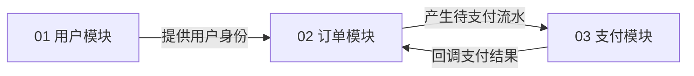
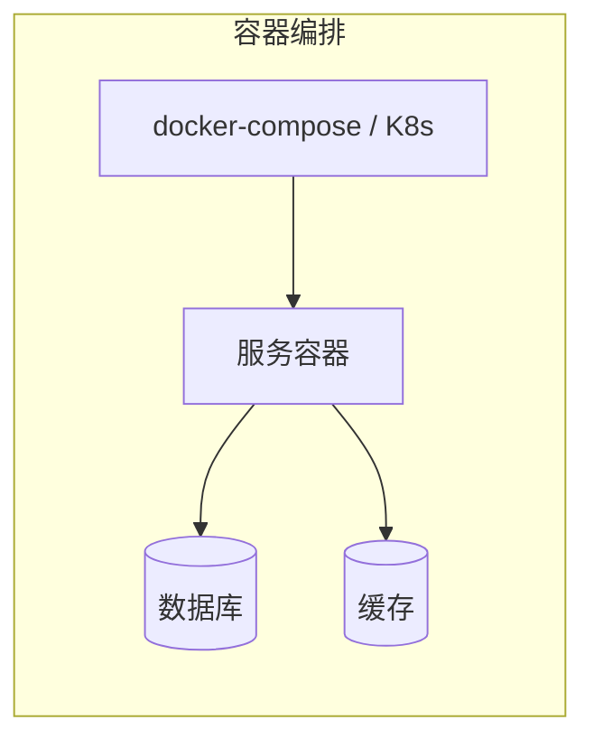

# 【后端技术方案总文档】{{PRODUCT_NAME}} TDD

> **文档状态**：`[草稿] / [待评审] / [已定稿]`
> **责任架构师**：{{AUTHOR_NAME}}　|　**创建/更新**：{{DATE}}
> **实现档位**：`[企业级生产] / [快速实现]`
> 📐 本文件是技术方案 **L1 总文档**；章节清单遵循 `references/tdd-structure.md`（6 必须 + 按需求/档位开关的可选）。

---

## 章节清单（写前先列）

| 章节 | 是否包含 | 依据 |
|------|---------|------|
| 1~6 必须章节 | ✅ 必含 | 范式固定 |
| 缓存设计 | {{✅/❌}} | {{有缓存需求则✅}} |
| 消息队列设计 | {{✅/❌}} | {{有异步需求则✅}} |
| 检索设计 | {{✅/❌}} | {{有搜索需求则✅}} |
| 全局规范/部署/监控 | {{✅/❌}} | 企业级✅ / 快速❌ |
| 性能/安全 | {{✅/❌}} | {{高并发/敏感数据则✅}} |

---

## 1. 文档元数据【必须】

| 字段 | 内容 |
|------|------|
| 项目名称 | {{PRODUCT_NAME}} |
| 需求来源 | PRD `{{PRD_PATH}}` / 原型 `{{PROTO_PATH}}` |
| 实现档位 | {{企业级生产 / 快速实现}} |
| 技术栈主语言 | {{LANGUAGE}} |

## 2. 技术选型总览【必须】

| 组件 | 选型 | 档位 | 理由 | 备选 |
|------|------|------|------|------|
| 语言/框架 | {{LANG}} | {{TIER}} | {{REASON}} | {{ALT}} |
| 数据库 | {{DB}} | {{TIER}} | {{REASON}} | {{ALT}} |
| 缓存 | {{CACHE}} | {{TIER}} | {{REASON}} | {{ALT}} |
| 检索 | {{SEARCH}} | {{TIER}} | {{REASON}} | {{ALT}} |
| 消息队列 | {{MQ}} | {{TIER}} | {{REASON}} | {{ALT}} |
| Docker 编排 | {{ORCH}} | {{TIER}} | {{REASON}} | {{ALT}} |
| 对象存储 | {{OSS}} | {{TIER}} | {{REASON}} | {{ALT}} |

## 3. 系统架构图【必须】（Mermaid）

```mermaid
flowchart TB
    subgraph 客户端
        Web[Web 端]
        App[移动端]
    end
    subgraph 接入层
        GW[API 网关]
    end
    subgraph 服务层
        S1[{{模块1服务}}]
        S2[{{模块2服务}}]
    end
    subgraph 数据层
        DB[(MySQL)]
        Cache[(Redis)]
        ES[(Elasticsearch)]
    end
    Web --> GW
    App --> GW
    GW --> S1
    GW --> S2
    S1 --> DB
    S1 --> Cache
    S2 --> ES
```

## 4. 模块清单与边界【必须】（应做 / 不应做）

| 序号 | 文件名 | 模块名称 | 应做（技术职责） | 不应做（负向边界） | 关键产出 |
|------|--------|---------|----------------|-------------------|---------|
| 01 | `01_xxx.md` | {{MODULE_A}} | {{A_DO}} | {{A_DONT}} | {{A_OUTPUT}} |
| 02 | `02_xxx.md` | {{MODULE_B}} | {{B_DO}} | {{B_DONT}} | {{B_OUTPUT}} |

## 5. 模块关联关系图【必须】（Mermaid + 关联表）



| 关联边 | 输出方提供什么 | 承接方如何消费 | 方式（同步/异步/共享数据） |
|--------|---------------|---------------|--------------------------|
| 01 → 02 用户身份 | 用户 ID + 会话 | 订单模块校验归属 | 同步调用 |

## 6. 全局表结构设计【必须】（所有表 + 全部字段）

### 6.1 表清单总览
| 表名 | 所属模块 | 说明 | 关键索引 |
|------|---------|------|---------|
| users | 01 用户 | 用户主表 | uk_email |
| orders | 02 订单 | 订单主表 | uk_order_no, idx_user_id |

### 6.2 逐表字段结构
#### 表：users
| 字段名 | 类型 | 可空 | 默认值 | 约束 | 索引 | 注释 |
|--------|------|------|--------|------|------|------|
| id | BIGINT | 否 | 自增 | 主键 | PRIMARY | 主键 |
| email | VARCHAR(128) | 否 | — | 非空 | uk_email | 邮箱 |
| created_at | DATETIME | 否 | CURRENT_TIMESTAMP | 非空 | — | 创建时间 |
| updated_at | DATETIME | 否 | CURRENT_TIMESTAMP | 非空 | — | 更新时间 |
| deleted_at | DATETIME | 是 | NULL | — | — | 软删除时间 |

#### 表：orders
（同结构展开；字段要素见 `references/data-model-guide.md`）

---

## 7. 缓存设计【可选 · 有缓存需求】

（仅当需求有热点/会话/锁时包含；否则删除并在「章节开关说明」留痕）
- 缓存对象：{{哪些数据进缓存}}；
- 缓存策略：{{Cache-Aside / 双删}} + 过期时间；
- 缓存与 DB 一致性：{{方案}}。

## 8. 消息队列设计【可选 · 有异步需求】

（仅当需求有异步通知/削峰/解耦时包含）
- 消息主题：{{TOPIC}}；生产者/消费者：{{PRODUCER / CONSUMER}}；
- 消费失败与重试：{{方案}}。

## 9. 检索设计【可选 · 有搜索需求】

（仅当需求有全文搜索/复杂过滤时包含）
- 索引设计：{{INDEX}}；同步策略：{{同步方式}}。

## 10. 全局技术规范【可选 · 企业级必选】

- 命名规范 / 错误码分段 / 日志规范（trace_id、脱敏）/ 安全规范（鉴权、校验、限流）。

## 11. 部署架构【可选 · 企业级必选】



## 12. 监控告警【可选 · 企业级必选】

- 监控指标（QPS/错误率/延迟）+ 告警阈值 + 链路追踪。

## 13. 性能与容量规划【可选 · 高并发必选】

- QPS 估算 / 容量预估 / 压测方案。

## 14. 安全合规【可选 · 敏感数据必选】

- 脱敏 / 权限 / 审计 / 合规要求。

---

## 附录：章节开关说明

| 章节 | 开关 | 依据 |
|------|------|------|
| {{如：检索设计}} | {{关闭}} | {{需求无搜索功能}} |
