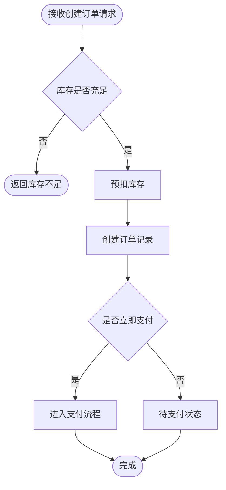

# 模块技术方案编写指南

> 用途：指导每个模块 `NN_xxx.md` 的写法——边界、流程图、接口设计、TDD 测试用例。

---

## 一、模块边界写法

每个模块必须写清「应该做什么 / 不应该做什么」：

| 应做 | 不应做 |
|------|--------|
| 本模块核心职责（技术视角，如：订单的创建、状态流转、库存扣减） | 明确排除（如：不负责支付回调，由支付模块承接） |

- 边界要**技术化、可执行**——写清"这个模块管哪些表、提供哪些接口、消费哪些事件"；
- 负向边界越清楚，模块间越不打架；与 PRD 模块划分对齐，但此处聚焦**技术职责**。

---

## 二、上下游依赖

| 方向 | 模块/系统 | 传递产物 | 方式 |
|------|----------|---------|------|
| 上游 | {{UP}} | {{产物/前提}} | 同步调用 / 异步消息 / 共享数据 |
| 下游 | {{DOWN}} | {{产物}} | {{方式}} |

- 与总文档「模块关联关系图」保持一致。

---

## 三、核心流程图规范

**能画流程图的必须画**，三类图按场景选用：

| 场景 | 图型 | 必含要素 |
|------|------|---------|
| 模块内业务处理逻辑 | `flowchart TD` | 判断菱形双出口、终态收敛 |
| 跨模块/跨系统调用 | `sequenceDiagram` | 参与者、消息、异常分支 |
| 对象生命周期 | `stateDiagram-v2` | 唯一起始、全部终态、流转触发条件 |

**示例（业务流程）**：


---

## 四、接口 / 服务设计

- 每个对外能力写清：接口路径 / 方法 / 入参 / 出参 / 异常码（快速档可简化）；
- 内部服务方法同理：方法签名 + 入参出参 + 异常；
- 与 PRD 的「业务信息清单」对应——接口字段来自业务信息项，这里补类型与校验。

---

## 五、关键技术点

每个模块写清 1~3 个关键难点及其方案：
- 并发控制（悲观锁 / 乐观锁 / 分布式锁）；
- 事务边界（跨服务事务 / 最终一致性 / 补偿）；
- 缓存策略（Cache-Aside + 双删 + 过期兜底）；
- 幂等设计（唯一索引 / token / 状态机）。

---

## 六、TDD 测试用例规范（核心）

### 6.1 总则
- **先写测试用例，后写实现方案**——测试用例是开发 TDD 先写测试的直接输入源；
- 形态 = **Gherkin 场景（承接 PRD 的 AC 编号）+ 代码级用例骨架**；
- 覆盖：正向 / 边界 / 异常 / 幂等 / 并发五类。

### 6.2 Gherkin 场景（业务可读）
```gherkin
Feature: 创建订单
  # 承接 PRD 的 AC-M03-001
  Scenario: 库存充足正常创建【P0】
    Given 商品库存为 10
    When 用户提交创建订单（数量 2）
    Then 订单创建成功，库存扣减为 8

  Scenario: 库存不足拦截【P0】
    Given 商品库存为 1
    When 用户提交创建订单（数量 2）
    Then 创建失败并返回「库存不足」，库存不变

  Scenario: 重复提交幂等【P1】
    Given 已存在一笔待支付订单
    When 用户用相同幂等键再次提交
    Then 不产生新订单，返回原订单
```

### 6.3 代码级用例骨架（可执行）
```go
// CreateOrder 创建订单
// 用例：TestCreateOrder
func TestCreateOrder(t *testing.T) {
    cases := []struct{
        name     string
        stock    int    // 输入：库存
        qty      int    // 输入：购买数量
        wantErr  bool   // 预期：是否报错
        wantStock int   // 预期：扣减后库存
    }{
        {"正常创建", 10, 2, false, 8},
        {"库存不足", 1, 2, true, 1},
        {"库存刚好", 2, 2, false, 0},
    }
    for _, c := range cases {
        t.Run(c.name, func(t *testing.T) {
            // 断言 c.wantErr / c.wantStock
        })
    }
}
```

> 语言随选型：Go 用 table-driven，Java 用 JUnit `@Test` + 断言，Python 用 pytest。

### 6.4 覆盖矩阵

| 测试用例编号 | 对应 AC | 类型 | 场景描述 |
|-------------|---------|------|---------|
| TC-Mxx-001 | AC-Mxx-001 | 正向 | 正常创建 |
| TC-Mxx-002 | AC-Mxx-002 | 边界 | 库存刚好 |
| TC-Mxx-003 | AC-Mxx-003 | 异常 | 库存不足 |
| TC-Mxx-004 | AC-Mxx-004 | 幂等 | 重复提交 |
| TC-Mxx-005 | AC-Mxx-005 | 并发 | 并发扣减不超卖 |

---

## 七、模块方案自检清单

- [ ] 应做 / 不应做边界写清？
- [ ] 上下游依赖与总文档关联图一致？
- [ ] 核心流程 / 时序 / 状态机图已画（能画必画）？
- [ ] 接口字段与 PRD 业务信息清单对应？
- [ ] 关键技术点（并发/事务/缓存/幂等）有方案？
- [ ] 测试用例五类覆盖（正向/边界/异常/幂等/并发）且标注 AC 编号？
