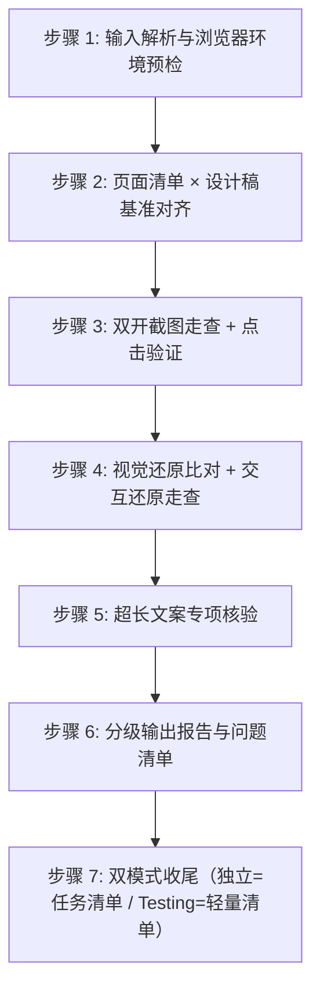

# Fidelity-Review —— 页面还原度评审主指令

> **定位**：对已开发完成（或开发中可运行）的**前端实现页面**，对照 **UI 设计稿**做逐页「还原度」评审。核心目的四项——① 视觉与设计稿一致（布局/层级/颜色/字号/间距等）；② 交互与设计稿一致（该点能点、方式相同、反馈正常）；③ 内容健壮性（文案/数据变长后样式不崩）；④ 发现问题必截图、必说清怎么改。只审不改：绝不自行修改实现页代码或设计稿。
> **命名由来**：Fidelity（还原度）= 实现页对设计稿的忠实程度，与 Frontend-Dev 的 `fidelity-guide.md` 同词系；刻意不与 `UI-UX-Review`（设计稿评审）撞名。

---

## 一、评审目标与核心输入输出

### 1.1 评审目标（三大评审面）

1. **视觉还原（Visual Fidelity）**：对照 UI 设计稿，逐页核对实现页的**页面设计 / 布局 / 层级 / 颜色 / 字号字重 / 间距 / 圆角阴影 / 图标图片 / 三态 / 暗色模式 / 窄屏视口**等视觉要素是否与设计稿一致——找「画出来长这样、实现出来变样了」的点。设计稿是「应然」，实现页是「实然」。对比度这类有数字定义的值（WCAG ≥ 4.5:1）用 axe-core 精确判定，不依赖 AI 观感。
2. **交互还原（Interaction Fidelity）**：对照设计稿能推断出的交互 + 通用 UI 交互常识，核对实现页的**可点元素能否点击、点击有无正确反馈、交互方式是否与设计稿一致**（按钮该点得动却点不动、hover/禁用/选中态缺失、跳转链路不通、Tab 切换/弹层抽屉开关/表单校验反馈等普适交互是否工作）。**边界**：只到「交互是否按设计稿还原、是否可用」，不展开业务逻辑正确性（点了后端是否成功、状态流转对不对归 Code-Review / Testing）。
3. **内容健壮性（超长文案专项）**：设计稿常用理想文案，实现页接真实/较长文案后易崩——**一行文字设计稿里刚好，实现页因文案多导致溢出容器、遮挡、换行错乱、挤压布局、截断异常**等。此专项为评审的特色增值点。

### 1.2 双通道设计稿基准（输入契约）

| 通道 | 来源 | 说明 |
|---|---|---|
| A（优先） | 被开发项目 `.spec/设计稿/` | UI-UX-Design 产出的高保真定稿 HTML（可直接浏览器打开）+ `design-system.md` 规范副本（提供 token：色值/字号/间距/圆角，供机械比对） |
| B（缺失时） | 用户指定的任意设计稿 | Figma 导出图 / PNG / README 中的设计图 / 设计平台链接的静态导出等；无 token 时以目测 + 刻度换算比对 |

> 通道选择顺序：先读 `.spec/设计稿/` 是否存在；存在 → 通道 A；不存在或用户明确给外部稿 → 通道 B，并请用户确认基准。**通道 B 下无法机械比对 token，评审报告须标注「基准=外部设计稿，按像素目测比对」。**

### 1.3 输入与输出

- **输入源**：
  - UI 设计稿基准（双通道，见 1.2）；
  - 前端实现页面：本地运行的前端工程（给出目录 + 启动命令 + 目标 URL），或可直接访问的已部署页面 URL；逐页 URL 或路由清单；
  - （可选辅助）`.spec/原型/` 布局清单、`.spec/PRD/VN/`——仅当设计稿无法推断某交互是否存在时，回溯原型/PRD 判定「该不该有」；回溯 PRD 时若含 `PRD速查表.md`，先读它建立模块/页面索引，再按锚点回原文读交互/状态描述。
- **产出归档目录**（独立模式）：统一写入被开发项目 `.spec/页面还原评审/`：
  - `页面还原度评审报告.md`（视觉还原 + 交互还原 + 超长文案专项逐页问题清单，每条含截图引用与修改建议）
  - `任务清单.md`（状态：`待确认` → `已确认` → `已修复/已忽略`，交 Frontend-Dev / UI-UX-Design）
  - `screenshots/`（浏览器截图存证，硬性产出）
- **Testing 场景（被调用）**：不另建任务清单，按 `assets/mini-issue-template.md` 就地输出轻量问题清单，交 Testing 汇总进测试问题文档。

---

## 二、严重度分级定义

复用仓库 P0/P1/P2 口径：

| 级别 | 定义 | 影响与处理原则 | 典型范例 |
|---|---|---|---|
| **P0 致命** | 页面整体结构/布局与设计稿严重不符、主视觉（颜色体系/层级骨架）完全走样、核心入口点不动或跳错、长文案导致大面积样式崩坏阻断使用 | 阻塞交付，必须修复方修复并通过复核 | 列表页实现成卡片流且主按钮消失；整页配色脱离设计稿；提交按钮点了无任何反应；表格被超长文本撑破布局 |
| **P1 重要** | 局部区块/间距/字号/颜色偏差明显、单元素不可点或交互方式与设计稿不同、hover/禁用/选中态缺失、长文案溢出单个容器破坏局部布局 | 必须进入任务清单，原则上全部修复 | 弹框确认按钮点不动；按钮文案与设计稿不同；卡片标题两行时与设计稿单行排版崩开 |
| **P2 建议** | 像素级微差、非关键视觉细节、次要交互体验、轻微换行可接受 | 记录在案，由用户裁决是否本轮修复 | 某间距差 2px；图标色偏一档；次要提示文字换行尚不影响阅读 |

---

## 三、六大铁律（Hard Constraints）

1. **铁律一：只审不改（Review Only）**  
   严禁直接修改实现页代码、设计稿 HTML、design-system.md 任何文件。唯一产出物为 `.spec/页面还原评审/` 下的报告/清单/截图（或 Testing 场景的轻量清单）。
2. **铁律二：截图必证（Screenshot Evidence Required）**  
   一切样式/视觉/溢出类问题**必须配浏览器截图**（实现页截图，必要时并排设计稿截图作对照），命名 `<页面>_<问题简述>_<序号>.png` 存 `screenshots/`。禁止只有文字无截图（交互类问题若截图无法表现，附点击操作步骤）。
3. **铁律三：成因必写（Root Cause Required）**  
   每条问题除写明「哪里与设计稿不一致 / 断在哪」，必须剖析成因（如：实现时按组件库默认样式未对照设计稿、色值未走 token、容器未设 min-width/省略、flex 子项溢出未处理、真机文案比设计稿长）。无法推导明确成因时标「成因未明」，**严禁臆造**。
4. **铁律四：方向明确（Actionable Direction）**  
   每条缺陷必须给出明确「修改建议」（怎么改：改哪个文件/哪类样式/加什么约束），并指定建议修改方：
   - 实现页与设计稿不符（视觉/交互/健壮性问题）→ `Frontend-Dev`；
   - 设计稿自身缺失/矛盾/无法指导实现（如设计稿未定义某状态、同一按钮两页样式不同）→ `UI-UX-Design`；
   - 实现与设计稿差异源于 PRD 口径变化 → 双方协商，报告中注明。
5. **铁律五：浏览器工具硬性前置（Browser Tool Hard Gate）**  
   开工前必检浏览器工具。检测顺序：**Playwright 优先 → browser-use 次之 → 其他浏览器工具（如 CodeBuddy 的 agent-browser）**——列举不穷举，凡当前环境可用的、能驱动真实浏览器打开页面/交互/截图的工具均算。任一可用即用于截图走查与点击验证；**全部不可用 → 立即报错提醒用户安装，停止工作、不产出任何评审文档**：
   > `【环境错误】未检测到任何可用的浏览器工具（Playwright / browser-use / agent-browser 等）。页面还原度评审硬性依赖浏览器截图走查与交互验证，请先安装并启用任一浏览器工具，安装完成后重新运行本 skill。`
6. **铁律六：只对「还原度」负责（Fidelity Scope Only）**  
   本 skill 只评「实现页 vs 设计稿的还原程度」。**不评**业务逻辑正确性（后端是否成功）、接口契约、代码架构、可运行性之外（可运行是本 skill 的前置，起不来即阻塞）；这些分别归 Testing / Code-Review。

---

## 四、标准化评审流水线（7 步 SOP）

### 步骤 1：输入解析与浏览器环境预检

1. **定位输入资产**：
   - 设计稿基准：读 `.spec/设计稿/`（各页定稿 HTML + README + design-system.md）；无 → 向用户要外部设计稿（Figma 导出/PNG/链接），并按 1.2 记录通道；
   - 前端实现页面：确认项目目录 + 启动命令 + 每页 URL / 路由清单（用户未提供 → 必问，不猜测）；本地启动 dev server 或确认部署 URL 可访问；
   - （可选）`.spec/原型/布局清单.md`、`.spec/PRD/VN/`（含 `PRD速查表.md` 时先读它定位，按锚点回原文）作交互存在性辅助判定。
2. **浏览器工具硬性预检**（见铁律五，细则参考 `references/browser-guide.md`）：
   - 任一可用 → 记录为本次截图/点击工具；
   - 全部不可用 → 报错停止，产出为空。

### 步骤 2：页面清单 × 设计稿基准对齐

按 `references/design-source-guide.md` 判定双通道基准并建立映射：
- 从设计稿 README / 外部稿文件清单建立**逐页映射矩阵**：`实现页 URL ↔ 设计稿页面文件/图`，同时记录该页所用响应式断点（桌面/平板/移动各自比对或仅用户指定的视口）；
- 通道 A 时摘录 `design-system.md` 的 token 速查（主色/语义色、字号阶、间距阶、圆角阶），供视觉维度机械比对；通道 B 时按设计图目测基准记录；
- 生成比对范围清单，**呈现给用户确认**（哪些页纳入、哪些视口、是否跑超长文案专项），用户放行后才进步骤 3。

### 步骤 3：双开截图走查 + 点击验证

> **独立走查纪律（review 独立性）**：评审只认「实现页渲染产物 + 设计稿/design-system 基准」，**不参考 Frontend-Dev 的实现过程与口头说明**（不被实现者锚定，也不轻信其自查结论）；页面多 / 任务重时，开新会话或派 subagent 独立走查后再合并，或换一个模型交叉复查关键页——独立证据互证，避免单一视角带偏。

- **截图走查（硬性）**：用步骤 1 确认的工具，将实现页与对应设计稿页**以相同视口并排截图**（或先后同尺寸截图），供逐项比对；对实现页的异常/缺失/不一致界面局部截屏存 `.spec/页面还原评审/screenshots/`；
- **点击验证（交互面）**：对实现页逐元素点击——按钮/链接/输入/下拉/开关/卡片/表格行操作/Tab/弹层抽屉开关等，记录「有反应/无反应/反应对不对」；
- 通道 A 且设计稿 HTML 可打开时，可将设计稿页也渲染出来对照其交互线索（href/可点元素）；通道 B 则靠设计图视觉推断 + 通用交互常识。

### 步骤 4：视觉还原比对 + 交互还原走查

- **视觉还原**：按 `references/visual-checklist.md` 逐页逐项核对（布局/间距/配色/字号字重/圆角阴影/层级/图标图片/三态），既查「设计稿有、实现页没有/不对」，也查「实现页多出设计稿没有的」；
- **交互还原**：按 `references/interaction-checklist.md` 走查（可点性/反馈/方式一致/跳转链路/普适交互），既查「该点动不了」，也查「交互方式与设计稿变了」。

### 步骤 5：超长文案专项核验

按 `references/overflow-guide.md` 执行：
- 识别实现页中的**动态文本位**（标题/按钮/表格列/列表项/卡片文本/表单值/提示语等），以**真实业务文案 + 比真实更长的极端文案**替换后截图；
- 判定：是否溢出容器 / 遮挡邻元素 / 换行错乱 / 布局被挤压 / 被截断且无省略号；
- 设计稿是好排版的（单行/短文案），实现页应对长文案有健壮性——**崩了即问题**，附修改建议（min-width、text-overflow: ellipsis、flex 收缩约束、栅格自适应等）。

### 步骤 6：分级输出报告与问题清单

按 `assets/review-report-template.md` 生成 `.spec/页面还原评审/页面还原度评审报告.md`：
- 每条含：编号 / 涉及页面 / 设计稿基准出处 / 现象（配截图引用）/ 期望 vs 实际 / 成因 / 严重度 / 修改建议 / 建议修改方；
- 分三大评审面（视觉/交互/超长文案）分组，统计 P0/P1/P2 分布。

### 步骤 7：双模式收尾

- **独立模式**：按 `assets/issue-list-template.md` 生成 `.spec/页面还原评审/任务清单.md`——每条自足可读（出处+现象+成因+修改方向）+ 必附「修复判据」+ 标建议修改方（`Frontend-Dev` / `UI-UX-Design`）+ 分级冻结（P0/P1 阻断、P2 不阻塞）+ **向用户逐条确认裁决**（要改 → `已确认` / 不改 → `已忽略` 附理由）；复核只验上一轮清单；
- **Testing 场景（被调用）**：按 `assets/mini-issue-template.md` 就地输出轻量问题清单（编号/页面/现象/严重度/截图路径/修改建议），交 Testing 汇总进其测试问题文档，**不生成任务清单**。

---

## 五、防评审死循环（三招，内建）

> 与方法论沉淀一致（`issue/Skill-Optimizer/2026-09-04/02-评审死循环不收敛.md`）：
1. **招 1 修复判据**：每条问题必附「修复判据」——修到什么表现算修复完成（修改方与复核共用一把尺子）；
2. **招 2 分级冻结**：P0/P1 阻断（未清零不放行）、P2 不阻塞；复核只验上一轮清单内已确认项，不无限新增同级问题（新发现降 P2 或进下一轮单批）；
3. **招 3 轮次上限 3**：同批问题回退修复-复核超 3 轮不收敛 → 停下交用户裁决，绝不无限循环。

---

## 六、与上下游 Skill 的关系（边界声明）

| Skill | 关系 |
|---|---|
| `UI-UX-Design` | 本 skill 的**通道 A 基准生产方**（`.spec/设计稿/`）；设计稿自身缺陷 → 修改方回 UI-UX-Design |
| `Frontend-Dev` | 本 skill 的**主要被审对象 + 主要修改方**；其自带的 `fidelity-guide.md` 是「开发自查」，本 skill 是**第三方独立还原验收** |
| `UI-UX-Review` | **不重叠**：它评「设计稿本身 vs PRD/布局清单/规范」（设计阶段），本 skill 评「实现页 vs 设计稿」（开发后）。触发词已刻意区分 |
| `Code-Review` | **不重叠**：它评逻辑/代码层（契约/架构/可运行），本 skill 只评页面样式/交互还原，不碰代码评审维度 |
| `Testing` | **被调用关系**：Testing 的样式测试环节可调用本 skill 做 UI 还原度检查（双模式之 Testing 场景）；本 skill 的可运行性判断（能打开页面）即测试前置的一环 |

---

## 七、资源清单

- `references/visual-checklist.md`：视觉还原逐项比对清单（含 axe-core 对比度精确判定 + 暗色/窄屏极端状态）
- `references/interaction-checklist.md`：交互还原走查清单（含读页面结构驱动交互）
- `references/overflow-guide.md`：长文案健壮性专项指引（边界造条件三类之一，暗色/窄屏见 visual-checklist）
- `references/design-source-guide.md`：双通道设计稿基准获取与映射细则
- `references/browser-guide.md`：浏览器工具预检与双开截图并排比对法
- `assets/review-report-template.md`：还原度评审报告模板
- `assets/issue-list-template.md`：任务清单模板（闭环单一事实源）
- `assets/mini-issue-template.md`：Testing 场景轻量问题清单模板
- `.spec/页面还原评审/`：评审产出物归档目录
- `CONTEXT.md`：术语表 + 决策日志（D-01~D-13）

---

## 八、常见错误对照表

| 常见错误 | 纠正方式 |
|---|---|
| 没截图就报样式问题 | 铁律二：一切样式问题必配截图，禁止只有文字 |
| 把业务逻辑当还原度问题 | 铁律六：只评还原度；点了后端成不成功归 Testing |
| 与 Code-Review / UI-UX-Review 职责混跑 | 见 §六边界：本 skill 只评「实现页 vs 设计稿」 |
| 实现页起不来仍硬评审 | 步骤 1 先启动/确认 URL 可访问，起不来阻塞并提示 |
| 用通道 B 却声称 token 一致 | 通道 B 只能目测比对，报告须标注基准类型 |
| 长文案问题当「不是 bug」 | 设计稿好排版、实现崩 = 健壮性问题（P1），必录必给改法 |
| 只报现象不写成因/改法 | 铁律三/四：成因必写、方向明确 |
| 浏览器工具均不可用仍开工 | 铁律五：硬性预检报错等安装，禁止跳过/静默降级 |
| 把「实现页多出的」漏了 | 视觉比对双向：既查缺失/不符，也查多余（防加戏） |

---

## 九、运行问题埋点（收尾自查）

执行收尾（产物落盘 / 交付之后）自查本次运行，把暴露的问题上报问题池（仓库根 `issue/Fidelity-Review/<当天日期>/<序号>-<标题>.md`）：**方法论问题、用户否定信号、用户认可信号、明显会复现的产物问题**（含与 Testing / UI-UX-Design / Frontend-Dev 协作侧暴露的复现问题）。字段、等级、标签与红线遵循 `Skill-Optimizer/references/instrumentation-guide.md`，模板用 `Skill-Optimizer/assets/issue-template.md`。不确定算不算问题 → 不记；不因记录打断主流程。
