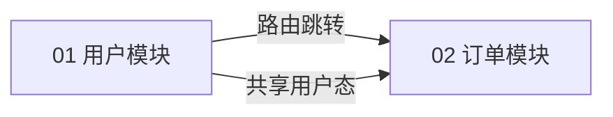

# 【前端技术方案总文档】{{PRODUCT_NAME}} 前端 FTDD

> **文档状态**：`[草稿] / [待评审] / [已定稿]`
> **责任前端架构师**：{{AUTHOR_NAME}}　|　**创建/更新**：{{DATE}}
> **实现档位**：`[企业级生产] / [demo 快速实现]`
> 📐 本文件是前端技术方案 **L1 总文档**：定选型、画架构、列页面与组件、划模块边界、定全局规范；模块细节在 `NN_xxx.md`。

---

## 1. 文档元数据

| 字段 | 内容 |
|------|------|
| 项目名称 | {{PRODUCT_NAME}} |
| 需求来源 | PRD `{{PRD_PATH}}` / 原型 `{{PROTO_PATH}}` / 后端 TDD `{{TDD_PATH}}` |
| 实现档位 | {{企业级生产 / demo 快速实现}} |
| 技术栈 | {{按选型填写；默认基线 pnpm + Vite + TypeScript + React（hooks）+ 原生 fetch + Sass/Less}} |

---

## 2. 技术选型总览

| 组件 | 选型 | 档位 | 理由 | 备选 |
|------|------|------|------|------|
| 端形态 | {{Web PC / H5 / 小程序 / App / 桌面 / 多端一套}} | {{TIER}} | {{REASON}} | — |
| 框架 | {{用户选定：React 18 / Vue 3 / Taro / uni-app / React Native / Electron / Flutter}} | {{TIER}} | {{REASON}} | {{ALT}} |
| 构建 | {{随框架：Vite / HBuilderX / Expo / electron-vite}} | {{TIER}} | {{REASON}} | — |
| 组件库 | {{随框架联动：AntD / Element Plus / NutUI-React / wot-design-uni / gluestack-ui…}} | {{TIER}} | {{REASON}} | {{ALT}} |
| 状态管理 | {{随框架联动：Zustand·RTK / Pinia / Riverpod…}} | {{TIER}} | {{REASON}} | {{ALT}} |
| 路由 | {{随框架联动：React Router / Vue Router / 声明式路由 / React Navigation}} | {{TIER}} | {{REASON}} | — |
| CSS | {{Sass/Less 按生态选}} + 组件样式隔离（React→CSS Modules / Vue→scoped）+ 全局抽离 | {{TIER}} | 隔离方案随框架 | Tailwind |
| 请求 | {{随端载体：fetch / Taro.request / uni.request / wx.request / dio}} 统一封装 | {{TIER}} | 契约对齐 TDD | — |
| 测试 | {{随框架联动：Vitest+RTL / Vitest+VTU / Jest+RNTL / flutter_test}} | {{TIER}} | {{REASON}} | — |
| 暗黑模式/主题 | {{开启 / 不开}} | {{TIER}} | {{REASON}} | — |
| 国际化 i18n | {{react-i18next / vue-i18n / 不开}} | {{TIER}} | {{REASON}} | — |
| 浏览器兼容性 | {{Vite 默认 / 用户指定}} | {{TIER}} | {{REASON}} | — |

> 选型规则与各框架配套生态见 `references/tech-stack-guide.md`；框架每次必问、用户确认才定稿。

---

## 3. 前端架构图（Mermaid，强制）

```mermaid
flowchart TB
    subgraph 用户层
        U[用户浏览器]
    end
    subgraph 前端应用
        Router[路由层 {{所选路由方案}}]
        Pages[页面容器层]
        Components[组件层 基础/业务组件]
        Hooks[逻辑层 hooks/组合式函数]
        Store[全局状态 Store]
        Api[请求层 fetch 封装]
        Styles[样式层 Sass/Less + 隔离方案]
    end
    subgraph 后端
        GW[API 网关]
        SVC[后端服务 TDD]
    end

    U --> Router
    Router --> Pages
    Pages --> Components
    Pages --> Hooks
    Components --> Hooks
    Hooks --> Api
    Hooks --> Store
    Api --> GW --> SVC
    Components --> Styles
    Pages --> Styles
```

> 架构图按实际选型绘制分层，标注数据流方向。

---

## 4. 页面清单（页面 = 路由）

| 序号 | 路由 | 页面名称 | 所属模块 | 职责 | 对应原型文件 |
|------|------|---------|---------|------|-------------|
| 01 | {{/path}} | {{PAGE_A}} | {{MODULE_A}} | {{DUTY}} | {{proto.html}} |
| 02 | {{/path/:id}} | {{PAGE_B}} | {{MODULE_B}} | {{DUTY}} | {{proto.html}} |

---

## 5. 组件清单

### 5.1 基础组件（跨项目复用）

| 组件 | 职责 | 来源 |
|------|------|------|
| {{Button / Modal / Table ...}} | {{DUTY}} | {{组件库 / 自研}} |

### 5.2 业务组件（模块内复用）

| 组件 | 分层 | 职责 | 复用范围 |
|------|------|------|---------|
| {{UserTable}} | 业务组件 | {{DUTY}} | 模块内 / 全局 |

### 5.3 基础支持（横切关注点）

| 支持项 | 方案 | 说明 |
|--------|------|------|
| 路由守卫 | {{ProtectedRoute + useAuth}} | 登录/权限拦截 |
| 错误边界 | {{ErrorBoundary}} | 渲染异常兜底 |
| 请求层 | {{request.ts fetch 封装}} | 见 §8.1 |
| 主题切换 | {{useTheme + CSS 变量}} | 可选 |
| 国际化 | {{react-i18next}} | 可选 |

---

## 6. 工程目录结构

```
{{PROJECT_NAME}}/
├── index.html
├── package.json
├── vite.config.ts
├── tsconfig.json
├── vitest.config.ts
├── .env.development
├── .env.production
└── src/
    ├── api/                 # fetch 请求封装 + 按域拆分
    ├── components/          # 基础组件 + 跨模块业务组件
    ├── hooks/               # 通用 hooks
    ├── pages/               # 页面容器
    ├── styles/              # 全局样式（variables/mixins/global/theme）
    ├── features/            # 业务模块（模块化开发）
    ├── router/              # 路由配置
    ├── store/               # 全局状态
    ├── locales/             # 国际化语言包（可选）
    ├── utils/               # 工具函数
    ├── types/               # 全局类型
    └── Test/                # 测试 setup
```

> 目录按所选框架调整：Vue3 组合式函数放 `composables/`；Taro/uni-app 用其页面路由与工程约定（pages/app.config）；RN/Flutter/Electron 按各自脚手架。

---

## 7. 模块清单与边界（应做 / 不应做）

| 序号 | 文件名 | 模块名称 | 应做（前端技术职责） | 不应做（负向边界） | 关键产出 |
|------|--------|---------|--------------------|-------------------|---------|
| 01 | `01_xxx.md` | {{MODULE_A}} | 承载哪些页面/提供哪些 hooks/消费哪些接口 | {{明确排除}} | {{页面+组件+hooks}} |
| 02 | `02_xxx.md` | {{MODULE_B}} | {{B_DO}} | {{B_DONT}} | {{B_OUTPUT}} |

---

## 8. 全局技术规范

### 8.1 fetch 请求封装（实例）

> 完整可运行实例见 `references/fetch-guide.md`；此处贴核心骨架。

```ts
// src/api/request.ts（核心）
export class ApiError extends Error {
  constructor(public status: number, message: string, public code?: string) {
    super(message);
  }
}

export async function request<T>(path: string, options: RequestOptions = {}): Promise<T> {
  // baseURL + 超时(AbortController) + token 注入 + 统一错误处理
  // 详见 references/fetch-guide.md 完整实现
}
```

### 8.2 全局命名规范

- 文件/目录：组件与 hooks 用 PascalCase（`UserTable.tsx` / `useUserList.ts`），工具/配置用 camelCase；
- 接口方法：`getXxx / createXxx / updateXxx / deleteXxx`；
- hooks：一律 `use` 前缀；
- CSS：组件样式隔离随框架（React→CSS Modules `*.module.scss/less`；Vue→scoped），类名语义化。

### 8.3 环境变量规范

| 变量 | 说明 |
|------|------|
| `VITE_API_BASE_URL` | 后端接口 baseURL |
| `VITE_APP_TITLE` | 应用标题 |
| {{其它}} | {{说明}} |

### 8.4 错误处理规范

- 请求错误统一由 `ApiError` 承载，UI 按 code 分类提示（HTTP 错误 / 超时 / 网络异常）；
- 渲染异常由 `ErrorBoundary` 兜底；
- 401 统一跳登录。

### 8.5 权限规范（企业级档）

- 路由级：`ProtectedRoute` + `useAuth`；
- 按钮级：`usePermission` 控制显隐。

### 8.6 UI 规范（设计 token + 界面状态）

> 规范先行：开发开始前 UI 规范必须已确认，后续开发照规范执行，不逐页重议。

| 项 | 规范 |
|----|------|
| 设计 token 来源 | 有设计稿：`.spec/设计稿/design-system.md` 为唯一视觉来源（色彩/字号阶梯/间距 4px 网格/圆角阴影）；无设计稿：按 `references/css-guide.md` 基线建 `src/styles/variables.scss`，先确认后开发 |
| 界面状态清单 | 按「10 大 UI 状态」核对：Skeleton/Loading/Success/Empty/Error/Disabled/PermissionDenied/NetworkError（通用）+ Streaming/PartialData（涉 AI 生成功能时）；逐页面声明适用状态及处理方案，写入模块文档 §9 |
| 状态视觉基准 | 状态呈现对齐设计稿状态稿（design-system §5.10）；无状态稿时按组件库标准态并在方案中注明 |

---

## 9. 测试策略

| 项 | 说明 |
|----|------|
| 测试框架 | {{随框架：Vitest+RTL / Vitest+VTU / Jest+RNTL / flutter_test}} |
| 测试对象 | 页面 / 组件 / hooks |
| 覆盖要求 | 渲染 / 交互 / 数据流 / 边界 / 异常 |
| AC 追溯 | 测试用例承接 PRD 的 AC 编号 |

---

## 10. 模块关联关系图（Mermaid + 关联表）



### 关联表（逐条验证闭环）

| 关联边 | 输出方提供什么 | 承接方如何消费 | 方式（路由跳转/共享组件/共享状态/接口依赖） |
|--------|---------------|---------------|------------------------------------------|
| 01 → 02 | {{用户态/组件/路由}} | {{如何消费}} | {{方式}} |
