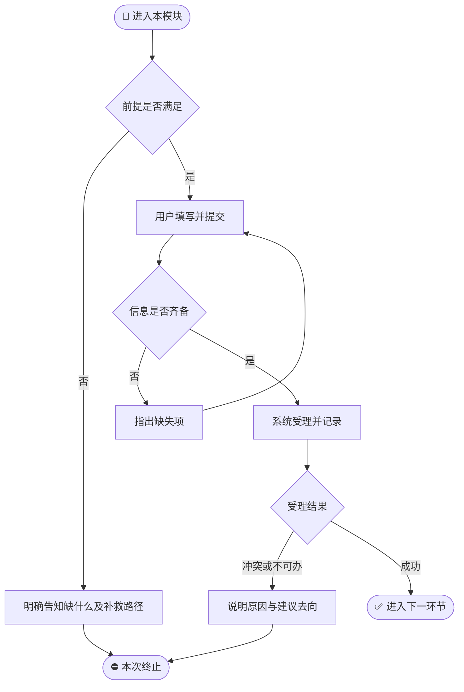
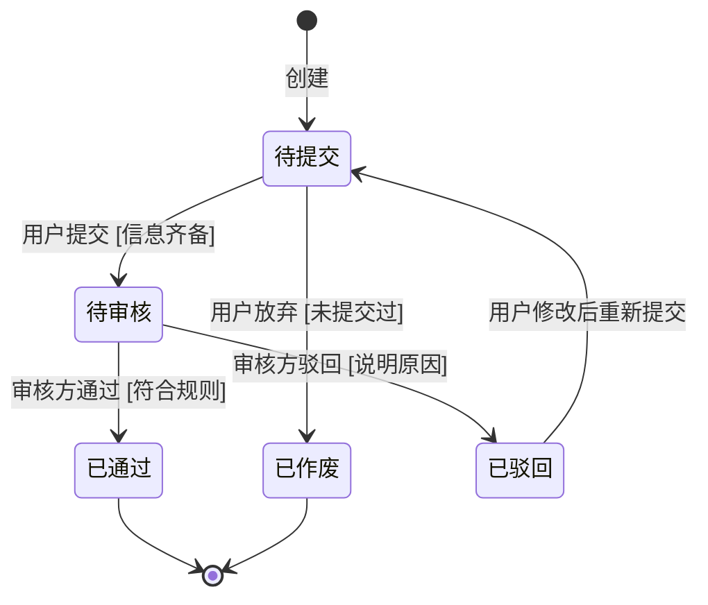

# 【模块规格】{{MODULE_INDEX}}_{{MODULE_NAME}}

> **所属需求**：{{PRODUCT_NAME}}（{{VERSION}}）　|　**模块定位**：{{MODULE_SUMMARY}}
> **责任 PM**：{{AUTHOR_NAME}}　|　**文档状态**：`[草稿]/[待评审]/[已定稿]`
>
> 📐 本文件是 **L2 需求细节 + L3 测试用例**：需求索引（§1）→ 需求细节（§3/§5/§7/§8）→ 测试用例（§9）。
> 写作要求与深度规范见 `references/prd-structure.md`。
<!-- 迭代模式未变更模块页首保留此行，其余情况删除 -->
<!-- > 本模块 V1→V2 无变更，仅随版本归档 -->

---

## 1. 模块概述与边界

### 1.1 定位与业务价值
{{MODULE_BUSINESS_VALUE}}

### 1.2 应做 / 明确不应做（负向边界）
| 应做 | 明确不应做 |
|---|---|
| {{DO_LIST}} | {{DONT_LIST}} |

### 1.3 需求条目索引（REQ 编号，本模块的目录）
> 每个需求一条目；「关联 AC」指向 §9 测试用例，形成 `REQ ↔ AC` 双向追溯。

| 需求编号 | 需求名称 | 一句话诉求 | 优先级 | 对应场景 | 关联 AC | 来源（可选） |
|---|---|---|---|---|---|---|
| `REQ-M{{MODULE_INDEX}}-001` | {{REQ_1_NAME}} | {{REQ_1_SUMMARY}} | `P0` | S1 | `AC-M{{MODULE_INDEX}}-001/002` | {{原话/数据/竞品/【设计假设】}} |
| `REQ-M{{MODULE_INDEX}}-002` | {{REQ_2_NAME}} | {{REQ_2_SUMMARY}} | `P1` | S2 | `AC-M{{MODULE_INDEX}}-003` | {{原话/数据/竞品/【设计假设】}} |

### 1.4 用户故事集
- **故事 1（核心主诉求）**：作为 {{USER_ROLE}}，我想 {{WANT}}，以便 {{BENEFIT}}。→ {{REQ_1}}
- **故事 2（逆向/管理诉求）**：作为 {{ROLE_2}}，我想 {{WANT_2}}，以便 {{BENEFIT_2}}。→ {{REQ_2}}
- （按需增加；每个故事至少对应 1 个 REQ、1 条 AC）

---

## 2. 前置条件与后置影响

### 2.1 模块关联关系标注
> 显式标出本模块与上下游模块/系统的关联：谁给我提供前提、我产出什么给谁（与总纲 §8 关联图一致）。

| 关联方向 | 关联模块/系统 | 传递的业务产物/前提 |
|---|---|---|
| 上游依赖 | {{UPSTREAM_1}} | {{UP_PRODUCT_1}} |
| 下游承接 | {{DOWNSTREAM_1}} | {{DOWN_PRODUCT_1}} |

### 2.2 前置条件（进入本模块业务的硬性前提）
1. **进入入口**：{{ENTRY_POINT}}（从哪个导航入口/上游业务进入本模块，如：首页「计划列表」→ 计划详情）；
2. **身份与权限**：{{AUTH_REQUIREMENT}}（如：已登录且为本人数据）；
3. **前序业务状态**：{{PREREQUISITE_STATE}}（如：关联订单已完成支付）；
4. **信息完整性**：{{DATA_PREREQUISITE}}（如：已绑定手机号）。

### 2.3 后置影响（本模块办结后的连锁反应）
1. **状态变化**：{{STATE_CHANGE}}（如：退款单由「待审核」转为「已同意」）；
2. **下游驱动**：{{DOWNSTREAM_TRIGGERS}}（如：通知运营侧出现待处理记录、订单侧可发起后续动作）。

---

## 3. 信息结构与场景操作步骤流

### 3.1 页面功能区块说明（轻量信息结构）
> 先写明本页「从哪个入口进入、可跳转到哪个出口」（导航层级），再列区块。
- **进入/去向**：从 {{FROM_ENTRY}} 进入，可跳转至 {{TO_EXIT}}（列表—详情层级在此标明）
- **区块 A｜{{ZONE_A_NAME}}**：承载 {{ZONE_A_CONTENT}}
- **区块 B｜操作区**：承载用户可执行的核心动作入口

### 3.2 场景操作步骤流（每个场景推演到出口）

#### 场景 S1：{{SCENARIO_S1_TITLE}}（对应 REQ-M{{MODULE_INDEX}}-001）
| 步骤 | 从哪进入 | 谁 | 做什么 | 系统给出什么 | 流向哪里 |
|---|---|---|---|---|---|
| 1 | {{ENTRY_1}} | 用户 | {{S1_STEP1_ACTION}} | — | 展示填写区 |
| 2 | — | 用户 | 确认提交 | 校验缺项：缺什么明确提示什么；全部齐备则受理并告知结果 | 受理后到达 {{NEXT_ZONE}} |

**异常推演（每条主链路必须推演到底，断头 = P0）**

| 异常 | 推演结论：用户看到什么 / 还能做什么 |
|---|---|
| 必填信息缺失就提交 | 页面明确指出缺失项与补法；已填内容不丢失，可继续补填再提交 |
| 提交后长时间无响应 | 出现"处理中"表示；仍无结果时明确告知失败原因，可原样重新提交，不产生重复记录 |
| 无权使用该功能 | 明确告知无权原因及申请路径，或不提供该入口 |

#### 场景 S2：{{SCENARIO_S2_TITLE}}（对应 REQ-M{{MODULE_INDEX}}-002）
（同结构展开；覆盖高频主场景之外的逆向/异常/管理场景）

---

## 4. 模块结构图与业务流程（Mermaid）

### 4.1 模块结构图（本模块内部功能结构）
```mermaid
flowchart LR
    M[{{MODULE_INDEX}} {{MODULE_NAME}}] --> F1[{{FUNC_1}}]
    M --> F2[{{FUNC_2}}]
    M --> F3[{{FUNC_3}}]
    F1 --> F2
```

### 4.2 模块业务流程图


### 4.3 对象生命周期状态机


---

## 5. 业务逻辑与计算规则

1. **{{RULE_1_TITLE}}**：{{RULE_1_BODY}}；
2. **排序与过滤默认值**：默认按 {{DEFAULT_SORT}}；筛选多条件并存时的组合口径：{{FILTER_LOGIC}}；
3. **谁可以看、谁可以改**：可见范围 {{VISIBILITY_RULE}}；修改权限 {{EDIT_PERMISSION}}。

---

## 6. 复杂度预警（产品层技术评估）

| 维度 | 结论 | 说明 |
|---|---|---|
| 复杂度评级 | `[高]/[中]/[低]` | {{COMPLEXITY_REASON}} |
| 关键依赖能力 | {{CAPABILITY_DEPENDENCY}}（点能力类别不点厂商） | {{DEPENDENCY_NOTE}} |
| 潜在瓶颈 | {{BOTTLENECK}} | {{BOTTLENECK_NOTE}} |
| 降级兜底思路 | {{FALLBACK_IDEA}} | {{FALLBACK_NOTE}} |

> ⚠️ 关键依赖能力点名**大模型推理/算法/生成类能力** → 判涉 AI，本模块末尾生成「附录 B 涉 AI 需求业务要求」（五维，规范见 `references/prd-structure.md` §六）。

---

## 7. 异常分支矩阵（业务语言）

| 编号 | 类别 | 触发场景 | 用户看到什么 | 还能做什么 |
|---|---|---|---|---|
| E-01 | 空数据态 | 首次进入/无符合条件内容 | 「暂无xx」+ 简短引导 | 点「去添加」开启首个创建 |
| E-02 | 超限极值 | 输入达到上限 | 即时提示已达上限 | 删减后再保存 |
| E-03 | 等待过久/中断 | 长时间无结果 | "处理中→失败，原因+文案" | 原样重试或取消；已填内容保留 |
| E-04 | 重复操作 | 连续快速重复提交 | 只受理一次的明确反馈 | 继续正常流转，不产生重复记录 |
| E-05 | 无权使用 | 登录态失效/越权访问 | 说明需登录或无权及原因 | 重新登录返回原位置继续 |
| E-06 | （业务特有）| {{BIZ_EXCEPTION_SCENE}} | {{BIZ_FEEDBACK}} | {{BIZ_NEXT}} |

---

## 8. 业务信息清单【v2 替代原数据字典】

| 信息项 | 业务含义 | 业务规则（必填与否/可选值/上限） |
|---|---|---|
| {{INFO_1_NAME}} | {{INFO_1_MEANING}} | {{INFO_1_RULES}} |
| 手机号 | 用于身份核对与结果触达 | 必填；11 位；展示时隐去中间四位 |
| {{INFO_N_NAME}} | {{INFO_N_MEANING}} | {{INFO_N_RULES}} |

---

## 9. 验收标准（Gherkin 单源 · 按需求分组 · TDD 输入源）

> 编号 `AC-Mxx-nnn` 连续；`Then` 只断言业务结果（可见反馈/状态变化/数据结果/流向），禁 DOM/CSS 断言；
> 按需求分组，每个 `REQ` 下挂其 AC，开发可「按需求逐个先写测试」。

```gherkin
Feature: {{MODULE_NAME}}
  作为 {{USER_ROLE}}，我希望 {{WANT}}，以便 {{BENEFIT}}

  # ===== REQ-M{{MODULE_INDEX}}-001 {{REQ_1_NAME}} =====
  Scenario: AC-M{{MODULE_INDEX}}-001【P0】正向主链路办结
    Given {{PRECONDITION_BIZ_STATE}}
    When {{USER_BIZ_ACTION}}
    Then {{VISIBLE_RESULT_AND_FLOW}}

  Scenario: AC-M{{MODULE_INDEX}}-002【P0】必填缺失拦截
    Given 处于填写态且某必填信息为空
    When 直接触发提交
    Then 系统指出缺失项与补法，不产生任何业务记录

  # ===== REQ-M{{MODULE_INDEX}}-002 {{REQ_2_NAME}} =====
  Scenario: AC-M{{MODULE_INDEX}}-003【P1】重复提交只受理一次
    Given 填写齐备并已提交一次
    When 在短时间内再次触发同一提交
    Then 仅存在一笔受理记录，重复动作被明确告知无需重复提交
```

### AC 覆盖度自检
- [ ] 每条步骤流场景至少对应 1 条 AC（双向标注编号）；
- [ ] 异常矩阵每一行都有对应 AC；
- [ ] 每个 REQ 至少 1 条 AC，且 REQ ↔ AC 双向可追溯；
- [ ] 编号 `AC-Mxx-nnn` 连续无跳号、无重号；优先级齐全（P0/P1）。

---

## A.【可选】效果度量事件清单

> ⚠️ 仅当总纲 §4 成功度量体系开启时才生成本章；否则整章不存在。
> 只定义「衡量什么」：动作 + 触发场景 + 分析用途；事件编码与采集实现归数据建设方案。

| 度量点 | 触发场景 | 分析用途 |
|---|---|---|
| {{METRIC_POINT_1}} | 用户完成{{ACTION_1}}时 | 计算转化率漏斗，支撑北极星指标 |

---

## B.【条件】涉 AI 需求业务要求（§6 判涉 AI 时生成，否则不存在）

> 判定：§6 关键依赖能力点名大模型推理/算法/生成类能力。五维规范见 `references/prd-structure.md` §六；全部业务语言、禁实现词；每维至少 1 条 AC。

| 涉 AI REQ | ① 输入数据覆盖 | ② 效果与失败表达底线 | ③ 不确定/可解释表达 | ④ Bad Case 降级与人工介入 | ⑤ 合规与内容安全 |
|---|---|---|---|---|---|
| `REQ-M{{MODULE_INDEX}}-xxx` {{REQ_NAME}} | {{业务需要哪些输入/覆盖哪些场景}} | {{结果正确性的业务定义；拿不准/无法回答时界面要求}} | {{低置信/无依据时给用户的提示}} | {{出错/违规/超时→用户看到什么还能做什么}} | {{不允许生成/展示/存储的规则与违规出口}} |
