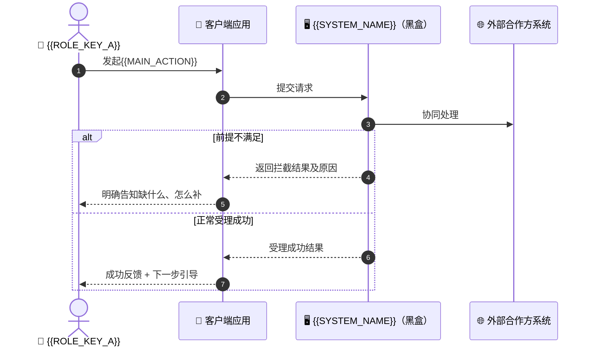
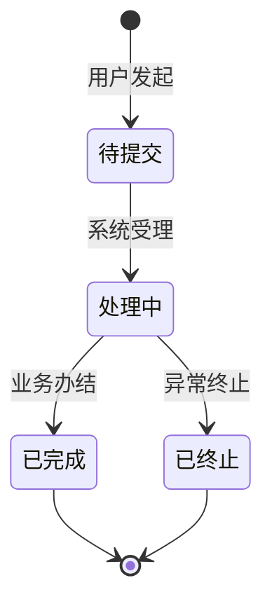

# 【需求总纲】{{PRODUCT_NAME}} PRD（{{VERSION}}）

> **文档状态**：`[草稿] / [待评审] / [已定稿] / [已发布]`
> **所属版本**：{{VERSION}}　|　**责任 PM**：{{AUTHOR_NAME}}　|　**创建/更新**：{{DATE}}
>
> 📐 本文件是 **L1 模块大纲**：只写模块边界与依赖、全局导航与入口结构，不展开需求细节（细节在对应 `NN_xxx.md`）。
> 写作要求与深度规范见 `references/prd-structure.md`。

---

## 1. 文档元数据与变更记录

### 1.1 基本信息
| 字段 | 内容 |
|---|---|
| **项目名称** | {{PRODUCT_NAME}} |
| **所属业务线** | {{BUSINESS_LINE}} |
| **文档版本** | {{VERSION}} |
| **参与人** | 产品经理、业务方，及后续评审的架构师/研发/QA/设计师 |

### 1.2 版本变更记录
| 版本号 | 变更日期 | 变更类型(`新增/变更/废弃`) | 核心变更摘要 | 发起人 |
|---|---|---|---|---|
| `V1.0` | {{DATE}} | 新增 | 0-1 首次建包 | {{AUTHOR_NAME}} |

---

## 2. 背景痛点与价值主张

- **市场/业务动因**：{{BUSINESS_CONTEXT}}
- **核心痛点**：
  1. {{PAIN_POINT_1}}
  2. {{PAIN_POINT_2}}
- **价值主张**：{{VALUE_PROPOSITION}}
- **本期关键取舍**：
  - 聚焦解决：{{FOCUS_POINTS}}
  - 暂缓/放弃：{{DEFERRED_POINTS}}（原因：{{DEFERRED_REASONS}}）

---

## 3. 用户画像与核心场景（JTBD）

### 3.1 目标用户画像
| 角色编码 | 名称与画像描述 | 核心诉求与痛点 |
|---|---|---|
| {{ROLE_KEY_A}} | {{ROLE_A_DESC}} | {{ROLE_A_PAIN}} |
| {{ROLE_KEY_B}} | {{ROLE_B_DESC}} | {{ROLE_B_PAIN}} |

### 3.2 核心 JTBD 场景
- **场景 1（高频主场景）**：在 {{WHEN_1}} 情境下，用户想 {{WANT_1}}，以便 {{SO_1}}。
- **场景 2（异常/逆向场景）**：在 {{WHEN_2}} 情境下，用户想 {{WANT_2}}，以便 {{SO_2}}。
- （按需增加；每个场景最终要能对应到至少一个模块的 AC 编号，形成追溯）

---

## 4. 成功度量体系【可选章】

> ⚠️ **开关规则**：仅当总览期澄清第 7 点用户明确选择「本期要做效果度量」时才保留本章；
> 否则删除本章，并在 §7 Out-of-Scope 写明「效果度量体系（指标/埋点/画像分析）本期不做，留后续迭代」。

| 指标层级 | 指标名称 | 定义与计算公式 | 基线值 | 目标值 |
|---|---|---|---|---|
| 北极星指标 | {{NORTH_STAR}} | {{FORMULA}} | {{BASELINE}} | {{TARGET}} |
| 一级支撑指标 | {{KPI_1}} | {{KPI_1_FORMULA}} | {{BASELINE_K1}} | {{TARGET_K1}} |

---

## 5. 全局主流程泳道图



---

## 6. 全局导航与入口结构（应用级 IA）

> 导航决定模块如何被触达——本章在模块清单之前，明确「用户从哪进、怎么分层」；只写入口与层级，不画控件线框。
> 各模块页面的归并与布局可视化，统一产出在独立文件 `页面视图.md`（L1.5 视图汇总层），本章只登记入口与层级。

### 6.1 一级入口清单
| 入口名称 | 承载内容 | 承接模块 | 进入条件 |
|---|---|---|---|
| {{ENTRY_1_NAME}}（如：首页/计划列表） | {{ENTRY_1_CONTENT}} | {{ENTRY_1_MODULE}} | {{ENTRY_1_COND}} |
| {{ENTRY_2_NAME}} | {{ENTRY_2_CONTENT}} | {{ENTRY_2_MODULE}} | {{ENTRY_2_COND}} |

### 6.2 列表—详情层级（聚合入口）
> 当一个业务对象有多条数据时，明确「总览列表在哪、单条详情从哪进」。
| 聚合入口（列表） | 单条进入（详情） | 数据状态范围 |
|---|---|---|
| {{LIST_1}}（如：计划列表） | {{DETAIL_1}}（如：单个计划详情） | 进行中 + 已完成（已归档单独收纳） |

### 6.3 入口空态
| 入口 | 空态表现 |
|---|---|
| {{ENTRY_1_NAME}} | 暂无数据时展示「暂无 xx」+ 引导创建 |

---

## 7. 模块清单与范围边界（L1 模块大纲核心）

### 7.1 模块清单（领域边界拆分）
> 拆分判据（命中其一即可独立成文）：独立业务生命周期 / 独占业务对象 / 可独立排期验收 / 应用级聚合入口（登记进第 6 章导航结构，不硬拆成模块）。

| 序号 | 文件名 | 模块名称 | 核心职责（应做） | 明确不应做 | 关键产出物 | 上下游依赖 | 需求/AC 预览 | 优先级 |
|---|---|---|---|---|---|---|---|---|
| 01 | `01_xxx.md` | {{MODULE_A}} | {{A_DO}} | {{A_DONT}} | {{A_OUTPUT}} | 上游 {{A_UP}}；下游 {{A_DOWN}} | {{A_REQ_COUNT}} 需求 / {{A_AC_COUNT}} 条 AC | `P0` |
| 02 | `02_xxx.md` | {{MODULE_B}} | {{B_DO}} | {{B_DONT}} | {{B_OUTPUT}} | 上游 {{B_UP}}；下游 {{B_DOWN}} | {{B_REQ_COUNT}} 需求 / {{B_AC_COUNT}} 条 AC | `P0` |

### 7.2 In-Scope / Out-of-Scope
- **In-Scope（本期必做）**：
  1. {{IN_1}}
  2. {{IN_2}}
- **Out-of-Scope（本期坚决不做/延期）**：
  1. 效果度量体系（若第 4 章未开启）
  2. {{OUT_2}}（延期至 V2）

---

## 8. 模块间关联关系图【v2 强制】

```mermaid
flowchart LR
    M01[01 {{MODULE_A}}] -- 提供登录态 --> M03[03 {{MODULE_C}}]
    M02[02 {{MODULE_B}}] -- 提供基础业务对象 --> M03
    M03 -- 产生待处理记录 --> M04[04 {{MODULE_D}}]
```

### 双向核对注记（逐条验证闭环）
| 关联边 | 输出方承诺产出（定义在哪一章） | 承接方如何承接（定义在哪一章） | 闭环结论 |
|---|---|---|---|
| 01 → 03 登录态 | {{E1_OUT}}（§） | {{E1_IN}}（§） | ✅ 闭环 |

---

## 9. 全局规范区（跨模块共享资产，模块只引用不重复定义）

### 9.1 术语表（Glossary）
| 术语 | 业务定义 | 易混淆概念排除 |
|---|---|---|
| {{TERM_1}} | {{TERM_1_DEF}} | {{TERM_1_EXCLUDE}} |

### 9.2 全局业务生命周期（横跨多模块的核心对象）


### 9.3 角色与权限约定（业务粒度）
| 角色 | 可发起 | 可查看范围 | 可处理 |
|---|---|---|---|
| {{ROLE_A}} | {{R_A_START}} | {{R_A_VIEW}} | {{R_A_HANDLE}} |
| {{ROLE_B}} | {{R_B_START}} | {{R_B_VIEW}} | {{R_B_HANDLE}} |

### 9.4 共享业务信息项
| 信息项 | 业务含义 | 业务规则（必填/可选值/上限） |
|---|---|---|
| 手机号 | {{MOBILE_MEANING}} | 必填；界面展示时隐去中间四位 |

---

## 10. 体验底线要求

| 体验维度 | 用户可感知的底线要求 | 不达底线时的期望表现 |
|---|---|---|
| 等待感知 | 提交后应出现明确的受理/进行中反馈，不干等无反馈 | 长时间无结果时明确告知失败原因，并给出可重试方式 |
| 中断恢复 | 填写中途退出再进入，已填内容不应丢失 | 恢复现场并提示续填位置 |
| 失败可恢复 | 生成/提交失败后可原样重试，不产生重复记录 | 明确提示失败原因与重试入口 |
| 隐私保护 | 涉私信息界面展示时应隐去关键片段 | — |

---

## 11.【迭代模式专属】版本差异矩阵与兼容影响面

> ⚠️ 从 0 到 1 项目标注「全新项目 N/A」；V2+ 迭代必填。

### 11.1 模块级 Diff 变更矩阵
| 模块序号 | 模块名称 | 版本状态(`[新增]/[变更]/[沿用-未变]`) | 本版变更点摘要 |
|---|---|---|---|
| 01 | {{MODULE_A}} | `[沿用-未变]` | 无变更，仅随版本归档 |
| 02 | {{MODULE_B}} | `[变更]` | {{DIFF_SUMMARY}} |

### 11.2 兼容影响面（需求侧）
- 存量数据如何认领：{{LEGACY_DATA}}
- 老用户使用习惯如何衔接：{{HABIT_COMPAT}}
- 是否需要过渡期安排：{{TRANSITION_PLAN}}

> 未变更模块页首标注：`> 本模块 V1→V2 无变更，仅随版本归档`
