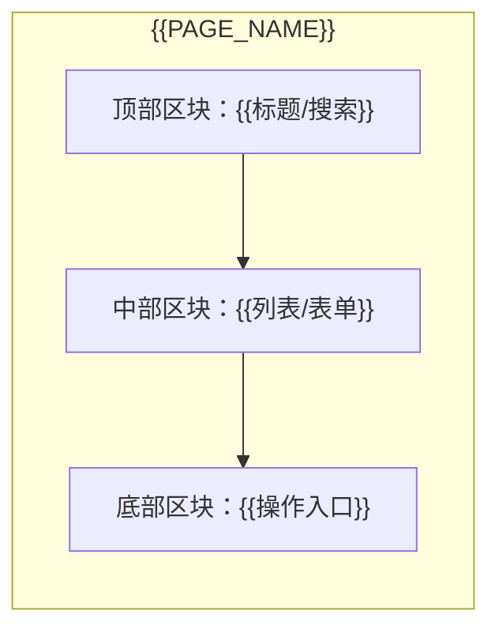

# 页面视图清单 — {{PRODUCT_NAME}} PRD

> **文档状态**：`[草稿] / [待评审] / [已定稿]`
> **所属版本**：{{VERSION}}　|　**责任 PM**：{{AUTHOR_NAME}}　|　**创建/更新**：{{DATE}}
>
> 📐 本文件是 **L1.5 视图汇总层**：横向归并各模块页面，用简单布局图可视化每个页面的功能区块堆叠。
> 写作要求与深度规范见 `references/prd-structure.md`；布局图画法见 `references/mermaid-patterns.md` §六。
> ⚠️ **域界红线**：布局图只到「功能区块堆叠」，禁控件名、禁像素、禁视觉样式。

---

## 1. 页面视图总览（模块 → 页面 映射）

| 模块 | 页面名称 | 页面职责（一句话） | 入口 / 出口 |
|---|---|---|---|
| 01 {{MODULE_A}} | {{PAGE_A1}} | {{一句话职责}} | {{从哪进 / 流向哪}} |
| 01 {{MODULE_A}} | {{PAGE_A2}} | {{一句话职责}} | {{从哪进 / 流向哪}} |
| 02 {{MODULE_B}} | {{PAGE_B1}} | {{一句话职责}} | {{从哪进 / 流向哪}} |

> 本表是「总纲 §6 导航入口」与「各模块 §3.1 页面区块」的归并汇总；页面与模块 §3.1 一一对应，无遗漏无冗余。

---

## 2. 全局页面流转图（页面间跳转关系）

```mermaid
flowchart LR
    Home[首页] --> List[{{列表页}}]
    List --> Detail[{{详情页}}]
    List --> New[{{新建页}}]
    Detail --> List
```

> 只画页面级跳转，覆盖全部页面；孤立页面（无入口或无出口）= P0。

---

## 3. 各模块页面视图详情

### 3.1 模块 01 {{MODULE_NAME}}

#### 页面：{{PAGE_NAME}}
- **页面职责**：{{一句话说明这个页面做什么}}
- **入口 / 出口**：从 {{ENTRY}} 进入，可跳转至 {{EXIT}}
- **显示内容（功能区块）**：
  1. {{ZONE_1}}：{{承载内容}}
  2. {{ZONE_2}}：{{承载内容}}
  3. {{ZONE_3}}：{{承载内容}}
- **简单布局图**：


#### 页面：{{PAGE_NAME_2}}
（同结构展开；侧边栏/左右分栏布局改用 `flowchart LR` + `direction LR`）

### 3.2 模块 02 {{MODULE_NAME}}
（同结构展开）
