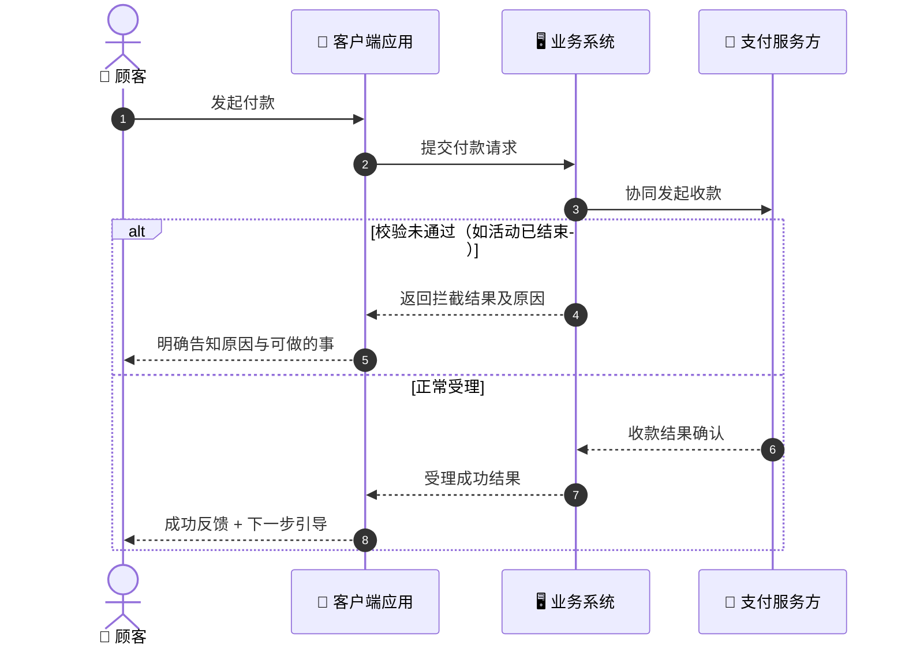
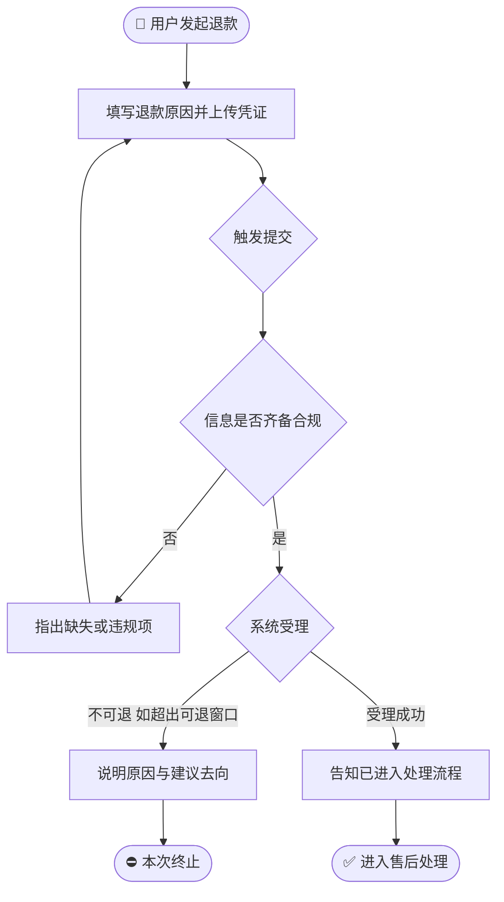
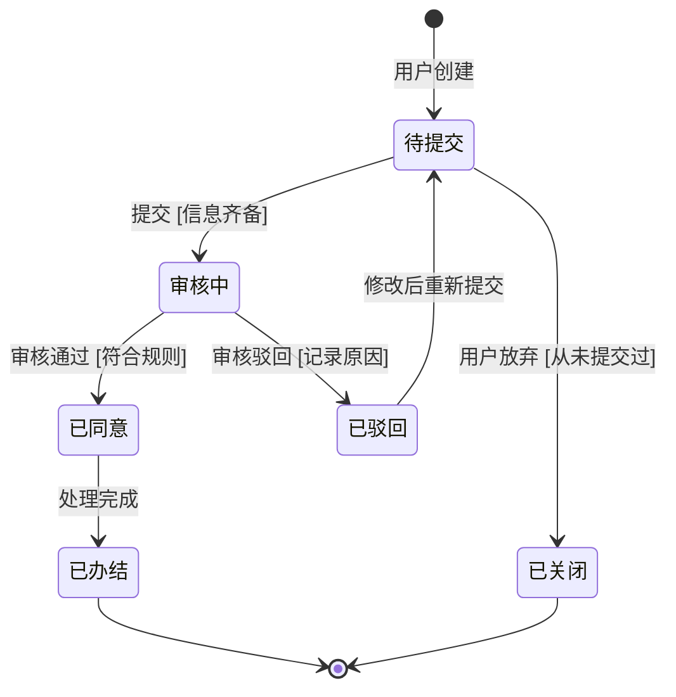
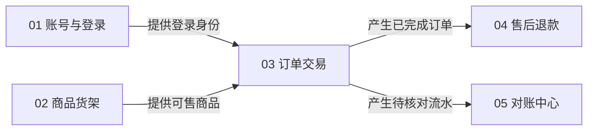

# Mermaid 图表规范指南（Mermaid Patterns v2）

> 指导用标准 Mermaid 绘制五类图：全局泳道时序图、模块流程图、对象生命周期状态机、**模块间关联关系图（v2 新增）**、**页面布局图（v3 新增）**。
> 总原则：图是需求的可视化，不是实现的示意——节点与消息一律业务语言，禁止实现词汇。

---

## 一、图表选型总表

| 场景 | 图型 | 表达内容 | 必含要素 |
|---|---|---|---|
| 全局主流程（跨角色/跨系统） | `sequenceDiagram` | 谁发起、谁处理、怎么收尾 | `autonumber`；`alt/else` 异常分支 |
| 模块内处理逻辑 | `flowchart TD/LR` | 步骤、判断、分支、终态 | 判断菱形必双出口；终态收敛 |
| 核心对象生命周期 | `stateDiagram-v2` | 状态从生到死全流转 | 唯一起始；全部有终态；连线标触发条件[Guard] |
| **模块间关联关系（总纲 §8）** | `flowchart LR` | 谁给谁提供什么前提/产物 | 每条边标注传递产物 + 双向核对注记表 |

---

## 二、全局主流程泳道时序图

### 2.1 参与者规则
- 只允许两类参与者：**人（actor 业务角色）** 与 **系统黑盒（participant）**；
- 系统黑盒的粒度 = 「客户端应用 / 业务系统 / 外部合作方系统」，不拆内部服务层；
- 命名不带技术词：允许「支付系统」「实名核验服务」这类业务称呼；禁止「API 网关」「RPC 服务」。

### 2.2 示例模板

### 2.3 避坑规则
1. 必须 `alt/else` 至少一条异常分支，禁止一路绿灯；
2. 消息文案 = 业务动词短句（「提交退款申请」「返回审核结论」），禁止路径、方法名、错误码；
3. 启用 `autonumber`，便于正文按序号引用（「见时序图第 4 步」）。

---

## 三、模块内业务流程图（flowchart）

### 3.1 示例模板（业务语言版）

### 3.2 规则
1. 节点形状语义化：起止圆角 `([...])`、动作矩形 `[...]`、判断菱形 `{...}`；
2. 所有判断必须 `-->|条件|` 双出口，禁悬空分支；
3. 自环（如「修改后重新校验」）必须在图上写明退出条件——吸收原 PERF-08：
   `Fill --> Fill : 反复修改 [退出条件：提交/放弃]`，或在节点旁注明终止条件。

---

## 四、核心对象生命周期状态机（stateDiagram-v2）

### 4.1 示例（售后单）

### 4.2 五大红线检查
1. 有且只有一个起始 `[*]`；
2. 每个状态最终收敛到终态，禁「流到某处卡死」；
3. 每条跃迁标注 `: 触发事件 [条件]`；
4. 禁非法逆向（如「已完成」直接跳回「待提交」）;
5. 逆向分支必须有闭环机制（驳回去哪、超时去哪）。

---

## 五、模块间关联关系图（总纲 §8 专用）★v2 新增

### 5.1 画法
- 一个模块一个节点（编号 + 名称），`flowchart LR` 左进右出表达依赖方向；
- **每条边必须标注传递的业务产物/前提**（名词短语）；
- 边的数量克制：只画真实存在的业务依赖，为对称好看而画的线一律删除。

### 5.2 强制配套：双向核对注记表
每条边逐条回答两问，任一问答不出 = P0 断点：

| 关联边 | 输出方承诺产出（在输出方哪一章有定义） | 承接方如何承接（在承接方哪一章用到） |
|---|---|---|
| M03 → M04 已完成订单 | 「§2 后置影响：订单完成后进入可售后名单」 | 「§2 前置条件：仅已完成订单可发起」 |

---

## 七、图表自查清单
- [ ] 四类图是否选对图型？
- [ ] 泳道图是否有异常分支且参与者全是黑盒/角色？
- [ ] 状态机五红线是否全过？
- [ ] 关联关系图每条边是否有产物标注且通过双向核对？
- [ ] 全部图中是否零实现词汇？
