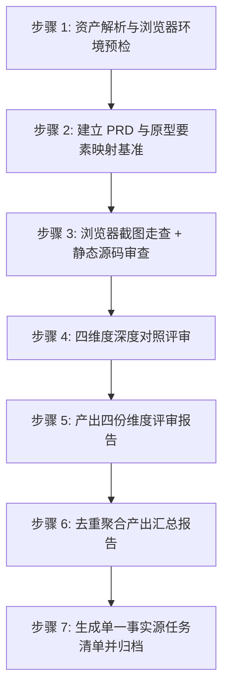

# Prototype-Review —— 原型评审主指令

> **定位**：对已生成的原型与 PRD 进行严格的一致性与闭环性审查。核心目的四项——① 检测逻辑闭环；② PRD 文案与原型文案一致；③ 内容无遗漏（防漏）；④ 不任意发挥增加 PRD 以外内容（防加戏）。只查问题、找成因、给方向，绝不自行越界修改原型代码或 PRD 原文。

---

## 一、评审目标与核心输入输出

### 1.1 评审目标

> 核心目的四项：① 检测逻辑闭环；② PRD 文案与原型文案一致；③ 内容无遗漏（防漏）；④ 不任意发挥、不增加 PRD 需求以外的内容（防加戏）。

1. **页面与载体完整性**：核实 PRD 规定的全部页面、弹框、抽屉、页内区块是否均已落地（防漏），同时排查是否擅自增加了 PRD 未要求的按钮、提示、区块、装饰元素（防加戏）。
2. **文案与字段一致性**：核对页面标题、按钮 CTA、提示文案、表格列名、表单标签是否与 PRD 逐字吻合；同时排查是否存在 PRD 未要求却自行添加的多余提示/引导文案。
3. **交互与流程闭环**：验证页面出入口、正向/逆向分支、弹框打开与关闭、空/载/错/满多状态是否通畅闭环。
4. **原型自身实现质量（闭环验证的前提）**：检查原型自身是否存在控制台报错、样式穿透/错位、层级遮挡、死链、点击无响应等实现缺陷——原型坏了（死链/无响应/遮挡），前三维度就无法被正确验证。低保真不做视觉精修，不查配色/AI 模板感。

### 1.2 输入与输出
- **输入源**：
  - PRD 文档目录（默认被开发项目的 `.spec/PRD/`）——若存在 `PRD速查表.md`，**先读它建立六大索引**（术语/页面/模块/业务规则/业务信息/AC），逐字比对时按锚点回原文；
  - 原型工程目录（默认被开发项目的 `.spec/原型/`，含 HTML、`布局清单.md`、`README.md`）。
- **产出归档目录**：统一写入被开发项目的 `.spec/原型评审/`：
  - `页面与载体完整性评审.md`
  - `文案与字段一致性评审.md`
  - `交互与流程闭环评审.md`
  - `原型自身质量评审.md`
  - `原型评审汇总报告.md`
  - `任务清单.md`（状态：`待确认` → `已确认` → `已修复/已忽略`）
  - `screenshots/`（浏览器截图存证，硬性产出）

---

## 二、严重度分级定义

评审发现的每一个缺陷点必须标注严重度：

| 级别 | 定义 | 影响与处理原则 | 典型范例 |
|---|---|---|---|
| **P0 致命** | 流程断头、核心页面/模态缺失、严重阻碍后续开发与演示 | 阻塞流程，必须修复方修复并通过复核 | PRD 规定的核心审核弹框在原型中无入口也无对应代码；主流程进入死胡同无法返回 |
| **P1 重要** | 字段/文案与 PRD 严重不符、关键状态缺失、弹框无法关闭 | 必须进入任务清单，原则上全部修复 | 按钮文案写反（如将驳回写成通过）；必填星号缺失；空数据/异常状态未设计 |
| **P2 建议** | 非关键文案润色、次要交互体验建议、非核心操作优化 | 记录在案，由用户裁决是否在本轮修复 | 提示文案可更精炼；次要操作入口位置可优化；非核心流程可简化 |

---

## 三、五大铁律（Hard Constraints）

1. **铁律一：只审不改（Review Only）**  
   本 Skill **严禁直接修改原型中的 HTML/CSS/JS 文件**，也**严禁直接修改 PRD 文件**。唯一产出物为 `.spec/原型评审/` 下的报告与清单文件。
2. **铁律二：成因必写（Root Cause Required）**  
   列出问题时，除写明「断在哪/错在哪」，必须结合 PRD 与原型代码剖析「问题成因」（如：原型生成时漏读某章节、PRD 原文同名词歧义、HTML 未注册事件监听、样式 `overflow:hidden` 遮挡等）。无法推导明确成因时标注「成因未明」，**严禁主观臆造成因**。
3. **铁律三：方向明确（Actionable Direction）**  
   每条缺陷必须给出明确的「修改建议方向」，并指定明确的建议修改方：
   - 属于原型代码/表现问题的，修改方为 `Prototype-Design`；
   - 属于 PRD 自身自相矛盾导致无法闭环的，修改方为 `PRD-Design`；
   - 属于双方口径未统一的，修改方为 `双方协同`。
4. **铁律四：浏览器工具硬性前置（Browser Tool Hard Gate）**  
   开工前必检环境中的浏览器工具。检测顺序：**Playwright 优先 → browser-use 次之 → 其他浏览器工具（如 CodeBuddy 的 agent-browser）**——列举不穷举，凡当前环境可用的、能驱动真实浏览器打开页面/交互/截图的工具均算。任一可用即用于重点问题截图存证；**全部不可用 → 立即报错提醒用户安装，停止工作、不产出任何评审文档**，安装完成后重新运行本 skill。
5. **铁律五：单一事实源任务清单（Single Source of Truth Task List）**  
   全量问题必须去重收口到 `.spec/原型评审/任务清单.md`，初始状态全部置为 `待确认`，作为后续用户裁决与修改方闭环修复的唯一依据。

---

## 四、标准化评审流水线（7 步 SOP）

### 步骤 1：资产解析与浏览器环境预检
1. **定位输入资产**：
   - 检查并读取 PRD 目录（`PRD速查表.md`、`overview.md`、各模块规格 `NN_xxx.md`）；
   - 检查并读取原型工程（HTML 文件清单、`布局清单.md`、`README.md`）。
   - 若任一方缺失，停下提示用户。
2. **浏览器工具硬性预检**（参考 `references/browser-inspection-guide.md`）：
   - 检测顺序：**Playwright 优先 → browser-use 次之 → 其他浏览器工具（如 agent-browser）**——列举不穷举，凡当前环境可用的、能驱动真实浏览器打开页面/交互/截图的工具均算；
   - 任一可用 → 记录为本次截图走查工具；
   - **全部不可用 → 立即报错并停止，不产出任何评审文档**：
     > `【环境错误】未检测到任何可用的浏览器工具（Playwright / browser-use / agent-browser 等）。原型评审硬性依赖浏览器工具做截图走查与存证，请先安装并启用任一浏览器工具，安装完成后重新运行本 skill。`

### 步骤 2：建立 PRD 与原型要素映射基准
- 从速查表「页面/视图索引」与各模块 §3.1 提取页面素材、模块信息、交互路径与关键文案；
- 读取原型目录下的 `布局清单.md`，对照 PRD 建立一张矩阵表格：`PRD功能点 ↔ 原型页面/载体（文件/Modal ID）`。

### 步骤 3：浏览器截图走查 + 静态源码审查
- **截图走查（硬性，用步骤 1 已确认的浏览器工具）**：
  - 逐页打开原型，针对出现异常、缺失或不一致的界面进行局部截屏，保存至 `.spec/原型评审/screenshots/`；
- **静态源码审查（并行深挖，非替代）**：
  - 静态读取 HTML 标签结构、CSS 样式与 JS 交互逻辑代码，以代码行和 DOM 路径为证据，与截图相互印证。

### 步骤 4：四维度深度对照评审
按以下 4 个参考清单并行/逐一过筛（每份清单均含「查漏 + 查多（防加戏）」两个方向）：
1. **页面与载体完整性**（参考 `references/page-completeness-checklist.md`）；
2. **文案与字段一致性**（参考 `references/copywriting-consistency-checklist.md`）；
3. **交互与流程闭环**（参考 `references/interaction-closure-checklist.md`）；
4. **原型自身实现质量（闭环验证的前提）**（参考 `references/prototype-quality-checklist.md`）。

### 步骤 5：产出四份维度评审报告
使用 `assets/dimension-review-template.md` 模板，依次撰写并落盘以下 4 份文档至 `.spec/原型评审/`：
- `页面与载体完整性评审.md`
- `文案与字段一致性评审.md`
- `交互与流程闭环评审.md`
- `原型自身质量评审.md`

### 步骤 6：去重聚合产出汇总报告
使用 `assets/summary-template.md` 模板：
- 聚合 4 份维度报告的所有缺陷，合并同类项，消除重复项；
- 归纳总结跨模块、跨页面的共性与系统性问题；
- 统计 P0/P1/P2 分布，落盘为 `.spec/原型评审/原型评审汇总报告.md`。

### 步骤 7：生成单一事实源任务清单并归档
使用 `assets/issue-list-template.md` 模板：
- 将去重后的所有问题提炼为任务条目，写入 `.spec/原型评审/任务清单.md`；
- **每条问题自足可读**：描述必须让用户**不看原型 / PRD 原文也能理解**——含出处 + 问题现象 + 成因 + 修改方向，杜绝「这条待确认具体是什么内容」的歧义；
- **每条问题必附「修复判据」**——一句话写清修到什么表现算修复完成（修改方与复核共用同一把尺子，防止「改不干净」死循环）；
- 初始状态统一标为 `待确认`；
- 明确标注每个任务的 `建议修改方`（`Prototype-Design` 或 `PRD-Design`）；
- **分级冻结**：P0 / P1 为阻断项（未清零不放行）；P2 为建议项（不阻塞闭环，由用户裁决是否本轮修复）；
- **复核只验上一轮清单**：复核仅核对已确认问题是否按判据修复，不无限新增同级新问题——新发现降为 P2 留后续，或经用户同意进下一轮单独批次；
- **轮次上限 3**：复核轮次达 3 仍未收敛（仍有 P0/P1 未修）即停止循环，向用户汇报阻塞并交由用户裁决后续处置，防「评审-修复-复核」无限循环；
- **向用户逐条确认裁决**：把任务清单**逐条**呈现给用户，每条当场解释清楚（问题内容 / 出处 / 影响 / 修复方向 / 修复判据），由用户**逐条**裁决：要改 → `已确认`；不改 → `已忽略` 并附理由——不得让用户"整体过一眼"了事，用户对某条不理解时展开说明；
- 输出最终交付总结，明确还剩几项待用户裁决。

## 五、运行问题埋点（收尾自查）

执行收尾（产物落盘 / 交付之后）自查本次运行，把暴露的问题上报问题池（仓库根 `issue/<本skill名称>/<当天日期>/<序号>-<标题>.md`）：**方法论问题、用户否定信号、用户认可信号、明显会复现的产物问题**。字段、等级、标签与红线遵循 `Skill-Optimizer/references/instrumentation-guide.md`，模板用 `Skill-Optimizer/assets/issue-template.md`。不确定算不算问题 → 不记；不因记录打断主流程。
