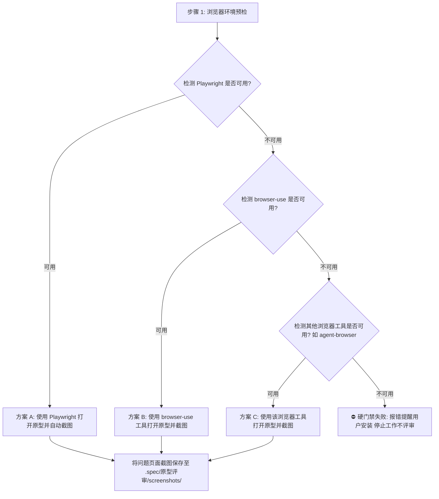

# 浏览器审批与截图指引（Browser Inspection & Screenshot Guide）

> 目标：指导原型评审过程中如何利用当前环境的浏览器工具进行视觉走查、截图取证与页面渲染验证。严格遵循「环境预检 → 工具选择 → **硬性前置、无工具不工作**」的原则。

---

## 一、工具检测与决策流

在原型评审开工前，**必须先检测当前运行环境中是否存在可用的浏览器工具**：

### 1.1 检测规则（能力检测，非名单穷举）
1. **优先检测 Playwright**：通过执行 `node -e "require('playwright')"` 或检测本地 Playwright 驱动。
2. **次选检测 browser-use**：若环境配备 browser-use 插件/MCP/命令行能力，则调用之。
3. **再检测其他浏览器工具**：如 CodeBuddy 的 `agent-browser`、其他浏览器类 MCP/插件——**列举不穷举，凡当前环境可用的、能驱动真实浏览器打开页面/交互/截图的工具均算**。
4. **全部不可用**：**硬门禁失败 → 立即报错提醒用户安装，停止工作、不产出任何评审文档**；绝不跳过截图环节硬评。

---

## 二、截图审批规范（当工具可用时）

### 2.1 截图范围与证据留存
- **何时截图**：
  - 仅针对发现的 **P0/P1 关键缺陷**（如：页面布局严重错位、弹框遮罩层级异常、文案严重冲突、关键状态缺失等）进行针对性截屏存证；
  - 常规纯文案一字之差或简单字段对照，直接使用代码行号比对，无需冗余截图。
- **截图命名与落盘路径**：
  - 目录：被开发项目 `.spec/原型评审/screenshots/`
  - 命名规范：`ISSUE-[编号]-[页面名称]-[问题简述].png`（如 `ISSUE-001-refund-modal-missing.png`）
- **报告内引用**：
  - 在维度评审报告中嵌入相对路径 Markdown 语法：``

---

## 三、硬门禁失败的报错规范（当工具全无时）

当检测到当前环境无任何可用浏览器工具（Playwright / browser-use / agent-browser 等均不可用）时：
1. **立即停止**：不产出评审报告与任务清单，截图走查是本 skill 的硬性前置；
2. **对用户报错明示**：
   > 【环境错误】未检测到任何可用的浏览器工具（Playwright / browser-use / agent-browser 等）。原型评审硬性依赖浏览器工具做截图走查与存证，请先安装并启用任一浏览器工具，安装完成后重新运行本 skill。
3. **静态源码审查的定位**：源码静态分析（DOM 树比对文案与标签、`<script>` 逻辑比对跳转链接与弹框 ID、样式类排查遮挡与隐藏）是**并行深挖证据的手段**，与截图相互印证——**不是**缺少浏览器工具时的替代评审方式。
