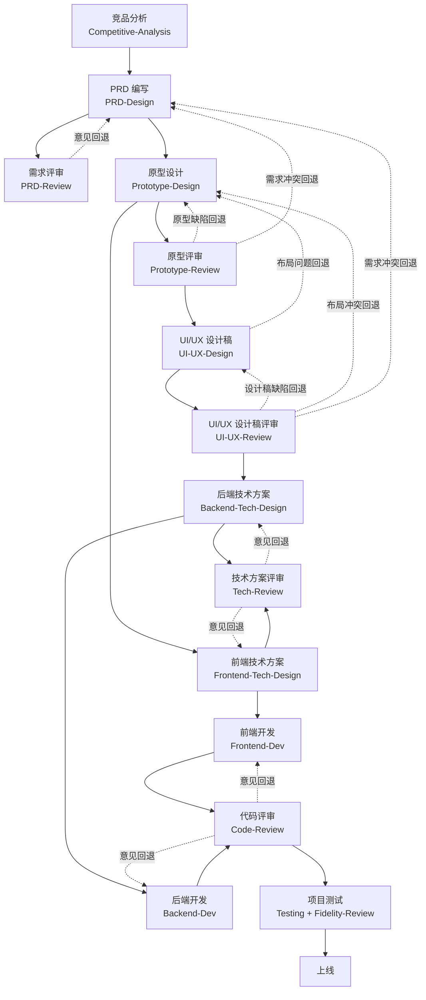

# tenger-skills

个人 Skills 仓库，沉淀一套覆盖软件产品**标准开发全流程**的 Claude Skills。

## 简介

本仓库沉淀了 16 个专业「技能（Skill）」+ 1 个编排总控 Skill + 1 个元优化 Skill，覆盖从产品想法到上线测试的完整软件开发链路，并支持对 Skill 本身的长期记录与优化：

**竞品分析 → 需求（PRD）→ 需求评审 → 原型 → 原型评审 → UI/UX 设计稿 → UI/UX 设计稿评审 → 技术方案 → 技术方案评审 → 开发 → 代码评审 → 测试**

> 第 15 个专业 Skill = [`Fidelity-Review`](./Fidelity-Review)（**页面还原度评审**）：对照 UI 设计稿评审前端实现页的视觉/交互还原 + 超长文案健壮性，只审不改、截图必证。**不占主链节点**——可独立触发（有设计稿 + 页面即可做还原验收），也被 `Testing` 测试流程内嵌调用（UI 还原度检查环节）。
>
> 第 16 个专业 Skill = [`Bug-Fix`](./Bug-Fix)（**日志驱动的 Bug 诊断与修复委托闭环**）：前后端日志入手，证据链定位根因，根因 Gate 后只交付问题定位报告（含修复方向）+ 修复任务清单——技术方案交 Frontend/Backend-Tech-Design、改码交 Frontend/Backend-Dev、回归由开发自测 + 按需 Testing，本 skill 只核对原始场景不再现并迭代判定闭环；不产方案、不改码、不做深度测试。**不占主链节点**——报障/日志/线上问题可独立触发，也承接 `Testing` / `Code-Review` 发现的可运行性问题。

每个 Skill 是一份结构化的指导文档，帮助 Claude 在对应场景下采用经过验证的方法与流程完成任务；各 Skill 之间通过「产出物」衔接，形成端到端的交付流水线。其中 [`Workflow`](./Workflow) 是**编排总控**，负责把 14 个链上专业 Skill 按流水线串起来自动调度（详见「全流程编排」章节）；[`Skill-Optimizer`](./Skill-Optimizer) 是**元优化器**（链外），负责各 Skill 的问题记录、聊天挖掘、自洽体检与全方位优化沉淀（详见「Skill 元优化」章节）。

## 标准开发流程

14 个链上专业 Skill 按软件开发生命周期串成一条流水线，分四个阶段（`Fidelity-Review` 与 `Bug-Fix` 不入链：前者为开发后/测试期的独立验收能力，后者为问题修复闭环入口，均见文末 Skill 清单）：

| 阶段 | Skill 链路 | 产出物 | 交付对象 |
|------|-----------|--------|---------|
| ① 需求 | 竞品分析 → PRD 编写 ⇄ 需求评审 | 竞品分析报告 / PRD | 原型设计 |
| ② 设计 | 原型设计 ⇄ 原型评审 → UI/UX 设计稿 ⇄ UI/UX 设计稿评审 → 后端技术方案 + 前端技术方案 ⇄ 技术方案评审 | 布局清单 / 设计稿 / TDD / FTDD | 开发 |
| ③ 开发 | 后端开发 + 前端开发 ⇄ 代码评审 | 可运行代码工程 | 测试 |
| ④ 测试 | 项目测试（样式还原环节内嵌 Fidelity-Review UI 还原度检查） | 分级测试问题文档 | 上线 |



> 五个评审类 Skill（需求评审 / 原型评审 / UI/UX 设计稿评审 / 技术方案评审 / 代码评审）遵循「只审不改 · 分工明确」原则：**只找问题、不做修改**——输出分级问题清单回退给上游，修改一律由对应产出方 skill（`PRD-Design` / `Prototype-Design` / `UI-UX-Design` / `Backend-Tech-Design` / `Frontend-Tech-Design` / `Backend-Dev` / `Frontend-Dev`）执行。
>
> [`Fidelity-Review`](./Fidelity-Review)（页面还原度评审）同为「只审不改 · 截图必证 · 每条附修改建议」的独立验收能力，不在上述主链五个评审节点内：修改方为 `Frontend-Dev`（实现还原问题）/ `UI-UX-Design`（设计稿缺陷）——通过 `.spec/页面还原评审/任务清单.md` 交接。

## 全流程编排

[`Workflow`](./Workflow) 是**可选的编排 Skill**：把 14 个专业 Skill 串成一条链，并支持**从任意节点起跑**。

**核心原则**：一条链，任意起点，逐步推进，随时可停。

| 项 | 约定 |
|---|---|
| 起点 | 用户点名，或从 `.spec/` 已有产物自动推断（推断后需用户确认）。**每个节点都可以作为起点** |
| 终点 | 用户点名；**不点名 = 只跑起点这一个节点**，跑完停下，后续由用户决定 |
| 跳过 | 任一节点可跳过（含五次评审），PIPELINE 标记 `已跳过` 并写原因 |
| 推进节奏 | 每完成一个节点 → 回填 PIPELINE → 输出交接摘要 → **停下等用户决定**（继续 / 跳过 / 重做 / 就到这） |
| 状态源 | 被开发项目根目录 `.spec/PIPELINE.md`（只记录本次路径涉及的节点） |
| 串行约束 | `TDD → FTDD`（FTDD 依赖 TDD 接口契约）、`后端开发 → 前端开发`（前端按后端真实契约对接）两处硬串行，不并行 |
| 回退 | 评审节点（PRD / 原型 / UI/UX 设计稿 / 技术方案 / 代码评审）任务清单 `已确认` 未清零即回退修改方，轮次上限 3 |

**举例**：

| 用户说 | 起点 | 跑什么 |
|---|---|---|
| 「从零开发 XX」 | 竞品分析 | 一路到测试 |
| 「只做竞品分析」 | 竞品分析 | 只跑这一个 |
| 「根据我的 PRD 生成原型」 | 原型设计 | 只跑原型，跑完停 |
| 「评审原型」 | 原型评审 | 只跑原型评审，跑完停 |
| 「生成设计稿」 | UI/UX 设计稿 | 只跑设计稿，跑完停 |
| 「评审设计稿」 | UI/UX 设计稿评审 | 只跑设计稿评审，跑完停 |
| 「我有 PRD 了，走后续开发」 | 原型设计 | 原型 → … → 测试 |
| 「评审这份代码」 | 代码评审 | 只跑这一个 |
| 「测试这个项目」 | 测试 | 只跑这一个 |

> `Workflow` 只做调度、记账与守门，**不产出任何业务文档**；14 个链上专业 Skill 永远可独立调用，行为不受影响。`Fidelity-Review`（第 15 个专业 Skill）与 `Bug-Fix`（第 16 个专业 Skill）均不入主链：前者作为独立验收能力随时可触发、并在 `Testing`（⑭ 节点）内被自动调用做 UI 还原度检查；后者作为「bug 诊断 + 修复委托」入口随时可触发：只出定位报告与修复任务清单，方案/改码/深度测试逐环委托对应 skill，承接报障/日志与 `Testing`/`Code-Review` 发现的可运行性问题。

## 产物目录约定

所有文档类产物统一存放在**被开发项目**根目录下的 `.spec/` 文件夹；代码类产物直接落在项目目录里；竞品分析（立项前执行）产物也落在被开发项目 `.spec/<主题>竞品分析/`。

### .spec 目录结构

```
<项目>/
├── .spec/
│   ├── <主题>竞品分析/      # Competitive-Analysis 产物（立项前）
│   ├── PRD/                # 需求文档（PRD-Design）
│   │   ├── V1/             # 第 1 版：overview.md + PRD速查表.md + NN_xxx.md + 验收结果详细说明.md
│   │   └── V2/             # 迭代版（若有，全量归档并做差异对比）
│   ├── 原型/                # 低保真原型（Prototype-Design）
│   ├── 原型评审/            # 原型评审产物（Prototype-Review：页面/文案/交互/实现质量四维评审 + 汇总报告 + 任务清单）
│   ├── 设计稿/              # UI/UX 设计稿（UI-UX-Design：README + 定稿 HTML + 设计规范副本 + 截图）
│   ├── 设计评审/            # UI/UX 设计稿评审产物（UI-UX-Review：四维评审 + 汇总报告 + 任务清单）
│   ├── 页面还原评审/         # 页面还原度评审产物（Fidelity-Review：还原度报告 + 任务清单 + screenshots）
│   ├── TDD/                # 后端技术方案文档（Backend-Tech-Design）
│   │   ├── V1/             # overview.md + NN_xxx.md
│   │   └── V2/
│   ├── FTDD/               # 前端技术方案文档（Frontend-Tech-Design）
│   │   ├── V1/
│   │   └── V2/
│   ├── 需求评审/            # PRD-Review 产物（前端/后端/测试评审 + 汇总报告 + 任务清单）
│   ├── 技术方案评审/         # Tech-Review 产物（后端/前端评审 + 汇总报告 + 任务清单）
│   ├── 代码评审/            # Code-Review 产物（后端/前端评审 + 汇总报告 + 任务清单）
│   ├── 测试/                # Testing 产物（测试计划/用例/问题文档 + 接口性能清单 + 截图）
│   └── bug修复/             # Bug-Fix 产物（问题定位报告 + 修复任务清单 + 复现材料）
├── src/（或 apps/）         # 代码（Backend-Dev / Frontend-Dev 产物）
└── ...
```

- **文档归 `.spec`**：需求、原型、技术方案、评审、测试等文档按上述分类存放。
- **代码归项目**：后端/前端代码直接落在项目目录（如 `apps/`、`src/`），不进入 `.spec`。
- **版本用子目录**：PRD / TDD / FTDD 按 `V1`、`V2` 分子目录，迭代时全量归档新版本。
- **竞品分析**：`Competitive-Analysis` 在立项前执行，产物落在被开发项目 `.spec/<主题>竞品分析/`。

## 浏览器工具策略

各 Skill 涉及浏览器工具（截图、页面核验、AI 视觉断言）时，统一按**两级策略**处理；检测顺序为 **Playwright 优先 → browser-use 次之 → 其他浏览器工具（如 CodeBuddy 的 agent-browser）**——列举不穷举，凡当前环境可用的、能驱动真实浏览器打开页面/交互/截图的工具均算：

| 级别 | Skill | 行为 |
|------|-------|------|
| **硬依赖** | `Prototype-Review` / `UI-UX-Review` / `Fidelity-Review` / `Frontend-Tech-Design` / `Frontend-Dev` / `Testing` | 开工前必检：任一可用即开工；全无 → 报错提醒安装，**安装完成才工作** |
| **软检测** | `Tech-Review` / `Backend-Tech-Design` | 有则用（版本核验），无则**跳过对应辅助步骤**，不阻塞 |

> 不涉及浏览器工具的 Skill（如 `Backend-Dev`、`Code-Review`、`UI-UX-Design`）不做检测或仅截图增强；`midscenejs` 仅为 `Testing` 样式视觉断言的可选增强。
>
> 策略正文（检测顺序 / 两级行为 / 硬依赖报错文案模板）见仓库根 `shared/browser-policy.md`；各 skill 正文只声明自身级别与动作，不重复定义。

## Skill 清单

| Skill | 目录 | 说明 | 状态 |
|-------|------|------|------|
| **全流程编排（总控）** | [**Workflow**](./Workflow) | 把 14 个专业 Skill 串成流水线：调度 + 状态（`.spec/PIPELINE.md`）+ 门禁 + 回退 | ✅ 完成 |
| **Skill 元优化（链外）** | [**Skill-Optimizer**](./Skill-Optimizer) | 记录 / 挖掘 / 体检 / 优化各 Skill + 从集中池 `bug-patterns/` 提炼错误模式反哺方案/开发 skill（各被修项目统一沉淀本池，一处定期提炼）：问题入 `issue/` 池（埋点 + 兜底 + 聊天挖掘 + 模式④体检），模式④七维自洽体检（术语 / 逻辑闭环 / 文句 / 声明-流程 / 跨位置同步 / 简洁不落俗 / 安全审计）出问题清单逐条裁决，全方位优化沉淀，标准先行、长期迭代 | ✅ 完成 |
| 竞品分析 | [Competitive-Analysis](./Competitive-Analysis) | 竞品调研、对比与分析 | ✅ 完成 |
| 产品需求文档（PRD） | [PRD-Design](./PRD-Design) | PRD 编写 | ✅ 完成 |
| 需求评审 | [PRD-Review](./PRD-Review) | PRD 评审 | ✅ 完成 |
| 原型设计 | [Prototype-Design](./Prototype-Design) | 低保真可交互原型图 + 布局清单 | ✅ 完成 |
| 原型评审 | [Prototype-Review](./Prototype-Review) | 原型与 PRD 一致性、页面完整性、交互闭环及原型缺陷评审（浏览器截图核验硬依赖） | ✅ 完成 |
| UI/UX 设计稿 | [UI-UX-Design](./UI-UX-Design) | 以 Superdesign 为底座生成设计稿：风格决策 Gate（三套方案）→ 生成前沉淀设计规范 → 逐页生成（布局零改动 + 去 AI 味）→ 质量门禁 → 归档 `.spec/设计稿/` | ✅ 完成 |
| UI/UX 设计稿评审 | [UI-UX-Review](./UI-UX-Review) | 设计稿四维独立复审（结构零改动 / 文案一致 / 规范一致 / 渲染质量 + 可点击性），浏览器渲染硬依赖，作为 UI-UX-Design 内部门禁的第三方兜底；防评审死循环三招内建 | ✅ 完成 |
| 页面还原度评审 | [Fidelity-Review](./Fidelity-Review) | 前端实现页 vs UI 设计稿的还原度评审（视觉还原 + 交互还原 + 超长文案专项；只审不改、截图必证、每条附修改建议；双通道基准 `.spec/设计稿/` 优先）；双模式：独立出 `.spec/页面还原评审/` 报告+任务清单，被 Testing 内嵌时出轻量清单 | ✅ 完成 |
| 后端技术方案 | [Backend-Tech-Design](./Backend-Tech-Design) | 后端技术方案文档（TDD）编写 | ✅ 完成 |
| 前端技术方案 | [Frontend-Tech-Design](./Frontend-Tech-Design) | 前端技术方案文档（FTDD）编写 | ✅ 完成 |
| 技术方案评审 | [Tech-Review](./Tech-Review) | 后端/前端技术方案评审（闭环 + 关联关系） | ✅ 完成 |
| 后端开发 | [Backend-Dev](./Backend-Dev) | 后端代码开发（微服务 + NestJS 优先 + Monorepo，维护性优先） | ✅ 完成 |
| 前端开发 | [Frontend-Dev](./Frontend-Dev) | 前端代码开发（依据 PRD + 原型 + TDD + FTDD，还原度高 + 模块化 + 测试先行 + 不确定即问 + 功能点提交 + monorepo 共享类型 + lint 门禁 + 浏览器硬预检 + 进度文档） | ✅ 完成 |
| 代码评审 | [Code-Review](./Code-Review) | 后端/前端代码评审（接口契约一致性 + 可运行性 + 架构合规，P0 附建议补丁） | ✅ 完成 |
| 项目测试 | [Testing](./Testing) | 依据 PRD + UI 设计稿本地跑真实项目做全流程测试（功能全状态 + 全点击 / 样式 midscenejs 视觉断言 + UI 还原度检查·内嵌 Fidelity-Review / 慢接口识别），输出分级测试问题文档 | ✅ 完成 |
| Bug 诊断与修复 | [Bug-Fix](./Bug-Fix) | 日志驱动的 Bug 诊断与修复委托闭环（链外）：前后端日志入手 → 复现确认 → 根因定位（证据链三段）→ 根因 Gate → 只交付定位报告+修复任务清单，逐环委托方案/开发/回归；不产方案、不改码、不做深度测试；承接报障/Testing/Code-Review 可运行性问题 | ✅ 初版定稿 |

## 目录结构

```
tenger-skills/
├── README.md                  # 仓库说明（本文件）
├── Workflow/                  # 全流程编排 Skill（总控）
├── Skill-Optimizer/           # Skill 元优化 Skill（链外，长期迭代）
├── Competitive-Analysis/      # 竞品分析 Skill
├── PRD-Design/                # 产品需求文档（PRD）Skill
├── PRD-Review/                # 需求评审 Skill
├── Prototype-Design/          # 原型设计 Skill
├── Prototype-Review/          # 原型评审 Skill
├── UI-UX-Design/              # UI/UX 设计稿 Skill（Superdesign 底座）
├── UI-UX-Review/              # UI/UX 设计稿评审 Skill
├── Fidelity-Review/           # 页面还原度评审 Skill（实现页 vs 设计稿）
├── Bug-Fix/                   # Bug 定位与修复闭环 Skill（日志→根因→方案→修复→回归）
├── Backend-Tech-Design/       # 后端技术方案（TDD）Skill
├── Frontend-Tech-Design/      # 前端技术方案（FTDD）Skill
├── Tech-Review/               # 技术方案评审 Skill
├── Backend-Dev/               # 后端开发 Skill
├── Frontend-Dev/              # 前端开发 Skill
├── Code-Review/               # 代码评审 Skill
├── Testing/                   # 项目测试 Skill
├── shared/                    # 跨 skill 公共约定（防死循环三招/浏览器策略/双基准术语/拷问协议核心/开发公共约定/评审模板）
├── issue/                     # 问题池（skill 自身问题，Skill-Optimizer 唯一事实源）
├── bug-patterns/              # 错误模式集中池（各被修项目 bug 统一沉淀此处，Bug-Fix 写 / Optimizer 提炼）
└── chats/                     # 待挖掘的聊天记录
```

## 什么是 Skill

Skill 是一个以 `SKILL.md` 为核心、可附带资源文件的目录。每个 Skill 通过 `description`（触发条件）被 Claude 自动识别，在匹配的场景下加载并遵循其中的方法。

一个标准的 Skill 目录结构如下：

```
skill-name/
├── SKILL.md        # 主文件（必需）：YAML 元数据 + 正文指令
├── references/     # 参考文档（按需加载）
├── assets/         # 输出模板 / 资源
└── scripts/        # 可执行脚本（可选）
```

> 各 Skill 的完整模块大纲见其目录下的 `README.md`。

## Skill 元优化

[`Skill-Optimizer`](./Skill-Optimizer)（链外，任何时刻可触发）负责让 Skill 越用越贴合个人需求——**长期迭代，不参与任何业务交付**：

| 模式 | 触发 | 干什么 |
|---|---|---|
| ① 记录（兜底） | 「记个问题」「这个 skill 哪里不好」 | 把问题写入 `issue/` 池 |
| ② 挖掘 | 丢聊天记录进 `chats/`（或粘贴） | 从记录提取优化点，确认后落 issue |
| ③ 优化 | 「优化 / 精简 / 迭代 XX skill」 | 读 issue 做八维全方位优化（问题修复 + 触发精准 + 上下文体积 + 指令写法 + 流程稳定 + 简洁不落俗 + 术语一致 + 心法注入），沉淀回各 Skill；对象为方案/开发 skill 或点名「提炼」时，从 `bug-patterns/` 池提炼错误模式为防复发规则（错误表加行 → references 清单 → Gate 预检项逐层升级） |
| ④ 体检 | 「体检 / 检查 XX skill」「XX 自洽吗 / 前后一致吗」 | 七维自洽体检（术语一致 / 逻辑闭环 / 文句质量 / 声明-流程一致 / 跨位置同步 / 简洁不落俗 / 安全审计），出问题清单逐条交你裁决（当场修 / 记 issue / 忽略） |

核心机制：**标准先行**（每模式有固定标准，流程不漂移，标准本身也可被优化）、**双问题池**（`issue/` = skill 自身问题、`bug-patterns/` = 真实 bug 错误模式）、**状态机 `待处理 → 处理中 → 已沉淀 / 已忽略`**（已沉淀强制留痕）、**自我指涉**（先优化自己再优化其他）。

## Skill 迭代

1. 在每个 Skill 目录的 `README.md` 中维护结构大纲
2. 逐步更新 `SKILL.md` 正文与资源文件
3. 用测试场景验证 Skill 能否正确触发与执行
4. 运行中暴露的问题经 `Skill-Optimizer` 记录 / 挖掘 / 体检 / 优化沉淀（见「Skill 元优化」）

## 参考

- [Anthropic Skills 规范](https://agentskills.io/specification)
