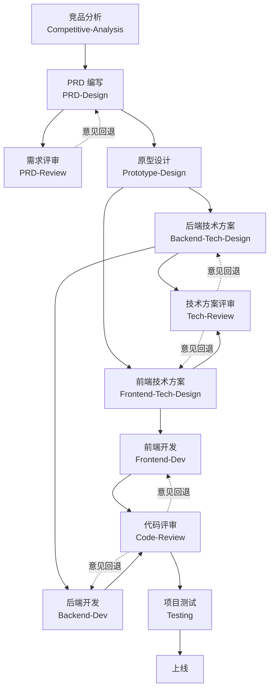

# tenger-skills

个人 Skills 仓库，沉淀一套覆盖软件产品**标准开发全流程**的 Claude Skills。

## 简介

本仓库沉淀了 11 个可复用的「技能（Skill）」，覆盖从产品想法到上线测试的完整软件开发链路：

**竞品分析 → 需求（PRD）→ 需求评审 → 原型 → 技术方案 → 技术方案评审 → 开发 → 代码评审 → 测试**

每个 Skill 是一份结构化的指导文档，帮助 Claude 在对应场景下采用经过验证的方法与流程完成任务；各 Skill 之间通过「产出物」衔接，形成端到端的交付流水线。

## 标准开发流程

11 个 Skill 按软件开发生命周期串成一条流水线，分四个阶段：

| 阶段 | Skill 链路 | 产出物 | 交付对象 |
|------|-----------|--------|---------|
| ① 需求 | 竞品分析 → PRD 编写 ⇄ 需求评审 | 竞品分析报告 / PRD | 原型设计 |
| ② 设计 | 原型设计 → 后端技术方案 + 前端技术方案 ⇄ 技术方案评审 | 高保真原型 / TDD / FTDD | 开发 |
| ③ 开发 | 后端开发 + 前端开发 ⇄ 代码评审 | 可运行代码工程 | 测试 |
| ④ 测试 | 项目测试 | 分级测试问题文档 | 上线 |



> 三个评审类 Skill（需求评审 / 技术方案评审 / 代码评审）遵循「只审不改」原则，输出分级问题清单，回退给上游修订。

## 产物目录约定

所有文档类产物统一存放在**被开发项目**根目录下的 `.spec/` 文件夹；代码类产物直接落在项目目录里；竞品分析（立项前执行）仍放在本仓库的 `Competitive-Analysis/.output/`。

### .spec 目录结构

```
<项目>/
├── .spec/
│   ├── PRD/                # 需求文档（PRD-Design）
│   │   ├── V1/             # 第 1 版：overview.md + 页面视图.md + NN_xxx.md + 验收结果详细说明.md
│   │   └── V2/             # 迭代版（若有，全量归档并做差异对比）
│   ├── 原型/                # 高保真原型（Prototype-Design）
│   ├── TDD/                # 后端技术文档（Backend-Tech-Design）
│   │   ├── V1/             # overview.md + NN_xxx.md
│   │   └── V2/
│   ├── FTDD/               # 前端技术文档（Frontend-Tech-Design）
│   │   ├── V1/
│   │   └── V2/
│   ├── 需求评审/            # PRD-Review 产物（前端/后端/测试评审 + 汇总报告）
│   ├── 技术方案评审/         # Tech-Review 产物（后端/前端评审 + 汇总报告）
│   ├── 代码评审/            # Code-Review 产物（后端/前端评审 + 汇总报告）
│   └── 测试/                # Testing 产物（测试计划/用例/问题文档 + 截图）
├── src/（或 apps/）         # 代码（Backend-Dev / Frontend-Dev 产物）
└── ...
```

- **文档归 `.spec`**：需求、原型、技术方案、评审、测试等文档按上述分类存放。
- **代码归项目**：后端/前端代码直接落在项目目录（如 `apps/`、`src/`），不进入 `.spec`。
- **版本用子目录**：PRD / TDD / FTDD 按 `V1`、`V2` 分子目录，迭代时全量归档新版本。
- **竞品分析例外**：`Competitive-Analysis` 在立项前执行，产物留在本仓库 `Competitive-Analysis/.output/<主题>竞品分析/`。

## Skill 清单

| Skill | 目录 | 说明 | 状态 |
|-------|------|------|------|
| 竞品分析 | [Competitive-Analysis](./Competitive-Analysis) | 竞品调研、对比与分析 | ✅ 完成 |
| 产品需求文档（PRD） | [PRD-Design](./PRD-Design) | PRD 编写 | ✅ 完成 |
| 需求评审 | [PRD-Review](./PRD-Review) | PRD 评审 | ✅ 完成 |
| 原型设计 | [Prototype-Design](./Prototype-Design) | 高保真可交互原型图 | ✅ 完成 |
| 后端技术方案 | [Backend-Tech-Design](./Backend-Tech-Design) | 后端技术方案文档（TDD）编写 | ✅ 完成 |
| 前端技术方案 | [Frontend-Tech-Design](./Frontend-Tech-Design) | 前端技术方案文档（FTDD）编写 | ✅ 完成 |
| 技术方案评审 | [Tech-Review](./Tech-Review) | 后端/前端技术方案评审（闭环 + 关联关系） | ✅ 完成 |
| 后端开发 | [Backend-Dev](./Backend-Dev) | 后端代码开发（微服务 + NestJS 优先 + Monorepo，维护性优先） | ✅ 完成 |
| 前端开发 | [Frontend-Dev](./Frontend-Dev) | 前端代码开发（依据 PRD + 原型 + TDD + FTDD，还原度高 + 模块化 + 测试先行 + 不确定即问 + 功能点提交 + monorepo 共享类型 + lint 门禁 + 进度文档） | ✅ 完成 |
| 代码评审 | [Code-Review](./Code-Review) | 后端/前端代码评审（接口契约一致性 + 可运行性 + 架构合规，P0 附建议补丁） | ✅ 完成 |
| 项目测试 | [Testing](./Testing) | 依据 PRD + UI 设计稿本地跑真实项目做全流程测试（功能全状态 + 全点击 / 样式 midscenejs 视觉断言 + 截图 / 慢接口识别），输出分级测试问题文档 | ✅ 完成 |

## 目录结构

```
tenger-skills/
├── README.md                  # 仓库说明（本文件）
├── Competitive-Analysis/      # 竞品分析 Skill
├── PRD-Design/                # 产品需求文档（PRD）Skill
├── PRD-Review/                # 需求评审 Skill
├── Prototype-Design/          # 原型设计 Skill
├── Backend-Tech-Design/       # 后端技术方案（TDD）Skill
├── Frontend-Tech-Design/      # 前端技术方案（FTDD）Skill
├── Tech-Review/               # 技术方案评审 Skill
├── Backend-Dev/               # 后端开发 Skill
├── Frontend-Dev/              # 前端开发 Skill
├── Code-Review/               # 代码评审 Skill
└── Testing/                   # 项目测试 Skill
```

## 什么是 Skill

Skill 是一个以 `SKILL.md` 为核心、可附带资源文件的目录。每个 Skill 通过 `description`（触发条件）被 Claude 自动识别，在匹配的场景下加载并遵循其中的方法。

一个标准的 Skill 目录结构如下：

```
skill-name/
├── SKILL.md        # 主文件（必需）：YAML 元数据 + 正文指令
├── references/     # 参考文档（按需加载）
├── assets/         # 输出模板 / 资源
└── scripts/        # 可执行脚本（可选）
```

> 各 Skill 的完整模块大纲见其目录下的 `README.md`。

## Skill 迭代

1. 在每个 Skill 目录的 `README.md` 中维护结构大纲
2. 逐步更新 `SKILL.md` 正文与资源文件
3. 用测试场景验证 Skill 能否正确触发与执行
4. 迭代优化直至满意

## 参考

- [Anthropic Skills 规范](https://agentskills.io/specification)
