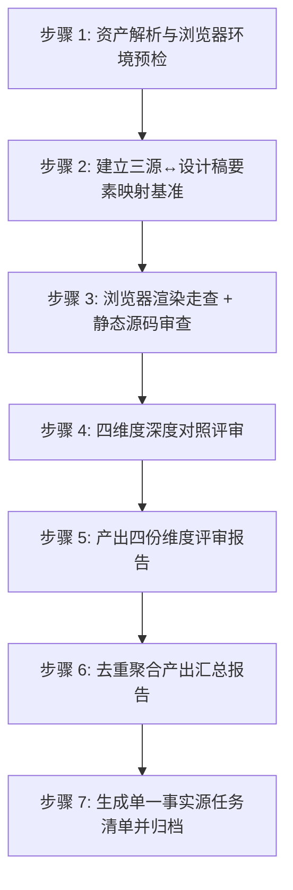

# UI-UX-Review —— UI/UX 设计稿评审主指令

> **定位**：对已生成的 UI/UX 设计稿（Superdesign 视觉稿 HTML）做**独立的第三方全面复审**，兜底 UI-UX-Design 内部门禁的自查盲区。核心目的四项——① 检测逻辑闭环（结构/跳转）；② 设计稿与 PRD / 布局清单文案一致；③ 内容无遗漏（防漏）；④ 不任意发挥增加出处以外的内容（防加戏）。同时把视觉稿**真正渲染出来**核验「规范是否落地、能不能点、有没有渲染缺陷」。只查问题、找成因、给方向，绝不自行越界修改设计稿 HTML 或对照源文档。

---

## 一、评审目标与核心输入输出

### 1.1 评审目标（四维）

1. **载体与结构零改动**：对照布局清单核验设计稿的独立页面、弹框、抽屉、页内区块、元素集合、跳转关系逐项一致（防漏），同时排查擅自增加的无出处区块 / 按钮 / 提示 / 装饰（防加戏）。视觉稿是对布局清单的「忠实穿衣」——结构不对 = 视觉阶段越权改了布局，必须打回。
2. **文案与字段一致性**：对照 PRD / 布局清单内容要素，逐字比对页面标题、按钮 CTA、列名、表单标签、提示语等界面文案；同时排查 PRD / 布局清单未要求却自行添加的多余文案。
3. **视觉规范一致性**：对照 `.superdesign/design-system.md`（评审读归档副本 `.spec/设计稿/design-system.md`），核查页面上一切视觉值（色值 / 字号 / 字重 / 间距 / 圆角 / 阴影 / 组件样式 / 图标）是否都能在规范 token 中找到出处，无规范外视觉值。
4. **视觉呈现与可交付质量（闭环验证的前提 + 独立价值）**：用浏览器**真实渲染**设计稿 HTML——
   - 规范是否真正落到页面上（render 出的视觉与 design-system 意图一致）；
   - **结构级可点击性验证**：对照布局清单的跳转关系逐入口点击——该跳转的入口（导航/按钮/行操作/弹框抽屉触发）是否为真实可点击元素（`<a href>` 或等价触发）？「长得像按钮/链接但点击无任何反应」的死元素 = 缺陷；
   - 渲染缺陷：控制台报错、死链、层级遮挡、图片/字体资源加载失败；
   - 反 AI 味 12 条目检 + 关键缺陷截图存证。
   - **边界**：设计稿是视觉稿不是可运行产品——不验证真实业务逻辑、真实数据、弹框真实开合逻辑；可点击性只到「入口真实存在且可点、href 去向与站点地图一致」，深度止于设计稿内部自闭环（详见 references/rendered-quality-checklist.md）。

### 1.2 输入与输出
- **输入源**：
  - PRD 文档目录（默认被开发项目 `.spec/PRD/`）——若存在 `PRD速查表.md`，**先读它建立六大索引**（术语/页面/模块/规则/字段/AC），逐字比对时按锚点回原文；
  - 布局清单（`.spec/原型/布局清单.md` 或 UI-UX-Design 步骤 2 展开的「设计任务清单」）；
  - 设计规范归档副本（`.spec/设计稿/design-system.md`；权威源 `.superdesign/design-system.md`，以归档副本为评审对照，缺副本时指明）；
  - 设计稿工程目录（默认 `.spec/设计稿/`，含各页定稿 HTML、`README.md`——记录页面清单 / draftId / 版本 / 输入来源 / 质量门禁记录）。
- **产出归档目录**：统一写入被开发项目 `.spec/设计评审/`：
  - `载体与结构零改动评审.md`
  - `文案与字段一致性评审.md`
  - `视觉规范一致性评审.md`
  - `视觉呈现与可交付质量评审.md`
  - `设计稿评审汇总报告.md`
  - `任务清单.md`（状态：`待确认` → `已确认` → `已修复/已忽略`）
  - `screenshots/`（浏览器截图存证，硬性产出——浏览器工具不可用则整个 skill 不工作）

---

## 二、严重度分级定义

评审发现的每一个缺陷点必须标注严重度（复用仓库 P0/P1/P2 口径）：

| 级别 | 定义 | 影响与处理原则 | 典型范例 |
|---|---|---|---|
| **P0 致命** | 结构错位（布局清单规定的页面/载体缺失或多出）、主流程入口无法点击、视觉严重偏离规范致不可作为还原基准、PRD 核心文案大面积冲突 | 阻塞流程，必须修复方修复并通过复核 | 布局清单规定某弹框，设计稿无入口也无对应视觉区块；主页面间跳转全是死链接；整页配色脱离 design-system 另起炉灶 |
| **P1 重要** | 局部结构偏差、文案逐字不符、规范局部未执行（某组件色值/圆角偏差）、该可点的单个入口是死元素、控制台报错 | 必须进入任务清单，原则上全部修复 | 按钮文案与 PRD 不同字；统计卡少一张；按钮无 href；页面有 JS 报错 |
| **P2 建议** | 非关键文案润色、次要视觉建议、边缘渲染瑕疵 | 记录在案，由用户裁决是否本轮修复 | 某处留白可再斟酌；提示文案可更精炼 |

---

## 三、六大铁律（Hard Constraints）

1. **铁律一：只审不改（Review Only）**  
   严禁直接修改设计稿 HTML / design-system.md / PRD / 布局清单任何文件。唯一产出物为 `.spec/设计评审/` 下的报告与清单文件。
2. **铁律二：成因必写（Root Cause Required）**  
   每条问题除写明「断在哪 / 错在哪」，必须结合对照源与设计稿 HTML 剖析成因（如：生成时未读布局清单某区块、design-system token 被绕过、直编时改坏 href、弹框以静态视觉展示但未做成触发）。无法推导明确成因时标注「成因未明」，**严禁主观臆造**。
3. **铁律三：方向明确（Actionable Direction）**  
   每条缺陷必须给出明确「修改建议方向」并指定建议修改方：
   - 设计稿本身问题（结构 / 文案 / 规范 / 渲染 / 可点击）→ `UI-UX-Design`；
   - 布局清单自身与 PRD 冲突或漏载体 → `Prototype-Design`；
   - PRD 定义自相矛盾 → `PRD-Design`；
   - 双方口径未统一 → `双方协同`。
4. **铁律四：浏览器工具硬性前置（Browser Tool Hard Gate）**  
   开工前必检浏览器工具。检测顺序：**Playwright 优先 → browser-use 次之 → 其他浏览器工具（如 CodeBuddy 的 agent-browser）**——凡当前环境可用的、能驱动真实浏览器打开页面/交互/截图的工具均算。任一可用即用于渲染截图走查与点击验证；**全部不可用 → 立即报错提醒用户安装，停止工作、不产出任何评审文档**，安装完成后重新运行本 skill。
5. **铁律五：单一事实源任务清单（Single Source of Truth Task List）**  
   全量问题去重收口到 `.spec/设计评审/任务清单.md`，初始全部 `待确认`，作为用户裁决与修改方闭环修复的唯一依据。
6. **铁律六：第三方独立兜底（Independent Oversight）**  
   UI-UX-Design 自带内部门禁（自查），本 skill 不从门禁结论出发、不轻信其「✅ 已通过」——以对照源 + 真实渲染为唯一证据独立复核，防自查走过场。

---

## 四、标准化评审流水线（7 步 SOP）

### 步骤 1：资产解析与浏览器环境预检
1. **定位输入资产**：
   - 检查并读取 PRD 目录（`overview.md`、`页面视图.md`、各模块规格；有 `PRD速查表.md` 先读它建索引）；
   - 检查并读取 `.spec/原型/布局清单.md`（或设计任务清单）与 `.spec/设计稿/design-system.md`；
   - 检查并读取设计稿工程（`.spec/设计稿/` 的 HTML 文件清单、`README.md`）。
   - 任一缺失 → 停下提示用户。
2. **浏览器工具硬性预检**（参考 `references/browser-inspection-guide.md`）：
   - 检测顺序：**Playwright 优先 → browser-use 次之 → 其他浏览器工具（如 agent-browser）**——列举不穷举，凡能驱动真实浏览器打开页面/交互/截图的工具均算；
   - 任一可用 → 记录为本次渲染走查与点击验证工具；
   - **全部不可用 → 立即报错并停止，不产出任何评审文档**：
     > `【环境错误】未检测到任何可用的浏览器工具（Playwright / browser-use / agent-browser 等）。设计稿评审硬性依赖浏览器渲染走查与点击验证，请先安装并启用任一浏览器工具，安装完成后重新运行本 skill。`

### 步骤 2：建立「PRD + 布局清单 + design-system ↔ 设计稿」要素映射基准
- 从 PRD 提取页面/模块/文案/跳转清单，从布局清单提取载体划分（独立页/弹框/抽屉/区块/元素/跳转站点地图）；
- 从 `.spec/设计稿/README.md` 与各 HTML 建立一张矩阵：`PRD 功能点 / 布局清单载体 ↔ 设计稿页面文件（draftId 版本）`；
- 建立 design-system 的 token 速查（色值表 / 字号阶 / 间距阶 / 圆角阶 / 组件规范摘要），供维度③机械比对。

### 步骤 3：浏览器渲染走查 + 静态源码审查
- **渲染走查（硬性，用步骤 1 已确认的浏览器工具）**：
  - 本地起静态服务（或 file:// 打开）渲染每个设计稿 HTML，逐页截图；对异常/缺失/不一致界面局部截图存 `.spec/设计评审/screenshots/`；
  - **逐入口点击验证**（结构级可点击性）：对照布局清单跳转关系，逐个点击应跳转的入口，观察是否有真实跳转反应；
- **静态源码审查（并行深挖，非替代）**：静态读取 HTML 结构（区块 / `<a>` / 组件 class）、CSS（`:root` token 变量、色值字号）、交互脚本，以代码行与 DOM 路径为证据与截图相互印证。

### 步骤 4：四维度深度对照评审
按 4 个参考清单并行/逐一过筛（每份均含「查漏 + 查多（防加戏）」两个方向）：
1. **载体与结构零改动**（`references/layout-freeze-checklist.md`）；
2. **文案与字段一致性**（`references/copywriting-consistency-checklist.md`）；
3. **视觉规范一致性**（`references/visual-spec-consistency-checklist.md`）；
4. **视觉呈现与可交付质量**（`references/rendered-quality-checklist.md`，含可点击性验证细则）。

### 步骤 5：产出四份维度评审报告
用 `assets/dimension-review-template.md` 模板，落盘 4 份文档至 `.spec/设计评审/`：
- `载体与结构零改动评审.md`
- `文案与字段一致性评审.md`
- `视觉规范一致性评审.md`
- `视觉呈现与可交付质量评审.md`

### 步骤 6：去重聚合产出汇总报告
用 `assets/summary-template.md` 模板：
- 聚合 4 份维度报告缺陷，合并同类项、消除重复；
- 归纳跨页面/跨维度的共性与系统性问题（如：整批页面某 token 都偏差 = 规范消费环节问题）；
- 统计 P0/P1/P2 分布，落盘 `.spec/设计评审/设计稿评审汇总报告.md`。

### 步骤 7：生成单一事实源任务清单并归档
用 `assets/issue-list-template.md` 模板：
- 去重后问题提炼为任务条目，写入 `.spec/设计评审/任务清单.md`；
- **每条问题自足可读**：含出处 + 现象 + 成因 + 修改方向，用户不看设计稿/原文也能理解；
- **每条必附「修复判据」**——一句话写清修到什么表现算过（修改方与复核共用一把尺子）；
- 初始状态统一 `待确认`；标注建议修改方（`UI-UX-Design` / `Prototype-Design` / `PRD-Design`）；
- **分级冻结**：P0 / P1 阻断项（未清零不放行）；P2 建议项（不阻塞闭环，用户裁决是否本轮修复）；
- **复核只验上一轮清单**：复核仅核对已确认问题是否按判据修复，不无限新增同级新问题——新发现降为 P2 留后续，或经用户同意进下一轮单独批次；
- **向用户逐条确认裁决**：任务清单逐条呈现、逐条解释（问题内容/出处/影响/修复方向/修复判据），逐条裁决：要改 → `已确认`；不改 → `已忽略` 附理由；
- 输出交付总结，明确剩几项待用户裁决。

---

## 五、防评审死循环（三招一升级，内建）

> 与方法论沉淀一致（`issue/Skill-Optimizer/2026-09-04/02-评审死循环不收敛.md`）：
1. **招 1 修复判据**：每条问题必附「修复判据」，修到什么表现算过——修改方与复核共用一把尺子，杜绝「改不干净再挑一轮」；
2. **招 2 分级冻结**：P0/P1 阻断（未清零不放行）、P2 不阻塞；复核只验上一轮清单内已确认项，不无限新增同级问题（新发现降 P2 或进下一轮单批）；
3. **招 3 轮次上限 3**：同批问题回退修复-复核超过 3 轮不收敛 → 停下交用户裁决（接受现状 / 忽略该问题 / 转人工），绝不无限循环；
4. **升级**：反复不收敛且暴露方法论问题 → 按 §六埋点上报 `issue/`，交 Skill-Optimizer 优化。

---

## 六、运行问题埋点（收尾自查）

执行收尾（产物落盘 / 交付之后）自查本次运行，把暴露的问题上报问题池（仓库根 `issue/UI-UX-Review/<当天日期>/<序号>-<标题>.md`）：**方法论问题、用户否定信号、用户认可信号、明显会复现的产物问题**（含 Superdesign 底座侧/ UI-UX-Design 侧的复现问题）。字段、等级、标签与红线遵循 `Skill-Optimizer/references/instrumentation-guide.md`，模板用 `Skill-Optimizer/assets/issue-template.md`。不确定算不算问题 → 不记；不因记录打断主流程。
