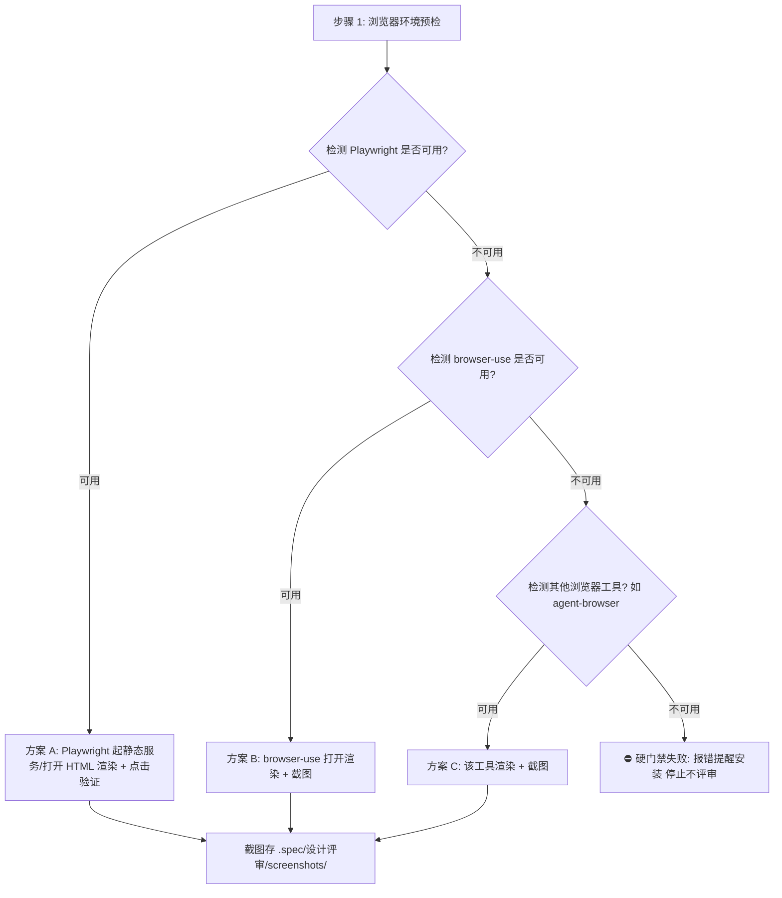

# 浏览器渲染与点击验证指引（Browser Rendering & Click Guide）

> 目标：指导设计稿评审如何用浏览器真实渲染设计稿 HTML、截图取证与做结构级可点击性验证。严格遵循「环境预检 → 工具选择 → **硬性前置、无工具不工作**」。

---

## 一、工具检测与决策流

设计稿评审开工前**必须先检测浏览器工具**：

### 1.1 检测规则（能力检测，非名单穷举）
1. **优先检测 Playwright**（`node -e "require('playwright')"` 或本地驱动）；
2. **次选 browser-use**（插件/MCP/命令行能力）；
3. **再检测其他浏览器工具**（CodeBuddy `agent-browser` 等，凡能驱动真实浏览器打开页面/交互/截图均算）；
4. **全部不可用 → 硬门禁失败**：立即报错提醒安装，停止工作、不产出任何评审文档；绝不跳过渲染环节硬评。

---

## 二、渲染准备

设计稿是**静态 HTML 视觉稿**，不依赖真实业务后端，渲染成本低：

- **首选**：本地起静态服务（`npx serve .spec/设计稿/` 或 `python -m http.server`）后打开；
- **次选**：直接 `file://` 打开（若页面资源全部内联 / data: / https 公网，可正常渲染）；
- 逐页渲染，记录每页是否可打开、有无控制台报错、关键视觉是否符合 design-system 意图。

---

## 三、截图与点击验证规范

### 3.1 截图范围与证据留存
- **何时截图**：仅针对 P0/P1 关键缺陷（布局错位、层级遮挡、死元素、规范被绕过、文案冲突、报错）截屏存证；
- **命名落盘**：`.spec/设计评审/screenshots/ISSUE-[编号]-[页面名]-[问题简述].png`；
- **报告引用**：维度报告嵌入相对路径 ``。

### 3.2 结构级可点击性验证方法
- 以布局清单跳转关系为入口清单；
- 对每个应跳转入口：定位元素 → 实际点击 → 观察有无跳转反应；
- 记录：`入口 → 是否真实可点 → 去向是否符合站点地图`；
- 死元素判断标准：视觉上明确呈现为按钮/链接形态（有按钮样式、下划线、指针 cursor、hover 效果），但点击无任何反应且无 href → 死元素缺陷。

---

## 四、静态源码审查的定位

- 静态源码分析（DOM 结构比对布局清单、grep 色值/字号比对 token、`<a>` href 比对站点地图、CSS 类排查遮挡）是**并行深挖证据的手段**，与截图相互印证；
- **不是**缺少浏览器时的替代方案——浏览器不可用即报错停止，不做纯静态降级评审。
